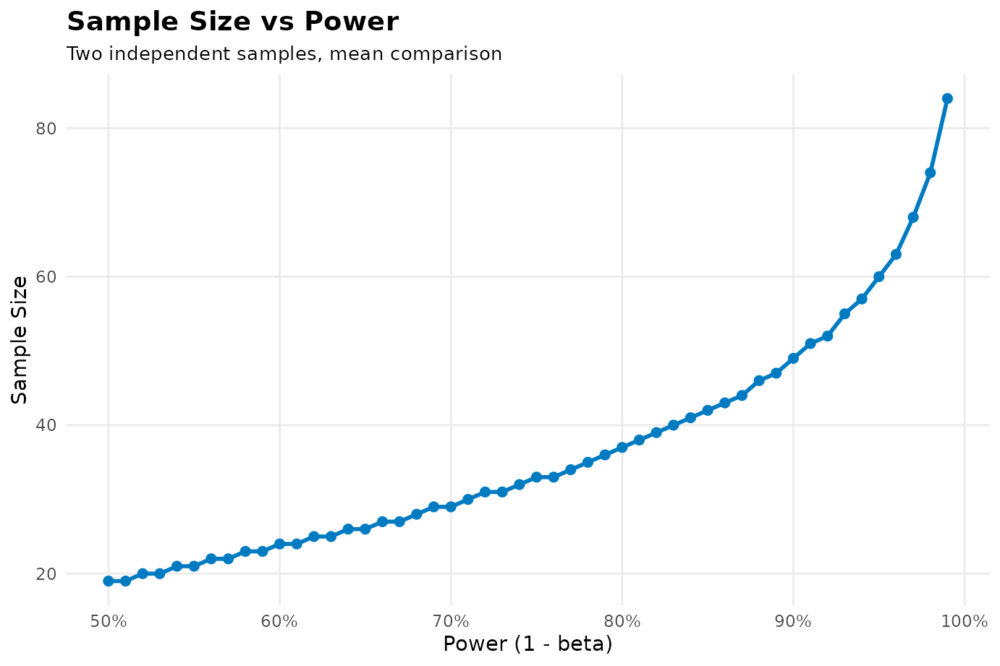
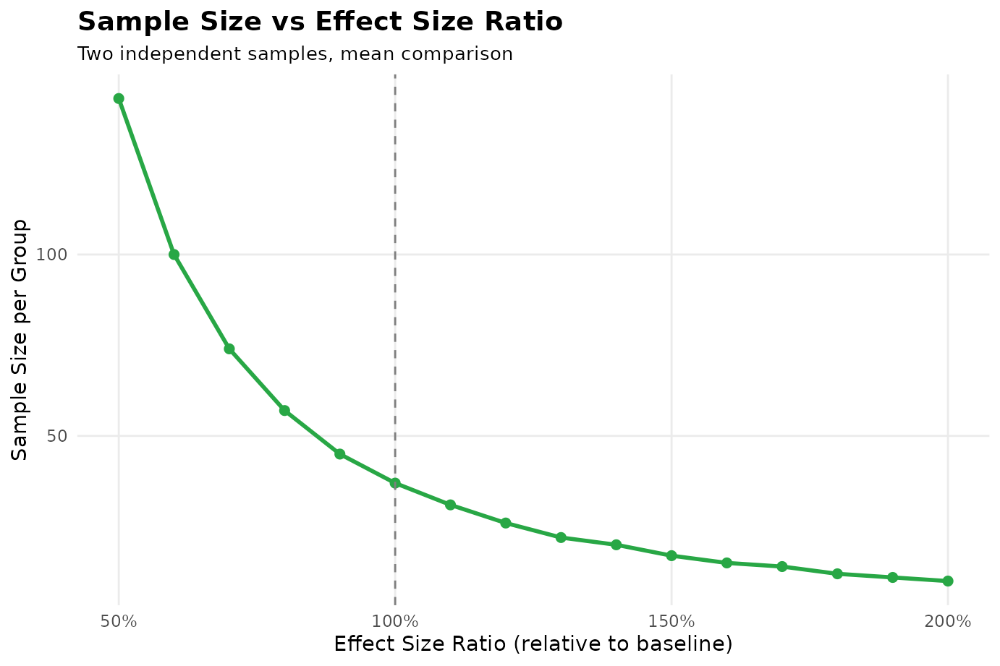

# SampleSizeCalc: A Comprehensive Guide to Sample Size Determination in Clinical Research

## Introduction: The Lifeblood of Clinical Research

For clinical investigators, calculating sample size is often the most
critical step when preparing grant proposals or IRB submissions.

Underpowered trials risk false-negative findings (\\P \> 0.05\\),
wasting research grants and patient effort. Conversely, overpowered
trials waste resources and expose unnecessary subjects to experimental
risks.

The `SampleSizeCalc` package supports the designs illustrated in **52
clinical scenarios** below. Each example explains the population, study
procedures, endpoint, planning assumptions, and how the result
translates into recruitment.

These are teaching protocols. Except where a published numerical example
is explicitly identified, clinical effects, standard deviations, event
rates, and margins are illustrative assumptions. The methodological
reference supports the formula; it does not establish those clinical
inputs. A real protocol should document the source population, endpoint
definition, follow-up window, and uncertainty of each planning input.

Numerical interpretations are evaluated from the R result objects when
the site is built. Some diagnostic branches convert an unrounded
requirement to a screening total; operational recruitment should also
respect integer case and control quotas. Default reports contain the
plain-text formula, LaTeX source, calculation process, and references.

------------------------------------------------------------------------

## Plain-English Glossary of Statistical Terms

- **\\\alpha\\ (Type I Error / False Positive)**: The probability of
  declaring a treatment effective when it truly is not — the
  “probability of convicting an innocent drug” (conventionally
  **0.05**).
- **\\\text{Power} = 1 - \beta\\ (True Positive Detection)**: The
  probability of catching a true effect when it exists — the
  “probability of catching the real culprit” (routinely **0.80** or
  **0.90**).
- **Continuous vs. Binary Endpoints**: Continuous measures numerical
  values (systolic BP drop in mmHg, fasting glucose in mmol/L); binary
  measures event status (eradicated vs. not, cured vs. not).
- **Two-Sided vs. One-Sided**: Two-sided tests for differences in either
  direction (classical RCTs); one-sided tests for non-inferiority and
  directional superiority.
- **Dropout Rate (\\d\\)**: Inflation formula \\N\_{\text{screen}} =
  \lceil N / (1 - d) \rceil\\.

------------------------------------------------------------------------

## Unified Syntax: The Three-Axis Function `calculate()`

\\\texttt{calculate(design, task, outcome, ...)}\\

- **Axis 1 `design`**: what type of study? (`"rct"`, `"paired"`,
  `"cohort"`, `"caseControl"`, `"diagAccuracy"`, `"diagAUC"`,
  `"singleArmPhaseII"`, `"bioequivalence"`, `"clusterRCT"`, …)
- **Axis 2 `task`**: what scientific question? (`"test"` hypothesis
  testing, `"estimate"` CI precision, `"noninferiority"`,
  `"superiority"`, `"equivalence"`)
- **Axis 3 `outcome`**: how is the endpoint measured? (`"mean"`,
  `"proportion"`, `"survival"`, `"auc"`, `"rate"`, `"ordinal"`, `"lr"`,
  `"correlation"`, `"events"`)

Printing a result shows the formula in plain text and LaTeX, the
calculation process, and references.
[`summary()`](https://rdrr.io/r/base/summary.html) also lists all
inputs, design axes, and recorded adjustments.

------------------------------------------------------------------------

## Chapter 1: Randomized Controlled Trials (RCTs)

### 1.1 Two Independent Means (Continuous Endpoint)

- **Population and decision**: A cardiology service plans a blinded,
  parallel, 1:1 randomized trial in adults aged 40–75 whose background
  antihypertensive treatment is stable, comparing an add-on study drug
  with add-on placebo.
- **Procedures and endpoint**: At baseline and week 12, use the same
  protocol to average repeated seated BP readings. The primary outcome
  is baseline minus week-12 systolic BP, so a larger positive change
  means greater improvement; each patient supplies one change score.
- **Planning inputs**: Assume mean reductions of 10 and 12 mmHg and a
  common change-score SD of 3 mmHg. These map to `mean1`, `mean2`, and
  `sd`; the SD of baseline BP is not interchangeable with the SD of
  change. Verify these assumptions using comparable pilot or external
  data.
- **Why this design**: The question is whether two independent mean
  changes differ, using two-sided α=0.05 and 80% power. The targeted
  between-group difference is 2 mmHg, distinct from either group’s
  reduction from baseline.
- **Formula**: \\n = 2\left(\frac{(Z\_{\alpha/2} + Z\_{\beta}) \cdot
  \sigma}{\mu_1 - \mu_2}\right)^2\\ Chow, Shao, Wang & Lokhnygina
  (2017), *Sample Size Calculations in Clinical Research* (3rd ed.), CRC
  Press.

``` r

res_1_1 <- calculate("rct", "test", "mean", mean1 = 10, mean2 = 12, sd = 3, alpha = 0.05, power = 0.8)
print(res_1_1)
#> ────────────────────────────────────────────────────────────────────────────────
#> ✔ Sample Size Calculation Results
#> • Design type: "Two independent samples, mean comparison"
#> • Sample size per group: 37
#> • Total sample size: 74
#> Formula (plain text):
#> `n = 2 * ((Z_alpha/2 + Z_beta) * sd / (mean1 - mean2))^2`
#> Formula (LaTeX):
#> $$n = 2\left(\frac{Z_{\alpha/2} + Z_{\beta}}{\delta}\right)^2 = 2\left(\frac{(Z_{\alpha/2} + Z_{\beta}) \cdot \sigma}{\mu_1 - \mu_2}\right)^2$$
#> Calculation process:
#> 
#> • Step 1: State hypotheses: H0: mu1 = mu2 vs H1: mu1 != mu2 (two-sided alpha =
#> 0.05, power = 0.80).
#> • Step 2: Calculate mean difference delta = |mu1 - mu2| = |10 - 12| = 2; common
#> SD sigma = 3.
#> • Step 3: Determine critical values: Z_(alpha/2) = 1.96 (for two-sided alpha =
#> 0.05), Z_beta = 0.8416 (for power = 0.80).
#> • Step 4: Compute initial sample size via normal approximation: n0 = 2 *
#> ((Z_(alpha/2) + Z_beta) * sigma / delta)^2 = 2 * ((1.96 + 0.8416) * 3 / 2)^2 =
#> 35.32.
#> • Step 5: Refine via exact two-sample Student's t-test power iteration
#> (accounting for degrees of freedom df = 2n - 2).
#> • Step 6: Round up to integer: n = 37 per group, total sample size N = 74.
#> Reference:
#> Chow, S. C., Shao, J., Wang, H., & Lokhnygina, Y. (2017). Sample Size Calculations in Clinical Research (3rd ed.). CRC Press. Chapter 3 (Comparing Means), Section 3.2.1 two-sample parallel design, Eq 3.11 (p. 48; the Student t refinement is Table 3.2, p. 49).
#> 
#>  Also: Machin et al. (2018) Eq 5.4, p. 69 (same formula with the Student t correction term).
#> ────────────────────────────────────────────────────────────────────────────────
#> 
```

- **Result and recruitment**: 37 analyzable patients per arm, 74 total.
  The report shows the normal approximation of about 35.32 per arm
  before the noncentral t calculation and rounding. If 10% are expected
  to lack the primary endpoint, plan 42 per arm (84 total); this
  additional adjustment is not included in the RCT result.

#### The four report components

| Component | Console label | Result field |
|----|----|----|
| Plain-text formula | `Formula (plain text)` | `formula` |
| LaTeX source | `Formula (LaTeX)` | `formula_latex` |
| Calculation process | `Calculation process` | `calculation_steps` (alias `calculation`) |
| References | `Reference` | `reference` |

``` r

res_1_1$formula
cat(res_1_1$formula_latex)
cat(res_1_1$calculation_steps, sep = "\n")
cat(res_1_1$reference)
```

The R console displays copyable LaTeX source. To typeset it in R
Markdown, use `cat(res_1_1$formula_latex)` in a chunk with
`results = "asis"`. The [reporting
guide](https://rpackages.portos.wang/sample_size_calc/articles/result-reporting.md)
includes an executed example and instructions for saving the report.

### 1.2 Two Independent Proportions (Binary Endpoint)

- **Population and decision**: A gastroenterology trial enrolls adults
  with confirmed *H. pylori* infection who are eligible for either of
  two 14-day regimens, with recent antibiotic use and previous
  eradication failure handled by prespecified eligibility rules.
- **Procedures and endpoint**: Determine eradication with a standardized
  urea breath test in a fixed post-treatment window. Define medication
  restrictions, invalid tests, and repeat assessments in advance;
  improvement in symptoms at treatment completion is not the eradication
  endpoint.
- **Planning inputs**: Illustrative rates are `p1 = 0.85` and
  `p2 = 0.70`, an absolute difference of 15 percentage points. Actual
  sources must match treatment history, resistance setting, and the
  timing and definition of eradication.
- **Why this design**: Different patients form the two groups, so use
  independent proportions with two-sided α=0.05 and 80% power.
  Prespecify how nonadherence and missing follow-up enter the analysis.
- **Formula** (Fleiss asymptotic): \\n =
  \frac{\left\[Z\_{\alpha/2}\sqrt{2\bar{p}(1-\bar{p})} +
  Z\_{\beta}\sqrt{p_1(1-p_1)+p_2(1-p_2)}\right\]^2}{(p_1-p_2)^2}\\
  Fleiss, Tytun & Ury (1980), *Biometrics* 36(2), 343-346.

``` r

res_1_2 <- calculate("rct", "test", "proportion", p1 = 0.85, p2 = 0.70, alpha = 0.05, power = 0.8)
print(res_1_2)
#> ────────────────────────────────────────────────────────────────────────────────
#> ✔ Sample Size Calculation Results
#> • Design type: "Two independent proportions"
#> • Sample size per group: 121
#> • Total sample size: 242
#> Formula (plain text):
#> `n = (Z_a/2 * sqrt(2*p_bar*(1-p_bar)) + Z_b * sqrt(p1*(1-p1)+p2*(1-p2)))^2 /
#> (p1-p2)^2`
#> Formula (LaTeX):
#> $$n = \frac{\left[Z_{\alpha/2}\sqrt{2\bar{p}(1-\bar{p})} + Z_{\beta}\sqrt{p_1(1-p_1) + p_2(1-p_2)}\right]^2}{(p_1 - p_2)^2}$$
#> Calculation process:
#> 
#> • Step 1: State hypotheses: H0: p1 = p2 vs H1: p1 != p2 (two-sided alpha =
#> 0.05, power = 0.80).
#> • Step 2: Compute pooled proportion: p_bar = (p1 + p2) / 2 = (0.85 + 0.70) / 2
#> = 0.775.
#> • Step 3: Determine critical values: Z_(alpha/2) = 1.96, Z_beta = 0.8416.
#> • Step 4: Compute Fleiss formula numerator components:
#> Z_(alpha/2)*sqrt(2*p_bar*(1-p_bar)) = 1.1575; Z_beta*sqrt(p1(1-p1)+p2(1-p2)) =
#> 0.4889.
#> • Step 5: Calculate unrounded sample size per group: n = (1.1575 + 0.4889)^2 /
#> (0.85 - 0.70)^2 = 120.47.
#> • Step 6: Round up to integer: n = 121 per group, total sample size N = 242.
#> Reference:
#> Primary (formula as implemented, without continuity correction): Fleiss, J. L., Tytun, A., & Ury, H. K. (1980). A simple approximation for calculating sample sizes for comparing independent proportions. Biometrics, 36(2), 343-346.
#> 
#> With continuity correction: Casagrande, J. T., Pike, M. C., & Smith, P. G. (1978). An improved approximate formula for calculating sample sizes for comparing two binomial distributions. Biometrics, 34(3), 483-494.
#> 
#> Book: Fleiss, J. L., Levin, B., & Paik, M. C. (2003). Statistical methods for rates and proportions (3rd ed.). Wiley.
#> ────────────────────────────────────────────────────────────────────────────────
#> 
```

- **Result and recruitment**: 121 patients per arm, 242 total. Allowing
  for 10% missing primary endpoints gives 135 per arm and 270 total; the
  analysis population and missing-data strategy still require explicit
  definitions.

### 1.3 Survival Analysis (Log-Rank Test Events)

- **Population and decision**: An oncology group plans a 1:1 randomized
  trial in advanced non-small-cell lung cancer patients eligible for
  both study regimens, with follow-up measured from randomization.
- **Procedures and endpoint**: Specify overall survival as the primary
  outcome, with death from any cause as the event and last confirmed
  survival as the censoring date. Progression is not an overall-survival
  event; a progression-free survival design needs its own event
  definition and assumptions.
- **Planning inputs**: Assume proportional hazards, `hr = 0.70`,
  experimental allocation `pE = 0.50`, two-sided α=0.05, and 80% power.
  A hazard ratio is not the ratio of two fixed-time death probabilities.
- **Why this design**: First determine the number of deaths required.
  Accrual duration, additional follow-up, survival distributions, and
  losses then determine what fraction of recruited patients will
  contribute an event and when analysis is feasible.
- **Formula** (Schoenfeld): \\E = \frac{(Z\_{\alpha/2} +
  Z\_{\beta})^2}{p_E(1 - p_E)\[\ln(HR)\]^2}\\ Schoenfeld (1983),
  *Biometrics* 39(2), 499-503.

``` r

res_1_3 <- calculate("rct", "test", "survival", hr = 0.70, pE = 0.50, alpha = 0.05, power = 0.8)
print(res_1_3)
#> ────────────────────────────────────────────────────────────────────────────────
#> ✔ Sample Size Calculation Results
#> • Design type: "Survival (log-rank)"
#> • Events needed: 247
#> Formula (plain text):
#> `E = (Z_a/2 + Z_b)^2 / (pE*(1-pE)*log(HR)^2)`
#> Formula (LaTeX):
#> $$E = \frac{(Z_{\alpha/2} + Z_{\beta})^2}{p_E(1-p_E)[\ln(HR)]^2}$$
#> Calculation process:
#> 
#> • Step 1: State survival parameters: Hazard Ratio HR = 0.70, experimental arm
#> allocation pE = 0.50 (alpha = 0.05, power = 0.80).
#> • Step 2: Compute log hazard ratio: ln(HR) = ln(0.70) = -0.3567.
#> • Step 3: Determine critical values: Z_(alpha/2) = 1.96, Z_beta = 0.8416.
#> • Step 4: Apply Schoenfeld formula: E = (Z_(alpha/2) + Z_beta)^2 / [pE * (1 -
#> pE) * (ln HR)^2] = (1.96 + 0.8416)^2 / [0.50 * 0.50 * (-0.3567)^2] = 246.79.
#> • Step 5: Round up to integer: Target events needed E = 247.
#> Reference:
#> Primary: Schoenfeld, D. A. (1983). Sample-size formula for the proportional-hazards regression model. Biometrics, 39(2), 499-503.
#> 
#> Extensions:
#> - Hsieh, F. Y., & Lavori, P. W. (2000). Sample-size calculations for the Cox proportional hazards regression model with nonbinary covariates. Controlled Clinical Trials, 21(6), 552-560.
#> - Rubinstein, L. V., Gail, M. H., & Santner, T. J. (1981). Planning the duration of a comparative clinical trial with loss to follow-up and a period of continued observation. Journal of Chronic Diseases, 34(9-10), 469-479.
#> ────────────────────────────────────────────────────────────────────────────────
#> 
```

- **Result and recruitment**: 247 deaths are required. If a separate
  accrual and follow-up model predicts an event fraction of 60% at
  analysis, a rough resource estimate is 412 patients. That fraction is
  an additional assumption, not an output derived from HR by this
  function.

### 1.4 Non-Inferiority Trial (Continuous Mean)

- **Population and decision**: A randomized parallel trial compares a
  lower-cost symptom-management strategy with usual care in patients
  with symptomatic diabetic peripheral neuropathy, while keeping
  background treatment stable.
- **Procedures and endpoint**: Use improvement from baseline to week 12
  on a prespecified symptom scale, with larger reductions indicating
  benefit. Standardize assessment and require sufficient baseline
  symptoms to avoid a pronounced floor effect.
- **Planning inputs**: Assume improvements of 10 and 9.5 points, SD=3,
  and a maximum acceptable loss of `margin = 1` point. Justify the
  margin using clinical importance and the established comparator
  effect; it should not be chosen from the anticipated difference alone.
- **Why this design**: Demonstrate that study minus control improvement
  exceeds −1 point. This example uses one-sided α=0.05 and 80% power; a
  protocol choosing one-sided 0.025 must recalculate accordingly.
- **Formula**: \\n = 2\left(\frac{(Z\_{\alpha} +
  Z\_{\beta})\sigma}{\mu_1 - \mu_2 + \Delta}\right)^2\\ Chow et
  al. (2017), Chapter 4.

``` r

res_1_4 <- calculate("rct", "noninferiority", "mean", mean1 = 10, mean2 = 9.5, sd = 3, margin = 1, alpha = 0.05, power = 0.8)
print(res_1_4)
#> ────────────────────────────────────────────────────────────────────────────────
#> ✔ Sample Size Calculation Results
#> • Design type: "Non-inferiority (means)"
#> • Sample size per group: 50
#> • Total sample size: 100
#> Formula (plain text):
#> `n = 2*(Z_a+Z_b)^2*sd^2/(mean1-mean2+margin)^2`
#> Formula (LaTeX):
#> $$n = 2\left(\frac{(Z_{\alpha} + Z_{\beta})\sigma}{\mu_1 - \mu_2 + \Delta}\right)^2$$
#> Calculation process:
#> 
#> • Step 1: State non-inferiority hypotheses: H0: mu1 - mu2 <= -margin vs H1: mu1
#> - mu2 > -margin (margin Delta = 1, one-sided alpha = 0.05, power = 0.80).
#> • Step 2: Effective difference: delta_E = mu1 - mu2 + margin = 10 - 9.50 + 1 =
#> 1.50; SD sigma = 3.
#> • Step 3: Determine critical values: one-sided Z_alpha = 1.6449, Z_beta =
#> 0.8416.
#> • Step 4: Compute sample size: n = 2 * (Z_alpha + Z_beta)^2 * sigma^2 /
#> delta_E^2 = 2 * (1.6449 + 0.8416)^2 * 3^2 / (1.50)^2 = 49.46.
#> • Step 5: Round up to integer: n = 50 per group, total sample size N = 100.
#> Reference:
#> Chow, S. C., Shao, J., Wang, H., & Lokhnygina, Y. (2017). Sample Size Calculations in Clinical Research (3rd ed.). CRC Press. Chapter 3 (Comparing Means), Section 3.2.2 noninferiority, Eq 3.12, p. 50.
#> 
#>  Also: Machin et al. (2018) Eq 11.3, p. 173.
#> ────────────────────────────────────────────────────────────────────────────────
#> 
```

- **Result and recruitment**: 50 per arm, 100 total. Document the
  primary analysis population, adherence handling, and missing outcomes
  alongside the margin justification; they are part of the
  non-inferiority design.

### 1.5 Non-Inferiority Trial (Binary Endpoint)

- **Population and decision**: An adult lower urinary tract infection
  trial compares a more convenient study regimen with an effective
  active comparator, using consistent microbiological and eligibility
  criteria.
- **Procedures and endpoint**: Define clinical cure in a fixed
  post-treatment visit window, with prespecified rules for rescue
  treatment, antibiotic switching, and missing visits. Each patient
  contributes one binary outcome.
- **Planning inputs**: Assume both cure rates are 85%, with a maximum
  acceptable absolute loss of 5 percentage points: `p1 = p2 = 0.85`,
  `margin = 0.05`. The margin is illustrative and requires clinical and
  effect-preservation justification.
- **Why this design**: Use one-sided α=0.05 and 80% power to exclude an
  unacceptable reduction in cure. A nonsignificant ordinary difference
  test does not establish non-inferiority.
- **Formula**: \\n =
  \frac{(Z\_{\alpha}+Z\_{\beta})^2\left\[p_1(1-p_1)+p_2(1-p_2)\right\]}{(p_1-p_2+\Delta)^2}\\
  Chow et al. (2017); Machin et al. (2018) Ch. 11.

``` r

res_1_5 <- calculate("rct", "noninferiority", "proportion", p1 = 0.85, p2 = 0.85, margin = 0.05, alpha = 0.05, power = 0.8)
print(res_1_5)
#> ────────────────────────────────────────────────────────────────────────────────
#> ✔ Sample Size Calculation Results
#> • Design type: "Non-inferiority (proportions)"
#> • Sample size per group: 631
#> • Total sample size: 1262
#> Parameter roles
#> 
#> • p1 = experimental-group response rate
#> • p2 = active-control response rate
#> • margin = non-inferiority margin Delta (one-sided alpha)
#> Formula (plain text):
#> `n = (Za+Zb)^2 * (p1q1+p2q2) / (p1-p2+margin)^2`
#> Formula (LaTeX):
#> $$n = \frac{(Z_{\alpha}+Z_{\beta})^2\left[p_1(1-p_1)+p_2(1-p_2)\right]}{(p_1-p_2+\Delta)^2}$$
#> Calculation process:
#> 
#> • Step 1: State non-inferiority hypotheses: H0: p1 - p2 <= -margin vs H1: p1 -
#> p2 > -margin (margin Delta = 0.05, one-sided alpha = 0.05, power = 0.80).
#> • Step 2: Effective difference: delta_E = p1 - p2 + margin = 0.85 - 0.85 + 0.05
#> = 0.05.
#> • Step 3: Determine critical values: one-sided Z_alpha = 1.6449, Z_beta =
#> 0.8416.
#> • Step 4: Compute sample size: n = (Z_alpha + Z_beta)^2 * [p1(1-p1) + p2(1-p2)]
#> / delta_E^2 = 630.62.
#> • Step 5: Round up to integer: n = 631 per group, total sample size N = 1262.
#> Reference:
#> Primary: Chow, S. C., Shao, J., Wang, H., & Lokhnygina, Y. (2017). Sample Size Calculations in Clinical Research (3rd ed.). CRC Press. Chapter 4 (Large Sample Tests for Proportions), Section 4.2.2 noninferiority/superiority, Eq 4.8 (p. 78).
#> 
#>  Also: Machin et al. (2018) Chapter 11, Eq 11.5-11.6, p. 174.
#> ────────────────────────────────────────────────────────────────────────────────
#> 
```

- **Result and recruitment**: 631 per arm, 1262 total. If endpoint
  completeness is expected to be 90%, plan 702 per arm. Treatment
  failures should not be removed from the denominator as though they
  were recruitment losses.

### 1.6 Superiority Trial (Continuous Mean)

- **Population and decision**: A knee osteoarthritis trial randomizes
  patients with sufficient baseline pain to a study topical preparation
  or active comparator, seeking improvement beyond a prespecified
  clinically relevant difference.
- **Procedures and endpoint**: Measure baseline-to-week-12 reduction on
  a specified WOMAC pain subscale, with standardized assessments and
  rules for rescue medication before measurement.
- **Planning inputs**: Assume reductions of 12 versus 10 points, SD=3,
  and `margin = 1` point. The effective difference is 12−10−1=1 point;
  using the full anticipated 2-point difference in the denominator would
  answer a different question.
- **Why this design**: This is superiority beyond a positive margin,
  with one-sided α=0.05 and 80% power. Specify the scale version, score
  direction, and clinical reasoning for the margin before observing
  results.
- **Formula**: \\n = 2\left(\frac{(Z\_{\alpha} +
  Z\_{\beta})\sigma}{\mu_1 - \mu_2 - \Delta}\right)^2\\ Chow et
  al. (2017).

``` r

res_1_6 <- calculate("rct", "superiority", "mean", mean1 = 12, mean2 = 10, sd = 3, margin = 1, alpha = 0.05, power = 0.8)
print(res_1_6)
#> ────────────────────────────────────────────────────────────────────────────────
#> ✔ Sample Size Calculation Results
#> • Design type: "Superiority (means)"
#> • Sample size per group: 112
#> • Total sample size: 224
#> Formula (plain text):
#> `n = 2*(Z_a+Z_b)^2*sd^2/(mean1-mean2-margin)^2`
#> Formula (LaTeX):
#> $$n = 2\left(\frac{(Z_{\alpha} + Z_{\beta})\sigma}{\mu_1 - \mu_2 - \Delta}\right)^2$$
#> Calculation process:
#> 
#> • Step 1: State superiority hypotheses: H0: mu1 - mu2 <= margin vs H1: mu1 -
#> mu2 > margin (margin Delta = 1, one-sided alpha = 0.05, power = 0.80).
#> • Step 2: Effective difference: delta_E = mu1 - mu2 - margin = 12 - 10 - 1 = 1;
#> SD sigma = 3.
#> • Step 3: Determine critical values: one-sided Z_alpha = 1.6449, Z_beta =
#> 0.8416.
#> • Step 4: Compute sample size: n = 2 * (Z_alpha + Z_beta)^2 * sigma^2 /
#> delta_E^2 = 2 * (1.6449 + 0.8416)^2 * 3^2 / (1)^2 = 111.29.
#> • Step 5: Round up to integer: n = 112 per group, total sample size N = 224.
#> Reference:
#> Chow, S. C., Shao, J., Wang, H., & Lokhnygina, Y. (2017). Sample Size Calculations in Clinical Research (3rd ed.). CRC Press. Chapter 3 (Comparing Means), Section 3.2.2 superiority, Eq 3.12, p. 50.
#> 
#>  Also: Machin et al. (2018) Eq 11.3, p. 173.
#> ────────────────────────────────────────────────────────────────────────────────
#> 
```

- **Result and recruitment**: 112 per arm, 224 total. Recruitment must
  deliver the required primary endpoints; changing the margin after
  observing outcomes would change the original scientific question.

### 1.7 Superiority Trial (Binary Endpoint)

- **Population and decision**: A dermatology trial compares two oral
  regimens in patients with confirmed toenail onychomycosis, defining
  one target nail per patient for the primary analysis.
- **Procedures and endpoint**: Evaluate complete cure at a fixed
  long-term visit, such as week 52, requiring both clinical clearing and
  mycological negativity. End-of-treatment cosmetic improvement is not
  the same endpoint.
- **Planning inputs**: Assume cure rates of 30% and 20%, and require the
  difference to exceed 5 percentage points: `p1 = 0.30`, `p2 = 0.20`,
  `margin = 0.05`. The remaining effective difference is 0.05.
- **Why this design**: Use one-sided α=0.05 and 80% power for
  superiority beyond the margin. Parameter sources should match
  severity, previous treatment, cure definition, and follow-up duration.
- **Formula**: \\n =
  \frac{(Z\_{\alpha}+Z\_{\beta})^2\left\[p_1(1-p_1)+p_2(1-p_2)\right\]}{(p_1-p_2-\Delta)^2}\\
  Chow et al. (2017).

``` r

res_1_7 <- calculate("rct", "superiority", "proportion", p1 = 0.30, p2 = 0.20, margin = 0.05, alpha = 0.05, power = 0.8)
print(res_1_7)
#> ────────────────────────────────────────────────────────────────────────────────
#> ✔ Sample Size Calculation Results
#> • Design type: "Superiority (proportions)"
#> • Sample size per group: 916
#> • Total sample size: 1832
#> Formula (plain text):
#> `n = (Z_alpha + Z_beta)^2 * (p1*(1-p1) + p2*(1-p2)) / (p1 - p2 - margin)^2`
#> Formula (LaTeX):
#> $$n = \frac{(Z_{\alpha} + Z_{\beta})^2[p_1(1-p_1) + p_2(1-p_2)]}{(p_1 - p_2 - \Delta)^2}$$
#> Calculation process:
#> 
#> • Step 1: State superiority hypotheses: H0: p1 - p2 <= margin vs H1: p1 - p2 >
#> margin (margin Delta = 0.05, one-sided alpha = 0.05, power = 0.80).
#> • Step 2: Effective difference: delta_E = p1 - p2 - margin = 0.30 - 0.20 - 0.05
#> = 0.05.
#> • Step 3: Determine critical values: one-sided Z_alpha = 1.6449, Z_beta =
#> 0.8416.
#> • Step 4: Compute sample size: n = (Z_alpha + Z_beta)^2 * [p1(1-p1) + p2(1-p2)]
#> / delta_E^2 = (1.6449 + 0.8416)^2 * [0.21 + 0.16] / (0.05)^2 = 915.02.
#> • Step 5: Round up to integer: n = 916 per group, total sample size N = 1832.
#> Reference:
#> Chow, S. C., Shao, J., Wang, H., & Lokhnygina, Y. (2017). Sample Size Calculations in Clinical Research (3rd ed.). CRC Press. Chapter 4 (Large Sample Tests for Proportions), Section 4.2.2 noninferiority/ superiority, Eq 4.8 (p. 78).
#> 
#>  Also: Machin et al. (2018) Eq 11.5-11.6, p. 174; Fleiss, Tytun & Ury (1980), Biometrics 36(2), 343-346.
#> ────────────────────────────────────────────────────────────────────────────────
#> 
```

- **Result and recruitment**: 916 per arm, 1832 total. If 10% lack the
  long-term endpoint, plan 1018 per arm and ensure sufficient follow-up
  visit capacity.

### 1.8 Equivalence Trial (Continuous Mean)

- **Population and decision**: A parallel randomized study compares two
  formulations in patients with stable hypothyroidism and stable
  background dosing, allowing sufficient time for the prespecified
  steady-state assessment.
- **Procedures and endpoint**: This teaching example uses mean
  steady-state total serum thyroxine, with standardized sampling time
  and laboratory platform. It illustrates equivalence of a continuous
  pharmacodynamic endpoint, not a complete bioequivalence or
  interchangeability assessment.
- **Planning inputs**: Assume means of 10 and 10.2 μg/dL, SD=3 μg/dL,
  and an equivalence corridor of ±1 μg/dL. The SD and margins require
  endpoint-specific clinical and pilot evidence.
- **Why this design**: Both unacceptable directions must be excluded
  using equivalence testing, with one-sided α=0.05 and target power 80%.
  Failure to find a difference does not establish equivalence.
- **Formula** (TOST): \\n = 2\left(\frac{(Z\_{\alpha} +
  Z\_{\beta/2})\sigma}{\Delta - \|\mu_1 - \mu_2\|}\right)^2\\ Chow et
  al. (2017).

``` r

res_1_8 <- calculate("rct", "equivalence", "mean", mean1 = 10, mean2 = 10.2, sd = 3, margin = 1, alpha = 0.05, power = 0.8)
print(res_1_8)
#> ────────────────────────────────────────────────────────────────────────────────
#> ✔ Sample Size Calculation Results
#> • Design type: "Equivalence (means)"
#> • Sample size per group: 241
#> • Total sample size: 482
#> Formula (plain text):
#> `n = 2*(Z_a+Z_b/2)^2*sd^2/(margin-|mean1-mean2|)^2`
#> Formula (LaTeX):
#> $$n = 2\left(\frac{(Z_{\alpha} + Z_{\beta/2})\sigma}{\Delta - |\mu_1 - \mu_2|}\right)^2$$
#> Calculation process:
#> 
#> • Step 1: State equivalence hypotheses (TOST): H0: |mu1 - mu2| >= margin vs H1:
#> |mu1 - mu2| < margin (margin Delta = 1, alpha = 0.05, power = 0.80).
#> • Step 2: Margin clearance: Delta - |mu1 - mu2| = 1 - |10 - 10.20| = 0.80; SD
#> sigma = 3.
#> • Step 3: Determine critical values: one-sided Z_alpha = 1.6449, Z_(beta/2) =
#> 1.2816.
#> • Step 4: Compute sample size: n = 2 * (Z_alpha + Z_(beta/2))^2 * sigma^2 /
#> (Delta - |mu1 - mu2|)^2 = 2 * (1.6449 + 1.2816)^2 * 3^2 / (0.80)^2 = 240.86.
#> • Step 5: Round up to integer: n = 241 per group, total sample size N = 482.
#> Reference:
#> Chow, S. C., Shao, J., Wang, H., & Lokhnygina, Y. (2017). Sample Size Calculations in Clinical Research (3rd ed.). CRC Press. Chapter 3 (Comparing Means), Section 3.2.3 equivalence, Eq 3.13, p. 51; the Z_{beta/2} convention is discussed in Section 3.6.1 (p. 67).
#> 
#>  Also: Machin et al. (2018) Eq 11.5-11.6, p. 174.
#> ────────────────────────────────────────────────────────────────────────────────
#> 
```

- **Result and recruitment**: 241 per arm, 482 total. This requirement
  concerns the single defined continuous endpoint; additional primary or
  pharmacokinetic outcomes need their own planning.

### 1.9 Equivalence Trial (Binary Endpoint)

- **Population and decision**: An anesthesia service randomizes adults
  undergoing the same type of surgery to two postoperative analgesic
  regimens, asking whether a more convenient regimen provides
  sufficiently similar response rates.
- **Procedures and endpoint**: Define success in advance, for example
  meeting a specified pain-reduction threshold without rescue medication
  during the first 6 hours. Prespecify rescue use, early withdrawal, and
  how repeated pain observations form one patient-level result.
- **Planning inputs**: Assume response rates of 50% and 52%, with an
  equivalence corridor of ±10 percentage points: `p1 = 0.50`,
  `p2 = 0.52`, `margin = 0.10`.
- **Why this design**: Use equivalence of independent proportions,
  one-sided α=0.05 and 80% power. The margin must be justified for this
  response definition rather than treated as a universal analgesic
  standard.
- **Formula**: \\n =
  \frac{(Z\_{\alpha}+Z\_{\beta/2})^2\left\[p_1(1-p_1)+p_2(1-p_2)\right\]}{(\Delta-\|p_1-p_2\|)^2}\\
  Chow et al. (2017).

``` r

res_1_9 <- calculate("rct", "equivalence", "proportion", p1 = 0.50, p2 = 0.52, margin = 0.10, alpha = 0.05, power = 0.8)
print(res_1_9)
#> ────────────────────────────────────────────────────────────────────────────────
#> ✔ Sample Size Calculation Results
#> • Design type: "Equivalence (proportions)"
#> • Sample size per group: 669
#> • Total sample size: 1338
#> Formula (plain text):
#> `n = (Z_alpha + Z_beta/2)^2 * (p1*(1-p1) + p2*(1-p2)) / (margin - |p1 - p2|)^2`
#> Formula (LaTeX):
#> $$n = \frac{(Z_{\alpha} + Z_{\beta/2})^2[p_1(1-p_1) + p_2(1-p_2)]}{(\Delta - |p_1-p_2|)^2}$$
#> Calculation process:
#> 
#> • Step 1: State equivalence hypotheses (TOST): H0: |p1 - p2| >= margin vs H1:
#> |p1 - p2| < margin (margin Delta = 0.10, alpha = 0.05, power = 0.80).
#> • Step 2: Margin clearance: Delta - |p1 - p2| = 0.10 - |0.50 - 0.52| = 0.08.
#> • Step 3: Determine critical values: one-sided Z_alpha = 1.6449, Z_(beta/2) =
#> 1.2816.
#> • Step 4: Compute sample size: n = (Z_alpha + Z_(beta/2))^2 * [p1(1-p1) +
#> p2(1-p2)] / (Delta - |p1 - p2|)^2 = 668.52.
#> • Step 5: Round up to integer: n = 669 per group, total sample size N = 1338.
#> Reference:
#> Chow, S. C., Shao, J., Wang, H., & Lokhnygina, Y. (2017). Sample Size Calculations in Clinical Research (3rd ed.). CRC Press. Chapter 4 (Large Sample Tests for Proportions), Section 4.2.3 equivalence, Eq 4.9 (p. 79).
#> 
#>  Also: Machin et al. (2018) Eq 11.5-11.6, p. 174.
#> ────────────────────────────────────────────────────────────────────────────────
#> 
```

- **Result and recruitment**: 669 per arm, 1338 total. The count is
  independent patients with primary outcomes, not the number of repeated
  pain assessments.

------------------------------------------------------------------------

## Chapter 2: Paired, Single-Arm, and Crossover Trials

### 2.1 Paired Means (Pre- vs. Post-Treatment)

- **Population and decision**: A rehabilitation clinic follows the same
  chronic low-back pain patients before and after a 6-week standardized
  exercise program, using a 0–10 pain scale.
- **Procedures and endpoint**: Define improvement as baseline minus
  week-6 score and use consistent measurement conditions. Each patient’s
  two scores must be linkable to form one paired difference.
- **Planning inputs**: Assume mean improvement `meanDiff = 2` points and
  difference-score SD `sdDiff = 3`. Estimate the latter from paired
  pilot data; neither the baseline nor follow-up SD alone is an
  appropriate substitute.
- **Why this design**: Use a two-sided paired-mean calculation with
  α=0.05 and 80% power. A before–after study estimates change;
  separating treatment effects from natural history requires an
  appropriate comparator design.
- **Formula**: \\n = \left(\frac{(Z\_{\alpha/2} + Z\_{\beta}) \cdot
  \sigma_d}{\mu_d}\right)^2\\ Rosner (2015), *Fundamentals of
  Biostatistics* (8th ed.).

``` r

res_2_1 <- calculate("paired", "test", "mean", meanDiff = 2, sdDiff = 3, alpha = 0.05, power = 0.8)
print(res_2_1)
#> ────────────────────────────────────────────────────────────────────────────────
#> ✔ Sample Size Calculation Results
#> • Design type: "Paired means"
#> • Pairs needed: 20
#> • Total individuals: 40
#> Formula (plain text):
#> `n = ((Z_a/2 + Z_b) * sd_diff / mean_diff)^2`
#> Formula (LaTeX):
#> $$n = \left(\frac{(Z_{\alpha/2} + Z_{\beta}) \cdot \sigma_d}{\mu_d}\right)^2$$
#> Calculation process:
#> 
#> • Step 1: State paired difference hypotheses: H0: mu_d = 0 vs H1: mu_d != 0
#> (alpha = 0.05, power = 0.80).
#> • Step 2: Expected paired difference mu_d = 2, SD of differences sigma_d = 3.
#> • Step 3: Determine critical values: Z_(alpha/2) = 1.96, Z_beta = 0.8416.
#> • Step 4: Normal approximation: n0 = ((Z_(alpha/2) + Z_beta) * sigma_d /
#> mu_d)^2 = ((1.96 + 0.8416) * 3 / 2)^2 = 17.66.
#> • Step 5: Exact paired Student's t-test degrees of freedom iteration.
#> • Step 6: Round up to integer: n = 20 pairs (total individuals = 40).
#> Reference:
#> Rosner, B. (2015). *Fundamentals of biostatistics* (8th ed.). Cengage Learning.
#> ────────────────────────────────────────────────────────────────────────────────
#> 
```

- **Result and recruitment**: 20 patients must complete both
  assessments, giving 40 measurements. A pair means two observations
  from one patient here. With 90% paired completion, recruit 23
  patients.

### 2.2 Paired Binary Outcomes (McNemar / Connor)

- **Population and decision**: A chronic-disease clinic introduces a
  medication reminder program in one cohort and compares adherence
  success before the program and at week 8.
- **Procedures and endpoint**: Apply the same prespecified adherence
  threshold in both periods. Each patient forms a paired binary record;
  the question is whether success rises from 60% to 80%, not a
  comparison of independent cohorts.
- **Planning inputs**: Set post-program `p1 = 0.80`, baseline
  `p2 = 0.60`, and discordant proportion `psi = 0.25`. This implies
  about 22.5% changing from failure to success and 2.5% changing in the
  opposite direction; verify that pattern using paired pilot records.
- **Why this design**: McNemar/Connor planning uses the discordant
  pairs, with two-sided α=0.05 and 80% power. Both measurements are
  needed for a complete pair.
- **Formula** (Connor): \\n = \frac{\left\[Z\_{\alpha/2}\sqrt{\psi} +
  Z\_{\beta}\sqrt{\psi-\delta^2}\right\]^2}{\delta^2}, \quad \delta =
  \|p_1-p_2\|\\ Connor (1987), *Biometrics* 43(1), 207-211.

``` r

res_2_2 <- calculate("paired", "test", "proportion", p1 = 0.80, p2 = 0.60, psi = 0.25, alpha = 0.05, power = 0.8)
print(res_2_2)
#> ────────────────────────────────────────────────────────────────────────────────
#> ✔ Sample Size Calculation Results
#> • Design type: "Paired binary outcomes (McNemar / Connor)"
#> • Total sample size: 94
#> • Pairs needed: 47
#> Parameter roles
#> 
#> • p1/p2 = expected proportions (or sensitivities) in pairs
#> • psi = expected discordant-pair proportion (pi10 + pi01)
#> • output is in PAIRS (n individuals = 2 x pairs)
#> Formula (plain text):
#> `n = [Za*sqrt(psi) + Zb*sqrt(psi-delta^2)]^2/delta^2`
#> Formula (LaTeX):
#> $$n = \frac{\left[Z_{\alpha/2}\sqrt{\psi} + Z_{\beta}\sqrt{\psi-\delta^2}\right]^2}{\delta^2}$$
#> Calculation process:
#> 
#> • Step 1: Paired binary parameters: p1 = 0.80, p2 = 0.60, discordant pair
#> proportion psi = 0.25, difference delta = |p1 - p2| = 0.20.
#> • Step 2: Determine critical values: Z_(alpha/2) = 1.96, Z_beta = 0.8416.
#> • Step 3: Connor formula: n_pairs = [Z_(alpha/2)*sqrt(psi) + Z_beta*sqrt(psi -
#> delta^2)]^2 / delta^2 = 46.63.
#> • Step 4: Round up to integer: Pairs needed = 47.
#> Reference:
#> Primary: Connor, R. J. (1987). Sample size for testing differences in proportions for the paired-sample design. Biometrics, 43(1), 207-211.
#> 
#>  Also: Akoglu, H. (2022). Turkish Journal of Emergency Medicine, 22(4), Table 2 Eq 3b + Tables 6A/6B (uncorrected and Yates-corrected values).
#> ────────────────────────────────────────────────────────────────────────────────
#> 
```

- **Result and recruitment**: 47 patients with complete pairs, or 94
  assessments. At 90% paired completion, recruit 53 patients; doubling
  the observations does not double the number of distinct people.

### 2.3 Single-Arm Mean vs. Historical Benchmark

- **Population and decision**: A rare-disease rehabilitation project
  evaluates exercise endurance after a training program, using a
  comparable historical mean as a fixed benchmark because recruitment is
  limited.
- **Procedures and endpoint**: Measure fully observed endurance duration
  in a standardized constant-load exercise test at week 8, in minutes.
  This is a continuous functional endpoint, not a censored survival
  time; historical and new cohorts need comparable severity, workloads,
  and stopping rules.
- **Planning inputs**: Treat the historical mean as `mu0 = 10` minutes,
  anticipate `mu1 = 12`, and assume `sigma = 3`, with two-sided α=0.05
  and 80% power.
- **Why this design**: This approximation treats the reference mean as
  known without error. A small or poorly matched historical sample
  requires a design that incorporates its uncertainty rather than
  treating a survival median as a known mean.
- **Formula**: \\n = \frac{(Z\_{\alpha/2} + Z\_{\beta})^2
  \sigma^2}{(\mu_1 - \mu_0)^2}\\ Machin et al. (2018), Chapter 5.

``` r

res_2_3 <- calculate("rctSingleArm", "test", "mean", mu0 = 10, mu1 = 12, sigma = 3, alpha = 0.05, power = 0.8)
print(res_2_3)
#> ────────────────────────────────────────────────────────────────────────────────
#> ✔ Sample Size Calculation Results
#> • Design type: "Single-arm trial (continuous, vs fixed value)"
#> • Required sample size: 18
#> Parameter roles
#> 
#> • mu0 = reference/historical control mean (the null value)
#> • mu1 = anticipated treatment mean
#> • sigma = population standard deviation
#> Formula (plain text):
#> `n = (Za/2 + Zb)^2 * sigma^2 / (mu1-mu0)^2`
#> Formula (LaTeX):
#> $$n = \frac{(Z_{\alpha/2} + Z_{\beta})^2 \sigma^2}{(\mu_1 - \mu_0)^2}$$
#> Calculation process:
#> 
#> • Step 1: Single-arm continuous hypotheses: H0: mu = 10 vs H1: mu = 12, SD
#> sigma = 3 (alpha = 0.05, power = 0.80).
#> • Step 2: Effect size delta = |mu1 - mu0| = |12 - 10| = 2.
#> • Step 3: Determine critical values: Z_(alpha/2) = 1.96, Z_beta = 0.8416.
#> • Step 4: Sample size: n = (Z_(alpha/2) + Z_beta)^2 * sigma^2 / delta^2 = (1.96
#> + 0.8416)^2 * 3^2 / (2)^2 = 17.66.
#> • Step 5: Round up to integer: Required sample size n = 18.
#> Reference:
#> Primary: Machin, D., Campbell, M. J., Tan, S. B., & Tan, S. H. (2018). Sample Sizes for Clinical, Laboratory and Epidemiology Studies (4th ed.). Wiley. Chapter 5 (Continuous Outcomes, single-sample comparison).
#> ────────────────────────────────────────────────────────────────────────────────
#> 
```

- **Result and recruitment**: 18 patients with the defined endpoint. If
  10% cannot complete the exercise assessment, plan 20 recruits;
  comparability of the reference remains central to interpretation.

### 2.4 Single-Arm Proportion vs. Historical Benchmark

- **Population and decision**: An exploratory single-arm study enrolls
  relapsed/refractory lymphoma patients with defined prior treatment
  lines, comparing a new protocol with a fixed historical response rate.
- **Procedures and endpoint**: Assess objective response at day 90 using
  consistent criteria. Prespecify deaths before assessment, rescue
  treatment, and unevaluable patients; restricting the denominator to
  surviving imaged patients changes the endpoint.
- **Planning inputs**: Use teaching assumptions `p0 = 0.70` and
  `p1 = 0.80`. Actual evidence must match treatment line, response
  definition, and assessment window to avoid an inappropriate historical
  comparator.
- **Why this design**: This example uses a two-sided normal
  approximation with α=0.05 and 80% power. For an exact one-sided
  success cutoff or interim futility decision, consider the following
  A’Hern or Simon examples.
- **Formula**: \\n = \frac{\left\[Z\_{\alpha/2}\sqrt{p_0(1-p_0)} +
  Z\_{\beta}\sqrt{p_1(1-p_1)}\right\]^2}{(p_1-p_0)^2}\\ Hajian-Tilaki
  (2014), Eq 6.8.

``` r

res_2_4 <- calculate("rctSingleArm", "test", "proportion", p0 = 0.70, p1 = 0.80, alpha = 0.05, power = 0.8)
print(res_2_4)
#> ────────────────────────────────────────────────────────────────────────────────
#> ✔ Sample Size Calculation Results
#> • Design type: "Single-arm trial (binary, vs fixed value)"
#> • Required sample size: 153
#> Parameter roles
#> 
#> • p0 = null/historical control proportion
#> • p1 = anticipated treatment proportion
#> Formula (plain text):
#> `n = [Za*sqrt(p0q0) + Zb*sqrt(p1q1)]^2/(p1-p0)^2`
#> Formula (LaTeX):
#> $$n = \frac{\left[Z_{\alpha/2}\sqrt{p_0(1-p_0)} + Z_{\beta}\sqrt{p_1(1-p_1)}\right]^2}{(p_1 - p_0)^2}$$
#> Calculation process:
#> 
#> • Step 1: Single-arm binary hypotheses: H0: p = 0.70 vs H1: p = 0.80 (alpha =
#> 0.05, power = 0.80).
#> • Step 2: Determine critical values: Z_(alpha/2) = 1.96, Z_beta = 0.8416.
#> • Step 3: Sample size: n = [Z_(alpha/2)*sqrt(p0*q0) + Z_beta*sqrt(p1*q1)]^2 /
#> (p1 - p0)^2 = 152.48.
#> • Step 4: Round up to integer: Required sample size n = 153.
#> Reference:
#> Primary: Hajian-Tilaki, K. (2014). Sample size estimation in diagnostic test studies of biomedical informatics. Journal of Biomedical Informatics, 48, 193-204 (Eq 6.8; worked example 0.70 vs 0.80 -> n=153).
#> 
#>  Also: Akoglu, H. (2022). Table 2, Equation 2; Machin et al. (2018) Ch.3.
#> ────────────────────────────────────────────────────────────────────────────────
#> 
```

- **Result and recruitment**: 153 patients with ascertainable primary
  outcomes. This count addresses the planned distinction between 70% and
  80%; it does not promise that the eventual response rate will equal
  the alternative.

### 2.5 Phase II Simon’s Optimal Two-Stage Design

- **Population and decision**: A single-arm phase-II sarcoma study
  enrolls patients with measurable advanced disease and consistent
  previous treatment eligibility, seeking early termination when the
  regimen has inadequate activity.
- **Procedures and endpoint**: Confirm objective response at
  approximately 8 weeks using prespecified criteria. Allow stage-1
  patients to reach the assessment window and verify their outcomes
  before the formal continuation decision.
- **Planning inputs**: Set an unacceptable response rate `p0 = 0.10`, a
  promising rate `p1 = 0.30`, one-sided α=0.05, and 80% power. Both
  rates must refer to the same disease subgroup and response definition.
- **Why this design**: `optimizer = "optimal"` minimizes expected
  enrollment under the null, potentially accepting a larger maximum
  total than the minimax design.
- **Formula**: exact binomial enumeration (Simon 1989). The design
  \\(r_1/n_1, r/n)\\ satisfies \\P_p(\text{reject }H_0) =
  \sum\_{x_1=r_1+1}^{n_1}\binom{n_1}{x_1}p^{x_1}(1-p)^{n_1-x_1}\\P_p(X_2
  \> r-x_1), \quad P\_{p_0}(\text{reject }H_0)\le\alpha\\ and the
  analogous expression under \\p_1\\ must reach the target power. Simon
  (1989), *Controlled Clinical Trials* 10(1), 1-10.

``` r

res_2_5 <- calculate("singleArmPhaseII", "test", "proportion", p0 = 0.10, p1 = 0.30, alpha = 0.05, power = 0.8, optimizer = "optimal")
print(res_2_5)
#> ────────────────────────────────────────────────────────────────────────────────
#> ✔ Sample Size Calculation Results
#> • Design type: "Single-arm phase II (Simon two-stage, optimal)"
#> • Stage 1 sample size: 10
#> • Stage 1 futility boundary (stop if responses <= r1): 1
#> • Total sample size (both stages): 29
#> • Overall boundary (declare effective if responses > r): 5
#> Parameter roles
#> 
#> • p0 = unacceptable response rate (null)
#> • p1 = desirable response rate (alternative)
#> • stage 1: stop for futility if responses <= r_stage_1 of n_stage_1
#> • overall: declare effective if responses > r_total of n_total
#> Formula (plain text):
#> `exact binomial: P(effective|p0) <= alpha and P(effective|p1) >= power`
#> Formula (LaTeX):
#> $$P(\text{reject } H_0 \mid p_0) \le \alpha \quad \text{and} \quad P(\text{reject } H_0 \mid p_1) \ge 1-\beta$$
#> Calculation process:
#> 
#> • Step 1: State phase II hypotheses: H0: p <= 0.10 (unacceptable) vs H1: p >=
#> 0.30 (promising) (alpha = 0.05, power = 0.80).
#> • Step 2: Exhaustive exact binomial search under 'optimal' criterion.
#> • Step 3: Stage 1: Accrue n1 = 10 patients; stop early for futility if
#> responses <= r1 = 1.
#> • Step 4: Stage 2: If > 1 responses observed, accrue additional 19 patients up
#> to total n = 29.
#> • Step 5: Final decision: Declare effective if total responses > r = 5
#> (Expected sample size under H0 = 15).
#> Reference:
#> Primary: Simon, R. (1989). Optimal two-stage designs for phase II clinical trials. Controlled Clinical Trials, 10(1), 1-10.
#> 
#>  Also: Machin et al. (2018) Chapter 17 (Therapeutic Exploratory Trials).
#> ────────────────────────────────────────────────────────────────────────────────
#> 
```

- **Result and stopping rules**: Enroll 10 initially and stop for
  futility if responses are ≤1. Otherwise add 19 patients to a maximum
  of 29. Reject the null only if total responses exceed 5 (at least 6).
  Stage 1 is included in the maximum total.

### 2.6 Phase II Simon’s Minimax Two-Stage Design

- **Population and decision**: A center addresses the same advanced
  sarcoma response question but has a firm ceiling on drug supply and
  eligible patients, making the worst-case enrollment especially
  important.
- **Procedures and endpoint**: Use the same response definition and
  assessment window, with a prespecified stage-wise continuation rule.
  Do not switch optimization criteria after examining interim responses.
- **Planning inputs**: Keep `p0 = 0.10`, `p1 = 0.30`, α=0.05, and 80%
  power, changing only `optimizer = "minimax"` so resource comparisons
  use the same error constraints.
- **Why this design**: Minimax minimizes the maximum total sample size,
  not necessarily the expected number under the null. Compare both
  criteria when budgeting assessments and medication.

``` r

res_2_6 <- calculate("singleArmPhaseII", "test", "proportion", p0 = 0.10, p1 = 0.30, alpha = 0.05, power = 0.8, optimizer = "minimax")
print(res_2_6)
#> ────────────────────────────────────────────────────────────────────────────────
#> ✔ Sample Size Calculation Results
#> • Design type: "Single-arm phase II (Simon two-stage, minimax)"
#> • Stage 1 sample size: 15
#> • Stage 1 futility boundary (stop if responses <= r1): 1
#> • Total sample size (both stages): 25
#> • Overall boundary (declare effective if responses > r): 5
#> Parameter roles
#> 
#> • p0 = unacceptable response rate (null)
#> • p1 = desirable response rate (alternative)
#> • stage 1: stop for futility if responses <= r_stage_1 of n_stage_1
#> • overall: declare effective if responses > r_total of n_total
#> ! Multiple designs may achieve the minimum total sample size N;
#> ! this implementation selects the design minimizing Type I error (alpha) among ties.
#> 
#> Formula (plain text):
#> `exact binomial: P(effective|p0) <= alpha and P(effective|p1) >= power`
#> Formula (LaTeX):
#> $$P(\text{reject } H_0 \mid p_0) \le \alpha \quad \text{and} \quad P(\text{reject } H_0 \mid p_1) \ge 1-\beta$$
#> Calculation process:
#> 
#> • Step 1: State phase II hypotheses: H0: p <= 0.10 (unacceptable) vs H1: p >=
#> 0.30 (promising) (alpha = 0.05, power = 0.80).
#> • Step 2: Exhaustive exact binomial search under 'minimax' criterion.
#> • Step 3: Stage 1: Accrue n1 = 15 patients; stop early for futility if
#> responses <= r1 = 1.
#> • Step 4: Stage 2: If > 1 responses observed, accrue additional 10 patients up
#> to total n = 25.
#> • Step 5: Final decision: Declare effective if total responses > r = 5
#> (Expected sample size under H0 = 19.50).
#> Reference:
#> Primary: Simon, R. (1989). Optimal two-stage designs for phase II clinical trials. Controlled Clinical Trials, 10(1), 1-10.
#> 
#>  Also: Machin et al. (2018) Chapter 17 (Therapeutic Exploratory Trials).
#> ────────────────────────────────────────────────────────────────────────────────
#> 
```

- **Result and stopping rules**: Stage 1 enrolls 15, stopping if
  responses are ≤1; the maximum total is 25, with rejection requiring
  more than 5 responses. Compare that maximum with the optimal design’s
  29 patients.

### 2.7 A’Hern Exact Single-Stage Binomial Design

- **Population and decision**: Another center studies the same sarcoma
  response question, but recruitment is concentrated and endpoint
  assessment delayed, so an interim futility analysis would not
  meaningfully affect enrollment.
- **Procedures and endpoint**: Perform one formal decision after every
  enrolled patient reaches the prespecified objective-response
  assessment window, retaining comparability with the historical
  benchmark.
- **Planning inputs**: Set `p0 = 0.10`, `p1 = 0.30`, one-sided α=0.05,
  and 80% power, then search the exact binomial distribution for a
  feasible total and rejection boundary.
- **Why this design**: A’Hern is a single-stage design. In this
  implementation, `r_total` is the boundary that must be exceeded, not
  the minimum number of successes itself.

``` r

res_2_7 <- SampleSizeCalc:::calculate_ahern(p0 = 0.10, p1 = 0.30, alpha = 0.05, power = 0.8)
print(res_2_7)
#> $design_type
#> [1] "Single-arm phase II (A'Hern single-stage)"
#> 
#> $n_required
#> [1] 25
#> 
#> $r_total
#> [1] 5
#> 
#> $parameters
#> $parameters$p0
#> [1] 0.1
#> 
#> $parameters$p1
#> [1] 0.3
#> 
#> $parameters$alpha
#> [1] 0.05
#> 
#> $parameters$power
#> [1] 0.8
#> 
#> 
#> $formula
#> [1] "P(X > r | p0) <= alpha and P(X > r | p1) >= power"
#> 
#> $formula_latex
#> [1] "$$P(X > r \\mid p_0) \\le \\alpha \\quad \\text{and} \\quad P(X > r \\mid p_1) \\ge 1-\\beta$$"
#> 
#> $reference
#> [1] "Primary: A'Hern, R. P. (2001). Sample size tables for exact single-stage phase II designs. Statistics in Medicine, 20(6), 859-866. https://doi.org/10.1002/sim.721"
#> 
#> $roles
#> [1] "p0 = unacceptable response rate"                       
#> [2] "p1 = desirable response rate"                          
#> [3] "declare effective if responses > r_total of n_required"
```

- **Result and decision rule**: Enroll 25; at least 6 responses are
  needed. The rule is `X > r_total`, whereas some publications use a
  symbol for the minimum success count.
- **Formula**: exact binomial — \\P(X \> r \mid p_0) \le \alpha\\ and
  \\P(X \> r \mid p_1) \ge 1-\beta\\ (A’Hern 2001).

### 2.8 2x2 Crossover Trial (Continuous Mean)

- **Population and decision**: A respiratory clinic compares two
  short-acting inhaled formulations in stable asthma patients able to
  complete repeat lung-function testing, randomizing the order to AB or
  BA.
- **Procedures and endpoint**: Each patient receives one formulation in
  each period, with FEV1 percent predicted measured at a fixed post-dose
  time. Prespecify washout based on duration of action and control
  background therapy and testing conditions.
- **Planning inputs**: Target `delta = 2` percentage points with
  within-subject period-error SD `sigma_within = 3`. This is not the
  same quantity as the SD of the difference between two observations.
- **Why this design**: Use a 2×2 crossover calculation with two-sided
  α=0.05 and 80% power. Stability and negligible carryover support the
  design, and the two sequences need balanced recruitment.
- **Formula**: \\n =
  \frac{2(Z\_{\alpha/2}+Z\_{\beta})^2\sigma_w^2}{\delta^2}\\ Senn
  (2002), *Cross-over Trials in Clinical Research* (2nd ed.).

``` r

res_2_8 <- calculate("crossover", "test", "mean", delta = 2, sigma_within = 3, alpha = 0.05, power = 0.8)
print(res_2_8)
#> ────────────────────────────────────────────────────────────────────────────────
#> ✔ Sample Size Calculation Results
#> • Design type: "2x2 crossover trial (continuous)"
#> • Required sample size: 18
#> • Total sample size: 36
#> Parameter roles
#> 
#> • delta = anticipated treatment difference (mu_T - mu_R)
#> • sigma_within = within-subject standard deviation
#> • n_required/n_per_sequence = subjects per sequence; total_n = 2 x that
#> ! This is the normal-approximation form (Julious 2004 Eq 6.6; Machin Eq 11.4). Senn (2002) Section 9.5.1, Eq 9.18-9.20, refines it with a Student t correction (df = n - 2), which typically needs 1-2 extra subjects; use the returned total as a lower bound and add 2 for exact 80% power.
#> 
#> Formula (plain text):
#> `n_total = 2 (Za/2 + Zb)^2 sigma_w^2 / delta^2 ; n_per_sequence = n_total/2`
#> Formula (LaTeX):
#> $$n_{\text{total}} = \frac{2(Z_{\alpha/2}+Z_{\beta})^2\sigma_w^2}{\delta^2}, \quad n_{\text{sequence}} = \frac{n_{\text{total}}}{2}$$
#> Calculation process:
#> 
#> • Step 1: Identify study design: 2x2 crossover trial (continuous).
#> • Step 2: Input parameters: delta = 2, sigma_within = 3, alpha = 0.05, power =
#> 0.80.
#> • Step 3: Apply design formula: n_total = 2 (Za/2 + Zb)^2 sigma_w^2 / delta^2 ;
#> n_per_sequence = n_total/2.
#> • Step 4: Calculated sample size metrics: Required sample size: 18; Total
#> sample size: 36.
#> Reference:
#> Primary: Senn, S. (2002). Cross-over Trials in Clinical Research (2nd ed.). Wiley. Section 9.5 'Sample-size issues', Eq 9.18-9.20, pp. 278-280 (sigma^2 = 2 sigma_w^2 for a basic estimator, Var = sigma^2/n, df = n - 2, n = total patients with n/2 per sequence).
#> 
#>  Also: Julious, S. A. (2004). Tutorial in biostatistics: sample sizes for clinical trials with normal data. Statistics in Medicine, 23(12), 1921-1986 (Section 6.3 'Cross-over trials', Eq 6.3/6.6; n there is the total sample size, and the reported quantity is per sequence).
#> ────────────────────────────────────────────────────────────────────────────────
#> 
```

- **Result and recruitment**: The function returns 18 per sequence, 36
  patients total, each completing two periods. With 10% incomplete
  follow-up, plan 20 per sequence; period measurements are not
  additional independent patients.

### 2.9 Bioequivalence (BE) Exact TOST

- **Population and decision**: A randomized two-sequence, two-period
  pharmacokinetic study compares test and reference formulations in
  eligible healthy adults, each receiving both formulations in the
  assigned order.
- **Procedures and endpoint**: Evaluate a single specified
  log-transformed PK parameter, such as AUC, using fixed sampling,
  washout, assay, and evaluable-profile rules.
- **Planning inputs**: Assume within-subject `cv = 0.25`, expected
  geometric mean ratio `theta0 = 1.0`, bounds 0.80–1.25, one-sided
  α=0.05, and 80% power. Source the CV from compatible crossover data
  for that PK parameter.
- **Why this design**: The function evaluates log-scale TOST power and
  searches sequence size. If AUC, Cmax, or other co-primary PK endpoints
  must all pass, assess each requirement and choose a study size that
  covers the prespecified objectives.
- **Formula** (exact noncentral \\t\\, Phillips 1990): \\\text{Power} =
  F_t(-t\_{1-\alpha, \nu}; \nu, \delta_2) - F_t(t\_{1-\alpha, \nu}; \nu,
  \delta_1), \quad \nu = N-2\\

``` r

res_2_9 <- calculate("bioequivalence", cv = 0.25, theta0 = 1.0, alpha = 0.05, power = 0.8)
print(res_2_9)
#> ────────────────────────────────────────────────────────────────────────────────
#> ✔ Sample Size Calculation Results
#> • Design type: "Bioequivalence (2x2 crossover, exact TOST noncentral t)"
#> • Required sample size: 12
#> • Total sample size: 24
#> • Power achieved: 0.8372
#> Parameter roles
#> 
#> • cv = intra-subject coefficient of variation (log scale implied)
#> • theta0 = anticipated geometric mean ratio (true ratio, default 1.0)
#> • margin = [0.80, 1.25] average BE criteria
#> • n is per sequence; total subjects = 2n
#> Formula (plain text):
#> `exact TOST (Phillips 1990): power = pt(-t, df, ncp=d2) - pt(t, df, ncp=d1)`
#> Formula (LaTeX):
#> $$\text{Power} = F_t(-t_{1-\alpha,\, \nu};\, \nu,\, \delta_2) - F_t(t_{1-\alpha,\, \nu};\, \nu,\, \delta_1), \quad \nu = N-2$$
#> Calculation process:
#> 
#> • Step 1: Intra-subject variance on log scale: sigma_w = sqrt(ln(1 + CV^2)) =
#> sqrt(ln(1 + 0.25^2)) = 0.2462.
#> • Step 2: Standard BE log-scale boundaries: [ln(0.80), ln(1.25)] = [-0.2231,
#> 0.2231].
#> • Step 3: Two One-Sided Tests (TOST) under assumed geometric mean ratio theta0
#> = 1.
#> • Step 4: Search sequence sample size n by evaluating the difference of
#> noncentral t distribution probabilities (Phillips 1990; df = 2n - 2).
#> • Step 5: Required sample size: n = 12 per sequence (achieved power = 0.8372,
#> Total N = 24).
#> Reference:
#> Primary: Phillips, K. F. (1990). Power of the two one-sided tests procedure in bioequivalence. Journal of Pharmacokinetics and Biopharmaceutics, 18(2), 137-144.
#> 
#>  Also: Julious, S. A. (2004). Tutorial in biostatistics: sample sizes for clinical trials with normal data. Statistics in Medicine, 23(12), 1921-1986 (Section 6.3 'Cross-over trials', Eq 6.1-6.9; the non-central t power expression is Eq 6.8).
#>  Schuirmann, D. J. (1987). J Pharmacokinet Biopharm, 15(6), 657-680;
#>  Chow & Liu (2009). Design and Analysis of Bioavailability and Bioequivalence Studies.
#> ────────────────────────────────────────────────────────────────────────────────
#> 
```

- **Result and recruitment**: 12 per sequence, 24 complete subjects,
  with calculated power 83.72%. With 10% incomplete profiles, plan 28
  recruits across balanced sequences. Recalculate if the expected ratio
  departs from 1.0.

------------------------------------------------------------------------

## Chapter 3: Observational and Epidemiological Studies

### 3.1 Prospective Cohort Study (Cumulative Incidence & RR)

- **Population and decision**: A cardiovascular cohort enrolls adults
  free of coronary disease at baseline but at appreciable cardiovascular
  risk, defining current smokers and never-smokers before a planned
  5-year follow-up.
- **Procedures and endpoint**: Use annual contacts and record
  verification to identify the first prespecified coronary event, with
  consistent ascertainment in both exposure groups. Existing cases do
  not enter an incidence denominator.
- **Planning inputs**: Assume 5-year risks of 20% and 30%, `ratio = 1`,
  and `dropout = 0.10`. These are cumulative risks over a fixed period,
  not cross-sectional prevalence or annual incidence densities.
- **Why this design**: A two-proportion approximation plans detection of
  the risk difference with two-sided α=0.05 and 80% power. Exposure is
  not randomized; confounding control and multivariable event
  requirements need separate analysis planning.
- **Formula**: \\n\_{1} =
  \frac{\left\[Z\_{\alpha/2}\sqrt{(1+\frac{1}{m})\bar{p}(1-\bar{p})} +
  Z\_{\beta}\sqrt{p_1(1-p_1)+\frac{p_0(1-p_0)}{m}}\right\]^2}{(p_1-p_0)^2},
  \quad n = \frac{n_1}{1-d}\\ Bhardwaj et al. (2024), *J Family Med Prim
  Care* 13(7), 2559.

``` r

res_3_1 <- calculate("cohort", "test", "proportion", p0 = 0.20, p1 = 0.30, ratio = 1, dropout = 0.10, alpha = 0.05, power = 0.8)
print(res_3_1)
#> ────────────────────────────────────────────────────────────────────────────────
#> ✔ Sample Size Calculation Results
#> • Design type: "Cohort study (cumulative incidence, RR)"
#> • Sample size per group: 327
#> • Exposed group: 327
#> • Unexposed group: 327
#> • Total sample size: 654
#> Parameter roles
#> 
#> • p0 = unexposed-group cumulative incidence
#> • p1 = exposed-group cumulative incidence
#> • ratio = unexposed:exposed allocation (m)
#> • effect measure: risk ratio RR (estimable in cohort designs)
#> Formula (plain text):
#> `n1 = [Za*sqrt((1+1/m)*pbar*(1-pbar)) + Zb*sqrt(p1q1+p0q0/m)]^2/(p1-p0)^2`
#> Formula (LaTeX):
#> $$n_{1} = \frac{\left[Z_{\alpha/2}\sqrt{(1+\frac{1}{m})\bar{p}(1-\bar{p})} + Z_{\beta}\sqrt{p_1(1-p_1)+\frac{p_0(1-p_0)}{m}}\right]^2}{(p_1-p_0)^2}$$
#> Calculation process:
#> 
#> • Step 1: Specify proportions: unexposed p0 = 0.20, exposed p1 = 0.30,
#> allocation ratio m = 1 (alpha = 0.05, power = 0.80).
#> • Step 2: Weighted average proportion: p_bar = (p1 + m*p0) / (1 + m) = 0.25.
#> • Step 3: Determine critical values: Z_(alpha/2) = 1.96, Z_beta = 0.8416.
#> • Step 4: Calculate exposed sample size: n_exposed =
#> [Z_(alpha/2)*sqrt((1+1/m)*p_bar*(1-p_bar)) + Z_beta*sqrt(p1*q1 + p0*q0/m)]^2 /
#> (p1 - p0)^2 = 293.15.
#> • Step 5: Calculate unexposed sample size: n_unexposed = m * n_exposed = 1 *
#> 293.15 = 293.15.
#> • Step 6: Round up before dropout inflation: ceiling(n_exposed) = 294,
#> ceiling(m*n_exposed) = 294; apply dropout d = 0.10 using ceiling(n/(1-d)).
#> Exposed = 327, Unexposed = 327, Total sample size N = 654.
#> Reference:
#> Primary: Bhardwaj et al. (2024). Journal of Family Medicine and Primary Care, 13(7), 2559 (worked example: p0=0.20, p1=0.30, m=1 -> 293/group).
#> 
#>  Also: Schlesselman, J. J. (1982). Case-Control Studies. Oxford University Press (cohort/case-control shared formula, roles swapped); Machin et al. (2018) Ch.3.
#> ────────────────────────────────────────────────────────────────────────────────
#> 
```

- **Result and recruitment**: 327 per group, 654 total, already
  including the specified 10% loss adjustment. Do not apply the same
  inflation again, and budget maintenance of the cohort over the full 5
  years.

### 3.2 Cohort Study (Person-Time Incidence Rate Ratio)

- **Population and decision**: An occupational cohort compares
  respiratory-disease incidence densities between exposed and unexposed
  workers whose entry and exit times vary, requiring observed
  person-time as the denominator.
- **Procedures and endpoint**: Define first incident disease and time at
  risk consistently, recording events and censoring. This Poisson rate
  approximation assumes approximately stable group-specific rates during
  observation.
- **Planning inputs**: Assume `rate1 = 0.20` and `rate0 = 0.10` events
  per person-year with equal person-time allocation. Convert sources
  reported per thousand person-years to the same units before
  calculation.
- **Why this design**: The result is required person-time, with
  two-sided α=0.05 and 80% power. Convert to workers using the realistic
  average observable time at risk, accounting for events and losses.
- **Formula**: \\T\_{0} =
  \frac{(Z\_{\alpha/2}+Z\_{\beta})^2(\lambda_1/r+\lambda_0)}{(\lambda_1-\lambda_0)^2},
  \quad T_1 = r \cdot T_0\\ Machin et al. (2018), Chapter 6.

``` r

res_3_2 <- calculate("cohort", "test", "rate", rate0 = 0.10, rate1 = 0.20, ratio = 1, alpha = 0.05, power = 0.8)
print(res_3_2)
#> ────────────────────────────────────────────────────────────────────────────────
#> ✔ Sample Size Calculation Results
#> • Design type: "Cohort study (incidence rate ratio, person-time)"
#> • Person-time, exposed group: 236
#> • Person-time, unexposed group: 236
#> • Expected events: 71
#> Parameter roles
#> 
#> • rate0 = unexposed-group incidence rate (events per person-time)
#> • rate1 = exposed-group incidence rate
#> • ratio = exposed:unexposed person-time ratio (r >= 1)
#> • effect measure: incidence rate ratio IRR
#> • person-time = total follow-up time; for fixed duration FT, subjects needed =
#> person-time / FT
#> Formula (plain text):
#> `T0 = (Za/2+Zb)^2 * (l1/r + l0) / (l1-l0)^2 ; T1 = r*T0`
#> Formula (LaTeX):
#> $$T_{0} = \frac{(Z_{\alpha/2}+Z_{\beta})^2(\lambda_1/r+\lambda_0)}{(\lambda_1-\lambda_0)^2}, \quad T_1 = r \cdot T_0$$
#> Calculation process:
#> 
#> • Step 1: Specify incidence rates: unexposed lambda0 = 0.10, exposed lambda1 =
#> 0.20, person-time ratio r = 1.
#> • Step 2: Determine critical values: Z_(alpha/2) = 1.96, Z_beta = 0.8416.
#> • Step 3: Calculate required person-time for unexposed group: T0 = (Z_(alpha/2)
#> + Z_beta)^2 * (lambda1/r + lambda0) / (lambda1 - lambda0)^2 = 235.47.
#> • Step 4: Calculate required person-time for exposed group: T1 = r * T0 = 1 *
#> 235.47 = 235.47.
#> • Step 5: Expected events: E = lambda0 * T0 + lambda1 * T1 = 71.
#> • Step 6: Round up to integer: Person-time unexposed = 236, Person-time exposed
#> = 236.
#> Reference:
#> Primary: Machin, D., Campbell, M. J., Tan, S. B., & Tan, S. H. (2018). Sample Sizes for Clinical, Laboratory and Epidemiology Studies (4th ed.). Wiley. Chapter 6 (Rate Outcomes).
#> 
#>  Also: Breslow, N. E., & Day, N. E. (1987). Statistical Methods in Cancer Research Vol. II. IARC (person-time rate comparison).
#> ────────────────────────────────────────────────────────────────────────────────
#> 
```

- **Result and recruitment**: 236 unexposed and 236 exposed
  person-years, with about 71 expected events. If each worker
  contributes an average of 2 observed years at risk, rough group sizes
  are 118 and 118 workers.

### 3.3 Case-Control Study (Odds Ratio)

- **Population and decision**: A hospital-linked community registry
  studies long-term night work and first myocardial infarction,
  enrolling incident cases and controls from the same source population
  that could have produced those cases.
- **Procedures and endpoint**: Measure night-work exposure in a fixed
  window before the case’s index date using records or a standardized
  questionnaire; use comparable index windows for controls to avoid
  treating post-infarction work changes as prior exposure.
- **Planning inputs**: Assume 30% of controls were exposed, target
  `OR = 2.0`, and use one control per case: `p0 = 0.30`, `m = 1`. Here
  `p0` is control exposure prevalence, not disease prevalence.
- **Why this design**: This is an unmatched case-control comparison. A
  1:1 group ratio does not mean individual age matching; the next
  example addresses matched pairs.
- **Formula** (Schlesselman): \\n\_{cases} =
  \frac{\left\[Z\_{\alpha/2}\sqrt{(1+1/m)\bar{p}(1-\bar{p})} +
  Z\_{\beta}\sqrt{p_1(1-p_1) + p_0(1-p_0)/m}\right\]^2}{(p_1-p_0)^2}\\
  Schlesselman (1982), *Case-Control Studies*, Oxford University Press.

``` r

res_3_3 <- calculate("caseControl", p0 = 0.30, OR = 2.0, m = 1, alpha = 0.05, power = 0.8)
print(res_3_3)
#> ────────────────────────────────────────────────────────────────────────────────
#> ✔ Sample Size Calculation Results
#> • Design type: "Case-control"
#> • Cases needed: 141
#> • Controls needed: 141
#> • Total subjects: 282
#> Formula (plain text):
#> `n_cases = [Z_alpha/2 * sqrt((1+1/m)*p_bar*(1-p_bar)) + Z_beta * sqrt(p1*(1-p1)
#> + p0*(1-p0)/m)]^2 / (p1 - p0)^2`
#> Formula (LaTeX):
#> $$n_{cases} = \frac{\left[Z_{\alpha/2}\sqrt{(1+1/m)\bar{p}(1-\bar{p})} + Z_{\beta}\sqrt{p_1(1-p_1) + p_0(1-p_0)/m}\right]^2}{(p_1-p_0)^2}$$
#> Calculation process:
#> 
#> • Step 1: Compute case exposure rate from Odds Ratio: p1 = (OR * p0) / (1 - p0
#> + OR * p0) = (2 * 0.30) / (1 - 0.30 + 2 * 0.30) = 0.4615.
#> • Step 2: Weighted average exposure (matching ratio m = 1): p_bar = (p1 + m*p0)
#> / (1 + m) = 0.3808.
#> • Step 3: Determine critical values: Z_(alpha/2) = 1.96, Z_beta = 0.8416.
#> • Step 4: Schlesselman formula for cases: n_cases =
#> [Z_(alpha/2)*sqrt((1+1/m)*p_bar*(1-p_bar)) + Z_beta*sqrt(p1*(1-p1) +
#> p0*(1-p0)/m)]^2 / (p1 - p0)^2 = 140.66.
#> • Step 5: Calculate controls needed: n_controls = m * n_cases = 1 * 140.66 =
#> 140.66.
#> • Step 6: Round up to integer: Cases needed = 141, Controls needed = 141, Total
#> subjects = 282.
#> Reference:
#> Primary: Schlesselman, J. J. (1982). Case-control studies: Design, conduct, analysis. Oxford University Press.
#> 
#> IARC classic: Breslow, N. E., & Day, N. E. (1980). Statistical methods in cancer research: Volume I - The analysis of case-control studies. IARC Scientific Publications No. 32.
#> 
#> For individually matched designs (not the formula implemented here): Dupont, W. D. (1988). Power calculations for matched case-control studies. Biometrics, 44(4), 1157-1168; see the caseControlMatched design.
#> ────────────────────────────────────────────────────────────────────────────────
#> 
```

- **Result and recruitment**: 141 cases and 141 controls, 282 people
  total. Assess case availability and control participation separately;
  additional controls do not automatically compensate for too few cases.

### 3.4 1:1 Matched Case-Control Study

- **Population and decision**: A study of oral contraceptive use and
  first ischemic stroke in young women pairs each incident case with an
  age-comparable control from the same source population.
- **Procedures and endpoint**: Measure exposure for both women before
  the same index date and preserve the pairing in analysis. Discordant
  pairs, where only one member was exposed, provide the main
  information.
- **Planning inputs**: Given control exposure 30% and `OR = 2`, the
  function derives case exposure and discordance using an
  independence-within-pair approximation. Real matching can induce
  exposure correlation, so verify the approximation using matched pilot
  tables.
- **Why this design**: Use a 1:1 matched case-control calculation with
  two-sided α=0.05 and 80% power. A pair here consists of two people,
  unlike a patient’s before–after observations.
- **Formula** (Dupont discordant-pairs): \\n\_{pairs} =
  \frac{\left\[Z\_{\alpha/2}\sqrt{\psi} +
  Z\_{\beta}\sqrt{\psi-\delta^2}\right\]^2}{\delta^2}, \quad \psi =
  p_1(1-p_0)+p_0(1-p_1)\\ Dupont (1988), *Biometrics* 44(4), 1157-1168.

``` r

res_3_4 <- calculate("caseControlMatched", p0 = 0.30, OR = 2.0, alpha = 0.05, power = 0.8)
print(res_3_4)
#> ────────────────────────────────────────────────────────────────────────────────
#> ✔ Sample Size Calculation Results
#> • Design type: "Individually matched case-control (1:1)"
#> • Total sample size: 288
#> • Cases needed: 144
#> • Controls needed: 144
#> Parameter roles
#> 
#> • p0 = control-group exposure rate
#> • OR = odds ratio to detect (p1 derived from p0 and OR)
#> • psi = expected discordant-pair proportion (pi10 + pi01 = p1*(1-p0) +
#> p0*(1-p1))
#> • note = individually matched designs require discordant-pair proportions
#> (psi), NOT the discordant odds ratio
#> Formula (plain text):
#> `n = [Za*sqrt(psi) + Zb*sqrt(psi-delta^2)]^2/delta^2`
#> Formula (LaTeX):
#> $$n_{pairs} = \frac{\left[Z_{\alpha/2}\sqrt{\psi} + Z_{\beta}\sqrt{\psi-\delta^2}\right]^2}{\delta^2}$$
#> Calculation process:
#> 
#> • Step 1: Matched case-control parameters: control exposure p0 = 0.30, Odds
#> Ratio OR = 2 (alpha = 0.05, power = 0.80).
#> • Step 2: Case exposure rate: p1 = (OR * p0) / (1 - p0 + OR * p0) = 0.4615.
#> • Step 3: Discordant pair probability: psi = pi10 + pi01 = 0.4846; difference
#> delta = |pi10 - pi01| = 0.1615.
#> • Step 4: Determine critical values: Z_(alpha/2) = 1.96, Z_beta = 0.8416.
#> • Step 5: Apply Dupont/Connor formula: n_pairs = [Z_(alpha/2)*sqrt(psi) +
#> Z_beta*sqrt(psi - delta^2)]^2 / delta^2 = 143.38.
#> • Step 6: Round up to integer: Pairs needed = 144 (Cases = 144, Controls =
#> 144).
#> Reference:
#> Primary: Dupont, W. D. (1988). Power calculations for matched case-control studies. Biometrics, 44(4), 1157-1168.
#> 
#>  Also: Schlesselman, J. J. (1982). Case-Control Studies, Oxford University Press (matched-pair approximation, p.174); Connor, R. J. (1987). Biometrics, 43(1), 207-211.
#> ────────────────────────────────────────────────────────────────────────────────
#> 
```

- **Result and recruitment**: 144 complete matched pairs, 288 people.
  With 90% complete-pair retention, prepare 160 pairs and plan
  verification and analysis at the pair level.

### 3.5 Cross-Sectional Association Survey

- **Population and decision**: A community survey compares current
  hypertension prevalence in obese and non-obese adults drawn from the
  same sampling frame, measuring exposure and outcome at the same survey
  visit.
- **Procedures and endpoint**: Prespecify BMI groups and hypertension
  ascertainment, using consistent BP measurement and medication-history
  collection. The endpoint is existing disease, not future incidence.
- **Planning inputs**: Assume non-obese `p0 = 0.20` and obese
  `p1 = 0.30`, equal comparison groups, two-sided α=0.05, and 80% power.
- **Why this design**: This calculation serves an association
  comparison. Exposure quotas affect estimation of overall prevalence,
  and village or household cluster sampling requires its own
  design-effect consideration.
- **Formula**: same two-proportion kernel as 3.1 with \\m = 1\\ (Machin
  et al. 2018, Ch. 3).

``` r

res_3_5 <- calculate("crosstab", p0 = 0.20, p1 = 0.30, alpha = 0.05, power = 0.8)
print(res_3_5)
#> ────────────────────────────────────────────────────────────────────────────────
#> ✔ Sample Size Calculation Results
#> • Design type: "Cross-sectional study (prevalence comparison, PR/OR)"
#> • Sample size per group: 294
#> • Exposed group: 294
#> • Unexposed group: 294
#> • Total sample size: 588
#> Parameter roles
#> 
#> • p0 = prevalence in unexposed group
#> • p1 = prevalence in exposed group
#> • effect measure: prevalence ratio PR (or OR)
#> • sampling: exposure and outcome observed at the same time point
#> Formula (plain text):
#> `n1 = [Za*sqrt((1+1/m)*pbar*(1-pbar)) + Zb*sqrt(p1q1+p0q0/m)]^2/(p1-p0)^2`
#> Formula (LaTeX):
#> $$n_{1} = \frac{\left[Z_{\alpha/2}\sqrt{(1+\frac{1}{m})\bar{p}(1-\bar{p})} + Z_{\beta}\sqrt{p_1(1-p_1)+\frac{p_0(1-p_0)}{m}}\right]^2}{(p_1-p_0)^2}$$
#> Calculation process:
#> 
#> • Step 1: Specify proportions: unexposed p0 = 0.20, exposed p1 = 0.30,
#> allocation ratio m = 1 (alpha = 0.05, power = 0.80).
#> • Step 2: Weighted average proportion: p_bar = (p1 + m*p0) / (1 + m) = 0.25.
#> • Step 3: Determine critical values: Z_(alpha/2) = 1.96, Z_beta = 0.8416.
#> • Step 4: Calculate exposed sample size: n_exposed =
#> [Z_(alpha/2)*sqrt((1+1/m)*p_bar*(1-p_bar)) + Z_beta*sqrt(p1*q1 + p0*q0/m)]^2 /
#> (p1 - p0)^2 = 293.15.
#> • Step 5: Calculate unexposed sample size: n_unexposed = m * n_exposed = 1 *
#> 293.15 = 293.15.
#> • Step 6: Round up to integer: Exposed = 294, Unexposed = 294, Total sample
#> size N = 588.
#> Reference:
#> Primary: Machin, D., Campbell, M. J., Tan, S. B., & Tan, S. H. (2018). Sample Sizes for Clinical, Laboratory and Epidemiology Studies (4th ed.). Wiley. Chapter 3 (Binary Outcomes).
#> 
#>  Also: Bhardwaj et al. (2024), p. 2558-2559.
#> ────────────────────────────────────────────────────────────────────────────────
#> 
```

- **Result and recruitment**: 294 per group, 588 total. If only 20% of
  screened residents are obese, obtaining that group’s quota requires
  roughly 1470 screened residents on average, exceeding the final
  comparison sample.

------------------------------------------------------------------------

## Chapter 4: Single-Sample Precision Estimation

### 4.1 Single Proportion Estimation (Prevalence Survey)

- **Population and decision**: A county health service estimates
  diabetes prevalence in a defined adult age range using an explicit
  population register, initially planning for independently sampled
  individuals.
- **Procedures and endpoint**: Classify each participant using a
  consistent diagnostic-history and laboratory protocol, with
  prespecified age eligibility and nonresponse handling across
  communities.
- **Planning inputs**: Assume `p = 0.10` and a 95% CI absolute
  half-width `precision = 0.02`. Two percentage points of absolute error
  differs from 20% relative error, even though they coincide numerically
  at this assumed prevalence.
- **Why this design**: This is precision estimation, requiring neither a
  between-group effect nor power. Account separately for cluster
  sampling, finite population correction when relevant, and nonresponse.
- **Formula**: \\n = \frac{Z\_{1-\alpha/2}^2 \cdot p(1-p)}{d^2}\\ Lwanga
  & Lemeshow (1991), WHO; Bhardwaj et al. (2024), p. 2558.

``` r

res_4_1 <- calculate("singleProportion", p = 0.10, precision = 0.02, alpha = 0.05)
print(res_4_1)
#> ────────────────────────────────────────────────────────────────────────────────
#> ✔ Sample Size Calculation Results
#> • Design type: "Single proportion estimation (precision)"
#> • Required sample size: 865
#> Parameter roles
#> 
#> • p = expected proportion (e.g. prevalence)
#> • precision = margin of error d (half-width of the CI)
#> • confidence level = 95%
#> Formula (plain text):
#> `n = Z^2 * p(1-p) / d^2`
#> Formula (LaTeX):
#> $$n = \frac{Z_{1-\alpha/2}^2 \cdot p(1-p)}{d^2}$$
#> Calculation process:
#> 
#> • Step 1: Specify anticipated proportion p = 0.10, margin of error d = 0.02
#> (absolute precision), alpha = 0.05.
#> • Step 2: Determine critical value: Z_(1-alpha/2) = 1.96 (confidence level =
#> 95%).
#> • Step 3: Compute variance component: p * (1 - p) = 0.10 * 0.90 = 0.09.
#> • Step 4: Calculate unrounded sample size: n = Z_(1-alpha/2)^2 * p * (1 - p) /
#> d^2 = (1.96)^2 * 0.09 / (0.02)^2 = 864.33.
#> • Step 5: Round up to integer: Required sample size n = 865.
#> Reference:
#> Bhardwaj et al. (2024). Determination of sample size for various study designs in medical research: A practical primer. Journal of Family Medicine and Primary Care, 13(7), 2555-2561 (p. 2558).
#> 
#> Also: Lwanga, S. K., & Lemeshow, S. (1991). Sample size determination in health studies: A practical manual. World Health Organization.
#> ────────────────────────────────────────────────────────────────────────────────
#> 
```

- **Result and recruitment**: 865 valid disease-status records. At 90%
  response, invite about 962 people; any design-effect adjustment must
  also be incorporated into the actual sampling plan.

### 4.2 Single Mean Estimation

- **Population and decision**: A pediatric service estimates mean serum
  ferritin in a specific healthy-child age stratum, with eligibility
  addressing factors such as acute infection that can alter ferritin.
- **Procedures and endpoint**: Obtain one measurement per child using
  standardized collection and assays. The objective is a population mean
  and its CI, not a reference interval covering 95% of individual
  children.
- **Planning inputs**: Assume `sigma = 10` μg/L, absolute half-width
  `precision = 2` μg/L, and 95% confidence. If analysis changes to a log
  scale, both SD and precision must be specified on that scale.
- **Why this design**: Use single-mean precision planning and inspect
  pilot distributions and outlier handling. This sample size does not
  establish precision for reference-interval endpoints.
- **Formula**: \\n = \left(\frac{Z\_{1-\alpha/2} \cdot
  \sigma}{d}\right)^2\\ Machin et al. (2018), Ch. 9.

``` r

res_4_2 <- calculate("singleMean", sigma = 10, precision = 2, alpha = 0.05)
print(res_4_2)
#> ────────────────────────────────────────────────────────────────────────────────
#> ✔ Sample Size Calculation Results
#> • Design type: "Single mean estimation (precision)"
#> • Required sample size: 99
#> Parameter roles
#> 
#> • sigma = population standard deviation (from pilot/literature)
#> • precision = margin of error d
#> Formula (plain text):
#> `n = (t_(n-1, 1-a/2) * sigma / d)^2 (iterated from the z starting value)`
#> Formula (LaTeX):
#> $$n = \left(\frac{t_{n-1,\,1-\alpha/2}\cdot\sigma}{d}\right)^2$$
#> Calculation process:
#> 
#> • Step 1: Specify population SD sigma = 10, margin of error d = 2, alpha =
#> 0.05.
#> • Step 2: Determine critical value: Z_(1-alpha/2) = 1.96 (confidence level =
#> 95%).
#> • Step 3: Compute unrounded sample size: n = (Z_(1-alpha/2) * sigma / d)^2 =
#> (1.96 * 10 / 2)^2 = 96.04.
#> • Step 4: Round up to integer: Required sample size n = 99.
#> Reference:
#> Primary: Machin, D., Campbell, M. J., Tan, S. B., & Tan, S. H. (2018). Sample Sizes for Clinical, Laboratory and Epidemiology Studies (4th ed.). Wiley. Chapter 9 (Confidence Intervals), Eq 9.18, p. 152 (iterative Student t form; Eq 9.19 for relative precision).
#> 
#>  Also: Bhardwaj et al. (2024), p. 2558 (continuous outcome precision, normal approximation).
#> ────────────────────────────────────────────────────────────────────────────────
#> 
```

- **Result and recruitment**: 99 valid measurements. With 5% unusable
  specimens, prepare 105 children; estimating separate age or sex strata
  requires separate stratum-level planning.

### 4.3 Pearson Correlation Coefficient Precision (Fisher-z)

- **Population and decision**: A nutrition study estimates the Pearson
  correlation between waist circumference and DXA body-fat percentage in
  adults with a representative range of body sizes, avoiding selection
  solely from extremes.
- **Procedures and endpoint**: Obtain both measurements on the same day
  and prespecify how replicate waist measurements are averaged. Each
  participant supplies one complete pair of continuous values.
- **Planning inputs**: Assume `r=0.50` and a 95% CI half-width of
  approximately 0.10, corresponding to total width about 0.20. The
  correlation is not R² and is not a measure of interchangeability.
- **Why this design**: Use Fisher-z precision planning for correlation.
  Demonstrating that two measurements can substitute for each other
  requires separate agreement objectives and methods.
- **Formula** (Machin Eqs 19.5-19.8): \\N\_{P0} = \frac{4
  z\_{1-\alpha/2}^2 (1-r^2)^2}{w^2} + 3, \quad N\_{Final} =
  (N\_{P0}-3)\left(\frac{w_0}{w}\right)^2 + 3\\ Machin et al. (2018),
  Ch. 19, pp. 307-308 (matches
  [`presize::prec_cor`](https://ctu-bern.github.io/presize/reference/prec_cor.html)).

``` r

res_4_3 <- calculate("singleCorrelation", r = 0.50, precision = 0.10, alpha = 0.05)
print(res_4_3)
#> ────────────────────────────────────────────────────────────────────────────────
#> ✔ Sample Size Calculation Results
#> • Design type: "Single correlation estimation (Fisher z precision)"
#> • Required sample size: 219
#> Parameter roles
#> 
#> • r = anticipated correlation coefficient
#> • precision = margin of error d (CI half-width, w = 2*d)
#> • confidence level = 95%
#> Formula (plain text):
#> `Machin 19.5-19.8: N_P0 = 4*z^2*(1-r^2)^2/w^2 + 3, refined via Fisher z bounds`
#> Formula (LaTeX):
#> $$N_{P0} = \frac{4 z_{1-\alpha/2}^2 (1-r^2)^2}{w^2} + 3, \quad N_{Final} = (N_{P0}-3)\left(\frac{w_0}{w}\right)^2 + 3$$
#> Calculation process:
#> 
#> • Step 1: Specify anticipated correlation r = 0.50, CI half-width d = 0.10
#> (width w = 2d = 0.20), alpha = 0.05.
#> • Step 2: Determine critical value: Z_(1-alpha/2) = 1.96.
#> • Step 3: Machin initial estimate: N_P0 = 4 * Z^2 * (1 - r^2)^2 / w^2 + 3 =
#> 219.08.
#> • Step 4: Refine via Fisher z transformation limits to adjust for confidence
#> interval skewness.
#> • Step 5: Round up to integer: Required sample size n = 219.
#> Reference:
#> Primary: Machin, D., Campbell, M. J., Tan, S. B., & Tan, S. H. (2018). Sample Sizes for Clinical, Laboratory and Epidemiology Studies (4th ed.). Wiley. Chapter 19 (The Correlation Coefficient), Equations 19.5-19.8, pp. 307-308.
#> 
#>  Also: Fisher, R. A. (1921). On the 'probable error' of a coefficient of correlation deduced from a small sample. Metron, 1, 3-32.
#> ────────────────────────────────────────────────────────────────────────────────
#> 
```

- **Result and recruitment**: 219 participants with complete measurement
  pairs. With 5% unusable pairs, recruit 231 people; repeated
  measurements of one person do not replace independent participants.

------------------------------------------------------------------------

## Chapter 5: Diagnostic Accuracy Studies

### 5.1 Sensitivity/Specificity Precision & Screening Size

- **Population and decision**: A stool-test validation consecutively
  recruits symptomatic or high-risk patients referred for colonoscopy,
  with an anticipated target-disease prevalence of 20%. That prevalence
  is not intended to represent general community screening.
- **Procedures and endpoint**: Collect the index-test sample before the
  reference examination, use a locked threshold, and ascertain disease
  consistently in all participants while keeping interpretations as
  independent as feasible.
- **Planning inputs**: Target sensitivity `prob = 0.85`, 95% CI
  half-width `d = 0.05`, and `prevalence = 0.20` for conversion from
  confirmed cases to a screening cohort.
- **Why this design**: This plans sensitivity precision and therefore
  requires enough reference-positive cases. If specificity precision is
  also primary, calculate its non-case requirement and meet both quotas.
- **Formula** (Zhou Eq 6.2): \\n\_{cases} = \frac{Z\_{1-\alpha/2}^2
  \cdot p(1-p)}{d^2}, \quad N\_{screen} =
  \frac{n\_{cases}}{\text{prevalence}}\\ Zhou, Obuchowski & McClish
  (2011), Section 6.1.1, pp. 194-196.

``` r

res_5_1 <- calculate("diagAccuracy", "estimate", "proportion", prob = 0.85, d = 0.05, prevalence = 0.20, alpha = 0.05)
print(res_5_1)
#> ────────────────────────────────────────────────────────────────────────────────
#> ✔ Sample Size Calculation Results
#> • Design type: "Diagnostic accuracy (single)"
#> • Cases needed: 196
#> • Total subjects to screen: 980
#> • Total subjects: 980
#> Formula (plain text):
#> `N_cases = (Z_1-a/2)^2 * P*(1-P)/d^2`
#> Formula (LaTeX):
#> $$n_{{{cases}}} = \frac{Z_{1-\alpha/2}^2 \cdot p(1-p)}{d^2}$$
#> Calculation process:
#> 
#> • Step 1: Specify diagnostic accuracy prob (Se or Sp) = 0.85, margin of error d
#> = 0.05, prevalence = 0.20 (alpha = 0.05).
#> • Step 2: Determine critical value: Z_(1-alpha/2) = 1.96 (confidence level =
#> 95%).
#> • Step 3: Calculate target cases required: n_cases = Z_sum^2 * prob * (1 -
#> prob) / d^2 = (1.96)^2 * 0.85 * 0.15 / (0.05)^2 = 195.91.
#> • Step 4: Adjust for disease prevalence: total subjects to screen = n_cases /
#> prevalence = 195.91 / 0.20 = 979.57.
#> • Step 5: Round up to integer: Target cases needed = 196, Total subjects to
#> screen = 980.
#> Reference:
#> Primary: Hanley, J. A., & McNeil, B. J. (1982). The meaning and use of the area under a receiver operating characteristic (ROC) curve. Radiology, 143(1), 29-36.
#> 
#> Review: Hajian-Tilaki, K. (2014). Sample size estimation in diagnostic test studies of biomedical informatics. Journal of Biomedical Informatics, 48, 193-204.
#> ────────────────────────────────────────────────────────────────────────────────
#> 
```

- **Result and recruitment**: 196 confirmed cases, with returned average
  screening size 980. An expected case yield is not a 90% probability
  guarantee; use Section 5.15 for that recruitment requirement.

### 5.2 Diagnostic Superiority Test (Asymptotic Method)

- **Population and decision**: An imaging team validates a lung-nodule
  diagnostic model in a referral population using a frozen model and
  positive threshold, with validation patients separate from development
  and threshold-selection data.
- **Procedures and endpoint**: Compare sensitivity among
  reference-confirmed malignant cases. Define a patient-level result or
  one prespecified lesion per patient rather than treating multiple
  nodules from one person as independent cases.
- **Planning inputs**: The protocol adopts minimum acceptable
  sensitivity `p0 = 0.70` and anticipates `prob = 0.85`. The 70%
  threshold is an assumption for this study, not a universal industry
  standard.
- **Why this design**: Use an asymptotic one-sided test with α=0.05 and
  80% power; assume referral-population prevalence 20% for average
  screening conversion. Plan specificity separately if required.
- **Formula** (Hajian-Tilaki Eq 6.8): \\n =
  \frac{\left\[Z\_{\alpha}\sqrt{p_0(1-p_0)} +
  Z\_{\beta}\sqrt{p(1-p)}\right\]^2}{(p - p_0)^2}\\

``` r

res_5_2 <- calculate("diagAccuracy", "test", "proportion", prob = 0.85, p0 = 0.70, prevalence = 0.20, alpha = 0.05, power = 0.8)
print(res_5_2)
#> ────────────────────────────────────────────────────────────────────────────────
#> ✔ Sample Size Calculation Results
#> • Design type: "Diagnostic superiority (single)"
#> • Cases needed: 50
#> • Total subjects to screen: 248
#> • Total subjects: 248
#> Formula (plain text):
#> `N_cases = [Za*sqrt(P0*Q0) + Zb*sqrt(P*Q)]^2 / (P-P0)^2`
#> Formula (LaTeX):
#> $$n = \frac{\left[Z_{\alpha}\sqrt{p_0(1-p_0)} + Z_{\beta}\sqrt{p(1-p)}\right]^2}{(p - p_0)^2}$$
#> Calculation process:
#> 
#> • Step 1: Identify study design: Diagnostic superiority (single).
#> • Step 2: Input parameters: prob = 0.85, p0 = 0.70, prevalence = 0.20, alpha =
#> 0.05, power = 0.80, method = asymptotic, alternative = one.sided.
#> • Step 3: Apply design formula: N_cases = [Za*sqrt(P0*Q0) + Zb*sqrt(P*Q)]^2 /
#> (P-P0)^2.
#> • Step 4: Calculated sample size metrics: Cases needed: 50; Total subjects to
#> screen: 248.
#> Reference:
#> Primary: Hajian-Tilaki, K. (2014). Sample size estimation in diagnostic test studies of biomedical informatics. Journal of Biomedical Informatics, 48, 193-204 (Eq 6.8; the paper uses two-sided Z_alpha/2 throughout, p. 197). https://doi.org/10.1016/j.jbi.2014.02.013
#> 
#>  One-sided variant: Akoglu, H. (2022). User's guide to sample size estimation in diagnostic accuracy studies. Turkish Journal of Emergency Medicine, 22(4), 177-185 (Table 2, Eq 2, p. 180; one-sided Z_alpha).
#> ────────────────────────────────────────────────────────────────────────────────
#> 
```

- **Result and recruitment**: 50 disease-positive cases. The unrounded
  requirement produces a returned screening total of 248; converting the
  rounded case quota at 20% prevalence gives 250. Allow separately for
  invalid tests or incomplete reference assessments.

### 5.3 Diagnostic Superiority Test (A’Hern Exact Method)

- **Population and decision**: The same locked-threshold lung-nodule
  diagnostic model is evaluated with relatively few disease-positive
  cases, motivating a direct exact-binomial requirement for the number
  correctly detected.
- **Procedures and endpoint**: Each confirmed malignant patient is
  classified as a true positive or false negative, with reference and
  unevaluable-result rules fixed before analysis. Do not move the
  diagnostic model threshold after seeing whether the cutoff is met.
- **Planning inputs**: Retain sensitivity 85% versus null 70%, one-sided
  α=0.05, and 80% power, but specify `method = "exact"` to search the
  discrete design.
- **Why this design**: Actual error and power need not equal nominal
  settings exactly. Record `actual_alpha`, `actual_power`, and
  `critical_successes` along with the sample size.
- **Formula**: exact binomial — \\P(X \ge r \mid p_0) \le \alpha\\,
  \\P(X \ge r \mid p) \ge 1-\beta\\ (A’Hern 2001).

``` r

res_5_3 <- calculate("diagAccuracy", "test", "proportion", prob = 0.85, p0 = 0.70, prevalence = 0.20, method = "exact", alpha = 0.05, power = 0.8)
print(res_5_3)
#> ────────────────────────────────────────────────────────────────────────────────
#> ✔ Sample Size Calculation Results
#> • Design type: "Diagnostic superiority (single test, exact binomial)"
#> • Cases needed: 49
#> • Total subjects to screen: 245
#> • Total subjects: 245
#> Parameter roles
#> 
#> • prob = expected diagnostic sensitivity/specificity
#> • p0 = unacceptable/null sensitivity or specificity threshold
#> • critical_successes = declare superior if correct cases >= 40 of 49
#> Formula (plain text):
#> `exact binomial: P(X >= r | p0) <= alpha and P(X >= r | prob) >= power`
#> Formula (LaTeX):
#> $$P(X \ge r \mid p_0) \le \alpha \quad \text{and} \quad P(X \ge r \mid p) \ge 1-\beta$$
#> Calculation process:
#> 
#> • Step 1: Identify study design: Diagnostic superiority (single test, exact
#> binomial).
#> • Step 2: Input parameters: prob = 0.85, p0 = 0.70, prevalence = 0.20, alpha =
#> 0.05, power = 0.80, method = exact.
#> • Step 3: Apply design formula: exact binomial: P(X >= r | p0) <= alpha and P(X
#> >= r | prob) >= power.
#> • Step 4: Calculated sample size metrics: Cases needed: 49; Total subjects to
#> screen: 245.
#> Reference:
#> Primary (exact binomial): A'Hern, R. P. (2001). Sample size tables for exact single-stage phase II designs. Statistics in Medicine, 20(6), 859-866. https://doi.org/10.1002/sim.721
#> 
#>  Also: Hajian-Tilaki, K. (2014). Sample size estimation in diagnostic test studies of biomedical informatics. Journal of Biomedical Informatics, 48, 193-204.
#> ────────────────────────────────────────────────────────────────────────────────
#> 
```

- **Result and decision rule**: 49 confirmed cases and at least 40
  true-positive classifications. Actual α is 0.048 and power 0.8089; at
  20% prevalence, returned average screening size is 245.

### 5.4 Dual-Endpoint Diagnostic Trial (Se + Sp Co-Primary)

- **Population and decision**: An independent breast-lesion diagnostic
  model validation requires both sensitivity and specificity to exceed
  their own benchmarks, consecutively enrolling patients scheduled for
  reference assessment with one defined analysis unit per patient.
- **Procedures and endpoint**: Reference-positive patients contribute
  sensitivity and reference-negative patients contribute specificity.
  Both endpoints must succeed; biopsy establishes disease truth and is
  not itself a competing accuracy benchmark.
- **Planning inputs**: Assume Se of 90% versus null 80%, Sp of 85%
  versus null 75%, and `dual_power = 0.90`. Powering each endpoint at
  90% supports an approximately 80% lower planning bound for joint
  success; the actual joint behavior depends on the design.
- **Why this design**: Track case and non-case requirements separately.
  The function also returns the larger requirement and a conservative
  screening conversion, but the two endpoint requirements do not refer
  to the same disease-status group.
- **Formula**: \\n = \max\left(n\_{Se},\\ n\_{Sp}\right), \quad n =
  \frac{\left\[Z\_{\alpha}\sqrt{p_0(1-p_0)} +
  Z\_{\beta}\sqrt{p(1-p)}\right\]^2}{(p-p_0)^2}\\

``` r

res_5_4 <- calculate("diagAccuracy", "test", "proportion", prob = 0.90, p0 = 0.80, prob_spec = 0.85, p0_spec = 0.75, prevalence = 0.40, dual = TRUE)
print(res_5_4)
#> ────────────────────────────────────────────────────────────────────────────────
#> ✔ Sample Size Calculation Results
#> • Design type: "Diagnostic accuracy (dual endpoint: Se + Sp)"
#> • Cases needed: 137
#> • N for sensitivity: 109
#> • N for specificity: 137
#> • Total subjects to screen: 343
#> • Total subjects: 343
#> Parameter roles
#> 
#> • prob/p0 = expected and null sensitivity
#> • prob_spec/p0_spec = expected and null specificity
#> • dual_power = per-endpoint power (default 0.90 -> ~80% joint)
#> Formula (plain text):
#> `n = [Za*sqrt(p0q0) + Zb*sqrt(pq)]^2/(p-p0)^2, each at dual_power; take max`
#> Formula (LaTeX):
#> $$n = \max\left(n_{Se},\, n_{Sp}\right), \quad n = \frac{\left[Z_{\alpha}\sqrt{p_0(1-p_0)} + Z_{\beta}\sqrt{p(1-p)}\right]^2}{(p-p_0)^2}$$
#> Calculation process:
#> 
#> • Step 1: Dual-endpoint setup: Se (null = 0.80, exp = 0.90), Sp (null = 0.75,
#> exp = 0.85), dual_power = 0.90 (joint power ~80%).
#> • Step 2: Calculate cases for sensitivity: n_Se = [Z_alpha*sqrt(p0*q0) +
#> Z_beta*sqrt(p*q)]^2 / (p - p0)^2 = 109.
#> • Step 3: Calculate controls for specificity: n_Sp = [Z_alpha*sqrt(p0*q0) +
#> Z_beta*sqrt(p*q)]^2 / (p - p0)^2 = 137.
#> • Step 4: Select dominant endpoint requirement: n_final = max(n_Se, n_Sp) =
#> 137.
#> • Step 5: Convert to screening population: Total subjects to screen = 137 /
#> 0.40 = 343.
#> Reference:
#> Strategy: Akoglu, H. (2022). User's guide to sample size estimation in diagnostic accuracy studies. Turkish Journal of Emergency Medicine, 22(4), 177-185 (p. 184: each endpoint at 90% power -> ~80% overall).
#> ────────────────────────────────────────────────────────────────────────────────
#> 
```

- **Result and recruitment**: Sensitivity requires 109 cases,
  specificity 137 non-cases. The reported maximum is 137, with
  conservative conversion 343. At prevalence 40%, separately converting
  rounded case and non-case quotas gives an average lower planning total
  of 273; account additionally for random case yield.

### 5.5 Unpaired Comparison of Two Diagnostic Tests

- **Population and decision**: Two pneumonia CT-based diagnostic systems
  are validated in independent patient groups, for example by random
  allocation from the same source population with each person assigned
  to one system’s formal assessment.
- **Procedures and endpoint**: Apply the same reference process in both
  groups and compare sensitivity in confirmed pneumonia cases. Severity
  distribution and reference ascertainment should not systematically
  differ between groups.
- **Planning inputs**: Assume sensitivities `p1 = 0.85`, `p2 = 0.75`,
  source prevalence 20%, two-sided α=0.05, and 80% power. This is not a
  comparison of positivity among all screened patients.
- **Why this design**: Use an unpaired two-proportion approach with
  independent confirmed cases in each group. If both systems evaluate
  the same patients, switch to paired planning with a discordance
  assumption.
- **Formula** (Fleiss kernel): \\n =
  \frac{\left\[Z\_{\alpha/2}\sqrt{2\bar{p}(1-\bar{p})} +
  Z\_{\beta}\sqrt{p_1(1-p_1)+p_2(1-p_2)}\right\]^2}{(p_1-p_2)^2}\\

``` r

res_5_5 <- calculate("diagAccuracyCompare", "test", "proportion", p1 = 0.85, p2 = 0.75, prevalence = 0.20, paired = FALSE, alpha = 0.05, power = 0.8)
print(res_5_5)
#> ────────────────────────────────────────────────────────────────────────────────
#> ✔ Sample Size Calculation Results
#> • Design type: "Two diagnostic measures"
#> • Cases needed: 250
#> • Total subjects to screen: 2500
#> • Total subjects: 2500
#> Formula (plain text):
#> `n = [Za/2 * sqrt(2*p_bar*(1-p_bar)) + Zb * sqrt(p1*(1-p1)+p2*(1-p2))]^2 /
#> (p1-p2)^2`
#> Formula (LaTeX):
#> $$n = \frac{\left[Z_{\alpha/2}\sqrt{2\bar{p}(1-\bar{p})} + Z_{\beta}\sqrt{p_1(1-p_1)+p_2(1-p_2)}\right]^2}{(p_1-p_2)^2}$$
#> Calculation process:
#> 
#> • Step 1: Identify study design: Two diagnostic measures.
#> • Step 2: Input parameters: p1 = 0.85, p2 = 0.75, prevalence = 0.20, paired =
#> FALSE, psi = , alpha = 0.05, power = 0.80.
#> • Step 3: Apply design formula: n = [Za/2 * sqrt(2*p_bar*(1-p_bar)) + Zb *
#> sqrt(p1*(1-p1)+p2*(1-p2))]^2 / (p1-p2)^2.
#> • Step 4: Calculated sample size metrics: Cases needed: 250; Total subjects to
#> screen: 2500.
#> Reference:
#> Primary: Hanley, J. A., & McNeil, B. J. (1982). The meaning and use of the area under a receiver operating characteristic (ROC) curve. Radiology, 143(1), 29-36.
#> 
#> Review: Hajian-Tilaki, K. (2014). Sample size estimation in diagnostic test studies of biomedical informatics. Journal of Biomedical Informatics, 48, 193-204.
#> ────────────────────────────────────────────────────────────────────────────────
#> 
```

- **Result and recruitment**: 250 confirmed pneumonia cases per group,
  with total average screening size 2500. Non-cases can support
  additional specificity reporting, but this calculation does not
  separately guarantee specificity precision or power.

### 5.6 Paired Comparison of Two Diagnostic Tests (Connor Kernel)

- **Population and decision**: Both frozen diagnostic model systems now
  evaluate the same patients’ CT images, and a common reference process
  establishes pneumonia status.
- **Procedures and endpoint**: Compare paired sensitivity only in
  disease-positive patients, recording both-correct, system-1-only
  correct, system-2-only correct, and both-incorrect results.
- **Planning inputs**: Assume sensitivities 85% versus 75% and
  `psi = 0.10`. This equals the minimum discordance compatible with the
  rate difference and implies no reverse discordance, making it an
  optimistic assumption; paired pilot data should inform less favorable
  scenarios.
- **Why this design**: Connor planning uses within-patient dependence,
  with two-sided α=0.05 and 80% power. A diagnostic pair is one patient
  assessed twice, not two independently recruited cases.
- **Formula** (Connor): \\n = \frac{\left\[Z\_{\alpha/2}\sqrt{\psi} +
  Z\_{\beta}\sqrt{\psi-\delta^2}\right\]^2}{\delta^2}\\

``` r

res_5_6 <- calculate("diagAccuracyCompare", "test", "proportion", p1 = 0.85, p2 = 0.75, prevalence = 0.20, paired = TRUE, psi = 0.10, alpha = 0.05, power = 0.8)
print(res_5_6)
#> ────────────────────────────────────────────────────────────────────────────────
#> ✔ Sample Size Calculation Results
#> • Design type: "Two diagnostic measures (paired, Connor)"
#> • Pairs needed: 77
#> • Total subjects to screen: 381
#> • Cases needed: 77
#> • Total subjects: 381
#> Parameter roles
#> 
#> • p1/p2 = expected sensitivities of the two tests
#> • psi = expected discordant-pair proportion (pi10 + pi01)
#> • output is in PAIRS (cases); screening total = pairs/prevalence
#> Formula (plain text):
#> `n = [Za*sqrt(psi) + Zb*sqrt(psi-delta^2)]^2/delta^2`
#> Formula (LaTeX):
#> $$n = \frac{\left[Z_{\alpha/2}\sqrt{\psi} + Z_{\beta}\sqrt{\psi-\delta^2}\right]^2}{\delta^2}$$
#> Calculation process:
#> 
#> • Step 1: Paired binary parameters: p1 = 0.85, p2 = 0.75, discordant pair
#> proportion psi = 0.10, difference delta = |p1 - p2| = 0.10.
#> • Step 2: Determine critical values: Z_(alpha/2) = 1.96, Z_beta = 0.8416.
#> • Step 3: Connor formula: n_pairs = [Z_(alpha/2)*sqrt(psi) + Z_beta*sqrt(psi -
#> delta^2)]^2 / delta^2 = 76.09.
#> • Step 4: Round up to integer: Pairs needed = 77.
#> Reference:
#> Primary: Connor, R. J. (1987). Biometrics, 43(1), 207-211.
#> 
#>  Also: Akoglu, H. (2022). Turkish Journal of Emergency Medicine, 22(4), Table 2 Eq 3b + Tables 6A/6B; Zhou et al. (2011) Section 6.2.2.
#> ────────────────────────────────────────────────────────────────────────────────
#> 
```

- **Result and recruitment**: 77 disease-positive patients, each
  evaluated by both systems. The returned screening conversion is 381;
  converting the rounded quota at 20% prevalence gives 385 screened
  patients on average.

### 5.7 Diagnostic Non-Inferiority (Proportions)

- **Population and decision**: A home-sampling assay is compared with a
  laboratory assay to determine whether reduced sampling burden
  preserves acceptable sensitivity, using two independent patient groups
  in this example.
- **Procedures and endpoint**: Each group receives its assigned assay
  and the same reference process. Compare true-positive fractions among
  confirmed cases; patients assessed by both assays would require
  consideration of paired covariance instead.
- **Planning inputs**: Assume study sensitivity 90%, control sensitivity
  88%, maximum acceptable loss `margin = 0.05`, one-sided α=0.05, and
  80% power. Justify the margin in terms of missed cases, convenience,
  and comparator performance.
- **Why this design**: `n_per_group` is the case requirement in each
  independent assay group. The screening conversion field describes one
  group and is not the total recruitment across both groups.
- **Formula**: \\n =
  \frac{(Z\_{\alpha}+Z\_{\beta})^2\left\[p_1(1-p_1)+p_2(1-p_2)\right\]}{(p_1-p_2+\Delta)^2}\\

``` r

res_5_7 <- calculate("diagAccuracyCompare", "noninferiority", "proportion", p1 = 0.90, p2 = 0.88, margin = 0.05, prevalence = 0.30, alpha = 0.05, power = 0.8)
print(res_5_7)
#> ────────────────────────────────────────────────────────────────────────────────
#> ✔ Sample Size Calculation Results
#> • Design type: "Diagnostic non-inferiority (two proportions)"
#> • Sample size per group: 247
#> • Total sample size: 494
#> • Cases needed: 247
#> • Total subjects to screen: 823
#> • Total subjects: 823
#> Parameter roles
#> 
#> • p1/p2 = expected sensitivities (or specificities) of the new/reference test
#> • margin = non-inferiority/equivalence margin Delta
#> • non-inferiority uses one-sided alpha; equivalence uses Z_{beta/2}
#> Formula (plain text):
#> `n = (Za+Zb)^2 * (p1q1+p2q2) / (p1-p2+margin)^2`
#> Formula (LaTeX):
#> $$n = \frac{(Z_{\alpha}+Z_{\beta})^2\left[p_1(1-p_1)+p_2(1-p_2)\right]}{(p_1-p_2+\Delta)^2}$$
#> Calculation process:
#> 
#> • Step 1: State non-inferiority hypotheses: H0: p1 - p2 <= -margin vs H1: p1 -
#> p2 > -margin (margin Delta = 0.05, one-sided alpha = 0.05, power = 0.80).
#> • Step 2: Effective difference: delta_E = p1 - p2 + margin = 0.90 - 0.88 + 0.05
#> = 0.07.
#> • Step 3: Determine critical values: one-sided Z_alpha = 1.6449, Z_beta =
#> 0.8416.
#> • Step 4: Compute sample size: n = (Z_alpha + Z_beta)^2 * [p1(1-p1) + p2(1-p2)]
#> / delta_E^2 = 246.80.
#> • Step 5: Round up to integer: n = 247 per group, total sample size N = 494.
#> Reference:
#> Framework: Chow, S. C., Shao, J., Wang, H., & Lokhnygina, Y. (2017). Sample Size Calculations in Clinical Research (3rd ed.). CRC Press. Chapter 4, Section 4.2.2 (noninferiority/superiority) and 4.2.3 (equivalence), Eq 4.8-4.9, pp. 78-79. Machin et al. (2018) Ch.11, Eq 11.5-11.6, p. 174.
#> 
#>  Diagnostic application: Zhou, X.-H., Obuchowski, N. A., & McClish, D. K. (2011). Statistical Methods in Diagnostic Medicine (2nd ed.), Section 6.3 (non-inferiority/equivalency of two tests), pp. 214-218.
#> ────────────────────────────────────────────────────────────────────────────────
#> 
```

- **Result and recruitment**: 247 cases per group, 494 cases across
  groups. The returned single-group screening conversion is 823; at 30%
  prevalence, rounded case quotas require about 1648 screened patients
  across both groups.

### 5.8 Diagnostic Equivalence (Proportions)

- **Population and decision**: A hospital evaluates whether two
  point-of-care analyzers have sufficiently similar sensitivity,
  assigning separate patients to independent device groups with a common
  reference examination.
- **Procedures and endpoint**: Use fixed positivity thresholds and
  standardized specimen handling and quality control. Testing the same
  specimens on both devices creates a paired study and requires a
  corresponding method.
- **Planning inputs**: Assume `p1 = 0.90`, `p2 = 0.89`, equivalence
  bounds ±0.05, one-sided α=0.05, and 80% power. The acceptable
  difference must reflect the particular disease and consequences of
  missed diagnoses.
- **Why this design**: Equivalence excludes unacceptable differences in
  both directions. A nonsignificant ordinary comparison is not evidence
  that the devices are interchangeable.
- **Formula**: \\n =
  \frac{(Z\_{\alpha}+Z\_{\beta/2})^2\left\[p_1(1-p_1)+p_2(1-p_2)\right\]}{(\Delta-\|p_1-p_2\|)^2}\\

``` r

res_5_8 <- calculate("diagAccuracyCompare", "equivalence", "proportion", p1 = 0.90, p2 = 0.89, margin = 0.05, prevalence = 0.30, alpha = 0.05, power = 0.8)
print(res_5_8)
#> ────────────────────────────────────────────────────────────────────────────────
#> ✔ Sample Size Calculation Results
#> • Design type: "Diagnostic equivalence (two proportions)"
#> • Sample size per group: 1006
#> • Total sample size: 2012
#> • Cases needed: 1006
#> • Total subjects to screen: 3353
#> • Total subjects: 3353
#> Parameter roles
#> 
#> • p1/p2 = expected sensitivities (or specificities) of the new/reference test
#> • margin = non-inferiority/equivalence margin Delta
#> • non-inferiority uses one-sided alpha; equivalence uses Z_{beta/2}
#> Formula (plain text):
#> `n = (Za+Zb/2)^2 * (p1q1+p2q2) / (margin-|p1-p2|)^2`
#> Formula (LaTeX):
#> $$n = \frac{(Z_{\alpha}+Z_{\beta/2})^2\left[p_1(1-p_1)+p_2(1-p_2)\right]}{(\Delta-|p_1-p_2|)^2}$$
#> Calculation process:
#> 
#> • Step 1: Identify study design: Diagnostic equivalence (two proportions).
#> • Step 2: Input parameters: p1 = 0.90, p2 = 0.89, margin = 0.05, task =
#> equivalence, prevalence = 0.30, alpha = 0.05, power = 0.80.
#> • Step 3: Apply design formula: n = (Za+Zb/2)^2 * (p1q1+p2q2) /
#> (margin-|p1-p2|)^2.
#> • Step 4: Calculated sample size metrics: Sample size per group: 1006; Total
#> sample size: 2012; Cases needed: 1006; Total subjects to screen: 3353.
#> Reference:
#> Framework: Chow, S. C., Shao, J., Wang, H., & Lokhnygina, Y. (2017). Sample Size Calculations in Clinical Research (3rd ed.). CRC Press. Chapter 4, Section 4.2.2 (noninferiority/superiority) and 4.2.3 (equivalence), Eq 4.8-4.9, pp. 78-79. Machin et al. (2018) Ch.11, Eq 11.5-11.6, p. 174.
#> 
#>  Diagnostic application: Zhou, X.-H., Obuchowski, N. A., & McClish, D. K. (2011). Statistical Methods in Diagnostic Medicine (2nd ed.), Section 6.3 (non-inferiority/equivalency of two tests), pp. 214-218.
#> ────────────────────────────────────────────────────────────────────────────────
#> 
```

- **Result and recruitment**: 1006 confirmed cases per group, 2012
  across groups. The single-group screening field is 3353; converting
  integer case quotas at 30% prevalence gives 6708 total screened
  patients.

### 5.9 ROC Area Under the Curve (AUC) Precision (Binormal Model)

- **Population and decision**: A biomarker team validates the
  discrimination of a frozen continuous risk score, recruiting
  reference-confirmed cases and non-cases in a 1:1 ratio from the same
  intended clinical population.
- **Procedures and endpoint**: Each patient contributes one score, and
  ROC-AUC summarizes ranking discrimination. Non-cases should resemble
  actual clinical comparators rather than exclusively healthy volunteers
  compared with advanced cases.
- **Planning inputs**: Assume AUC=0.80, 95% CI half-width `d = 0.10`,
  `ratio = 1`, and `var_method = "binormal"`. Inform the AUC and
  variance choice using independent pilot or external validation data.
- **Why this design**: This estimates AUC precision with
  investigator-set disease quotas. Such a quota sample does not directly
  estimate population prevalence or unweighted positive predictive
  value.
- **Formula** (Obuchowski 1994 binormal variance, Zhou Eq 6.5):
  \\n\_{cases} = \left(\frac{Z\_{1-\alpha/2}}{d}\right)^2 \cdot V(AUC),
  \quad V = 0.0099\\e^{-a^2/2}\left\[(5a^2+8) +
  \frac{a^2+8}{R}\right\],\\ a = \sqrt{2}\\\Phi^{-1}(A)\\

``` r

res_5_9 <- calculate("diagAUC", "estimate", "auc", auc = 0.80, d = 0.10, ratio = 1, var_method = "binormal", alpha = 0.05)
print(res_5_9)
#> ────────────────────────────────────────────────────────────────────────────────
#> ✔ Sample Size Calculation Results
#> • Design type: "Single-group AUC CI precision"
#> • Cases needed: 46
#> • Total subjects to screen: 92
#> • Total subjects: 92
#> Parameter roles
#> 
#> • auc = anticipated area under the ROC curve
#> • precision = desired CI half-width L
#> • ratio = case:control ratio R (cases:non-cases; default 1)
#> • var_method = binormal variance function
#> Formula (plain text):
#> `N_cases = (Z_1-a/2 / d)^2 * V(AUC)`
#> Formula (LaTeX):
#> $$n_{cases} = \left(\frac{Z_{1-\alpha/2}}{d}\right)^2 \cdot V(AUC)$$
#> Calculation process:
#> 
#> • Step 1: Anticipated AUC = 0.80, precision d = 0.10, supplied allocation R =
#> 1, alpha = 0.05.
#> • Step 2: Use the binormal variance model with the supplied allocation: V(AUC)
#> = 0.1195.
#> • Step 3: Calculate cases: n_cases = (Z_(1-alpha/2)/d)^2 * V(AUC) =
#> (1.96/0.10)^2 * 0.1195 = 45.89.
#> • Step 4: Convert using the supplied allocation: total = n_cases*(1+R) =
#> 45.89*(1+1) = 91.78.
#> • Step 5: Round up: Target cases needed = 46, Total subjects to screen = 92.
#> Reference:
#> Primary: Zhou, X.-H., Obuchowski, N. A., & McClish, D. K. (2011). Statistical Methods in Diagnostic Medicine (2nd ed.). Wiley. Section 6.1.2, pp. 196-199 (Eq 6.4/6.5/6.6; CTC worked example).
#> 
#>  Original variance: Hanley, J. A., & McNeil, B. J. (1982). Radiology, 143(1), 29-36.
#>  Binormal variance: Obuchowski, N. A. (1994). Computing sample size for receiver operating characteristic studies. Investigative Radiology, 29(2), 238-243.
#> ────────────────────────────────────────────────────────────────────────────────
#> 
```

- **Result and recruitment**: 46 cases and the same number of non-cases,
  92 total. Meet both disease-status quotas; a sufficient total with too
  few cases does not meet this precision plan.

### 5.10 ROC-AUC Superiority Test

- **Population and decision**: A team validates an independent miRNA
  score against a prespecified minimum useful discrimination level,
  rather than merely testing whether it exceeds random ranking at
  AUC=0.5.
- **Procedures and endpoint**: Freeze the algorithm before collecting
  continuous scores and reference disease status, handling cases and
  non-cases consistently. The primary endpoint is the overall ROC-AUC.
- **Planning inputs**: Assume `auc = 0.80`, minimum acceptable
  `auc0 = 0.70`, source prevalence 30%, one-sided α=0.05, and 80% power.
  Justify the minimum for the intended application.
- **Why this design**: An AUC test does not automatically guarantee
  sensitivity, specificity at an operating threshold, or calibration.
  Plan those separately if they are also primary objectives.
- **Formula**: \\n\_{cases} = \frac{\left(Z\_{\alpha}\sqrt{V(AUC_0)} +
  Z\_{\beta}\sqrt{V(AUC)}\right)^2}{(AUC - AUC_0)^2}\\

``` r

res_5_10 <- calculate("diagAUC", "test", "auc", auc = 0.80, auc0 = 0.70, prevalence = 0.30, alpha = 0.05, power = 0.8)
print(res_5_10)
#> ────────────────────────────────────────────────────────────────────────────────
#> ✔ Sample Size Calculation Results
#> • Design type: "AUC superiority (single)"
#> • Cases needed: 82
#> • Total subjects to screen: 272
#> • Total subjects: 272
#> Formula (plain text):
#> `n_cases = (Z_alpha/2 * sqrt(V(AUC0)) + Z_beta * sqrt(V(AUC)))^2 / (AUC -
#> AUC0)^2, binormal V`
#> Formula (LaTeX):
#> $$n_{cases} = \frac{\left(Z_{\alpha/2}\sqrt{V(AUC_0)} + Z_{\beta}\sqrt{V(AUC)}\right)^2}{(AUC - AUC_0)^2}$$
#> Calculation process:
#> 
#> • Step 1: Specify AUC alternative = 0.80, null AUC0 = 0.70, prevalence = 0.30
#> (one-sided alpha = 0.05, power = 0.80).
#> • Step 2: Determine critical values: one-sided Z_alpha = 1.6449, Z_beta =
#> 0.8416.
#> • Step 3: Evaluate Hanley-McNeil variance under alternative V(AUC) and null
#> V(AUC0).
#> • Step 4: Calculate target cases: n_cases = [Z_alpha*sqrt(V(AUC0)) +
#> Z_beta*sqrt(V(AUC))]^2 / (AUC - AUC0)^2.
#> • Step 5: Round up to integer: Target cases needed = 82, Total subjects to
#> screen = 272.
#> Reference:
#> Primary: Zhou, X.-H., Obuchowski, N. A., & McClish, D. K. (2011). Statistical Methods in Diagnostic Medicine (2nd ed.). Wiley. Section 6.1.4, Eq 6.8, pp. 199-200 (V(AUC) from Eq 6.5; the CTC worked example on p. 200 reports n = 13 with a two-tailed 5% test).
#> 
#>  Variance function: Obuchowski, N. A. (1994). Investigative Radiology, 29(2), 238-243.
#> 
#>  Review: Hajian-Tilaki, K. (2014). Journal of Biomedical Informatics, 48, 193-204 (Eq 7.5).
#> ────────────────────────────────────────────────────────────────────────────────
#> 
```

- **Result and recruitment**: 82 cases, with an average screening size
  of 272. Non-cases also contribute to AUC estimation, so recruiting
  cases alone does not satisfy the design.

### 5.11 Two ROC-AUC Comparison

- **Population and decision**: A liver-lesion study obtains two imaging
  scores from the same patients and uses a common reference standard to
  compare two correlated ROC-AUC estimates.
- **Procedures and endpoint**: Retain patient-level pairing between the
  continuous scores, with reference interpretation as independent as
  feasible from either study score.
- **Planning inputs**: Assume AUCs 0.80 and 0.70 and `r=0.50`, where r
  is correlation between AUC estimators, not ordinary Pearson
  correlation between raw scores. Use compatible paired pilot data to
  inform it.
- **Why this design**: Use two-sided α=0.05, 80% power, and assumed
  prevalence 30%. Completing both examinations provides paired
  information; it does not create two independent patients.
- **Formula**: \\n\_{cases} = \frac{2(Z\_{\alpha/2} + Z\_{\beta})^2
  \cdot V(AUC) \cdot (1-r)}{(AUC_1 - AUC_2)^2}\\ Hajian-Tilaki (2014),
  Eqs 7.6/7.8.

``` r

res_5_11 <- calculate("diagAUCCompare", "test", "auc", auc1 = 0.80, auc2 = 0.70, r = 0.50, prevalence = 0.30, alpha = 0.05, power = 0.8)
print(res_5_11)
#> ────────────────────────────────────────────────────────────────────────────────
#> ✔ Sample Size Calculation Results
#> • Design type: "AUC comparison (two tests)"
#> • Cases needed: 81
#> • Total subjects to screen: 270
#> • Total subjects: 270
#> Formula (plain text):
#> `n_cases = 2 * (Z_alpha/2 + Z_beta)^2 * V(AUC) * (1 - r) / (AUC1 - AUC2)^2,
#> binormal V`
#> Formula (LaTeX):
#> $$n_{cases} = \frac{2(Z_{\alpha/2} + Z_{\beta})^2 \cdot V(AUC) \cdot (1-r)}{(AUC_1 - AUC_2)^2}$$
#> Calculation process:
#> 
#> • Step 1: Specify AUC1 = 0.80, AUC2 = 0.70, correlation r = 0.50, prevalence =
#> 0.30 (alpha = 0.05, power = 0.80).
#> • Step 2: Determine critical values: Z_(alpha/2) = 1.96, Z_beta = 0.8416.
#> • Step 3: Evaluate pooled Hanley-McNeil variance V(AUC_avg).
#> • Step 4: Calculate target cases: n_cases = 2 * (Z_(alpha/2) + Z_beta)^2 *
#> V(AUC) * (1 - r) / (AUC1 - AUC2)^2.
#> • Step 5: Round up to integer: Target cases needed = 81, Total subjects to
#> screen = 270.
#> Reference:
#> Primary: Hajian-Tilaki, K. (2014). Sample size estimation in diagnostic test studies of biomedical informatics. Journal of Biomedical Informatics, 48, 193-204 (Eq 7.6-7.8, paired/independent two-AUC comparison; the worked example on p. 199 gives n = 211 with the binormal variance). https://doi.org/10.1016/j.jbi.2014.02.013
#> 
#>  Variance function: Zhou, X.-H., Obuchowski, N. A., & McClish, D. K. (2011). Statistical Methods in Diagnostic Medicine (2nd ed.), Eq 6.5.
#> ────────────────────────────────────────────────────────────────────────────────
#> 
```

- **Result and recruitment**: 81 cases assessed by both methods; the
  screening field is 270. Converting the rounded case quota at 30%
  prevalence gives 270 screened patients on average.

### 5.12 Two ROC-AUC Non-Inferiority

- **Population and decision**: A hospital evaluates a portable,
  lower-cost scoring device for preservation of the standard device’s
  discrimination, arranging equal case and non-case quotas and obtaining
  both scores from each patient.
- **Procedures and endpoint**: Generate both continuous scores with
  locked algorithms, construct ROC curves against the same disease
  reference, and retain patient pairing.
- **Planning inputs**: Assume study AUC=0.85, reference AUC=0.82,
  `r=0.50`, maximum loss `margin = 0.05`, one-sided α=0.05, and 80%
  power.
- **Why this design**: Justify the AUC margin for the intended use. This
  branch uses equal case/non-case allocation in its variance
  calculation; its total is not derived from natural clinical
  prevalence.
- **Formula**: \\n = \frac{2(Z\_{\alpha}+Z\_{\beta})^2
  V(1-r)}{(AUC_1-AUC_2+\Delta)^2}\\

``` r

res_5_12 <- calculate("diagAUCCompare", "noninferiority", "auc", auc1 = 0.85, auc2 = 0.82, r = 0.50, margin = 0.05, alpha = 0.05, power = 0.8)
print(res_5_12)
#> ────────────────────────────────────────────────────────────────────────────────
#> ✔ Sample Size Calculation Results
#> • Design type: "Diagnostic non-inferiority (two ROC areas)"
#> • Cases needed: 102
#> • Total subjects to screen: 203
#> • Total subjects: 203
#> Parameter roles
#> 
#> • auc1/auc2 = anticipated ROC areas of the new/reference test
#> • r = expected correlation between the two AUC estimates (paired designs)
#> • margin = non-inferiority/equivalence margin on the AUC difference
#> Formula (plain text):
#> `n = 2(Za+Zb)^2 * V * (1-r) / (auc1-auc2+margin)^2`
#> Formula (LaTeX):
#> $$n = \frac{2(Z_{\alpha}+Z_{\beta})^2 V(1-r)}{(AUC_1-AUC_2+\Delta)^2}$$
#> Calculation process:
#> 
#> • Step 1: Identify study design: Diagnostic non-inferiority (two ROC areas).
#> • Step 2: Input parameters: auc1 = 0.85, auc2 = 0.82, r = 0.50, margin = 0.05,
#> task = noninferiority, var_method = binormal, alpha = 0.05, power = 0.80.
#> • Step 3: Apply design formula: n = 2(Za+Zb)^2 * V * (1-r) /
#> (auc1-auc2+margin)^2.
#> • Step 4: Calculated sample size metrics: Cases needed: 102; Total subjects to
#> screen: 203.
#> Reference:
#> Framework: margin designs per Chow et al. (2017) Ch.4 Eq 4.8-4.9 (pp. 78-79) and Machin et al. (2018) Ch.11 Eq 11.5-11.6 (p. 174). AUC variance per Zhou et al. (2011) Eq 6.4/6.5/6.6.
#> 
#>  Diagnostic application: Zhou et al. (2011) Section 6.3, pp. 214-218.
#> ────────────────────────────────────────────────────────────────────────────────
#> 
```

- **Result and recruitment**: The case requirement is 102, and the total
  conversion field is 203. Enforcing integer equal case and non-case
  quotas gives 204 people, each receiving both device assessments.

### 5.13 Two ROC-AUC Equivalence

- **Population and decision**: Two diagnostic model scores are evaluated
  for sufficiently similar AUCs on the same clinical validation sample,
  with cases and non-cases recruited in equal proportions.
- **Procedures and endpoint**: Each patient receives both frozen
  continuous scores, and paired AUC differences are calculated against
  the same disease reference. AUCs from independent hospital samples are
  not correlated estimates merely because they use similar patients.
- **Planning inputs**: Assume AUCs 0.85 and 0.84, `r=0.50`, equivalence
  bounds ±0.05, one-sided α=0.05, and 80% power. Variance-model and
  correlation assumptions materially affect the requirement.
- **Why this design**: The objective excludes both unacceptable
  directions of AUC difference. AUC equivalence alone does not establish
  interchangeability at every threshold or clinical decision.
- **Formula**: \\n = \frac{2(Z\_{\alpha}+Z\_{\beta/2})^2
  V(1-r)}{(\Delta-\|AUC_1-AUC_2\|)^2}\\

``` r

res_5_13 <- calculate("diagAUCCompare", "equivalence", "auc", auc1 = 0.85, auc2 = 0.84, r = 0.50, margin = 0.05, alpha = 0.05, power = 0.8)
print(res_5_13)
#> ────────────────────────────────────────────────────────────────────────────────
#> ✔ Sample Size Calculation Results
#> • Design type: "Diagnostic equivalence (two ROC areas)"
#> • Cases needed: 537
#> • Total subjects to screen: 1073
#> • Total subjects: 1073
#> Parameter roles
#> 
#> • auc1/auc2 = anticipated ROC areas of the new/reference test
#> • r = expected correlation between the two AUC estimates (paired designs)
#> • margin = non-inferiority/equivalence margin on the AUC difference
#> Formula (plain text):
#> `n = 2(Za+Zb/2)^2 * V * (1-r) / (margin-|auc1-auc2|)^2`
#> Formula (LaTeX):
#> $$n = \frac{2(Z_{\alpha}+Z_{\beta/2})^2 V(1-r)}{(\Delta-|AUC_1-AUC_2|)^2}$$
#> Calculation process:
#> 
#> • Step 1: Identify study design: Diagnostic equivalence (two ROC areas).
#> • Step 2: Input parameters: auc1 = 0.85, auc2 = 0.84, r = 0.50, margin = 0.05,
#> task = equivalence, var_method = binormal, alpha = 0.05, power = 0.80.
#> • Step 3: Apply design formula: n = 2(Za+Zb/2)^2 * V * (1-r) /
#> (margin-|auc1-auc2|)^2.
#> • Step 4: Calculated sample size metrics: Cases needed: 537; Total subjects to
#> screen: 1073.
#> Reference:
#> Framework: margin designs per Chow et al. (2017) Ch.4 Eq 4.8-4.9 (pp. 78-79) and Machin et al. (2018) Ch.11 Eq 11.5-11.6 (p. 174). AUC variance per Zhou et al. (2011) Eq 6.4/6.5/6.6.
#> 
#>  Diagnostic application: Zhou et al. (2011) Section 6.3, pp. 214-218.
#> ────────────────────────────────────────────────────────────────────────────────
#> 
```

- **Result and recruitment**: 537 cases, with total conversion 1073.
  Equal integer case and non-case quotas require 1074 people, each
  providing scores from both systems.

### 5.14 Negative Likelihood Ratio Threshold Precision

- **Population and decision**: An emergency team independently validates
  a fixed-threshold D-dimer pathway, focusing on how a negative result
  changes pulmonary embolism probability and initially planning equal
  confirmed case and non-case quotas.
- **Procedures and endpoint**: Ascertain disease consistently, estimate
  sensitivity and specificity, and plan the upper log-scale CI limit for
  LR−=(1−Se)/Sp rather than a fixed-width sensitivity CI.
- **Planning inputs**: Assume Se=0.90 and Sp=0.50, giving anticipated
  LR−=0.20; target an approximate 95% upper limit of `target_lr = 0.40`
  at those anticipated parameters. Justify the target using pretest
  probability and the intended decision.
- **Why this design**: With equal groups, the variance coefficient is
  0.9/0.1+0.5/0.5=10 and the target log distance is log(0.4/0.2). This
  is approximate precision planning, not 95% assurance that every
  realized study CI meets the target.
- **Formula** (Simel 1991 log-CI): \\\log(LR^-) \pm
  Z\_{1-\alpha/2}\sqrt{\frac{Se}{n(1-Se)} + \frac{1-Sp}{n\cdot Sp}}\\
  Hajian-Tilaki (2014), Section 6.4, Eqs 6.13/6.14.

``` r

res_5_14 <- calculate("diagLR", "estimate", "lr", sens = 0.90, spec = 0.50, target_lr = 0.40, lr_type = "negative", alpha = 0.05)
print(res_5_14)
#> ────────────────────────────────────────────────────────────────────────────────
#> ✔ Sample Size Calculation Results
#> • Design type: "Likelihood ratio (negative, log-CI method)"
#> • Cases needed: 80
#> • Controls needed: 80
#> • Total subjects: 160
#> Parameter roles
#> 
#> • sens/spec = expected sensitivity/specificity (determine the observed LR)
#> • target_lr = LR boundary the CI must not cross (precision target)
#> • n is computed per group (equal cases and controls)
#> ! Plans the approximate CI limit at the anticipated Se/Sp to reach target_lr;
#> ! this is a precision calculation, not a guarantee about every realized CI.
#> ! distinct from fixed-width CI approaches (e.g. prec_lr in presize).
#> 
#> Formula (plain text):
#> `log(LR-) +- Z * sqrt(Se/(n*(1-Se)) + (1-Sp)/(n*Sp))`
#> Formula (LaTeX):
#> $$\log(LR^-) \pm Z_{1-\alpha/2}\sqrt{\frac{Se}{n(1-Se)} + \frac{1-Sp}{n \cdot Sp}}$$
#> Calculation process:
#> 
#> • Step 1: Identify study design: Likelihood ratio (negative, log-CI method).
#> • Step 2: Input parameters: sensitivity = 0.90, specificity = 0.50, lr_type =
#> negative, lr_observed = 0.20, target_lr = 0.40, prevalence = 1, alpha = 0.05.
#> • Step 3: Apply design formula: log(LR-) +- Z * sqrt(Se/(n*(1-Se)) +
#> (1-Sp)/(n*Sp)).
#> • Step 4: Calculated sample size metrics: Total sample size: 160; Cases needed:
#> 80; Controls needed: 80; Total subjects: 160.
#> Reference:
#> Primary: Hajian-Tilaki, K. (2014). Sample size estimation in diagnostic test studies of biomedical informatics. Journal of Biomedical Informatics, 48, 193-204 (Section 6.4, Eqs 6.10-6.14; negative LR example n=80 per group).
#> 
#>  CI method: Simel, D. L., Samsa, G. P., & Matchar, D. B. (1991). Likelihood ratios with confidence: sample size estimation for accuracy of a diagnostic test. Journal of Clinical Epidemiology, 44(8), 763-770.
#> ────────────────────────────────────────────────────────────────────────────────
#> 
```

- **Result and recruitment**: 80 confirmed pulmonary embolism cases and
  80 non-cases, 160 total. These are disease-status quotas, not total
  consecutive emergency attendees; a consecutive design must
  additionally account for local prevalence and the yield of both
  groups.

### 5.15 Guaranteed Screening Target (`screen_required`)

- **Population and decision**: A colorectal referral cohort needs 196
  reference-positive cases and anticipates prevalence 20%, so the team
  must decide how many complete test-and-reference appointments to
  prepare.
- **Procedures and endpoint**: With a fixed consecutively enrolled
  total, the number of cases varies around its expectation. Screening
  980 people gives an expected 196 cases, not a high-probability
  guarantee of that many.
- **Planning inputs**: Use `n = 196`, `prevalence = 0.20`, and
  `beta = 0.10` as the tolerated probability of insufficient cases. This
  beta concerns recruitment yield, distinct from type-II error in an
  accuracy hypothesis test.
- **Why this design**: Find the smallest total meeting the binomial tail
  requirement, assuming approximately independent disease status and
  stable source prevalence. Enrichment or stratified quotas require
  their corresponding recruitment assumptions.
- **Formula**: \\P(\text{Binomial}(N, \text{prevalence}) \ge n) \ge
  1-\beta\\ Zhou et al. (2011), Eq 6.3.

``` r

safe_n <- screen_required(n = 196, prevalence = 0.20, beta = 0.10)
cat("Average screening target: 980; 90% guaranteed enrollment target:", safe_n, "\n")
#> Average screening target: 980; 90% guaranteed enrollment target: 1061
```

- **Result and recruitment**: Prepare 1061 complete participants, 81
  more than the expectation-based total. Under these assumptions the
  chance of at least 196 cases is 90.09%. Incomplete reference
  examinations require additional operational allowance.

### 5.16 Multi-Reader Multi-Case (MRMC) Power Analysis

- **Population and decision**: An imaging study compares two
  breast-imaging techniques using 8 radiologists and the same 50
  patients, accounting for both patient and reader variability.
- **Procedures and endpoint**: Randomize reading order, control memory
  effects between sessions, and blind readers to reference status. Each
  reader evaluates both techniques for each patient.
- **Planning inputs**: Reuse the Zhou textbook mammography planning
  components: AUC difference `delta = 0.10`,
  reader/occasion/patient-sampling variances 0.00123, 0.00087, and
  0.00196, and correlations `rho1 = 0.5`, `rho2 = 0.3`, `rho3 = 0.25`,
  `rho_b = 0.75`. These require compatible MRMC pilot information and
  are not replaceable by the SD of a single AUC estimate.
- **Why this design**:
  [`mrmc_power()`](https://rpackages.portos.wang/sample_size_calc/reference/mrmc_power.md)
  evaluates power at fixed patient and reader counts; it does not solve
  for minimum enrollment. One reading occasion entails 50×8×2=800
  interpretations.
- **Formula** (non-central \\F\\, Zhou Eq 6.32): \\\lambda =
  \frac{J\delta^2}{2\left\[\sigma_b^2(1-\rho_b) + \sigma_w^2/Q +
  \sigma_c^2\left((1-\rho_1)+(J-1)(\rho_2-\rho_3)\right)\right\]}, \quad
  \text{power} = P(F\_{1,J-1}(\lambda) \> F\_{1-\alpha})\\ Zhou et
  al. (2011), Section 6.5, Eq 6.32, p. 221 (worked example p. 225).

``` r

res_5_16 <- mrmc_power(n = 50, J = 8, delta = 0.10, sigma_b2 = 0.00123, sigma_w2 = 0.00087, sigma_c2 = 0.00196, rho1 = 0.50, rho2 = 0.30, rho3 = 0.25, rho_b = 0.75)
print(res_5_16)
#> ────────────────────────────────────────────────────────────────────────────────
#> ✔ Sample Size Calculation Results
#> • Design type: "MRMC (paired-patient, paired-reader, Obuchowski-Rockette)"
#> Parameter roles
#> 
#> • n = patients with the condition (paired-patient: imaged under both tests)
#> • J = readers per test
#> • delta = accuracy difference to detect
#> • sigma_b2/sigma_w2/sigma_c2 = reader/occasion/patient-sampling variance
#> components
#> • rho1/rho2/rho3 = correlations (same-reader-diff-test / diff-reader-same-test
#> / diff-reader-diff-test)
#> • rho_b = same-reader, different-test correlation (Table 6.3 p_b)
#> ! MRMC power depends on 6 variance/correlation components estimated from
#> ! pilot data or literature (Zhou Table 6.3); treat results as approximate.
#> ! sigma_c2 is the patient-sampling variance component V(A)/n (Zhou p. 221),
#> ! so it already reflects the patient sample size; it is not divided by n again.
#> ! rho_b is the same-reader, different-test correlation (Table 6.3 `p_b`);
#> ! when omitted it defaults to rho1.
#> ! For reader variability planning: sigma_b2 = (accuracy range / 4)^2 is a
#> ! common heuristic (Zhou p. 223, Beam 1996 mammography example).
#> 
#> Formula (plain text):
#> `lambda = J*delta^2/(2*[sb2(1-rho_b) + sw2/Q +
#> sc2*((1-rho1)+(J-1)(rho2-rho3))]); power = P(F_{1,J-1}(lambda) > F_{1-alpha})`
#> Formula (LaTeX):
#> $$\lambda = \frac{J \delta^2}{2\left[\sigma_b^2(1-\rho_b) + \frac{\sigma_w^2}{Q} + \sigma_c^2\left((1-\rho_1) + (J-1)(\rho_2-\rho_3)\right)\right]}, \quad \text{Power} = P(F_{1,J-1}(\lambda) > F_{1-\alpha})$$
#> Calculation process:
#> 
#> • Step 1: Identify study design: MRMC (paired-patient, paired-reader,
#> Obuchowski-Rockette).
#> • Step 2: Input parameters: n = 50, J = 8, delta = 0.10, sigma_b2 = 0.0012,
#> sigma_w2 = 0.0009, sigma_c2 = 0.002, rho1 = 0.50, rho2 = 0.30, rho3 = 0.25,
#> rho_b = 0.75, rho_b_defaulted = FALSE, alpha = 0.05, n_repeats = 1,
#> noncentrality_lambda = 14.0672.
#> • Step 3: Apply design formula: lambda = J*delta^2/(2*[sb2(1-rho_b) + sw2/Q +
#> sc2*((1-rho1)+(J-1)(rho2-rho3))]); power = P(F_{1,J-1}(lambda) > F_{1-alpha}).
#> Reference:
#> Primary: Zhou, X.-H., Obuchowski, N. A., & McClish, D. K. (2011). Statistical Methods in Diagnostic Medicine (2nd ed.). Wiley. Section 6.5, Eq 6.32, Tables 6.3-6.5, pp. 220-226 (mammography worked example: 89% power).
#> 
#>  Model: Obuchowski, N. A., & Rockette, H. E. (1995). Hypothesis testing of diagnostic accuracy for multiple readers and multiple tests: an ANOVA approach with dependent observations. Communications in Statistics - Simulation and Computation, 24(2), 285-308.
#> 
#>  Method review: Obuchowski, N. A., Beiden, S. V., Berbaum, K. S., Hillis, S. L., Ishwaran, H., Song, H. H., & Wagner, R. F. (2004). Multireader, multicase receiver operating characteristic analysis: an empirical comparison of five methods. Academic Radiology, 11(9), 980-995.
#> ────────────────────────────────────────────────────────────────────────────────
#> 
```

- **Result and workload**: Calculated power is 89.3%. Recalculate if
  reader availability, case spectrum, or variance components change;
  maintaining only the same total number of interpretations is
  insufficient.

------------------------------------------------------------------------

## Chapter 6: Complex and Modern Trial Designs

### 6.1 Cluster Randomized Trial (Continuous Outcome)

- **Population and decision**: A multicenter ICU study randomizes wards
  to a care workflow to reduce contamination between patients treated by
  the same staff, with about 20 eligible patients per ward.
- **Procedures and endpoint**: Define a patient-level continuous
  recovery score with higher values indicating benefit, standardized
  timing, and assessor training. Assume control mean 10 and intervention
  mean 12.
- **Planning inputs**: Use patient-level SD=3, `icc = 0.05`, and
  `cluster_size = 20`, giving design effect 1.95. ICC evidence should
  match the ward structure, outcome, and recruitment period.
- **Why this design**: The function applies the design effect to the
  individually randomized requirement, adds Machin’s Student t
  correction, and rounds **once** at the cluster level (each extra
  cluster adds a further m patients). Also assess whether the cluster
  count, unequal sizes, and intended cluster or mixed-model analysis
  support the actual trial.
- **Formula** (Machin Eq 12.10, p. 199): \\DE = 1 + (m-1)\rho, \quad N =
  DE\left\[\frac{(1+\varphi)^2}{\varphi}\cdot\frac{(Z\_{\alpha/2}+Z\_{\beta})^2}{(\delta/\sigma)^2} +
  \frac{Z^2\_{\alpha/2}}{2}\right\], \quad K = \left\lceil
  \frac{N/(1+\varphi)}{m} \right\rceil\\ Machin et al. (2018), Ch. 12,
  Eq 12.4-12.13, pp. 197-200; Donner & Klar (2000).

``` r

res_6_1 <- calculate("clusterRCT", "test", "mean", mean1 = 10, mean2 = 12, sd = 3, icc = 0.05, cluster_size = 20, alpha = 0.05, power = 0.8)
print(res_6_1)
#> ────────────────────────────────────────────────────────────────────────────────
#> ✔ Sample Size Calculation Results
#> • Design type: "Cluster RCT: two independent samples, mean comparison"
#> • Sample size per group: 80
#> • Total sample size: 160
#> • Clusters per arm: 4
#> Parameter roles
#> 
#> • mean1/mean2 = group means; sd = common SD (individual level)
#> • icc = intra-cluster correlation rho (Machin Eq 12.4)
#> • cluster_size = subjects per cluster m
#> • DE = 1+(m-1)*ICC = 1.9500; n_clusters per arm = 4
#> ! Machin Eq 12.10 includes the Student t correction z^2/2 and rounds once
#> ! at the cluster level; each extra cluster adds a further m subjects.
#> ! For variable cluster sizes use Eq 12.6-12.7 (cv_m) and Eq 12.8.
#> 
#> Formula (plain text):
#> `N = DE*[(1+phi)^2/phi*(Za/2+Zb)^2/(delta/sigma)^2 + Za/2^2/2], DE =
#> 1+(m-1)*ICC`
#> Formula (LaTeX):
#> $$N = DE\left[\frac{(1+\varphi)^2}{\varphi}\cdot\frac{(Z_{\alpha/2}+Z_{\beta})^2}{(\delta/\sigma)^2} + \frac{Z^2_{\alpha/2}}{2}\right], \quad DE = 1+(m-1)\rho$$
#> Calculation process:
#> 
#> • Step 1: Compute individual-level sample size without clustering from standard
#> two-group formulas.
#> • Step 2: Calculate design effect (inflation factor): DE = 1 + (cluster_size -
#> 1) * ICC = 1 + (20 - 1) * 0.05 = 1.95.
#> • Step 3: Inflate sample size for clustering: n_clustered = n_individual * DE.
#> • Step 4: Determine clusters required per arm: n_clusters = ceiling(n_clustered
#> / cluster_size) = 4.
#> • Step 5: Total individuals per arm = 4 * 20 = 80; Total sample size N = 160.
#> Reference:
#> Primary: Machin, D., Campbell, M. J., Tan, S. B., & Tan, S. H. (2018). Sample Sizes for Clinical, Laboratory and Epidemiology Studies (4th ed.). Wiley. Chapter 12 (Cluster Designs): Eq 12.4 (ICC), Eq 12.5 (DE), Eq 12.9-12.10 (sample size with the Student t correction), pp. 197-199; Example 12.1, p. 206 (N=171.35 -> 172, K=86).
#> 
#>  Also: Donner, A., & Klar, N. (2000). Design and Analysis of Cluster Randomisation Trials in Health Research. Arnold.
#> ────────────────────────────────────────────────────────────────────────────────
#> 
```

- **Result and recruitment**: 4 wards and 80 patients per arm, 8 wards
  and 160 patients overall. Plan ward-level losses at the cluster level;
  adding patients in only a few wards does not replace additional
  independent wards.

### 6.2 Cluster Randomized Trial (Binary Outcome)

- **Population and decision**: A public-health team randomizes villages
  to appointment reminders and education to improve screening uptake in
  eligible residents, reducing within-village intervention spillover.
- **Procedures and endpoint**: Recruit 20 eligible residents per village
  using a prespecified procedure and verify completion of one valid
  screen within a fixed 6-month window, yielding one binary outcome per
  resident.
- **Planning inputs**: Assume uptake 20% versus 30%, `icc = 0.05`,
  `cluster_size = 20`, two-sided α=0.05, and 80% power. Eligibility and
  observation windows should match the source data.
- **Why this design**: Inflate the two-proportion requirement and round
  to whole villages. Unequal village sizes or stratified randomization
  warrant assessment against the final analysis design.
- **Formula**: same design effect applied to the two-proportion kernel.

``` r

res_6_2 <- calculate("clusterRCT", "test", "proportion", p1 = 0.30, p2 = 0.20, icc = 0.05, cluster_size = 20, alpha = 0.05, power = 0.8)
print(res_6_2)
#> ────────────────────────────────────────────────────────────────────────────────
#> ✔ Sample Size Calculation Results
#> • Design type: "Cluster RCT: two independent proportions"
#> • Sample size per group: 580
#> • Total sample size: 1160
#> • Clusters per arm: 29
#> Parameter roles
#> 
#> • p1/p2 = group proportions; pbar = (p1+p2)/2
#> • icc = intra-cluster correlation rho_Binary (Machin Eq 12.13)
#> • cluster_size = subjects per cluster m
#> • DE = 1+(m-1)*ICC = 1.9500; n_clusters per arm = 29
#> ! Machin Eq 12.10 includes the Student t correction z^2/2 and rounds once
#> ! at the cluster level; each extra cluster adds a further m subjects.
#> 
#> Formula (plain text):
#> `N = DE*[(1+phi)^2/phi*(Za/2+Zb)^2/(delta/sigma_Plan)^2 + Za/2^2/2], sigma_Plan
#> = sqrt(pbar(1-pbar))`
#> Formula (LaTeX):
#> $$N = DE\left[\frac{(1+\varphi)^2}{\varphi}\cdot\frac{(Z_{\alpha/2}+Z_{\beta})^2}{(\delta/\sigma_{Plan})^2} + \frac{Z^2_{\alpha/2}}{2}\right], \quad \sigma_{Plan}=\sqrt{\bar{p}(1-\bar{p})}$$
#> Calculation process:
#> 
#> • Step 1: Compute individual-level sample size without clustering from standard
#> two-group formulas.
#> • Step 2: Calculate design effect (inflation factor): DE = 1 + (cluster_size -
#> 1) * ICC = 1 + (20 - 1) * 0.05 = 1.95.
#> • Step 3: Inflate sample size for clustering: n_clustered = n_individual * DE.
#> • Step 4: Determine clusters required per arm: n_clusters = ceiling(n_clustered
#> / cluster_size) = 29.
#> • Step 5: Total individuals per arm = 29 * 20 = 580; Total sample size N =
#> 1160.
#> Reference:
#> Primary: Machin, D., Campbell, M. J., Tan, S. B., & Tan, S. H. (2018). Sample Sizes for Clinical, Laboratory and Epidemiology Studies (4th ed.). Wiley. Chapter 12 (Cluster Designs): Eq 12.5 (DE), Eq 12.10 (sample size with the Student t correction), Eq 12.12 (sigma_Plan for a binary outcome), Eq 12.13 (rho_Binary), pp. 197-200; Example 12.4, p. 208.
#> 
#>  Also: Donner, A., & Klar, N. (2000). Design and Analysis of Cluster Randomisation Trials in Health Research. Arnold.
#> ────────────────────────────────────────────────────────────────────────────────
#> 
```

- **Result and recruitment**: 29 villages and 580 residents per arm, 58
  villages and 1160 residents total. Budget village coordination and
  resident follow-up separately, including procedures for villages that
  miss their target size.

### 6.3 Stepped-Wedge Cluster Randomized Trial

- **Population and decision**: Twenty-four counties sequentially
  implement hand hygiene, with randomized switching order in batches
  of 6. Four switches plus baseline create 5 observation periods, and
  all counties ultimately receive the intervention.
- **Procedures and endpoint**: Sample about 100 new neonates per county
  per period and ascertain infection in a fixed window. This is repeated
  cross-sectional sampling, not 5 repeated observations of the same
  neonates; the binary endpoint is planned using an additive
  risk-difference approximation.
- **Planning inputs**: Set `theta = -0.016`, between-county variance
  `tau2 = 2.25e-4`, individual variance `sigma2_ind = 0.0475` (about 5%
  baseline risk), and `m = 100`.
- **Why this design**: Evaluate power for a fixed cluster, period, and
  sample configuration. The implemented simplified formula does not
  explicitly fit a full calendar-time trend; seasonal or secular changes
  require a model or simulation including those effects.
- **Formula** (Hussey & Hughes Eq 8): \\Var(\hat{\theta}) = \frac{I
  \tau^2 (\tau^2 + T\sigma^2)}{(IU - W)\tau^2 + (U^2 + ITU - TW -
  IV)\sigma^2}, \quad \text{power} = \Phi\left(\|\theta\|/SE -
  z\_{1-\alpha/2}\right)\\ Hussey & Hughes (2007), *Contemp Clin Trials*
  28(2), 182-191.

``` r

res_6_3 <- calculate("steppedWedge", "test", "mean", theta = -0.016, tau2 = 2.25e-4, sigma2_ind = 0.0475, m = 100, n_clusters = 24, clusters_per_step = 6, alpha = 0.05)
print(res_6_3)
#> ────────────────────────────────────────────────────────────────────────────────
#> ✔ Sample Size Calculation Results
#> • Design type: "Stepped wedge cluster trial (Hussey-Hughes, mean outcome)"
#> • Clusters per arm: 24
#> • Power achieved: 0.674
#> Parameter roles
#> 
#> • theta = treatment effect (additive scale; e.g. risk difference)
#> • tau2 = between-cluster variance (e.g. (CV*mean)^2)
#> • sigma2_ind = individual-level variance (binary: p(1-p))
#> • m = individuals sampled per cluster per time point
#> • clusters_per_step = clusters randomized at each step (full design)
#> ! Hussey & Hughes (2007) Eq 8 assumes no underlying calendar time trends.
#> ! If secular time trends are present, statistical power may be lower;
#> ! consider incorporating time fixed effects via simulation or swCRTdesign.
#> 
#> Formula (plain text):
#> `Var = I*s2*(s2 + T*t2)/((I*U-W)*s2 + (U^2+I*T*U-T*W-I*V)*t2); power =
#> Phi(|theta|/se - z)`
#> Formula (LaTeX):
#> $$\text{Var}(\hat{\theta}) = \frac{I \sigma^2(\sigma^2+T\tau^2)}{(IU-W)\sigma^2 + (U^2+ITU-TW-IV)\tau^2}, \quad \sigma^2 = \sigma_{ind}^2/m, \quad \text{Power} = \Phi\left(\frac{|\theta|}{\text{SE}} - z_{1-\alpha/2}\right)$$
#> Calculation process:
#> 
#> • Step 1: Identify study design: Stepped wedge cluster trial (Hussey-Hughes,
#> mean outcome).
#> • Step 2: Input parameters: theta = -0.016, tau2 = 0.0002, sigma2_ind = 0.0475,
#> m = 100, n_clusters = 24, clusters_per_step = 6, alpha = 0.05.
#> • Step 3: Apply design formula: Var = I*s2*(s2 + T*t2)/((I*U-W)*s2 +
#> (U^2+I*T*U-T*W-I*V)*t2); power = Phi(|theta|/se - z).
#> • Step 4: Calculated sample size metrics: Clusters per arm: 24; Power achieved:
#> 0.674.
#> Reference:
#> Primary: Hussey, M. A., & Hughes, J. P. (2007). Design and analysis of stepped wedge cluster randomized trials. Contemporary Clinical Trials, 28(2), 182-191 (Eq 8, p. 187; EPT worked example I=24, T=5, m=100, p=0.05, CV=0.3 -> ~80% power at a 36% relative reduction).
#> ────────────────────────────────────────────────────────────────────────────────
#> 
```

- **Result and workload**: Calculated power is 67.4%. With different
  neonates each period, budget 24×5×100=12000 observations, together
  with switching training, period definitions, and complete
  county-period data.

### 6.4 Ordered Categorical Outcome (Whitehead Model)

- **Population and decision**: A 1:1 randomized osteoarthritis trial
  compares a study injection with control using pain improvement at week
  12, classified as small, moderate, or large improvement.
- **Procedures and endpoint**: Define category thresholds in advance and
  obtain one ordered patient-level outcome using the same scale and
  scoring procedures. Category order must be consistent with the
  anticipated treatment direction.
- **Planning inputs**: Assume pooled category distribution
  `prop_bar = c(0.2, 0.5, 0.3)`, common `or = 1.5`, two-sided α=0.05,
  and 80% power. The distribution is the combined planning distribution,
  not an arbitrary single-arm set of rates.
- **Why this design**: Whitehead’s approximation assumes a common
  proportional odds effect across cutpoints. Effects concentrated in a
  particular category require assessment under an appropriate
  alternative distribution.
- **Formula** (Whitehead 1993): \\N =
  \frac{3\\(Z\_{\alpha/2}+Z\_{\beta})^2}{(\log OR)^2\\(1-\sum
  \bar{p}\_j^3)}\\

``` r

res_6_4 <- calculate("twoOrdinal", "test", "ordinal", or = 1.5, prop_bar = c(0.2, 0.5, 0.3), alpha = 0.05, power = 0.8)
print(res_6_4)
#> ────────────────────────────────────────────────────────────────────────────────
#> ✔ Sample Size Calculation Results
#> • Design type: "Two-group ordered categorical outcome (Mann-Whitney /
#> proportional odds)"
#> • Sample size per group: 342
#> • Total sample size: 683
#> Parameter roles
#> 
#> • or = anticipated odds ratio (proportional odds)
#> • prop_bar = anticipated average category proportions (sums to 1)
#> • output: total N and per-group n (equal allocation)
#> Formula (plain text):
#> `N = Gamma*(1+phi)^2/phi*(Za/2+Zb)^2/(log OR)^2 ; Gamma = 3/(1 - sum(p_bar^3))`
#> Formula (LaTeX):
#> $$N = \frac{\Gamma\,(1+\phi)^2}{\phi}\cdot\frac{(Z_{\alpha/2}+Z_{\beta})^2}{(\log OR)^2}, \quad \Gamma = \frac{3}{1-\sum_j \bar{p}_j^3}$$
#> Calculation process:
#> 
#> • Step 1: Specify odds ratio OR = 1.50, pooled proportion categories = [0.20,
#> 0.50, 0.30].
#> • Step 2: Determine critical values: Z_(alpha/2) = 1.96, Z_beta = 0.8416.
#> • Step 3: Compute Whitehead variance factor: 1 - sum(p_bar_j^3).
#> • Step 4: Whitehead formula: N = 3 * (Z_(alpha/2) + Z_beta)^2 / [(ln OR)^2 * (1
#> - sum(p_bar^3))].
#> • Step 5: Round up to integer: Total sample size N = 683, per group n = 342.
#> Reference:
#> Primary: Whitehead, J. (1993). Sample size calculations for ordered categorical data. Statistics in Medicine, 12(24), 2257-2271 (Eq 9-10, p. 2260; Example 1, p. 2261).
#> 
#>  Book: Machin, D., Campbell, M. J., Tan, S. B., & Tan, S. H. (2018). Sample Sizes for Clinical, Laboratory and Epidemiology Studies (4th ed.). Wiley. Chapter 4, Eq 4.3-4.4, p. 57; Example 4.1, p. 59.
#> ────────────────────────────────────────────────────────────────────────────────
#> 
```

- **Result and recruitment**: The formula returns total lower bound 683
  and rounded group size 342. Strict 1:1 allocation therefore needs 684
  participants before any allowance for missing endpoints.

### 6.5 Clinical Prediction Model Development (Riley 2020 BMJ Binary)

- **Population and decision**: An ICU team develops a model predicting
  in-hospital death at admission, consecutively enrolling eligible first
  admissions and using predictors available at the intended prediction
  time.
- **Procedures and endpoint**: Each patient has one admission outcome.
  Count parameters needed for categorical expansions, splines, and
  interactions; 10 parameters need not mean 10 raw variables.
- **Planning inputs**: Assume outcome proportion `prev = 0.30`,
  `n_parameters = 10`, anticipated Cox–Snell R²=0.10, target shrinkage
  0.90, and overall-risk precision 0.05. External performance estimates
  should be relevant and adjusted for optimism.
- **Why this design**: This branch takes the larger of overall-risk
  precision B1 and shrinkage B3, with auxiliary information. It does not
  implement every Riley criterion or automatically plan machine-learning
  tuning and external validation.
- **Formula** (Riley 2020, criteria B1 & B3): \\n\_{B1} =
  \left(\frac{z}{\delta}\right)^2 \phi(1-\phi), \quad n\_{B3} =
  \frac{P}{(S-1)\ln(1-R^2\_{CS}/S)}, \quad n = \max(n\_{B1}, n\_{B3})\\
  Riley et al. (2020), *BMJ* 368, m441 (criteria B1 and B3 in this
  example).

``` r

res_6_5 <- calculate("predictiveModel", "plan", "binary", prev = 0.30, n_parameters = 10, r2_cs = 0.10, shrinkage = 0.90, precision_delta = 0.05, alpha = 0.05)
print(res_6_5)
#> ────────────────────────────────────────────────────────────────────────────────
#> ✔ Sample Size Calculation Results
#> • Design type: "Prediction model development (Riley 2020, binary)"
#> • Required sample size: 850
#> • Events required: 255
#> Parameter roles
#> 
#> • prev = anticipated outcome proportion in the target population
#> • n_parameters = candidate predictor parameters (P)
#> • r2_cs = anticipated Cox-Snell R2 (conservative, optimism-adjusted)
#> • shrinkage = target uniform shrinkage factor S (default 0.9)
#> • mape = target mean absolute prediction error (default 0.05)
#> ! B1 (proportion precision, delta=0.050): n = 323
#> ! B3 (shrinkage S=0.90, R2cs=0.1000): n = 850
#> ! B2 (MAPE=0.050, P=10 <= 30): n = 461 (informational)
#> ! B4 (optimism in Nagelkerke R2 <= 0.05) is handled inside B3 via the
#> ! shrinkage target in the pmsampsize implementation; see Riley 2020 Box 1.
#> 
#> Formula (plain text):
#> `B1: n=(z/d)^2*p(1-p); B3: n=P/((S-1)*ln(1-R2cs/S)); n = max(B1, B3)`
#> Formula (LaTeX):
#> $$n_{B1} = \left(\frac{z_{1-\alpha/2}}{\delta}\right)^2 \phi(1-\phi), \quad n_{B3} = \frac{p}{(S-1)\ln(1 - R_{CS}^2/S)}, \quad n = \max(n_{B1}, n_{B3})$$
#> Calculation process:
#> 
#> • Step 1: Identify study design: Prediction model development (Riley 2020,
#> binary).
#> • Step 2: Input parameters: prev = 0.30, n_parameters = 10, r2_cs = 0.10,
#> max_r2cs = 0.7053, shrinkage = 0.90, mape = 0.05, precision_delta = 0.05, alpha
#> = 0.05.
#> • Step 3: Apply design formula: B1: n=(z/d)^2*p(1-p); B3:
#> n=P/((S-1)*ln(1-R2cs/S)); n = max(B1, B3).
#> • Step 4: Calculated sample size metrics: Required sample size: 850; Total
#> sample size: 850; Events required: 255.
#> Reference:
#> Primary: Riley, R. D., Ensor, J., Snell, K. I. E., et al. (2020). Calculating the sample size required for developing a clinical prediction model. BMJ, 368, m441 (Box 1, Figures 1-5).
#> 
#>  B2 formula: van Smeden, M., et al. (2019). Stat Methods Med Res, 28, 2455-74. B3 derivation: Riley et al. (2019). Stat Med, 38, 1276-96 (PART II). Software: pmsampsize (Stata/R).
#> ────────────────────────────────────────────────────────────────────────────────
#> 
```

- **Result and recruitment**: 850 patients with about 255 expected
  deaths at the assumed rate. Document which criteria are covered,
  internal validation, and missing-predictor handling; splitting the
  development sample does not create an independent external validation
  study.

### 6.6 Clinical Prediction Model Development (Riley 2020 Rate)

- **Population and decision**: A cardiovascular cohort plans a model for
  10-year mortality risk and first assesses how much observed time at
  risk is needed to estimate the overall baseline cumulative incidence.
- **Procedures and endpoint**: Record time from entry to death or
  censoring, approximating the overall event process by a constant
  hazard so that 10-year risk is 1−exp(−rate×10).
- **Planning inputs**: Assume `rate = 0.10` events per person-year,
  `timepoint = 10` years, and two-sided 95% CI errors no larger than
  `precision_delta = 0.05`. Align the rate and time units.
- **Why this design**: This addresses overall-risk precision criterion
  T1, not all model-development requirements. Extrapolation from shorter
  observation to 10 years relies especially strongly on the assumed
  hazard model.
- **Formula** (criterion T1): \\F(t) = 1 - e^{-\lambda t}\\; find
  person-years \\T\\ such that both CI margins of \\F(t)\\ stay within
  \\\delta\\.

``` r

res_6_6 <- calculate("predictiveModel", "plan", "rate", rate = 0.10, timepoint = 10, precision_delta = 0.05, alpha = 0.05)
print(res_6_6)
#> ────────────────────────────────────────────────────────────────────────────────
#> ✔ Sample Size Calculation Results
#> • Design type: "Prediction model development (Riley 2020, time-to-event)"
#> • Required person-time: 2366
#> Parameter roles
#> 
#> • rate = anticipated event rate per person-year
#> • timepoint = key prediction time point t (years)
#> • precision_delta = maximum margin of error for F(t)
#> • n_parameters/epv = optional EPP cross-check (classic 10 EPV)
#> Formula (plain text):
#> `F(t) = 1-exp(-rate*t); CI: 1-exp(-(rate +- z*sqrt(rate/T))*t); find T with
#> margins <= delta`
#> Formula (LaTeX):
#> $$F(t) = 1 - e^{-\lambda t}, \quad \text{CI: } 1 - \exp\left(-\left(\lambda \pm z_{1-\alpha/2}\sqrt{\frac{\lambda}{T}}\right)t\right)$$
#> Calculation process:
#> 
#> • Step 1: Identify study design: Prediction model development (Riley 2020,
#> time-to-event).
#> • Step 2: Input parameters: rate = 0.10, timepoint = 10, precision_delta =
#> 0.05, alpha = 0.05, n_parameters = , epv = .
#> • Step 3: Apply design formula: F(t) = 1-exp(-rate*t); CI: 1-exp(-(rate +-
#> z*sqrt(rate/T))*t); find T with margins <= delta.
#> • Step 4: Calculated sample size metrics: Required person-time: 2366.
#> Reference:
#> Primary: Riley, R. D., Ensor, J., Snell, K. I. E., et al. (2020). Calculating the sample size required for developing a clinical prediction model. BMJ, 368, m441 (Figure 1, time-to-event panel; criterion T1; worked example: rate=0.10/year, t=10y, delta=0.05 -> 2366 person-years).
#> ────────────────────────────────────────────────────────────────────────────────
#> 
```

- **Result and recruitment**: 2366 person-years at risk. If each patient
  contributes an average of 5 observed years at risk, an initial
  resource estimate is 474 patients; events, censoring, accrual, and
  other development criteria determine the actual requirement.

### 6.7 Prediction Model Development (Classic EPV)

- **Population and decision**: At an early grant-planning stage,
  investigators want a rough cohort size for a binary mortality
  prediction model containing 10 predictor parameters.
- **Procedures and endpoint**: Each patient contributes one complete
  hospital outcome, and events are deaths. Include coefficients for
  categorical levels, interactions, and nonlinear effects in the
  parameter count.
- **Planning inputs**: Use `epv = 10`, `n_parameters = 10`, and
  `event_prevalence = 0.30`, calculating events first and then
  converting by the anticipated event proportion.
- **Why this design**: EPV is a resource-planning rule of thumb rather
  than a complete calculation for power or prediction error. Develop the
  protocol further using explicit performance and shrinkage assumptions
  such as those in Section 6.5.
- **Formula**: \\n\_{events} = EPV \times k, \quad n\_{subjects} =
  n\_{events} / \pi\\ Peduzzi et al. (1996), *J Clin Epidemiol* 49(12),
  1373-1379.

``` r

res_6_7 <- calculate("predictiveModel", "plan", "events", n_parameters = 10, epv = 10, event_prevalence = 0.30)
print(res_6_7)
#> ────────────────────────────────────────────────────────────────────────────────
#> ✔ Sample Size Calculation Results
#> • Design type: "Prediction model development (events-per-variable)"
#> • Required sample size: 334
#> • Events required: 100
#> Parameter roles
#> 
#> • n_parameters = candidate predictor parameters (k)
#> • epv = events per variable (classic minimum 10)
#> • event_prevalence = proportion of subjects with the outcome
#> ! EPV >= 10 is a minimum heuristic; Riley et al. (2019, BMJ 364:l951)
#> ! provide a modern precision-based alternative (planned for a later release).
#> 
#> Formula (plain text):
#> `n_events = EPV * k ; n_subjects = n_events / prevalence`
#> Formula (LaTeX):
#> $$n_{events} = EPV \times k, \quad n_{subjects} = n_{events} / \pi$$
#> Calculation process:
#> 
#> • Step 1: Specify candidate predictor parameters k = 10, Events Per Variable
#> target EPV = 10.
#> • Step 2: Calculate required events: n_events = EPV * k = 10 * 10 = 100.
#> • Step 3: Convert to subjects using event prevalence pi = 0.30: n_subjects =
#> n_events / prevalence = 334.
#> • Step 4: Required events = 100, Total subjects = 334.
#> Reference:
#> Primary: Peduzzi, P., Concato, J., Kemper, E., Holford, T. R., & Feinstein, A. R. (1996). A simulation study of the number of events per variable in logistic regression analysis. Journal of Clinical Epidemiology, 49(12), 1373-1379.
#> ────────────────────────────────────────────────────────────────────────────────
#> 
```

- **Result and recruitment**: Target 100 events, giving 334 patients by
  the assumed event proportion. This targets an expected event count;
  actual observed events can still fall short and need consideration in
  accrual and follow-up planning.

### 6.8 Inter-Rater Reliability: Cohen’s Kappa Precision

- **Population and decision**: Two radiologists estimate binary reading
  agreement in a prespecified breast-imaging assessment set designed to
  have approximately balanced positive and negative reading margins.
- **Procedures and endpoint**: Readers independently assess the same
  images while blinded to each other’s decisions. Each patient forms a
  pair of ratings; κ measures agreement beyond chance, not sensitivity
  or specificity.
- **Planning inputs**: Use balanced `pi1 = pi2 = 0.50`, anticipated
  `kappa = 0.70`, and 95% CI half-width `d = 0.10`. Actual margins
  require evidence from the target population or an explicit enrichment
  strategy.
- **Why this design**: This estimates one κ with two fixed readers. The
  unit is the patient/specimen being rated; repeating the same image
  does not replace independent specimens.
- **Formula** (Cantor 1996): \\n =
  Q\left(\frac{z\_{1-\alpha/2}}{d}\right)^2, \quad Q =
  \frac{p_o(1-p_o)}{(1-p_e)^2}\\

``` r

res_6_8 <- calculate("kappa", "estimate", "proportion", pi1 = 0.50, pi2 = 0.50, kappa = 0.70, d = 0.10, alpha = 0.05)
print(res_6_8)
#> ────────────────────────────────────────────────────────────────────────────────
#> ✔ Sample Size Calculation Results
#> • Design type: "Cohen's kappa estimation (CI precision)"
#> • Required sample size: 196
#> Parameter roles
#> 
#> • pi1/pi2 = expected Rating-1 proportions for rater 1 / rater 2
#> • kappa1 = planning value of kappa
#> • d = desired CI half-width
#> Formula (plain text):
#> `n = Q * (z/d)^2 ; Q = p_o(1-p_o)/(1-p_e)^2`
#> Formula (LaTeX):
#> $$n = Q\left(\frac{z_{1-\alpha/2}}{d}\right)^2, \quad Q = \frac{p_o(1-p_o)}{(1-p_e)^2}$$
#> Calculation process:
#> 
#> • Step 1: Identify study design: Cohen's kappa estimation (CI precision).
#> • Step 2: Input parameters: pi1 = 0.50, pi2 = 0.50, kappa = 0.70, d = 0.10,
#> alpha = 0.05, Q = 0.51.
#> • Step 3: Apply design formula: n = Q * (z/d)^2 ; Q = p_o(1-p_o)/(1-p_e)^2.
#> • Step 4: Calculated sample size metrics: Required sample size: 196; Total
#> sample size: 196.
#> Reference:
#> Primary: Cantor, A. B. (1996). Sample-size calculations for Cohen's kappa. Psychological Methods, 1(2), 150-153 (Fleiss-Cohen-Everitt 1969 asymptotic variance; worked examples N=165 and N=214).
#> ────────────────────────────────────────────────────────────────────────────────
#> 
```

- **Result and workload**: 196 independent specimens, each assessed by
  both readers, giving 392 readings. This result concerns the balanced
  assessment set; different rating margins require their own planning.

### 6.9 Inter-Rater Reliability: Two Independent Kappa Test

- **Population and decision**: An imaging department compares a
  structured reporting checklist with routine reading using independent
  patient image sets for the two workflows, with two readers producing
  paired ratings within each set.
- **Procedures and endpoint**: Estimate a κ in each group, then compare
  the independent estimates. Reusing the same images under both
  workflows creates dependent κ estimates and is not the design modeled
  here.
- **Planning inputs**: Assume κ values 0.70 and 0.50, margins of 0.50,
  two-sided α=0.05, and 80% power. The required number refers to
  specimens per group, not to the number of radiologists.
- **Why this design**: Keep case spectrum, reader training, and category
  definitions comparable between groups so the comparison reflects the
  intended reporting workflow difference.
- **Formula**: \\n = \frac{\left\[z\_{\alpha}\sqrt{2Q_1} +
  z\_{\beta}\sqrt{Q_1+Q_2}\right\]^2}{(K_1-K_2)^2}\\ Cantor (1996),
  *Psychological Methods* 1(2), 150-153.

``` r

res_6_9 <- calculate("kappa", "test", "proportion", pi1 = 0.50, pi2 = 0.50, kappa1 = 0.70, kappa2 = 0.50, alpha = 0.05, power = 0.8)
print(res_6_9)
#> ────────────────────────────────────────────────────────────────────────────────
#> ✔ Sample Size Calculation Results
#> • Design type: "Cohen's kappa test (two independent kappas)"
#> • Required sample size: 214
#> Parameter roles
#> 
#> • pi1/pi2 = expected Rating-1 proportions (both raters/groups)
#> • kappa1 = kappa under the null (e.g. questionnaire 1)
#> • kappa2 = kappa under the alternative (e.g. questionnaire 2)
#> • n is per group (two independent kappa estimates)
#> Formula (plain text):
#> `n = (z_a*sqrt(2*Q1) + z_b*sqrt(Q1+Q2))^2/(K1-K2)^2`
#> Formula (LaTeX):
#> $$n = \frac{\left[z_{\alpha}\sqrt{2Q_1} + z_{\beta}\sqrt{Q_1+Q_2}\right]^2}{(K_1-K_2)^2}$$
#> Calculation process:
#> 
#> • Step 1: Identify study design: Cohen's kappa test (two independent kappas).
#> • Step 2: Input parameters: pi1 = 0.50, pi2 = 0.50, kappa1 = 0.70, kappa2 =
#> 0.50, alpha = 0.05, power = 0.80, Q_null = 0.51, Q_alt = 0.75.
#> • Step 3: Apply design formula: n = (z_a*sqrt(2*Q1) +
#> z_b*sqrt(Q1+Q2))^2/(K1-K2)^2.
#> • Step 4: Calculated sample size metrics: Required sample size: 214; Total
#> sample size: 214.
#> Reference:
#> Primary: Cantor, A. B. (1996). Sample-size calculations for Cohen's kappa. Psychological Methods, 1(2), 150-153 (worked example: K1=0.7, K2=0.5, pi=0.5 -> N=214).
#> ────────────────────────────────────────────────────────────────────────────────
#> 
```

- **Result and workload**: 214 specimens per group, 428 total. Two
  ratings per specimen imply about 856 interpretations across the study.

### 6.10 Interrupted Time Series (ITS Level Change)

- **Population and decision**: A hospital implements an antimicrobial
  stewardship policy on a defined date, using 12 monthly observations
  before and 12 after implementation to assess an immediate level
  change.
- **Procedures and endpoint**: Each time point is a hospital-level
  aggregate, such as antibiotic-use intensity per hundred patient-days.
  Monthly dependence matters; patients contributing to a month are not
  independent time points in this calculation.
- **Planning inputs**: Assume a change of 2 residual outcome SDs,
  `effect_sd = 2`, AR(1) correlation `rho = 0.30`, and
  `n_pre = n_post = 12`. This is a strong illustrative standardized
  effect, not a 2% reduction.
- **Why this design**: This evaluates approximate power for a fixed time
  series using a simplified level-shift and AR(1) adjustment.
  Seasonality, pre-existing trends, slope changes, or concurrent
  policies need appropriate segmented-regression or simulation planning.
- **Formula** (AR(1)-adjusted approximation): \\\text{power} =
  \Phi\left(\frac{\delta}{SE} - z\_{\alpha/2}\right), \quad SE =
  \sqrt{\tfrac{1}{n\_{eff}^{pre}} + \tfrac{1}{n\_{eff}^{post}}}, \quad
  n\_{eff} = \frac{n(1-\rho)}{1+\rho}\\ Bernal, Cummins & Gasparrini
  (2017), *Int J Epidemiol* 46(1), 348-355 (experimental approximation).

``` r

res_6_10 <- calculate("its", "test", "rate", effect_sd = 2, n_pre = 12, n_post = 12, rho = 0.3, alpha = 0.05, power = 0.8)
print(res_6_10)
#> ────────────────────────────────────────────────────────────────────────────────
#> ✔ Sample Size Calculation Results
#> • Design type: "Interrupted time series (level change, AR(1)-adjusted)"
#> • Power achieved: 0.949
#> Parameter roles
#> 
#> • effect_sd = anticipated level change in outcome SD units
#> • n_pre/n_post = number of time points before/after the interruption
#> • rho = AR(1) autocorrelation of the series
#> ! EXPERIMENTAL method: transparent AR(1)-adjusted normal approximation.
#> ! Bernal et al. (2017, Int J Epidemiol) recommend >= 8 time points per segment;
#> ! rigorous ITS power calculations require simulation.
#> 
#> Formula (plain text):
#> `power = Phi(effect/SE - z); SE = sqrt(1/n_eff_pre + 1/n_eff_post); n_eff =
#> n(1-rho)/(1+rho)`
#> Formula (LaTeX):
#> $$\text{power} = \Phi\left(\frac{\delta}{SE} - z_{\alpha/2}\right), \quad SE = \sqrt{\tfrac{1}{n_{eff}^{pre}} + \tfrac{1}{n_{eff}^{post}}}$$
#> Calculation process:
#> 
#> • Step 1: Identify study design: Interrupted time series (level change,
#> AR(1)-adjusted).
#> • Step 2: Input parameters: effect_sd = 2, n_pre = 12, n_post = 12, rho = 0.30,
#> alpha = 0.05.
#> • Step 3: Apply design formula: power = Phi(effect/SE - z); SE =
#> sqrt(1/n_eff_pre + 1/n_eff_post); n_eff = n(1-rho)/(1+rho).
#> • Step 4: Calculated sample size metrics: Power achieved: 0.949.
#> Reference:
#> Framework: Bernal, J. L., Cummins, S., & Gasparrini, A. (2017). Interrupted time series regression for the evaluation of public health interventions: a tutorial. International Journal of Epidemiology, 46(1), 348-355. Sample-size content is a transparent approximation, not from a validated source.
#> ────────────────────────────────────────────────────────────────────────────────
#> 
```

- **Result and observation plan**: Approximate power for the 24 monthly
  observations is 94.9%. This does not mean 24 patients are required or
  that seasonality and time trends are controlled; align observation
  length with the intended model and data quality.

------------------------------------------------------------------------

## Chapter 7: Protocol Writing & Visual Diagnostics

### Turning the scenarios into complete protocols

#### Protocol A: BP trial assumptions and recruitment sensitivity

Record the Section 1.1 population, week-12 change endpoint, and
independent-patient analysis unit together. Identify the supporting
study, its sample size, mean changes, and change-score SD. A source
reporting only baseline SD or a standard error does not directly provide
the planning SD.

The table holds the control mean at 10, two-sided α=0.05, and power at
80%, while increasing SD from 3 to 4 or reducing the group difference
from 2 to 1.5. Recruitment is separately inflated for 10% missing
primary outcomes, illustrating the impact of plausible uncertainty on
the budget.

``` r

rct_plan <- data.frame(
  scenario = c("Base case", "Higher variability", "Smaller difference", "Both changes"),
  mean2 = c(12, 12, 11.5, 11.5),
  sd = c(3, 4, 3, 4)
)
rct_plan$complete <- vapply(seq_len(nrow(rct_plan)), function(i) {
  calculate("rct", "test", "mean",
    mean1 = 10, mean2 = rct_plan$mean2[i], sd = rct_plan$sd[i]
  )$n_per_group
}, numeric(1))
rct_plan$recruit <- ceiling(rct_plan$complete / 0.9)
knitr::kable(rct_plan,
  col.names = c("Scenario", "Study mean", "Change SD", "Complete/arm", "Recruit/arm")
)
```

| Scenario           | Study mean | Change SD | Complete/arm | Recruit/arm |
|:-------------------|-----------:|----------:|-------------:|------------:|
| Base case          |       12.0 |         3 |           37 |          42 |
| Higher variability |       12.0 |         4 |           64 |          72 |
| Smaller difference |       11.5 |         3 |           64 |          72 |
| Both changes       |       11.5 |         4 |          113 |         126 |

State which scenario drives the final target, why it is appropriate, and
whether recruitment and endpoint capacity can support it. Merely stating
that inputs came from the literature obscures differences in populations
and measurements.

#### Protocol B: Sensitivity case quotas and screening capacity

Section 5.1 requires 196 evaluable disease-positive cases, whereas a
referral service initially sees patients of unknown disease status.
Estimate source prevalence from consecutive records using the same
referral criteria before translating the case target into examination
capacity.

The table compares prevalence assumptions of 10%, 20%, and 30%, showing
expectation-based conversion and the minimum enrollment for 90%
probability of enough cases. The 95% confidence level for sensitivity
and the 90% recruitment-yield probability are separate quantities.

``` r

diag_plan <- data.frame(prevalence = c(0.10, 0.20, 0.30))
diag_plan$expected <- ceiling(
  res_5_1$target_state_cases_needed / diag_plan$prevalence
)
diag_plan$guaranteed <- vapply(diag_plan$prevalence, function(prev) {
  screen_required(res_5_1$target_state_cases_needed, prev, beta = 0.10)
}, numeric(1))
knitr::kable(diag_plan,
  col.names = c("Prevalence", "Expectation-based total", "90% yield requirement")
)
```

| Prevalence | Expectation-based total | 90% yield requirement |
|-----------:|------------------------:|----------------------:|
|        0.1 |                    1960 |                  2132 |
|        0.2 |                     980 |                  1061 |
|        0.3 |                     654 |                   704 |

These targets refer to participants completing both index and reference
assessments. Define reference-test capacity, repeat specimens, and
monthly throughput. If only 95% of invitees complete both assessments,
treating the table as an invitation count does not preserve the original
case-yield guarantee.

### Protocol text to adapt

> **RCT example.** This parallel, blinded, randomized trial evaluates
> baseline-to-week-12 systolic BP reduction. Based on \[insert
> compatible evidence source\], anticipated reductions are 10 and 12
> mmHg with common change-score SD 3 mmHg. Two-sided α=0.05 and 80%
> power require 37 analyzable patients per arm using two-sample t-test
> planning. Allowing 10% missing primary endpoints, we plan 42 per arm,
> 84 total. Calculations use SampleSizeCalc; the primary analysis
> population and missing-outcome handling are prespecified in the
> analysis plan.

> **Diagnostic example.** Consecutive patients from \[insert intended
> referral setting\] undergo a locked-threshold index test and a common
> reference examination. Based on \[insert compatible evidence
> sources\], anticipated sensitivity is 85% and prevalence 20%.
> Estimating sensitivity with approximately 0.05 half-width at 95%
> confidence requires 196 evaluable cases. A minimum 1061 complete
> participants gives at least 90% probability of enough cases under the
> binomial prevalence assumption. Procedures for incomplete reference
> assessments and supplementary recruitment are prespecified separately.

### Detailed reports and plots

Default [`print()`](https://rdrr.io/r/base/print.html) output includes
both formula formats, the calculation process, and references. Use
[`summary()`](https://rdrr.io/r/base/summary.html) to additionally
display all input parameters, design axes, and recorded adjustments:

``` r

summary(res_1_1)
#> ────────────────────────────────────────────────────────────────────────────────
#> ✔ Sample Size Calculation Summary
#> ────────────────────────────────────────────────────────────────────────────────
#> 
#> ── Study Design
#> • Type: "Two independent samples, mean comparison"
#> • Design: "rct"
#> • Task: "test" | Outcome: "mean"
#> 
#> ── Parameters
#> • mean1: 10
#> • mean2: 12
#> • sd: 3
#> • alpha: 0.05
#> • power: 0.8
#> 
#> ── Sample Size Results
#> • Sample size per group: 37
#> • Total sample size: 74
#> 
#> ── Formula
#> Plain text:
#> `n = 2 * ((Z_alpha/2 + Z_beta) * sd / (mean1 - mean2))^2`
#> LaTeX:
#> $$n = 2\left(\frac{Z_{\alpha/2} + Z_{\beta}}{\delta}\right)^2 = 2\left(\frac{(Z_{\alpha/2} + Z_{\beta}) \cdot \sigma}{\mu_1 - \mu_2}\right)^2$$
#> 
#> ── Calculation Process
#> • Step 1: State hypotheses: H0: mu1 = mu2 vs H1: mu1 != mu2 (two-sided alpha =
#> 0.05, power = 0.80).
#> • Step 2: Calculate mean difference delta = |mu1 - mu2| = |10 - 12| = 2; common
#> SD sigma = 3.
#> • Step 3: Determine critical values: Z_(alpha/2) = 1.96 (for two-sided alpha =
#> 0.05), Z_beta = 0.8416 (for power = 0.80).
#> • Step 4: Compute initial sample size via normal approximation: n0 = 2 *
#> ((Z_(alpha/2) + Z_beta) * sigma / delta)^2 = 2 * ((1.96 + 0.8416) * 3 / 2)^2 =
#> 35.32.
#> • Step 5: Refine via exact two-sample Student's t-test power iteration
#> (accounting for degrees of freedom df = 2n - 2).
#> • Step 6: Round up to integer: n = 37 per group, total sample size N = 74.
#> 
#> ── Reference
#> Chow, S. C., Shao, J., Wang, H., & Lokhnygina, Y. (2017). Sample Size Calculations in Clinical Research (3rd ed.). CRC Press. Chapter 3 (Comparing Means), Section 3.2.1 two-sample parallel design, Eq 3.11 (p. 48; the Student t refinement is Table 3.2, p. 49).
#> 
#>  Also: Machin et al. (2018) Eq 5.4, p. 69 (same formula with the Student t correction term).
#> ────────────────────────────────────────────────────────────────────────────────
```

``` r

plot(res_1_1, type = "power")
```



``` r

plot(res_1_1, type = "sample_size")
```


