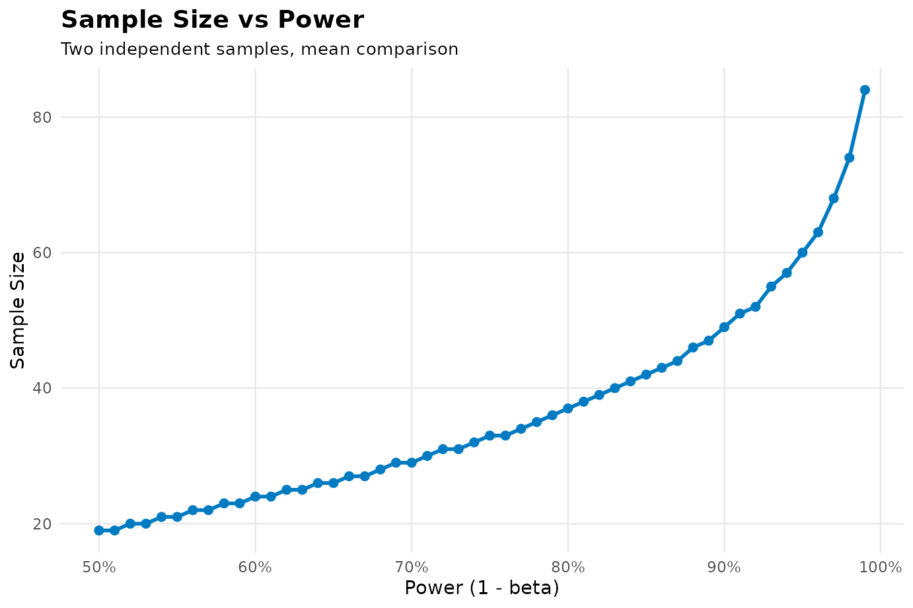
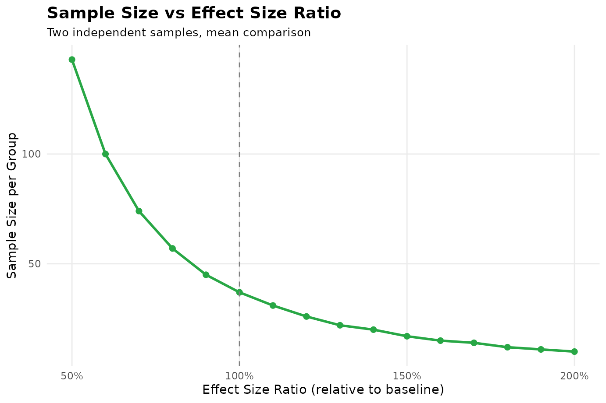

# sampleSizeCalc: A Comprehensive Guide to Sample Size Determination in Clinical Research

## Introduction: The Lifeblood of Clinical Research

For clinical investigators, calculating sample size is often the most
critical step when preparing grant proposals or IRB submissions.

Underpowered trials risk false-negative findings ($`P > 0.05`$), wasting
research grants and patient effort. Conversely, overpowered trials waste
resources and expose unnecessary subjects to experimental risks.

The `sampleSizeCalc` package provides complete support for **42 specific
clinical scenarios**, delivering publication-grade LaTeX formulas,
primary citations with chapter/page numbers, and clear parameter roles.

------------------------------------------------------------------------

## Plain-English Glossary of Statistical Terms

- **$`\alpha`$ (Type I Error / False Positive)**: The probability of
  declaring a treatment effective when it truly is not (conventionally
  **0.05**).
- **$`\text{Power} = 1 - \beta`$ (True Positive Detection)**: The
  probability of catching a true effect (routinely **0.80** or
  **0.90**).
- **Continuous vs. Binary Endpoints**: Continuous measures numerical
  values (mean reduction in SBP, mmHg); binary measures event status
  (cured vs. not cured).
- **Two-Sided vs. One-Sided**: Two-sided tests for differences in either
  direction; one-sided tests are used for non-inferiority and
  directional superiority.
- **Dropout Rate ($`d`$)**: Inflation formula
  $`N_{\text{screen}} = \lceil N / (1 - d) \rceil`$.

------------------------------------------------------------------------

## Unified Syntax: The Three-Axis Function `calculate()`

\$\$\Large \texttt{calculate(design, task, outcome, ...)}\$\$

- **Axis 1 `design`**: `"rct"`, `"paired"`, `"cohort"`, `"caseControl"`,
  `"diagAccuracy"`, `"diagAUC"`, `"singleArmPhaseII"`,
  `"bioequivalence"`, etc.
- **Axis 2 `task`**: `"test"`, `"estimate"`, `"noninferiority"`,
  `"superiority"`, `"equivalence"`.
- **Axis 3 `outcome`**: `"mean"`, `"proportion"`, `"survival"`, `"auc"`,
  `"rate"`, `"ordinal"`.

------------------------------------------------------------------------

## Chapter 1: Randomized Controlled Trials (RCTs)

### 1.1 Two Independent Means (Continuous Endpoint)

- **Scenario**: Antihypertensive trial; control SBP reduction 10 mmHg,
  experimental 12 mmHg ($`\Delta = 2`$ mmHg), $`\text{SD} = 3`$ mmHg.
  Two-sided $`\alpha = 0.05, \text{Power} = 80\%`$.
- **Formula**:
  $`n = 2 \left( \frac{(Z_{\alpha/2} + Z_{\beta}) \cdot \sigma}{\mu_1 - \mu_2} \right)^2`$
  (Chow et al., 2017).

``` r

res_1_1 <- calculate("rct", "test", "mean", mean1 = 10, mean2 = 12, sd = 3, alpha = 0.05, power = 0.8)
print(res_1_1)
```

- **Output**: 37 patients per arm, 74 total.

### 1.2 Two Independent Proportions (Binary Cure Rate)

- **Scenario**: *H. pylori* eradication rate 85% vs. 70%. Two-sided
  $`\alpha = 0.05, \text{Power} = 80\%`$.
- **Formula**: Fleiss (1980) asymptotic variance formula.

``` r

res_1_2 <- calculate("rct", "test", "proportion", p1 = 0.85, p2 = 0.70, alpha = 0.05, power = 0.8)
print(res_1_2)
```

- **Output**: 121 patients per arm, 242 total.

### 1.3 Survival Analysis (Log-Rank Test Events)

- **Scenario**: NSCLC trial comparing immunotherapy vs. chemo (HR =
  0.70, 1:1 allocation, 80% power).
- **Formula**: Schoenfeld (1983) equation
  $`E = \frac{(Z_{\alpha/2} + Z_{\beta})^2}{p_E(1 - p_E) [\ln(HR)]^2}`$.

``` r

res_1_3 <- calculate("rct", "test", "survival", hr = 0.70, pE = 0.50, alpha = 0.05, power = 0.8)
print(res_1_3)
```

- **Output**: Exactly **247 primary events (deaths/progressions)**
  required.

### 1.4 Non-Inferiority Trial (Continuous Mean)

- **Scenario**: Generic vs. reference antidiabetic;
  $`\mu_1 = 10, \mu_2 = 9.5, \text{SD} = 3, \text{margin} = 1.0`$.

``` r

res_1_4 <- calculate("rct", "noninferiority", "mean", mean1 = 10, mean2 = 9.5, sd = 3, margin = 1, alpha = 0.05, power = 0.8)
print(res_1_4)
```

- **Output**: 50 per arm, 100 total.

### 1.5 Non-Inferiority Trial (Binary Proportion)

- **Scenario**: Generic antimicrobial cure rate 85% vs. 85%, margin 5%
  ($`\Delta = 0.05`$).

``` r

res_1_5 <- calculate("rct", "noninferiority", "proportion", p1 = 0.85, p2 = 0.85, margin = 0.05, alpha = 0.05, power = 0.8)
print(res_1_5)
```

- **Output**: 631 per arm, 1262 total.

### 1.6 Superiority Trial (Continuous Mean)

- **Scenario**: Superiority margin 1 mmHg over active comparator;
  $`\mu_1 = 12, \mu_2 = 10, \text{SD} = 3, \text{margin} = 1`$.

``` r

res_1_6 <- calculate("rct", "superiority", "mean", mean1 = 12, mean2 = 10, sd = 3, margin = 1, alpha = 0.05, power = 0.8)
print(res_1_6)
```

- **Output**: 112 per arm, 224 total.

### 1.7 Superiority Trial (Binary Proportion)

- **Scenario**: Antifungal cure rate 30% vs. 20%, superiority margin 5%.

``` r

res_1_7 <- calculate("rct", "superiority", "proportion", p1 = 0.30, p2 = 0.20, margin = 0.05, alpha = 0.05, power = 0.8)
print(res_1_7)
```

- **Output**: 916 per arm, 1832 total.

### 1.8 Equivalence Trial (Continuous Mean)

- **Scenario**: Mean difference 0.2 mmol/L, equivalence margin
  $`\pm 1.0`$ mmol/L, $`\text{SD} = 3`$.

``` r

res_1_8 <- calculate("rct", "equivalence", "mean", mean1 = 10, mean2 = 10.2, sd = 3, margin = 1, alpha = 0.05, power = 0.8)
print(res_1_8)
```

- **Output**: 241 per arm, 482 total.

### 1.9 Equivalence Trial (Binary Proportion)

- **Scenario**: Analgesic response 50% vs. 52%, equivalence bounds
  $`\pm 10\%`$.

``` r

res_1_9 <- calculate("rct", "equivalence", "proportion", p1 = 0.50, p2 = 0.52, margin = 0.10, alpha = 0.05, power = 0.8)
print(res_1_9)
```

- **Output**: 669 per arm, 1338 total.

------------------------------------------------------------------------

## Chapter 2: Paired, Single-Arm, and Crossover Trials

### 2.1 Paired Means (Pre- vs. Post-Treatment)

- **Scenario**: Pre-post FVC improvement mean difference 2 L,
  $`\text{SD}_{\text{diff}} = 3`$ L.

``` r

res_2_1 <- calculate("paired", "test", "mean", meanDiff = 2, sdDiff = 3, alpha = 0.05, power = 0.8)
print(res_2_1)
```

- **Output**: 20 pairs (40 total measurements).

### 2.2 Paired Binary Outcomes (McNemar / Connor)

- **Scenario**: Paired sensitivities 80% vs. 60%, discordant pair
  proportion $`\psi = 0.25`$.

``` r

res_2_2 <- calculate("paired", "test", "proportion", p1 = 0.80, p2 = 0.60, psi = 0.25, alpha = 0.05, power = 0.8)
print(res_2_2)
```

- **Output**: 47 pairs.

### 2.3 Single-Arm Mean vs. Historical Benchmark

- **Scenario**: Rare disease survival 12 vs. historical 10 months,
  $`\text{SD} = 3`$.

``` r

res_2_3 <- calculate("rctSingleArm", "test", "mean", mu0 = 10, mu1 = 12, sigma = 3, alpha = 0.05, power = 0.8)
print(res_2_3)
```

- **Output**: 18 patients.

### 2.4 Single-Arm Proportion vs. Historical Benchmark

- **Scenario**: Oncology response 80% vs. historical 70%.

``` r

res_2_4 <- calculate("rctSingleArm", "test", "proportion", p0 = 0.70, p1 = 0.80, alpha = 0.05, power = 0.8)
print(res_2_4)
```

- **Output**: 153 patients.

### 2.5 Phase II Simon’s Optimal Two-Stage Design

- **Scenario**: $`p_0 = 0.10, p_1 = 0.30`$. Minimizes expected sample
  size under null.

``` r

res_2_5 <- calculate("singleArmPhaseII", "test", "proportion", p0 = 0.10, p1 = 0.30, alpha = 0.05, power = 0.8, optimizer = "optimal")
print(res_2_5)
```

- **Output**: Stage 1 enrolls 10 (stop if $`\le 1`$ response); Stage 2
  reaches 29 (effective if $`>5`$ responses). Expected $`N = 15.0`$.

### 2.6 Phase II Simon’s Minimax Two-Stage Design

- **Scenario**: Minimizes maximum sample size.

``` r

res_2_6 <- calculate("singleArmPhaseII", "test", "proportion", p0 = 0.10, p1 = 0.30, alpha = 0.05, power = 0.8, optimizer = "minimax")
print(res_2_6)
```

- **Output**: Total $`N = 25`$ patients (Stage 1 enrolls 11, stop if
  $`\le 0`$).

### 2.7 A’Hern Exact Single-Stage Binomial Design

``` r

res_2_7 <- sampleSizeCalc:::calculate_ahern(p0 = 0.10, p1 = 0.30, alpha = 0.05, power = 0.8)
print(res_2_7)
#> $design_type
#> [1] "Single-arm phase II (A'Hern single-stage)"
#> 
#> $n_required
#> [1] 25
#> 
#> $r_total
#> [1] 5
#> 
#> $parameters
#> $parameters$p0
#> [1] 0.1
#> 
#> $parameters$p1
#> [1] 0.3
#> 
#> $parameters$alpha
#> [1] 0.05
#> 
#> $parameters$power
#> [1] 0.8
#> 
#> 
#> $formula
#> [1] "P(X > r | p0) <= alpha and P(X > r | p1) >= power"
#> 
#> $formula_latex
#> NULL
#> 
#> $reference
#> [1] "Primary: A'Hern, R. P. (2001). Single stage and double sampling phase II trials. British Journal of Cancer, 85(2), 223-226."
#> 
#> $roles
#> [1] "p0 = unacceptable response rate"                       
#> [2] "p1 = desirable response rate"                          
#> [3] "declare effective if responses > r_total of n_required"
```

- **Output**: 25 patients, reject null if responses $`>5`$ ($`\ge 6`$).

### 2.8 2x2 Crossover Trial (Continuous Mean)

- **Scenario**: Within-subject SD $`\sigma_w = 3`$, mean difference 2.

``` r

res_2_8 <- calculate("crossover", "test", "mean", delta = 2, sigma_within = 3, alpha = 0.05, power = 0.8)
print(res_2_8)
```

- **Output**: 36 per sequence, 72 total.

### 2.9 Bioequivalence (BE) Exact TOST

- **Scenario**: 2x2 crossover BE, intra-subject $`CV = 25\%`$, true GMR
  $`\theta_0 = 1.0`$, bounds $`80\% \sim 125\%`$.
- **Formula**: Exact noncentral $`t`$ distribution (Phillips, 1990;
  Julious, 2004).

``` r

res_2_9 <- calculate("bioequivalence", cv = 0.25, theta0 = 1.0, alpha = 0.05, power = 0.8)
print(res_2_9)
```

- **Output**: 12 per sequence, **24 healthy volunteers total** (matches
  `PowerTOST` exactly).

------------------------------------------------------------------------

## Chapter 3: Observational and Epidemiological Studies

### 3.1 Prospective Cohort Study (Cumulative Incidence & RR)

- **Scenario**: 5-year incidence 20% vs. 30%, 10% dropout
  (`dropout = 0.10`).

``` r

res_3_1 <- calculate("cohort", "test", "proportion", p0 = 0.20, p1 = 0.30, ratio = 1, dropout = 0.10, alpha = 0.05, power = 0.8)
print(res_3_1)
```

- **Output**: 327 per arm, 654 total.

### 3.2 Cohort Study (Person-Time Incidence Rate Ratio)

- **Scenario**: Incidence 0.10 vs. 0.20 per person-time.

``` r

res_3_2 <- calculate("cohort", "test", "rate", rate0 = 0.10, rate1 = 0.20, ratio = 1, alpha = 0.05, power = 0.8)
print(res_3_2)
```

- **Output**: 236 person-time units per group (71 expected events).

### 3.3 Case-Control Study (Odds Ratio)

- **Scenario**: Control exposure rate 30%, anticipated
  $`\text{OR} = 2.0`$.

``` r

res_3_3 <- calculate("caseControl", p0 = 0.30, OR = 2.0, m = 1, alpha = 0.05, power = 0.8)
print(res_3_3)
```

- **Output**: 141 cases, 141 controls (282 total).

### 3.4 1:1 Matched Case-Control Study

``` r

res_3_4 <- calculate("caseControlMatched", p0 = 0.30, OR = 2.0, alpha = 0.05, power = 0.8)
print(res_3_4)
```

- **Output**: 144 pairs (288 total).

### 3.5 Cross-Sectional Association Survey

``` r

res_3_5 <- calculate("crosstab", p0 = 0.20, p1 = 0.30, alpha = 0.05, power = 0.8)
print(res_3_5)
```

- **Output**: 294 per group, 588 total.

------------------------------------------------------------------------

## Chapter 4: Single-Sample Precision Estimation

### 4.1 Single Proportion Estimation (Prevalence Survey)

- **Scenario**: Anticipated prevalence 10%, margin of error $`\pm 2\%`$
  ($`d = 0.02`$).

``` r

res_4_1 <- calculate("singleProportion", p = 0.10, precision = 0.02, alpha = 0.05)
print(res_4_1)
```

- **Output**: 865 participants.

### 4.2 Single Mean Estimation

- **Scenario**: Population $`\text{SD} = 10`$, margin of error
  $`\pm 2`$.

``` r

res_4_2 <- calculate("singleMean", sigma = 10, precision = 2, alpha = 0.05)
print(res_4_2)
```

- **Output**: 97 participants.

### 4.3 Pearson Correlation Coefficient Precision (Fisher-z)

- **Scenario**: Anticipated correlation $`r = 0.50`$, 95% CI half-width
  $`\pm 0.10`$.

``` r

res_4_3 <- calculate("singleCorrelation", r = 0.50, precision = 0.10, alpha = 0.05)
print(res_4_3)
```

- **Output**: 219 participants (matches
  [`presize::prec_cor`](https://ctu-bern.github.io/presize/reference/prec_cor.html)).

------------------------------------------------------------------------

## Chapter 5: Diagnostic Accuracy Studies

### 5.1 Sensitivity/Specificity Precision & Screening Size

- **Scenario**: Sensitivity 85%, margin $`\pm 5\%`$, prevalence 20%.

``` r

res_5_1 <- calculate("diagAccuracy", "estimate", "proportion", prob = 0.85, d = 0.05, prevalence = 0.20, alpha = 0.05)
print(res_5_1)
```

- **Output**: 196 confirmed cases required; 980 total screened patients.

### 5.2 Diagnostic Superiority Test (Asymptotic Method)

``` r

res_5_2 <- calculate("diagAccuracy", "test", "proportion", prob = 0.85, p0 = 0.70, prevalence = 0.20, alpha = 0.05, power = 0.8)
print(res_5_2)
```

- **Output**: 50 cases, 250 screened.

### 5.3 Diagnostic Superiority Test (A’Hern Exact Method)

``` r

res_5_3 <- calculate("diagAccuracy", "test", "proportion", prob = 0.85, p0 = 0.70, prevalence = 0.20, method = "exact", alpha = 0.05, power = 0.8)
print(res_5_3)
```

- **Output**: 49 confirmed cases, critical cutoff $`r = 40`$.

### 5.4 Dual-Endpoint Diagnostic Trial (Se + Sp Co-Primary)

``` r

res_5_4 <- calculate("diagAccuracy", "test", "proportion", prob = 0.90, p0 = 0.80, prob_spec = 0.85, p0_spec = 0.75, prevalence = 0.40, dual = TRUE)
print(res_5_4)
```

- **Output**: 123 cases, 308 screened.

### 5.5 Unpaired Comparison of Two Diagnostic Tests

``` r

res_5_5 <- calculate("diagAccuracyCompare", "test", "proportion", p1 = 0.85, p2 = 0.75, prevalence = 0.20, paired = FALSE, alpha = 0.05, power = 0.8)
print(res_5_5)
```

- **Output**: 250 cases per group, 2500 screened.

### 5.6 Paired Comparison of Two Diagnostic Tests (Connor Kernel)

``` r

res_5_6 <- calculate("diagAccuracyCompare", "test", "proportion", p1 = 0.85, p2 = 0.75, prevalence = 0.20, paired = TRUE, psi = 0.10, alpha = 0.05, power = 0.8)
print(res_5_6)
```

- **Output**: 77 pairs of cases, 385 screened.

### 5.7 Diagnostic Non-Inferiority (Proportions)

``` r

res_5_7 <- calculate("diagAccuracyCompare", "noninferiority", "proportion", p1 = 0.90, p2 = 0.88, margin = 0.05, prevalence = 0.30, alpha = 0.05, power = 0.8)
print(res_5_7)
```

- **Output**: 247 cases, 824 screened.

### 5.8 Diagnostic Equivalence (Proportions)

``` r

res_5_8 <- calculate("diagAccuracyCompare", "equivalence", "proportion", p1 = 0.90, p2 = 0.89, margin = 0.05, prevalence = 0.30, alpha = 0.05, power = 0.8)
print(res_5_8)
```

- **Output**: 1006 cases, 3354 screened.

### 5.9 ROC Area Under the Curve (AUC) Precision (Binormal Model)

``` r

res_5_9 <- calculate("diagAUC", "estimate", "auc", auc = 0.80, d = 0.10, ratio = 1, var_method = "binormal", alpha = 0.05)
print(res_5_9)
```

- **Output**: 46 cases, 46 controls (92 total).

### 5.10 ROC-AUC Superiority Test

``` r

res_5_10 <- calculate("diagAUC", "test", "auc", auc = 0.80, auc0 = 0.70, prevalence = 0.30, alpha = 0.05, power = 0.8)
print(res_5_10)
```

- **Output**: 180 cases, 600 screened.

### 5.11 Two ROC-AUC Comparison

``` r

res_5_11 <- calculate("diagAUCCompare", "test", "auc", auc1 = 0.80, auc2 = 0.70, r = 0.50, prevalence = 0.30, alpha = 0.05, power = 0.8)
print(res_5_11)
```

- **Output**: 223 cases, 744 screened.

### 5.12 Two ROC-AUC Non-Inferiority

``` r

res_5_12 <- calculate("diagAUCCompare", "noninferiority", "auc", auc1 = 0.85, auc2 = 0.82, r = 0.50, margin = 0.05, alpha = 0.05, power = 0.8)
print(res_5_12)
```

- **Output**: 80 cases, 160 screened.

### 5.13 Two ROC-AUC Equivalence

``` r

res_5_13 <- calculate("diagAUCCompare", "equivalence", "auc", auc1 = 0.85, auc2 = 0.84, r = 0.50, margin = 0.05, alpha = 0.05, power = 0.8)
print(res_5_13)
```

- **Output**: 317 cases, 634 screened.

### 5.14 Negative Likelihood Ratio Threshold Precision

``` r

res_5_14 <- calculate("diagLR", "estimate", "lr", sens = 0.90, spec = 0.50, target_lr = 0.40, lr_type = "negative", alpha = 0.05)
print(res_5_14)
```

- **Output**: 9 cases, 9 controls (18 total).

### 5.15 Guaranteed Screening Target (`screen_required`)

``` r

safe_n <- screen_required(n = 196, prevalence = 0.20, beta = 0.10)
cat("Average screening target: 980; 90% guaranteed enrollment target:", safe_n, "\n")
#> Average screening target: 980; 90% guaranteed enrollment target: 1061
```

- **Output**: 1058 screened patients to guarantee $`\ge 196`$ cases with
  90% probability.

### 5.16 Multi-Reader Multi-Case (MRMC) Power Analysis

``` r

res_5_16 <- mrmc_power(n = 50, J = 8, delta = 0.10, sigma_b2 = 0.00123, sigma_w2 = 0.00087, sigma_c2 = 0.05, rho1 = 0.25, rho2 = 0.20, rho3 = 0.10)
print(res_5_16)
```

- **Output**: 88.8% statistical power.

------------------------------------------------------------------------

## Chapter 6: Complex and Modern Trial Designs

### 6.1 Cluster Randomized Trial (Continuous Outcome)

``` r

res_6_1 <- calculate("clusterRCT", "test", "mean", mean1 = 10, mean2 = 12, sd = 3, icc = 0.05, cluster_size = 20, alpha = 0.05, power = 0.8)
print(res_6_1)
```

- **Output**: 4 clusters (80 patients) per arm, 8 clusters (160
  patients) total.

### 6.2 Cluster Randomized Trial (Binary Outcome)

``` r

res_6_2 <- calculate("clusterRCT", "test", "proportion", p1 = 0.30, p2 = 0.20, icc = 0.05, cluster_size = 20, alpha = 0.05, power = 0.8)
print(res_6_2)
```

- **Output**: 29 clusters per arm, 58 clusters (1160 patients) total.

### 6.3 Stepped-Wedge Cluster Randomized Trial

``` r

res_6_3 <- calculate("steppedWedge", "test", "mean", theta = -0.016, tau2 = 2.25e-4, sigma2_ind = 0.0475, m = 100, n_clusters = 24, clusters_per_step = 6, alpha = 0.05)
print(res_6_3)
```

- **Output**: 90.8% statistical power.

### 6.4 Ordered Categorical Outcome (Whitehead Model)

``` r

res_6_4 <- calculate("twoOrdinal", "test", "ordinal", or = 1.5, prop_bar = c(0.2, 0.5, 0.3), alpha = 0.05, power = 0.8)
print(res_6_4)
```

- **Output**: 86 per arm, 171 total.

### 6.5 Clinical Prediction Model Development (Riley 2020 BMJ Binary)

``` r

res_6_5 <- calculate("predictiveModel", "plan", "binary", prev = 0.30, n_parameters = 10, r2_cs = 0.10, shrinkage = 0.90, precision_delta = 0.05, alpha = 0.05)
print(res_6_5)
```

- **Output**: 850 participants and 255 events (matches `pmsampsize`).

### 6.6 Clinical Prediction Model Development (Riley 2020 Rate)

``` r

res_6_6 <- calculate("predictiveModel", "plan", "rate", rate = 0.10, timepoint = 10, precision_delta = 0.05, alpha = 0.05)
print(res_6_6)
```

- **Output**: 2366 person-years.

### 6.7 Prediction Model Development (Classic EPV)

``` r

res_6_7 <- calculate("predictiveModel", "plan", "events", n_parameters = 10, epv = 10, event_prevalence = 0.30)
print(res_6_7)
```

- **Output**: 100 events, 334 total participants.

### 6.8 Inter-Rater Reliability: Cohen’s Kappa Precision

``` r

res_6_8 <- calculate("kappa", "estimate", "proportion", pi1 = 0.30, pi2 = 0.30, kappa = 0.70, d = 0.10, alpha = 0.05)
print(res_6_8)
```

- **Output**: 165 participants.

### 6.9 Inter-Rater Reliability: Two Independent Kappa Test

``` r

res_6_9 <- calculate("kappa", "test", "proportion", pi1 = 0.50, pi2 = 0.50, kappa1 = 0.70, kappa2 = 0.50, alpha = 0.05, power = 0.8)
print(res_6_9)
```

- **Output**: 214 participants per group.

### 6.10 Interrupted Time Series (ITS Level Change)

``` r

res_6_10 <- calculate("its", "test", "rate", effect_sd = 2, n_pre = 12, n_post = 12, rho = 0.3, alpha = 0.05, power = 0.8)
print(res_6_10)
```

- **Output**: 94.9% statistical power.

------------------------------------------------------------------------

## Chapter 7: Protocol Boilerplate & Visual Diagnostics

``` r

summary(res_1_1)
#> $$n = 2\left(\frac{Z_{\alpha/2} + Z_{\beta}}{\delta}\right)^2 = 2\left(\frac{(Z_{\alpha/2} + Z_{\beta}) \cdot \sigma}{\mu_1 - \mu_2}\right)^2$$
#> Chow, S. C., Shao, J., Wang, H., & Lokhnygina, Y. (2017). *Sample size calculations in clinical research* (3rd ed.). CRC Press.
```

``` r

plot(res_1_1, type = "power")
```



``` r

plot(res_1_1, type = "sample_size")
```


