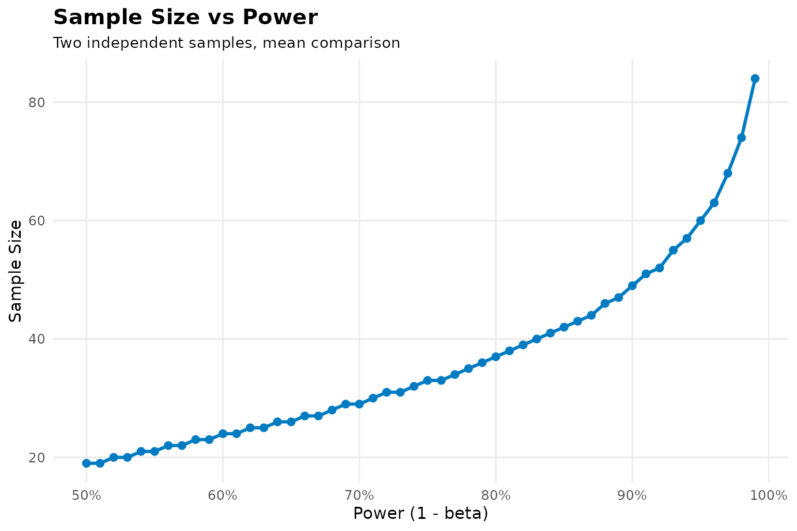
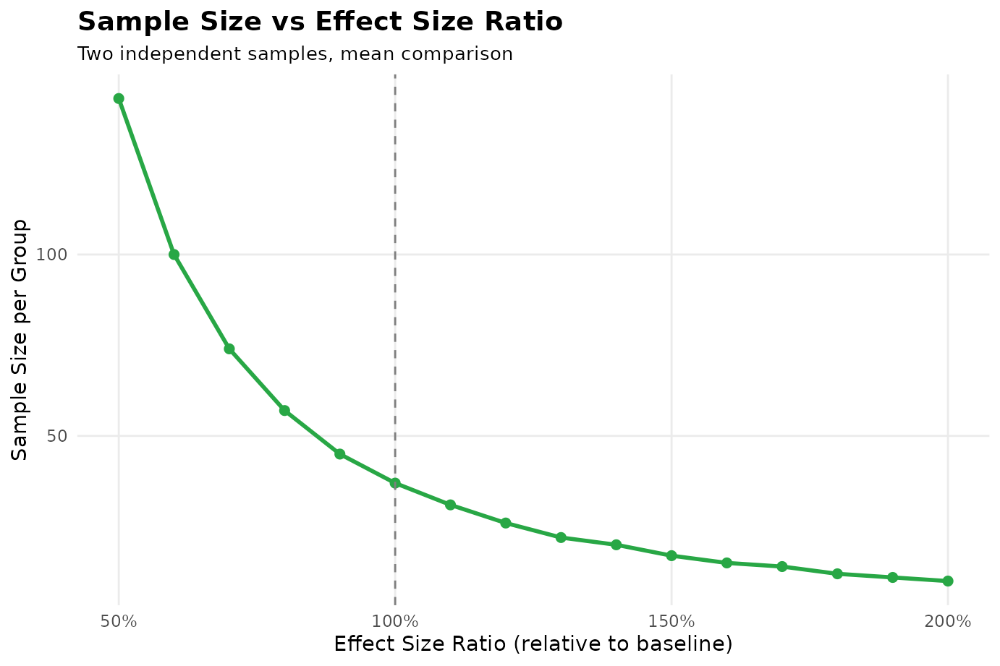

# sampleSizeCalc 完整使用指南：全场景临床科研样本量计算（零基础到精通）

## 引言：为什么样本量计算是临床研究的第一生命线？

很多临床医生在申报国家自然科学基金、撰写临床试验方案（Protocol）或提交伦理审查时，最容易被评审专家质疑的就是**样本量计算依据**。

不经严谨测算就随意定一个样本量（比如“凭经验随访 50
例”），会面临两大致命风险： 1.
**样本量过小（Underpowered，检验效能不足）**：哪怕药物真有疗效，因为人数太少，微弱的信号会被人体的抽样波动彻底掩盖，最终
\\P \>
0.05\\，得出“无统计学显著差异”的假阴性结论，浪费科研经费与受试者心血。
2.
**样本量过大（Overpowered，不符合医学伦理）**：纳入过多患者不仅拖延试验周期，更在伦理上让多余的受试者暴露在未知疗效或有潜在副作用的试验药物中。

`sampleSizeCalc`（临床研究样本量计算器）覆盖了经典双臂
RCT、流行病学调查、Simon
两阶段试验、生物等效性、诊断试验及预测模型等设计。本指南用 **52
个临床场景**说明如何把研究问题转成计算参数。

下面的研究方案均为教学示例。除明确标注的教材数值例题外，治疗效果、标准差、发生率及界值是演示假设；公式的参考文献不代表这些临床参数已有实证支持。实际方案应记录参数来自哪项同类研究、哪批先导数据，以及人群、随访时间和结局定义是否一致。

每个场景依次说明研究人群、实施流程、参数设定和设计选择。结果解读中的数值由
R
对象直接生成。部分诊断分支先用未取整样本量换算筛查数；招募计划还应按已取整的病例配额换算，并分别保证疾病阳性与阴性受试者数量。

**默认打印计算结果时，会同时显示纯文本公式、LaTeX
公式源码、计算过程和参考文献，并按设计提供参数角色说明。**
赋值保存结果后，输入对象名称或调用
[`print()`](https://rdrr.io/r/base/print.html)
即可查看；[`summary()`](https://rdrr.io/r/base/summary.html)
还会列出全部输入参数及已记录的调整。

------------------------------------------------------------------------

## 统计零基础必读：核心概念通俗白话字典

- **\\\alpha\\（I 类错误 / 假阳性率 / 显著性水平）**：
  - *通俗比喻*：**“法官冤枉好人的概率”**。新药明明没有用，但巧合之下我们误认为新药有用的概率。
  - *常规取值*：国际学术界惯例设为 **0.05（即
    5%）**。单侧检验（如非劣效试验）常设为 0.025 或 0.05。
- **\\\text{Power} = 1 - \beta\\（检验效能 / 统计学把握度）**：
  - *通俗比喻*：**“警察抓出真凶的把握”**。新药确实有用时，我们的试验能以多大的概率把它检测出来。
  - *常规取值*：通常设为 **0.80（80%）** 或
    **0.90（90%）**。把握度要求越高，需要招募的患者越多。
- **连续型指标（Mean，均数） vs 二分类指标（Proportion，比例）**：
  - *连续型指标*：测量出来是具体数值，如收缩压降幅（mmHg）、空腹血糖（mmol/L）。核心参数是“均数差（\\\Delta\\）”与“标准差（\\\sigma\\,
    SD）”。
  - *二分类指标*：只有“有效/无效”、“治愈/未治愈”，如有效率 80%、死亡率
    15%。
- **双侧检验（Two-sided） vs 单侧检验（One-sided）**：
  - *双侧检验*：事先不确定新药到底会比对照组好还是差，两头都看（经典临床试验通用）。
  - *单侧检验*：只关心新药是否优于对照药，或者新药是否“不差于”对照药（非劣效/优效性试验通用）。
- **脱落率（Dropout Rate）**：
  - 随访中患者失访或退出。设计划脱落率为 \\d\\（如
    10%），目标样本量需放大：\\N\_{\text{screen}} = \lceil N / (1 - d)
    \rceil\\。

------------------------------------------------------------------------

## 核心语法：统一三轴入口 `calculate()`

在 `sampleSizeCalc` 中，所有计算统一汇聚为一个函数：

\\\Large \texttt{calculate(design, task, outcome, ...)}\\

- **第一轴 `design`（设计类型）**：我们在做什么类型的研究？（`"rct"`,
  `"paired"`, `"cohort"`, `"caseControl"`, `"diagAccuracy"`,
  `"diagAUC"`, `"singleArmPhaseII"`, `"bioequivalence"`, `"clusterRCT"`
  等）
- **第二轴 `task`（统计任务）**：科学目的是什么？（`"test"` 假设检验,
  `"estimate"` 置信区间精度, `"noninferiority"` 非劣效, `"superiority"`
  优效, `"equivalence"` 等效）
- **第三轴 `outcome`（结局指标）**：如何度量疗效？（`"mean"` 均数,
  `"proportion"` 比例, `"survival"` 生存事件数, `"auc"` 诊断AUC,
  `"rate"` 人时率）

------------------------------------------------------------------------

## 第一章：随机对照试验（RCT）全场景实战

### 1.1 两独立样本均数比较（连续变量）

- **研究背景与人群**：心内科拟开展两臂、双盲、平行随机试验，纳入 40–75
  岁、基础降压方案稳定的门诊患者，比较加用研究药与加用安慰剂的效果，按
  1:1 分组。
- **实施与主要结局**：基线和第 12
  周均按统一流程取多次坐位血压的平均值。主要结局是“基线减去第 12
  周”的收缩压降幅，正值越大表示改善越多；每名患者贡献一个连续结局。
- **参数设定与依据**：演示假设对照组平均下降 10 mmHg、研究药组下降 12
  mmHg，个体降幅的合并 SD 为 3
  mmHg。`mean1 = 10`、`mean2 = 12`、`sd = 3` 对应这些量，不能用基线血压
  SD 替代降幅 SD。正式取值需核对同类人群、相同测量流程的先导资料。
- **设计选择**：问题是两组平均降幅是否不同，因此使用双侧
  `alpha = 0.05`、`power = 0.8` 的两独立样本均数比较；这里的 2 mmHg
  是拟检出的组间差，不是每组各自的治疗效果。
- **数学公式与出处**： \\n = 2 \left( \frac{(Z\_{\alpha/2} + Z\_{\beta})
  \cdot \sigma}{\mu_1 - \mu_2} \right)^2\\ *出处*：Chow, S. C., Shao,
  J., Wang, H., & Lokhnygina, Y. (2017). *Sample Size Calculations in
  Clinical Research* (3rd ed.). CRC Press.
- **参数说明**：`mean1`, `mean2` 为两组均值；`sd`
  为合并标准差（\\\>0\\）。

``` r

res_1_1 <- calculate("rct", "test", "mean", mean1 = 10, mean2 = 12, sd = 3, alpha = 0.05, power = 0.8)
print(res_1_1)
#> ────────────────────────────────────────────────────────────────────────────────
#> ✔ Sample Size Calculation Results
#> • Design type: "Two independent samples, mean comparison"
#> • Sample size per group: 37
#> • Total sample size: 74
#> Formula (plain text):
#> `n = 2 * ((Z_alpha/2 + Z_beta) * sd / (mean1 - mean2))^2`
#> Formula (LaTeX):
#> $$n = 2\left(\frac{Z_{\alpha/2} + Z_{\beta}}{\delta}\right)^2 = 2\left(\frac{(Z_{\alpha/2} + Z_{\beta}) \cdot \sigma}{\mu_1 - \mu_2}\right)^2$$
#> Calculation process:
#> 
#> • Step 1: State hypotheses: H0: mu1 = mu2 vs H1: mu1 != mu2 (two-sided alpha =
#> 0.05, power = 0.80).
#> • Step 2: Calculate mean difference delta = |mu1 - mu2| = |10 - 12| = 2; common
#> SD sigma = 3.
#> • Step 3: Determine critical values: Z_(alpha/2) = 1.96 (for two-sided alpha =
#> 0.05), Z_beta = 0.8416 (for power = 0.80).
#> • Step 4: Compute initial sample size via normal approximation: n0 = 2 *
#> ((Z_(alpha/2) + Z_beta) * sigma / delta)^2 = 2 * ((1.96 + 0.8416) * 3 / 2)^2 =
#> 35.32.
#> • Step 5: Refine via exact two-sample Student's t-test power iteration
#> (accounting for degrees of freedom df = 2n - 2).
#> • Step 6: Round up to integer: n = 37 per group, total sample size N = 74.
#> Reference:
#> Chow, S. C., Shao, J., Wang, H., & Lokhnygina, Y. (2017). *Sample size calculations in clinical research* (3rd ed.). CRC Press.
#> ────────────────────────────────────────────────────────────────────────────────
#> 
```

- **输出解读与招募安排**：每组需 37 名可分析患者，总计 74
  人。报告先列出正态近似的每组约 35.32 人，再通过非中心 t
  分布效能求解并取整。若另预计 10%
  的主要结局无法获得，则应按每组向上取整，计划招募 42 人/组、共 84
  人；该调整尚未包含在上述 RCT 结果中。

#### 默认报告的四项内容与提取方式

| 内容 | 控制台标签 | 对象字段 |
|----|----|----|
| 纯文本公式 | `Formula (plain text)` | `formula` |
| LaTeX 公式源码 | `Formula (LaTeX)` | `formula_latex` |
| 计算过程 | `Calculation process` | `calculation_steps`，别名 `calculation` |
| 参考文献 | `Reference` | `reference` |

``` r

res_1_1$formula
cat(res_1_1$formula_latex)
cat(res_1_1$calculation_steps, sep = "\n")
cat(res_1_1$reference)
```

R 控制台显示可复制的 LaTeX 源码。在 R Markdown 文档中，可以通过
`results = "asis"` 代码块内的 `cat(res_1_1$formula_latex)` 排版公式。
[结果报告指南](https://portos-wang.github.io/Sample_Size_Calc/articles/result-reporting.md)提供可执行示例和保存报告的方法。

### 1.2 两独立样本比例比较（二分类治愈率）

- **研究背景与人群**：消化内科拟纳入经检测确认幽门螺杆菌感染、尚未接受本轮根除治疗的成年人，随机比较两种
  14 天治疗方案；近期抗菌药使用和既往根除失败应按方案预先处理。
- **实施与主要结局**：疗程结束后按统一时间窗进行尿素呼气试验，预先定义停药要求及无效检测的处理。主要结局是每位受试者是否达到根除标准，不能把服药结束时症状好转当作根除。
- **参数设定与依据**：以 `p1 = 0.85`、`p2 = 0.70`
  演示预期根除率，目标是检出 15
  个百分点的绝对差异。真实取值应来自治疗史、耐药背景、根除判定时间相近的研究或本中心数据。
- **设计选择**：两组由不同患者构成，使用独立两比例比较，双侧
  α=0.05、效能
  80%。意向性分析如何处理漏服药和未完成复查，应在招募前写入方案。
- **数学公式与出处**： \\n = \frac{\left\[
  Z\_{\alpha/2}\sqrt{2\bar{p}(1-\bar{p})} + Z\_{\beta}\sqrt{p_1(1-p_1) +
  p_2(1-p_2)} \right\]^2}{(p_1 - p_2)^2}\\ *出处*：Fleiss, J. L., Tytun,
  A., & Ury, H. K. (1980). *Biometrics*, 36(2), 343-346.

``` r

res_1_2 <- calculate("rct", "test", "proportion", p1 = 0.85, p2 = 0.70, alpha = 0.05, power = 0.8)
print(res_1_2)
#> ────────────────────────────────────────────────────────────────────────────────
#> ✔ Sample Size Calculation Results
#> • Design type: "Two independent proportions"
#> • Sample size per group: 121
#> • Total sample size: 242
#> Formula (plain text):
#> `n = (Z_a/2 * sqrt(2*p_bar*(1-p_bar)) + Z_b * sqrt(p1*(1-p1)+p2*(1-p2)))^2 /
#> (p1-p2)^2`
#> Formula (LaTeX):
#> $$n = \frac{\left[Z_{\alpha/2}\sqrt{2\bar{p}(1-\bar{p})} + Z_{\beta}\sqrt{p_1(1-p_1) + p_2(1-p_2)}\right]^2}{(p_1 - p_2)^2}$$
#> Calculation process:
#> 
#> • Step 1: State hypotheses: H0: p1 = p2 vs H1: p1 != p2 (two-sided alpha =
#> 0.05, power = 0.80).
#> • Step 2: Compute pooled proportion: p_bar = (p1 + p2) / 2 = (0.85 + 0.70) / 2
#> = 0.775.
#> • Step 3: Determine critical values: Z_(alpha/2) = 1.96, Z_beta = 0.8416.
#> • Step 4: Compute Fleiss formula numerator components:
#> Z_(alpha/2)*sqrt(2*p_bar*(1-p_bar)) = 1.1575; Z_beta*sqrt(p1(1-p1)+p2(1-p2)) =
#> 0.4889.
#> • Step 5: Calculate unrounded sample size per group: n = (1.1575 + 0.4889)^2 /
#> (0.85 - 0.70)^2 = 120.47.
#> • Step 6: Round up to integer: n = 121 per group, total sample size N = 242.
#> Reference:
#> Primary (formula as implemented, without continuity correction): Fleiss, J. L., Tytun, A., & Ury, H. K. (1980). A simple approximation for calculating sample sizes for comparing independent proportions. Biometrics, 36(2), 343-346.
#> 
#> With continuity correction: Casagrande, J. T., Pike, M. C., & Smith, P. G. (1978). An improved approximate formula for calculating sample sizes for comparing two binomial distributions. Biometrics, 34(3), 483-494.
#> 
#> Book: Fleiss, J. L., Levin, B., & Paik, M. C. (2003). Statistical methods for rates and proportions (3rd ed.). Wiley.
#> ────────────────────────────────────────────────────────────────────────────────
#> 
```

- **输出解读与招募安排**：每组需要 121 人，总计 242
  人。若招募资源估计需预留 10% 的主要结局缺失，可计划 135 人/组、共 270
  人；最终分析集及缺失数据策略仍需预先规定。

### 1.3 生存分析与 Log-Rank 检验（时间-事件结局）

- **研究背景与人群**：肿瘤科拟在符合两种治疗适应条件的晚期非小细胞肺癌患者中，按
  1:1 随机比较研究方案与对照方案，随访从随机化之日开始。
- **实施与主要结局**：主要结局设为总生存期，事件严格定义为任何原因死亡；存活患者在末次确认存活时间删失。若研究目标改为无进展生存期，需要重新定义事件并重新估计参数。
- **参数设定与依据**：假设比例风险成立，拟检出
  `hr = 0.70`，实验组分配比例 `pE = 0.50`，双侧 α=0.05、效能 80%。HR
  是瞬时风险比，不能直接当成两个固定时点死亡率之比。
- **设计选择**：本步先求所需死亡事件数。再根据计划入组期、追加随访期、预期生存曲线和失访情况估计事件成熟比例，才能制定需要招募多少患者及何时分析。
- **数学公式与出处**： \\E = \frac{(Z\_{\alpha/2} +
  Z\_{\beta})^2}{p_E(1 - p_E) \[\ln(HR)\]^2}\\ *出处*：Schoenfeld, D. A.
  (1983). *Biometrics*, 39(2), 499-503.

``` r

res_1_3 <- calculate("rct", "test", "survival", hr = 0.70, pE = 0.50, alpha = 0.05, power = 0.8)
print(res_1_3)
#> ────────────────────────────────────────────────────────────────────────────────
#> ✔ Sample Size Calculation Results
#> • Design type: "Survival (log-rank)"
#> • Events needed: 247
#> Formula (plain text):
#> `E = (Z_a/2 + Z_b)^2 / (pE*(1-pE)*log(HR)^2)`
#> Formula (LaTeX):
#> $$E = \frac{(Z_{\alpha/2} + Z_{\beta})^2}{p_E(1-p_E)[\ln(HR)]^2}$$
#> Calculation process:
#> 
#> • Step 1: State survival parameters: Hazard Ratio HR = 0.70, experimental arm
#> allocation pE = 0.50 (alpha = 0.05, power = 0.80).
#> • Step 2: Compute log hazard ratio: ln(HR) = ln(0.70) = -0.3567.
#> • Step 3: Determine critical values: Z_(alpha/2) = 1.96, Z_beta = 0.8416.
#> • Step 4: Apply Schoenfeld formula: E = (Z_(alpha/2) + Z_beta)^2 / [pE * (1 -
#> pE) * (ln HR)^2] = (1.96 + 0.8416)^2 / [0.50 * 0.50 * (-0.3567)^2] = 246.79.
#> • Step 5: Round up to integer: Target events needed E = 247.
#> Reference:
#> Primary: Schoenfeld, D. A. (1983). Sample-size formula for the proportional-hazards regression model. Biometrics, 39(2), 499-503.
#> 
#> Extensions:
#> - Hsieh, F. Y., & Lavori, P. W. (2000). Sample-size calculations for the Cox proportional hazards regression model with nonbinary covariates. Controlled Clinical Trials, 21(6), 552-560.
#> - Rubinstein, L. V., Gail, M. H., & Santner, T. J. (1981). Planning the duration of a comparative clinical trial with loss to follow-up and a period of continued observation. Journal of Chronic Diseases, 34(9-10), 469-479.
#> ────────────────────────────────────────────────────────────────────────────────
#> 
```

- **输出解读与招募安排**：需要累计 247
  例死亡事件。若另有入组与随访模型估计分析时约 60%
  的受试者发生死亡，则资源规划的粗略人数为 412 人；60%
  是另一个规划假设，并非本函数根据 HR 自动得到的结果。

### 1.4 均数非劣效性检验（Non-Inferiority, Mean）

- **研究背景与人群**：拟在有症状的糖尿病周围神经病变患者中，比较一种成本较低的症状管理方案与常规方案，采用平行随机设计，并使合并治疗保持稳定。
- **实施与主要结局**：以第 12
  周相对基线的症状评分降幅为主要结局，降幅越大越好；量表范围、评估者培训及基线最低症状程度需预先规定，避免明显地板效应。
- **参数设定与依据**：演示设研究组降幅为 10 分、对照组 9.5 分，SD 为 3
  分，允许最大疗效损失 `margin = 1`
  分。该界值应根据临床重要性及对照治疗既往效应论证，不能由本次预期差异反推。
- **设计选择**：需要证明“研究组减对照组”的差值大于 −1
  分，故采用非劣效性均数设计。本例单侧 α=0.05、效能
  80%；正式方案如选用单侧 0.025，应按该值重新计算。
- **数学公式与出处**： \\n = 2\left(\frac{(Z\_{\alpha} +
  Z\_{\beta})\sigma}{\mu_1 - \mu_2 + \Delta}\right)^2\\ *出处*：Chow et
  al. (2017) Chapter 4. 单侧 \\\alpha = 0.05\\。

``` r

res_1_4 <- calculate("rct", "noninferiority", "mean", mean1 = 10, mean2 = 9.5, sd = 3, margin = 1, alpha = 0.05, power = 0.8)
print(res_1_4)
#> ────────────────────────────────────────────────────────────────────────────────
#> ✔ Sample Size Calculation Results
#> • Design type: "Non-inferiority (means)"
#> • Sample size per group: 50
#> • Total sample size: 100
#> Formula (plain text):
#> `n = 2*(Z_a+Z_b)^2*sd^2/(mean1-mean2+margin)^2`
#> Formula (LaTeX):
#> $$n = 2\left(\frac{(Z_{\alpha} + Z_{\beta})\sigma}{\mu_1 - \mu_2 + \Delta}\right)^2$$
#> Calculation process:
#> 
#> • Step 1: State non-inferiority hypotheses: H0: mu1 - mu2 <= -margin vs H1: mu1
#> - mu2 > -margin (margin Delta = 1, one-sided alpha = 0.05, power = 0.80).
#> • Step 2: Effective difference: delta_E = mu1 - mu2 + margin = 10 - 9.50 + 1 =
#> 1.50; SD sigma = 3.
#> • Step 3: Determine critical values: one-sided Z_alpha = 1.6449, Z_beta =
#> 0.8416.
#> • Step 4: Compute sample size: n = 2 * (Z_alpha + Z_beta)^2 * sigma^2 /
#> delta_E^2 = 2 * (1.6449 + 0.8416)^2 * 3^2 / (1.50)^2 = 49.46.
#> • Step 5: Round up to integer: n = 50 per group, total sample size N = 100.
#> Reference:
#> Chow, S. C., Shao, J., Wang, H., & Lokhnygina, Y. (2017). *Sample size calculations in clinical research* (3rd ed.). CRC Press.
#> ────────────────────────────────────────────────────────────────────────────────
#> 
```

- **输出解读与招募安排**：需要 50 人/组、总计 100
  人。方案应同时说明主要分析集、依从性处理和缺失结局策略；这些分析约定与非劣效界值的临床论证一起构成样本量依据。

### 1.5 比例非劣效性检验（Non-Inferiority, Proportion）

- **研究背景与人群**：拟在病原学及入组标准一致的成人下尿路感染患者中，随机比较研究抗菌方案与有效对照方案，目标是评估较便利方案能否保持可接受的治愈效果。
- **实施与主要结局**：在预设的治疗后访视窗口判定临床治愈，每位患者只有“治愈/未治愈”一个结局；救援治疗、提前更换抗菌药和失访的处理应预先统一。
- **参数设定与依据**：演示假设两组治愈率均为 85%，可接受的最大绝对损失为
  5 个百分点，即
  `p1 = p2 = 0.85`、`margin = 0.05`。该界值是本例假设，须结合对照疗效保留和临床后果论证。
- **设计选择**：检验研究组治愈率是否不低于对照组超过 5
  个百分点，采用单侧 α=0.05、效能 80%
  的非劣效两比例计算；不能用“组间差异不显著”代替非劣效结论。
- **数学公式与出处**： \\n = \frac{(Z\_{\alpha} + Z\_{\beta})^2
  \[p_1(1-p_1) + p_2(1-p_2)\]}{(p_1 - p_2 + \Delta)^2}\\ *出处*：Chow et
  al. (2017); Machin et al. (2018) Ch.11.

``` r

res_1_5 <- calculate("rct", "noninferiority", "proportion", p1 = 0.85, p2 = 0.85, margin = 0.05, alpha = 0.05, power = 0.8)
print(res_1_5)
#> ────────────────────────────────────────────────────────────────────────────────
#> ✔ Sample Size Calculation Results
#> • Design type: "Non-inferiority (proportions)"
#> • Sample size per group: 631
#> • Total sample size: 1262
#> Parameter roles
#> 
#> • p1 = experimental-group response rate
#> • p2 = active-control response rate
#> • margin = non-inferiority margin Delta (one-sided alpha)
#> Formula (plain text):
#> `n = (Za+Zb)^2 * (p1q1+p2q2) / (p1-p2+margin)^2`
#> Formula (LaTeX):
#> $$n = \frac{(Z_{\alpha}+Z_{\beta})^2\left[p_1(1-p_1)+p_2(1-p_2)\right]}{(p_1-p_2+\Delta)^2}$$
#> Calculation process:
#> 
#> • Step 1: State non-inferiority hypotheses: H0: p1 - p2 <= -margin vs H1: p1 -
#> p2 > -margin (margin Delta = 0.05, one-sided alpha = 0.05, power = 0.80).
#> • Step 2: Effective difference: delta_E = p1 - p2 + margin = 0.85 - 0.85 + 0.05
#> = 0.05.
#> • Step 3: Determine critical values: one-sided Z_alpha = 1.6449, Z_beta =
#> 0.8416.
#> • Step 4: Compute sample size: n = (Z_alpha + Z_beta)^2 * [p1(1-p1) + p2(1-p2)]
#> / delta_E^2 = 630.62.
#> • Step 5: Round up to integer: n = 631 per group, total sample size N = 1262.
#> Reference:
#> Primary: Chow, S. C., Shao, J., Wang, H., & Lokhnygina, Y. (2017). Sample Size Calculations in Clinical Research (3rd ed.). CRC Press; Machin et al. (2018) Chapter 11 (Non-inferiority and Equivalence).
#> ────────────────────────────────────────────────────────────────────────────────
#> 
```

- **输出解读与招募安排**：需 631 人/组、合计 1262
  人。若主要结局完整率预计为 90%，按组预留后需 702
  人/组；治疗失败不应被当成“脱落”而从治愈率分母中剔除。

### 1.6 均数优效性检验（Superiority, Mean）

- **研究背景与人群**：风湿科拟在有足够基线疼痛程度的膝骨关节炎患者中，随机比较研究外用制剂与活性对照，研究目标是获得超过预设临床幅度的疼痛改善。
- **实施与主要结局**：统一治疗 12 周，以 WOMAC
  疼痛分量表的基线至终点降幅为连续结局，规定救援镇痛药的使用记录和评估前时间窗。
- **参数设定与依据**：演示预期研究组降 12 分、对照组降 10 分，降幅
  SD=3；`margin = 1` 分表示需要超过的组间差异。因此公式中的有效差为
  12−10−1=1 分，不能把预期差 2 分直接作为分母。
- **设计选择**：这是带正向界值的优效性检验，使用单侧 α=0.05、效能
  80%。量表版本、分值方向及 1 分界值的临床意义应在正式方案中明确。
- **数学公式与出处**： \\n = 2\left(\frac{(Z\_{\alpha} +
  Z\_{\beta})\sigma}{\mu_1 - \mu_2 - \Delta}\right)^2\\ *出处*：Chow et
  al. (2017). 单侧 \\\alpha = 0.05\\。

``` r

res_1_6 <- calculate("rct", "superiority", "mean", mean1 = 12, mean2 = 10, sd = 3, margin = 1, alpha = 0.05, power = 0.8)
print(res_1_6)
#> ────────────────────────────────────────────────────────────────────────────────
#> ✔ Sample Size Calculation Results
#> • Design type: "Superiority (means)"
#> • Sample size per group: 112
#> • Total sample size: 224
#> Formula (plain text):
#> `n = 2*(Z_a+Z_b)^2*sd^2/(mean1-mean2-margin)^2`
#> Formula (LaTeX):
#> $$n = 2\left(\frac{(Z_{\alpha} + Z_{\beta})\sigma}{\mu_1 - \mu_2 - \Delta}\right)^2$$
#> Calculation process:
#> 
#> • Step 1: State superiority hypotheses: H0: mu1 - mu2 <= margin vs H1: mu1 -
#> mu2 > margin (margin Delta = 1, one-sided alpha = 0.05, power = 0.80).
#> • Step 2: Effective difference: delta_E = mu1 - mu2 - margin = 12 - 10 - 1 = 1;
#> SD sigma = 3.
#> • Step 3: Determine critical values: one-sided Z_alpha = 1.6449, Z_beta =
#> 0.8416.
#> • Step 4: Compute sample size: n = 2 * (Z_alpha + Z_beta)^2 * sigma^2 /
#> delta_E^2 = 2 * (1.6449 + 0.8416)^2 * 3^2 / (1)^2 = 111.29.
#> • Step 5: Round up to integer: n = 112 per group, total sample size N = 224.
#> Reference:
#> Chow, S. C., Shao, J., Wang, H., & Lokhnygina, Y. (2017). *Sample size calculations in clinical research* (3rd ed.). CRC Press.
#> ────────────────────────────────────────────────────────────────────────────────
#> 
```

- **输出解读与招募安排**：需 112 人/组、合计 224
  人。招募计划应保证主要结局可获得；减少界值与增加预期差异会改变有效差，不能在观察到结果后再调整界值。

### 1.7 比例优效性检验（Superiority, Proportion）

- **研究背景与人群**：皮肤科拟在经真菌学确认的趾甲真菌病患者中，随机比较两种口服治疗方案；主要分析以患者为单位，并预先选定一个目标趾甲。
- **实施与主要结局**：治疗后随访至预设的第 52
  周，以临床清除与真菌学阴性同时达到定义“完全治愈”。疗程结束时的外观改善不能替代该长期结局。
- **参数设定与依据**：演示治愈率为 30% 与 20%，研究要求真实差异超过 5
  个百分点，故输入 `p1 = 0.30`、`p2 = 0.20`、`margin = 0.05`，有效差为
  0.05。
- **设计选择**：采用单侧 α=0.05、效能 80%
  的带界值优效性两比例设计。参数资料需要匹配疾病严重程度、既往治疗和同样的治愈判定时间。
- **数学公式与出处**： \\n = \frac{(Z\_{\alpha} + Z\_{\beta})^2
  \[p_1(1-p_1) + p_2(1-p_2)\]}{(p_1 - p_2 - \Delta)^2}\\ *出处*：Chow et
  al. (2017).

``` r

res_1_7 <- calculate("rct", "superiority", "proportion", p1 = 0.30, p2 = 0.20, margin = 0.05, alpha = 0.05, power = 0.8)
print(res_1_7)
#> ────────────────────────────────────────────────────────────────────────────────
#> ✔ Sample Size Calculation Results
#> • Design type: "Superiority (proportions)"
#> • Sample size per group: 916
#> • Total sample size: 1832
#> Formula (plain text):
#> `n = (Z_alpha + Z_beta)^2 * (p1*(1-p1) + p2*(1-p2)) / (p1 - p2 - margin)^2`
#> Formula (LaTeX):
#> $$n = \frac{(Z_{\alpha} + Z_{\beta})^2[p_1(1-p_1) + p_2(1-p_2)]}{(p_1 - p_2 - \Delta)^2}$$
#> Calculation process:
#> 
#> • Step 1: State superiority hypotheses: H0: p1 - p2 <= margin vs H1: p1 - p2 >
#> margin (margin Delta = 0.05, one-sided alpha = 0.05, power = 0.80).
#> • Step 2: Effective difference: delta_E = p1 - p2 - margin = 0.30 - 0.20 - 0.05
#> = 0.05.
#> • Step 3: Determine critical values: one-sided Z_alpha = 1.6449, Z_beta =
#> 0.8416.
#> • Step 4: Compute sample size: n = (Z_alpha + Z_beta)^2 * [p1(1-p1) + p2(1-p2)]
#> / delta_E^2 = (1.6449 + 0.8416)^2 * [0.21 + 0.16] / (0.05)^2 = 915.02.
#> • Step 5: Round up to integer: n = 916 per group, total sample size N = 1832.
#> Reference:
#> Chow, S. C., Shao, J., Wang, H., & Lokhnygina, Y. (2017). *Sample size calculations in clinical research* (3rd ed.). CRC Press.
#> ────────────────────────────────────────────────────────────────────────────────
#> 
```

- **输出解读与招募安排**：需要 916 人/组、合计 1832
  人。长随访应另估结局缺失比例；按 10% 预留时为 1018
  人/组，且应规划治疗后复查容量。

### 1.8 均数等效性检验（Equivalence, Mean）

- **研究背景与人群**：拟在剂量及基础病情稳定的甲状腺功能减退患者中，随机比较两种制剂的药效学结局，两臂患者独立，终点评估前给予足够的稳态观察时间。
- **实施与主要结局**：本例仅以稳态血清总甲状腺素均值作连续终点，统一采血时点与检验平台；它演示均数等效设计，不构成制剂生物等效性或可互换性的完整评价。
- **参数设定与依据**：假设均值为 10 与 10.2 μg/dL、SD=3
  μg/dL，预设等效范围 ±1 μg/dL，即 `margin = 1`。界值和 SD
  均需由相应终点的临床与先导资料支撑。
- **设计选择**：目标是把组间差异限制在两个边界以内，采用双单侧检验的等效性计算，单侧
  α=0.05、整体目标效能 80%；“没有发现差异”并不等于等效。
- **数学公式与出处**： \\n = 2\left(\frac{(Z\_{\alpha} +
  Z\_{\beta/2})\sigma}{\Delta - \|\mu_1 - \mu_2\|}\right)^2\\
  *出处*：Chow et al. (2017).

``` r

res_1_8 <- calculate("rct", "equivalence", "mean", mean1 = 10, mean2 = 10.2, sd = 3, margin = 1, alpha = 0.05, power = 0.8)
print(res_1_8)
#> ────────────────────────────────────────────────────────────────────────────────
#> ✔ Sample Size Calculation Results
#> • Design type: "Equivalence (means)"
#> • Sample size per group: 241
#> • Total sample size: 482
#> Formula (plain text):
#> `n = 2*(Z_a+Z_b/2)^2*sd^2/(margin-|mean1-mean2|)^2`
#> Formula (LaTeX):
#> $$n = 2\left(\frac{(Z_{\alpha} + Z_{\beta/2})\sigma}{\Delta - |\mu_1 - \mu_2|}\right)^2$$
#> Calculation process:
#> 
#> • Step 1: State equivalence hypotheses (TOST): H0: |mu1 - mu2| >= margin vs H1:
#> |mu1 - mu2| < margin (margin Delta = 1, alpha = 0.05, power = 0.80).
#> • Step 2: Margin clearance: Delta - |mu1 - mu2| = 1 - |10 - 10.20| = 0.80; SD
#> sigma = 3.
#> • Step 3: Determine critical values: one-sided Z_alpha = 1.6449, Z_(beta/2) =
#> 1.2816.
#> • Step 4: Compute sample size: n = 2 * (Z_alpha + Z_(beta/2))^2 * sigma^2 /
#> (Delta - |mu1 - mu2|)^2 = 2 * (1.6449 + 1.2816)^2 * 3^2 / (0.80)^2 = 240.86.
#> • Step 5: Round up to integer: n = 241 per group, total sample size N = 482.
#> Reference:
#> Chow, S. C., Shao, J., Wang, H., & Lokhnygina, Y. (2017). *Sample size calculations in clinical research* (3rd ed.). CRC Press.
#> ────────────────────────────────────────────────────────────────────────────────
#> 
```

- **输出解读与招募安排**：需 241 人/组、合计 482
  人。这里的样本量对应单个已定义连续终点；若另有主要终点或不同药代参数，应分别规划其统计要求。

### 1.9 比例等效性检验（Equivalence, Proportion）

- **研究背景与人群**：麻醉科拟在接受相同类型手术的成人中，随机比较两种术后镇痛方案，评估在更便利给药条件下能否获得相近的镇痛成功率。
- **实施与主要结局**：例如预先将“术后 6
  小时内疼痛降幅达到规定标准且无需救援用药”定义为成功；明确救援用药、提前退出及多次疼痛记录的归并规则。
- **参数设定与依据**：演示成功率为 50% 与 52%，可接受的绝对差异区间为
  ±10 个百分点，对应 `p1 = 0.50`、`p2 = 0.52`、`margin = 0.10`。
- **设计选择**：采用等效性两比例设计，单侧 α=0.05、效能
  80%。界值应在揭盲前根据该成功定义的临床意义确定，并非通用于所有镇痛药的标准。
- **数学公式与出处**： \\n = \frac{(Z\_{\alpha} + Z\_{\beta/2})^2
  \[p_1(1-p_1) + p_2(1-p_2)\]}{(\Delta - \|p_1 - p_2\|)^2}\\
  *出处*：Chow et al. (2017).

``` r

res_1_9 <- calculate("rct", "equivalence", "proportion", p1 = 0.50, p2 = 0.52, margin = 0.10, alpha = 0.05, power = 0.8)
print(res_1_9)
#> ────────────────────────────────────────────────────────────────────────────────
#> ✔ Sample Size Calculation Results
#> • Design type: "Equivalence (proportions)"
#> • Sample size per group: 669
#> • Total sample size: 1338
#> Formula (plain text):
#> `n = (Z_alpha + Z_beta/2)^2 * (p1*(1-p1) + p2*(1-p2)) / (margin - |p1 - p2|)^2`
#> Formula (LaTeX):
#> $$n = \frac{(Z_{\alpha} + Z_{\beta/2})^2[p_1(1-p_1) + p_2(1-p_2)]}{(\Delta - |p_1-p_2|)^2}$$
#> Calculation process:
#> 
#> • Step 1: State equivalence hypotheses (TOST): H0: |p1 - p2| >= margin vs H1:
#> |p1 - p2| < margin (margin Delta = 0.10, alpha = 0.05, power = 0.80).
#> • Step 2: Margin clearance: Delta - |p1 - p2| = 0.10 - |0.50 - 0.52| = 0.08.
#> • Step 3: Determine critical values: one-sided Z_alpha = 1.6449, Z_(beta/2) =
#> 1.2816.
#> • Step 4: Compute sample size: n = (Z_alpha + Z_(beta/2))^2 * [p1(1-p1) +
#> p2(1-p2)] / (Delta - |p1 - p2|)^2 = 668.52.
#> • Step 5: Round up to integer: n = 669 per group, total sample size N = 1338.
#> Reference:
#> Chow, S. C., Shao, J., Wang, H., & Lokhnygina, Y. (2017). *Sample size calculations in clinical research* (3rd ed.). CRC Press.
#> ────────────────────────────────────────────────────────────────────────────────
#> 
```

- **输出解读与招募安排**：需 669 人/组、合计 1338
  人。该人数对应完整的二分类主要终点，不能用多次疼痛测量次数替代独立患者数。

------------------------------------------------------------------------

## 第二章：配对、单臂与交叉临床试验

### 2.1 配对均数比较（自身前后对照）

- **研究背景与人群**：康复门诊拟对一组慢性腰痛患者实施 6
  周标准化运动干预，在同一患者治疗前后各测量一次 0–10 分疼痛评分。
- **实施与主要结局**：主要结局是每位患者的“基线评分减第 6
  周评分”，预期平均改善 2
  分；两次测量应使用相同量表和时间条件，并能够按患者配对。
- **参数设定与依据**：输入
  `meanDiff = 2`、`sdDiff = 3`，后者是患者内差值的
  SD。它应来自成对先导数据，不能直接取治疗前或治疗后单次评分的 SD。
- **设计选择**：采用双侧 α=0.05、效能 80%
  的配对均数计算。一组前后研究可估计平均变化；如需区分自然病程与干预效应，还需要相应的对照研究设计。
- **数学公式与出处**： \\n = \left(\frac{(Z\_{\alpha/2} + Z\_{\beta})
  \cdot \sigma_d}{\mu_d}\right)^2\\ *出处*：Rosner, B. (2015).
  *Fundamentals of biostatistics* (8th ed.). Cengage Learning.

``` r

res_2_1 <- calculate("paired", "test", "mean", meanDiff = 2, sdDiff = 3, alpha = 0.05, power = 0.8)
print(res_2_1)
#> ────────────────────────────────────────────────────────────────────────────────
#> ✔ Sample Size Calculation Results
#> • Design type: "Paired means"
#> • Pairs needed: 20
#> • Total individuals: 40
#> Formula (plain text):
#> `n = ((Z_a/2 + Z_b) * sd_diff / mean_diff)^2`
#> Formula (LaTeX):
#> $$n = \left(\frac{(Z_{\alpha/2} + Z_{\beta}) \cdot \sigma_d}{\mu_d}\right)^2$$
#> Calculation process:
#> 
#> • Step 1: State paired difference hypotheses: H0: mu_d = 0 vs H1: mu_d != 0
#> (alpha = 0.05, power = 0.80).
#> • Step 2: Expected paired difference mu_d = 2, SD of differences sigma_d = 3.
#> • Step 3: Determine critical values: Z_(alpha/2) = 1.96, Z_beta = 0.8416.
#> • Step 4: Normal approximation: n0 = ((Z_(alpha/2) + Z_beta) * sigma_d /
#> mu_d)^2 = ((1.96 + 0.8416) * 3 / 2)^2 = 17.66.
#> • Step 5: Exact paired Student's t-test degrees of freedom iteration.
#> • Step 6: Round up to integer: n = 20 pairs (total individuals = 40).
#> Reference:
#> Rosner, B. (2015). *Fundamentals of biostatistics* (8th ed.). Cengage Learning.
#> ────────────────────────────────────────────────────────────────────────────────
#> 
```

- **输出解读与招募安排**：需要 20 名患者完成前后两次评估，即 40
  次测量。这里的一“对”是同一患者的两次观测，不能理解成两名患者；若预计
  10% 不能完成配对，可招募 23 名患者。

### 2.2 配对二分类比较（McNemar / Connor）

- **研究背景与人群**：慢病门诊拟在同一批患者中实施服药提醒项目，比较干预前与第
  8 周达到预设服药依从性标准的比例。
- **实施与主要结局**：以同一规则将每个时期判为达标或未达标，按患者形成
  2×2 配对表。主要问题是达标率是否从 60% 提高至
  80%，不是把两次随访当成两个独立样本。
- **参数设定与依据**：用 `p1 = 0.80` 表示干预后比例、`p2 = 0.60`
  表示干预前比例，并假设不一致配对占比 `psi = 0.25`。这相当于约 22.5%
  由未达标变达标、2.5% 反向变化，需由配对先导资料判断是否合理。
- **设计选择**：McNemar/Connor 计算利用不一致配对的信息，双侧
  α=0.05、效能 80%。只有两期都完成评估的患者才能提供完整配对。
- **数学公式与出处**： \\n\_{\text{pairs}} = \frac{\left\[
  Z\_{\alpha/2}\sqrt{\psi} + Z\_{\beta}\sqrt{\psi - \delta^2}
  \right\]^2}{\delta^2}, \quad \delta = \|p_1 - p_2\|\\
  *出处*：Connor, R. J. (1987). *Biometrics*, 43(1), 207-211.

``` r

res_2_2 <- calculate("paired", "test", "proportion", p1 = 0.80, p2 = 0.60, psi = 0.25, alpha = 0.05, power = 0.8)
print(res_2_2)
#> ────────────────────────────────────────────────────────────────────────────────
#> ✔ Sample Size Calculation Results
#> • Design type: "Paired binary outcomes (McNemar / Connor)"
#> • Total sample size: 94
#> • Pairs needed: 47
#> Parameter roles
#> 
#> • p1/p2 = expected proportions (or sensitivities) in pairs
#> • psi = expected discordant-pair proportion (pi10 + pi01)
#> • output is in PAIRS (n individuals = 2 x pairs)
#> Formula (plain text):
#> `n = [Za*sqrt(psi) + Zb*sqrt(psi-delta^2)]^2/delta^2`
#> Formula (LaTeX):
#> $$n = \frac{\left[Z_{\alpha/2}\sqrt{\psi} + Z_{\beta}\sqrt{\psi-\delta^2}\right]^2}{\delta^2}$$
#> Calculation process:
#> 
#> • Step 1: Paired binary parameters: p1 = 0.80, p2 = 0.60, discordant pair
#> proportion psi = 0.25, difference delta = |p1 - p2| = 0.20.
#> • Step 2: Determine critical values: Z_(alpha/2) = 1.96, Z_beta = 0.8416.
#> • Step 3: Connor formula: n_pairs = [Z_(alpha/2)*sqrt(psi) + Z_beta*sqrt(psi -
#> delta^2)]^2 / delta^2 = 46.63.
#> • Step 4: Round up to integer: Pairs needed = 47.
#> Reference:
#> Primary: Connor, R. J. (1987). Sample size for testing differences in proportions for the paired-sample design. Biometrics, 43(1), 207-211.
#> 
#>  Also: Akoglu, H. (2022). Turkish Journal of Emergency Medicine, 22(4), Table 2 Eq 3b + Tables 6A/6B (uncorrected and Yates-corrected values).
#> ────────────────────────────────────────────────────────────────────────────────
#> 
```

- **输出解读与招募安排**：需要 47 名患者的完整配对记录，共 94
  次评估。若预计配对完成率为 90%，应招募 53
  人；输出中的两倍计数不表示需要同样数量的不同患者。

### 2.3 单臂试验对比已知常模均值

- **研究背景与人群**：罕见病康复项目拟评价一个训练方案后的恒定负荷运动耐力，因为可招募人群有限，先与可比历史队列的固定均值作单臂比较。
- **实施与主要结局**：终点为第 8
  周标准化运动试验中完整测得的耐力持续时间，单位分钟；不是存在删失的生存期。历史与本次试验应匹配入组病情、运动负荷和停止规则。
- **参数设定与依据**：将历史均值作为固定 `mu0 = 10` 分钟，预期本次均值
  `mu1 = 12`、SD `sigma = 3` 分钟，双侧 α=0.05、效能 80%。
- **设计选择**：该单样本近似把历史均值当成无估计误差的常数。如果历史样本很小或测量方案不同，应将历史对照的不确定性纳入其他设计，而不能直接沿用本结果。
- **数学公式与出处**： \\n = \frac{(Z\_{\alpha/2} + Z\_{\beta})^2
  \sigma^2}{(\mu_1 - \mu_0)^2}\\ *出处*：Machin et al. (2018) Chapter 5.

``` r

res_2_3 <- calculate("rctSingleArm", "test", "mean", mu0 = 10, mu1 = 12, sigma = 3, alpha = 0.05, power = 0.8)
print(res_2_3)
#> ────────────────────────────────────────────────────────────────────────────────
#> ✔ Sample Size Calculation Results
#> • Design type: "Single-arm trial (continuous, vs fixed value)"
#> • Required sample size: 18
#> Parameter roles
#> 
#> • mu0 = reference/historical control mean (the null value)
#> • mu1 = anticipated treatment mean
#> • sigma = population standard deviation
#> Formula (plain text):
#> `n = (Za/2 + Zb)^2 * sigma^2 / (mu1-mu0)^2`
#> Formula (LaTeX):
#> $$n = \frac{(Z_{\alpha/2} + Z_{\beta})^2 \sigma^2}{(\mu_1 - \mu_0)^2}$$
#> Calculation process:
#> 
#> • Step 1: Single-arm continuous hypotheses: H0: mu = 10 vs H1: mu = 12, SD
#> sigma = 3 (alpha = 0.05, power = 0.80).
#> • Step 2: Effect size delta = |mu1 - mu0| = |12 - 10| = 2.
#> • Step 3: Determine critical values: Z_(alpha/2) = 1.96, Z_beta = 0.8416.
#> • Step 4: Sample size: n = (Z_(alpha/2) + Z_beta)^2 * sigma^2 / delta^2 = (1.96
#> + 0.8416)^2 * 3^2 / (2)^2 = 17.66.
#> • Step 5: Round up to integer: Required sample size n = 18.
#> Reference:
#> Primary: Machin, D., Campbell, M. J., Tan, S. B., & Tan, S. H. (2018). Sample Sizes for Clinical, Laboratory and Epidemiology Studies (4th ed.). Wiley. Chapter 5 (Continuous Outcomes, single-sample comparison).
#> ────────────────────────────────────────────────────────────────────────────────
#> 
```

- **输出解读与招募安排**：需 18
  名可分析患者，每人提供一次终点评估。若预计 10%
  的运动测试无法完成，可安排 20
  名患者；对照值的可比性仍是解释结果的关键。

### 2.4 单臂试验对比历史对照有效率

- **研究背景与人群**：血液科拟在入组及既往治疗线数明确的复发/难治性淋巴瘤患者中，开展一个探索性单臂治疗研究，与固定的历史反应率进行比较。
- **实施与主要结局**：在预设的第 90
  天由统一标准评价是否达到客观缓解，明确缓解前死亡、救援治疗与无法评估的处理；分母按方案规定，不能只保留存活且完成影像复查者。
- **参数设定与依据**：教学设历史反应率 `p0 = 0.70`、预期反应率
  `p1 = 0.80`。正式值需来自相同治疗线数、反应标准及观察窗口的人群，避免把更早期患者的疗效作为历史对照。
- **设计选择**：本例用双侧 α=0.05、效能 80%
  的单臂比例近似计算；若需要精确的单侧决策界值或期中停试规则，可参考后续
  A’Hern 或 Simon 场景。
- **数学公式与出处**： \\n = \frac{\left\[
  Z\_{\alpha/2}\sqrt{p_0(1-p_0)} + Z\_{\beta}\sqrt{p_1(1-p_1)}
  \right\]^2}{(p_1 - p_0)^2}\\ *出处*：Hajian-Tilaki, K. (2014). *J
  Biomed Inform*, 48, 193-204 (Eq 6.8).

``` r

res_2_4 <- calculate("rctSingleArm", "test", "proportion", p0 = 0.70, p1 = 0.80, alpha = 0.05, power = 0.8)
print(res_2_4)
#> ────────────────────────────────────────────────────────────────────────────────
#> ✔ Sample Size Calculation Results
#> • Design type: "Single-arm trial (binary, vs fixed value)"
#> • Required sample size: 153
#> Parameter roles
#> 
#> • p0 = null/historical control proportion
#> • p1 = anticipated treatment proportion
#> Formula (plain text):
#> `n = [Za*sqrt(p0q0) + Zb*sqrt(p1q1)]^2/(p1-p0)^2`
#> Formula (LaTeX):
#> $$n = \frac{\left[Z_{\alpha/2}\sqrt{p_0(1-p_0)} + Z_{\beta}\sqrt{p_1(1-p_1)}\right]^2}{(p_1 - p_0)^2}$$
#> Calculation process:
#> 
#> • Step 1: Single-arm binary hypotheses: H0: p = 0.70 vs H1: p = 0.80 (alpha =
#> 0.05, power = 0.80).
#> • Step 2: Determine critical values: Z_(alpha/2) = 1.96, Z_beta = 0.8416.
#> • Step 3: Sample size: n = [Z_(alpha/2)*sqrt(p0*q0) + Z_beta*sqrt(p1*q1)]^2 /
#> (p1 - p0)^2 = 152.48.
#> • Step 4: Round up to integer: Required sample size n = 153.
#> Reference:
#> Primary: Hajian-Tilaki, K. (2014). Sample size estimation in diagnostic test studies of biomedical informatics. Journal of Biomedical Informatics, 48, 193-204 (Eq 6.8; worked example 0.70 vs 0.80 -> n=153).
#> 
#>  Also: Akoglu, H. (2022). Table 2, Equation 2; Machin et al. (2018) Ch.3.
#> ────────────────────────────────────────────────────────────────────────────────
#> 
```

- **输出解读与招募安排**：需要 153 名患者的可判定主要结局。人数是为区分
  70% 与 80% 的假设设定，不能据此承诺真实治疗反应率一定达到 80%。

### 2.5 单臂肿瘤 II 期：Simon 两阶段最优设计（Optimal）

- **研究背景与人群**：肿瘤科拟对有可测量病灶、既往治疗线数一致的晚期肉瘤患者开展单臂
  II 期研究，希望在药物无效时尽早停止招募。
- **实施与主要结局**：主要结局为治疗后约 8
  周、按预设标准确认的客观缓解。第一阶段患者应完成相应观察后再进行正式无效性判断，阶段间需预留评估和数据核实时间。
- **参数设定与依据**：设不可接受反应率 `p0 = 0.10`、值得继续开发的反应率
  `p1 = 0.30`，单侧 α=0.05、效能
  80%。两个率应对应同样的疾病亚型和缓解定义。
- **设计选择**：`optimizer = "optimal"`
  使零假设下的期望入组人数尽可能小；代价是最大总人数可能高于 minimax
  方案。
- **数学公式与出处**：完全精确二项网格穷举搜索，Simon, R. (1989).
  *Controlled Clin Trials*, 10(1), 1-10。设计 \\(r_1/n_1, r/n)\\
  需同时满足 \\P(\text{有效}\mid p_0) \le \alpha\\ 与
  \\P(\text{有效}\mid p_1) \ge 1-\beta\\。

``` r

res_2_5 <- calculate("singleArmPhaseII", "test", "proportion", p0 = 0.10, p1 = 0.30, alpha = 0.05, power = 0.8, optimizer = "optimal")
print(res_2_5)
#> ────────────────────────────────────────────────────────────────────────────────
#> ✔ Sample Size Calculation Results
#> • Design type: "Single-arm phase II (Simon two-stage, optimal)"
#> • Stage 1 sample size: 10
#> • Stage 1 futility boundary (stop if responses <= r1): 1
#> • Total sample size (both stages): 29
#> • Overall boundary (declare effective if responses > r): 5
#> Parameter roles
#> 
#> • p0 = unacceptable response rate (null)
#> • p1 = desirable response rate (alternative)
#> • stage 1: stop for futility if responses <= r_stage_1 of n_stage_1
#> • overall: declare effective if responses > r_total of n_total
#> Formula (plain text):
#> `exact binomial: P(effective|p0) <= alpha and P(effective|p1) >= power`
#> Formula (LaTeX):
#> $$P(\text{reject } H_0 \mid p_0) \le \alpha \quad \text{and} \quad P(\text{reject } H_0 \mid p_1) \ge 1-\beta$$
#> Calculation process:
#> 
#> • Step 1: State phase II hypotheses: H0: p <= 0.10 (unacceptable) vs H1: p >=
#> 0.30 (promising) (alpha = 0.05, power = 0.80).
#> • Step 2: Exhaustive exact binomial search under 'optimal' criterion.
#> • Step 3: Stage 1: Accrue n1 = 10 patients; stop early for futility if
#> responses <= r1 = 1.
#> • Step 4: Stage 2: If > 1 responses observed, accrue additional 19 patients up
#> to total n = 29.
#> • Step 5: Final decision: Declare effective if total responses > r = 5
#> (Expected sample size under H0 = 15).
#> Reference:
#> Primary: Simon, R. (1989). Optimal two-stage designs for phase II clinical trials. Controlled Clinical Trials, 10(1), 1-10.
#> 
#>  Also: Machin et al. (2018) Chapter 17 (Therapeutic Exploratory Trials).
#> ────────────────────────────────────────────────────────────────────────────────
#> 
```

- **输出解读与执行规则**：第一阶段入组 10 人，缓解数≤1
  时因无效停止；否则再入组 19 人，总数最多 29
  人。最终总缓解数需\>5，即至少 6
  人，才能拒绝零假设。两个阶段的人数是包含关系，不是另外再招募一个总样本量。

### 2.6 单臂肿瘤 II 期：Simon 两阶段极小极大设计（Minimax）

- **研究背景与人群**：同样研究晚期肉瘤的单臂 II
  期治疗，但中心药物供应和可招募病例数有明确上限，研究者更关心任何情况下最多需要多少人。
- **实施与主要结局**：仍以统一时间窗内的客观缓解为二分类终点，在两个阶段之间按预设界值决定是否继续；不能在期中观察后切换优化标准。
- **参数设定与依据**：保持 `p0 = 0.10`、`p1 = 0.30`、α=0.05、效能
  80%，仅把 `optimizer` 改为
  `"minimax"`，以便在相同错误率约束下比较资源需求。
- **设计选择**：minimax
  最小化最大总人数，不保证零假设下的期望人数也最小；期中评估、药物准备与中心预算应同时比较两种方案。

``` r

res_2_6 <- calculate("singleArmPhaseII", "test", "proportion", p0 = 0.10, p1 = 0.30, alpha = 0.05, power = 0.8, optimizer = "minimax")
print(res_2_6)
#> ────────────────────────────────────────────────────────────────────────────────
#> ✔ Sample Size Calculation Results
#> • Design type: "Single-arm phase II (Simon two-stage, minimax)"
#> • Stage 1 sample size: 11
#> • Stage 1 futility boundary (stop if responses <= r1): 0
#> • Total sample size (both stages): 25
#> • Overall boundary (declare effective if responses > r): 5
#> Parameter roles
#> 
#> • p0 = unacceptable response rate (null)
#> • p1 = desirable response rate (alternative)
#> • stage 1: stop for futility if responses <= r_stage_1 of n_stage_1
#> • overall: declare effective if responses > r_total of n_total
#> ! Multiple designs may achieve the minimum total sample size N;
#> ! this implementation selects the design minimizing Type I error (alpha) among ties.
#> 
#> Formula (plain text):
#> `exact binomial: P(effective|p0) <= alpha and P(effective|p1) >= power`
#> Formula (LaTeX):
#> $$P(\text{reject } H_0 \mid p_0) \le \alpha \quad \text{and} \quad P(\text{reject } H_0 \mid p_1) \ge 1-\beta$$
#> Calculation process:
#> 
#> • Step 1: State phase II hypotheses: H0: p <= 0.10 (unacceptable) vs H1: p >=
#> 0.30 (promising) (alpha = 0.05, power = 0.80).
#> • Step 2: Exhaustive exact binomial search under 'minimax' criterion.
#> • Step 3: Stage 1: Accrue n1 = 11 patients; stop early for futility if
#> responses <= r1 = 0.
#> • Step 4: Stage 2: If > 0 responses observed, accrue additional 14 patients up
#> to total n = 25.
#> • Step 5: Final decision: Declare effective if total responses > r = 5
#> (Expected sample size under H0 = 20.60).
#> Reference:
#> Primary: Simon, R. (1989). Optimal two-stage designs for phase II clinical trials. Controlled Clinical Trials, 10(1), 1-10.
#> 
#>  Also: Machin et al. (2018) Chapter 17 (Therapeutic Exploratory Trials).
#> ────────────────────────────────────────────────────────────────────────────────
#> 
```

- **输出解读与执行规则**：第一阶段 11 人，缓解数≤0
  时停止；继续时总入组最多 25 人，最终缓解数需\>5。该最大总人数可与
  optimal 方案的 29 人直接比较。

### 2.7 单臂肿瘤 II 期：A’Hern 单阶段精确二项设计

- **研究背景与人群**：另一家中心拟回答相同的肉瘤治疗问题，但病例招募集中、终点评估滞后，无法在招募过程中实施有实际作用的期中无效性分析。
- **实施与主要结局**：所有受试者完成预设的客观缓解评估后，只进行一次正式统计决策；病例和缓解定义应与历史对照保持一致。
- **参数设定与依据**：设 `p0 = 0.10`、`p1 = 0.30`、单侧 α=0.05、效能
  80%，通过精确二项分布搜索可行的总人数及拒绝界值。
- **设计选择**：A’Hern 单阶段设计适合一次性决策。输出的 `r_total`
  是“需超过”的无效界值，达到等于该界值的缓解数还不足以拒绝零假设。
- **数学公式与出处**：\\P(X \> r \mid p_0) \le \alpha\\ 且 \\P(X \> r
  \mid p_1) \ge 1-\beta\\；A’Hern, R. P. (2001). *Br J Cancer*, 85(2),
  223-226.

``` r

res_2_7 <- sampleSizeCalc:::calculate_ahern(p0 = 0.10, p1 = 0.30, alpha = 0.05, power = 0.8)
print(res_2_7)
#> $design_type
#> [1] "Single-arm phase II (A'Hern single-stage)"
#> 
#> $n_required
#> [1] 25
#> 
#> $r_total
#> [1] 5
#> 
#> $parameters
#> $parameters$p0
#> [1] 0.1
#> 
#> $parameters$p1
#> [1] 0.3
#> 
#> $parameters$alpha
#> [1] 0.05
#> 
#> $parameters$power
#> [1] 0.8
#> 
#> 
#> $formula
#> [1] "P(X > r | p0) <= alpha and P(X > r | p1) >= power"
#> 
#> $formula_latex
#> [1] "$$P(X > r \\mid p_0) \\le \\alpha \\quad \\text{and} \\quad P(X > r \\mid p_1) \\ge 1-\\beta$$"
#> 
#> $reference
#> [1] "Primary: A'Hern, R. P. (2001). Single stage and double sampling phase II trials. British Journal of Cancer, 85(2), 223-226."
#> 
#> $roles
#> [1] "p0 = unacceptable response rate"                       
#> [2] "p1 = desirable response rate"                          
#> [3] "declare effective if responses > r_total of n_required"
```

- **输出解读与执行规则**：需 25 人，至少出现 6
  例缓解才拒绝零假设。这里使用
  `X > r_total`，与部分文献把“最少成功数”直接记作 r 的记号不同。

### 2.8 2x2 交叉试验均数比较

- **研究背景与人群**：呼吸科拟在病情稳定、能完成重复肺功能检查的哮喘患者中，比较两种短效吸入制剂，随机分配
  AB 或 BA 给药顺序。
- **实施与主要结局**：每名患者在两个研究期分别接受一种制剂，按统一给药后时间测量
  FEV1
  占预计值的百分比。洗脱时间需按药效持续时间预先确定，并控制背景治疗及测试条件。
- **参数设定与依据**：拟检出的治疗差为 `delta = 2`
  个百分点，单次期内误差的个体内 SD 为
  `sigma_within = 3`；它与两次观测差值的 SD 不是同一个参数。
- **设计选择**：采用 2×2 交叉均数设计，双侧 α=0.05、效能
  80%。稳定病情和可忽略的残留效应是交叉方案的重要前提，两个序列还需保持人数平衡。
- **数学公式与出处**： \\n = \frac{2(Z\_{\alpha/2} + Z\_{\beta})^2
  \sigma_w^2}{\delta^2}\\ *出处*：Senn, S. (2002). *Cross-over Trials in
  Clinical Research* (2nd ed.). Wiley.

``` r

res_2_8 <- calculate("crossover", "test", "mean", delta = 2, sigma_within = 3, alpha = 0.05, power = 0.8)
print(res_2_8)
#> ────────────────────────────────────────────────────────────────────────────────
#> ✔ Sample Size Calculation Results
#> • Design type: "2x2 crossover trial (continuous)"
#> • Required sample size: 36
#> • Total sample size: 72
#> Parameter roles
#> 
#> • delta = anticipated treatment difference (mu_T - mu_R)
#> • sigma_within = within-subject standard deviation
#> • n is per sequence; total subjects = 2n (each receives both treatments)
#> Formula (plain text):
#> `n = 2 (Za/2 + Zb)^2 sigma_w^2 / delta^2 (per sequence)`
#> Formula (LaTeX):
#> $$n = \frac{2(Z_{\alpha/2}+Z_{\beta})^2\sigma_w^2}{\delta^2}$$
#> Calculation process:
#> 
#> • Step 1: Identify study design: 2x2 crossover trial (continuous).
#> • Step 2: Input parameters: delta = 2, sigma_within = 3, alpha = 0.05, power =
#> 0.80.
#> • Step 3: Apply design formula: n = 2 (Za/2 + Zb)^2 sigma_w^2 / delta^2 (per
#> sequence).
#> • Step 4: Calculated sample size metrics: Required sample size: 36; Total
#> sample size: 72.
#> Reference:
#> Primary: Senn, S. (2002). Cross-over Trials in Clinical Research (2nd ed.). Wiley.
#> 
#>  Also: Julious, S. A. (2004). Tutorial in biostatistics: sample sizes for clinical trials with normal data. Statistics in Medicine, 23, 1921-1986 (crossover section).
#> ────────────────────────────────────────────────────────────────────────────────
#> 
```

- **输出解读与招募安排**：本函数给出每序列 36 人、合计 72
  名患者，每人完成两个研究期。按 10% 的未完成比例预留，应为 40
  人/序列，两个时期的测量次数不能当成独立患者数。

### 2.9 生物等效性（BE）精确 TOST 非中心 t 检验

- **研究背景与人群**：拟在符合方案要求的健康成人中，进行受试制剂与参比制剂的随机、两序列、两周期交叉药代研究，每人按顺序接受两种制剂。
- **实施与主要结局**：以单个已指定的药代参数（例如
  AUC）的对数值进行等效性评价，预先固定采血计划、洗脱期、分析方法及有效药代曲线判定规则。
- **参数设定与依据**：教学假设个体内 CV=`0.25`、预期几何均数比
  `theta0 = 1.0`，接受范围为 0.80–1.25，单侧 α=0.05、目标效能 80%。CV
  应来自相近制剂和相同药代参数的交叉数据。
- **设计选择**：函数在对数尺度计算 TOST 效能并搜索序列人数。若 Cmax
  等多个主要药代参数都需达标，应分别评价所需样本量，并在方案中选择能覆盖全部要求的规模。
- **数学公式与出处**： \\\text{Power} = F_t(-t\_{1-\alpha, \nu}; \nu,
  \delta_2) - F_t(t\_{1-\alpha, \nu}; \nu, \delta_1), \quad \nu = N -
  2\\ *出处*：Phillips, K. F. (1990). *J Pharmacokinet Biopharm*, 18(2),
  137-144; Julious (2004) Eq 13.

``` r

res_2_9 <- calculate("bioequivalence", cv = 0.25, theta0 = 1.0, alpha = 0.05, power = 0.8)
print(res_2_9)
#> ────────────────────────────────────────────────────────────────────────────────
#> ✔ Sample Size Calculation Results
#> • Design type: "Bioequivalence (2x2 crossover, exact TOST noncentral t)"
#> • Required sample size: 12
#> • Total sample size: 24
#> • Power achieved: 0.8372
#> Parameter roles
#> 
#> • cv = intra-subject coefficient of variation (log scale implied)
#> • theta0 = anticipated geometric mean ratio (true ratio, default 1.0)
#> • margin = [0.80, 1.25] average BE criteria
#> • n is per sequence; total subjects = 2n
#> Formula (plain text):
#> `exact TOST (Phillips 1990): power = pt(-t, df, ncp=d2) - pt(t, df, ncp=d1)`
#> Formula (LaTeX):
#> $$\text{Power} = F_t(-t_{1-\alpha,\, \nu};\, \nu,\, \delta_2) - F_t(t_{1-\alpha,\, \nu};\, \nu,\, \delta_1), \quad \nu = N-2$$
#> Calculation process:
#> 
#> • Step 1: Intra-subject variance on log scale: sigma_w = sqrt(ln(1 + CV^2)) =
#> sqrt(ln(1 + 0.25^2)) = 0.2462.
#> • Step 2: Standard BE log-scale boundaries: [ln(0.80), ln(1.25)] = [-0.2231,
#> 0.2231].
#> • Step 3: Two One-Sided Tests (TOST) under assumed geometric mean ratio theta0
#> = 1.
#> • Step 4: Search sequence sample size n by evaluating the difference of
#> noncentral t distribution probabilities (Phillips 1990; df = 2n - 2).
#> • Step 5: Required sample size: n = 12 per sequence (achieved power = 0.8372,
#> Total N = 24).
#> Reference:
#> Primary: Phillips, K. F. (1990). Power of the two one-sided tests procedure in bioequivalence. Journal of Pharmacokinetics and Biopharmaceutics, 18(2), 137-144.
#> 
#>  Also: Julious, S. A. (2004). Tutorial in biostatistics: sample sizes for clinical trials with normal data. Statistics in Medicine, 23, 1921-1986 (Eq 13, p. 1941);
#>  Schuirmann, D. J. (1987). J Pharmacokinet Biopharm, 15(6), 657-680;
#>  Chow & Liu (2009). Design and Analysis of Bioavailability and Bioequivalence Studies.
#> ────────────────────────────────────────────────────────────────────────────────
#> 
```

- **输出解读与招募安排**：需每序列 12 人、共 24
  名完成两周期的受试者，模型计算的效能为 83.72%。预计 10%
  不能完成时，可招募 28 人，并保持两序列平衡；偏离 1.0
  的预期均数比需重新计算。

------------------------------------------------------------------------

## 第三章：观察性与流行病学研究实战

### 3.1 前瞻性队列研究（累积发病率与 RR，含脱落率）

- **研究背景与人群**：心血管队列拟纳入基线无冠心病、但具有一定心血管风险的成年人，按预先定义的当前吸烟与从不吸烟状态建立两组，计划随访
  5 年。
- **实施与主要结局**：每年随访并核实医疗记录，以首次发生预定义冠心病事件为主要结局；两组采用相同判定标准和随访强度，既往冠心病病例不进入发病率分母。
- **参数设定与依据**：教学设 5 年累积发病风险为 20% 与
  30%，`ratio = 1`、`dropout = 0.10`。这些是固定随访时长的风险，不能用横断面患病率或每年发病密度替换。
- **设计选择**：该两比例近似用于规划两组累积风险差异的样本规模，双侧
  α=0.05、效能
  80%。吸烟并非随机分配，多变量混杂控制和所需事件数还应在分析方案中另外论证。
- **数学公式与出处**： \\n\_{1} =
  \frac{\left\[Z\_{\alpha/2}\sqrt{(1+\frac{1}{m})\bar{p}(1-\bar{p})} +
  Z\_{\beta}\sqrt{p_1(1-p_1)+\frac{p_0(1-p_0)}{m}}\right\]^2}{(p_1-p_0)^2},
  \quad n = \frac{n_1}{1-d}\\ *出处*：Bhardwaj et al. (2024). *J Family
  Med Prim Care*, 13(7), 2559.

``` r

res_3_1 <- calculate("cohort", "test", "proportion", p0 = 0.20, p1 = 0.30, ratio = 1, dropout = 0.10, alpha = 0.05, power = 0.8)
print(res_3_1)
#> ────────────────────────────────────────────────────────────────────────────────
#> ✔ Sample Size Calculation Results
#> • Design type: "Cohort study (cumulative incidence, RR)"
#> • Sample size per group: 327
#> • Exposed group: 327
#> • Unexposed group: 327
#> • Total sample size: 654
#> Parameter roles
#> 
#> • p0 = unexposed-group cumulative incidence
#> • p1 = exposed-group cumulative incidence
#> • ratio = unexposed:exposed allocation (m)
#> • effect measure: risk ratio RR (estimable in cohort designs)
#> Formula (plain text):
#> `n1 = [Za*sqrt((1+1/m)*pbar*(1-pbar)) + Zb*sqrt(p1q1+p0q0/m)]^2/(p1-p0)^2`
#> Formula (LaTeX):
#> $$n_{1} = \frac{\left[Z_{\alpha/2}\sqrt{(1+\frac{1}{m})\bar{p}(1-\bar{p})} + Z_{\beta}\sqrt{p_1(1-p_1)+\frac{p_0(1-p_0)}{m}}\right]^2}{(p_1-p_0)^2}$$
#> Calculation process:
#> 
#> • Step 1: Specify proportions: unexposed p0 = 0.20, exposed p1 = 0.30,
#> allocation ratio m = 1 (alpha = 0.05, power = 0.80).
#> • Step 2: Weighted average proportion: p_bar = (p1 + m*p0) / (1 + m) = 0.25.
#> • Step 3: Determine critical values: Z_(alpha/2) = 1.96, Z_beta = 0.8416.
#> • Step 4: Calculate exposed sample size: n_exposed =
#> [Z_(alpha/2)*sqrt((1+1/m)*p_bar*(1-p_bar)) + Z_beta*sqrt(p1*q1 + p0*q0/m)]^2 /
#> (p1 - p0)^2 = 293.15.
#> • Step 5: Calculate unexposed sample size: n_unexposed = m * n_exposed = 1 *
#> 293.15 = 293.15.
#> • Step 6: Round up before dropout inflation: ceiling(n_exposed) = 294,
#> ceiling(m*n_exposed) = 294; apply dropout d = 0.10 using ceiling(n/(1-d)).
#> Exposed = 327, Unexposed = 327, Total sample size N = 654.
#> Reference:
#> Primary: Bhardwaj et al. (2024). Journal of Family Medicine and Primary Care, 13(7), 2559 (worked example: p0=0.20, p1=0.30, m=1 -> 293/group).
#> 
#>  Also: Schlesselman, J. J. (1982). Case-Control Studies. Oxford University Press (cohort/case-control shared formula, roles swapped); Machin et al. (2018) Ch.3.
#> ────────────────────────────────────────────────────────────────────────────────
#> 
```

- **输出解读与招募安排**：返回每组 327 人、合计 654
  人，已经包含本次指定的 10%
  失访调整。招募计划不应再次重复膨胀，并需确保整个 5
  年随访期的维护能力。

### 3.2 队列研究人时发病率比（IRR）比较

- **研究背景与人群**：职业健康队列拟比较暴露与非暴露工人的呼吸道疾病发病密度，各人进入及退出队列的时间可能不同，需要用真实观察人时作分母。
- **实施与主要结局**：预先定义首次新发事件及在险起止时间，按同一规则登记事件和删失。本例用
  Poisson 率比较近似，假设组内事件率在观察期相对稳定。
- **参数设定与依据**：演示设暴露组 `rate1 = 0.20`、非暴露组
  `rate0 = 0.10` 例/人年，两组人时比为
  1；若资料单位是每千人年，必须先一致换算。
- **设计选择**：计算的首先是人时而非人数，双侧 α=0.05、效能
  80%。应由实际平均可观察在险时间把人时需求转成需招募的工人数。
- **数学公式与出处**： \\T_0 = \frac{(Z\_{\alpha/2} + Z\_{\beta})^2
  (\lambda_1/r + \lambda_0)}{(\lambda_1 - \lambda_0)^2}, \quad T_1 = r
  \cdot T_0\\ *出处*：Machin et al. (2018) Chapter 6.

``` r

res_3_2 <- calculate("cohort", "test", "rate", rate0 = 0.10, rate1 = 0.20, ratio = 1, alpha = 0.05, power = 0.8)
print(res_3_2)
#> ────────────────────────────────────────────────────────────────────────────────
#> ✔ Sample Size Calculation Results
#> • Design type: "Cohort study (incidence rate ratio, person-time)"
#> • Person-time, exposed group: 236
#> • Person-time, unexposed group: 236
#> • Expected events: 71
#> Parameter roles
#> 
#> • rate0 = unexposed-group incidence rate (events per person-time)
#> • rate1 = exposed-group incidence rate
#> • ratio = unexposed:exposed person-time ratio
#> • effect measure: incidence rate ratio IRR
#> • person-time = total follow-up time; for fixed duration FT, subjects needed =
#> person-time / FT
#> Formula (plain text):
#> `T0 = (Za/2+Zb)^2 * (l1/r + l0) / (l1-l0)^2 ; T1 = r*T0`
#> Formula (LaTeX):
#> $$T_{0} = \frac{(Z_{\alpha/2}+Z_{\beta})^2(\lambda_1/r+\lambda_0)}{(\lambda_1-\lambda_0)^2}, \quad T_1 = r \cdot T_0$$
#> Calculation process:
#> 
#> • Step 1: Specify incidence rates: unexposed lambda0 = 0.10, exposed lambda1 =
#> 0.20, person-time ratio r = 1.
#> • Step 2: Determine critical values: Z_(alpha/2) = 1.96, Z_beta = 0.8416.
#> • Step 3: Calculate required person-time for unexposed group: T0 = (Z_(alpha/2)
#> + Z_beta)^2 * (lambda1/r + lambda0) / (lambda1 - lambda0)^2 = 235.47.
#> • Step 4: Calculate required person-time for exposed group: T1 = r * T0 = 1 *
#> 235.47 = 235.47.
#> • Step 5: Expected events: E = lambda0 * T0 + lambda1 * T1 = 71.
#> • Step 6: Round up to integer: Person-time unexposed = 236, Person-time exposed
#> = 236.
#> Reference:
#> Primary: Machin, D., Campbell, M. J., Tan, S. B., & Tan, S. H. (2018). Sample Sizes for Clinical, Laboratory and Epidemiology Studies (4th ed.). Wiley. Chapter 6 (Rate Outcomes).
#> 
#>  Also: Breslow, N. E., & Day, N. E. (1987). Statistical Methods in Cancer Research Vol. II. IARC (person-time rate comparison).
#> ────────────────────────────────────────────────────────────────────────────────
#> 
```

- **输出解读与招募安排**：非暴露与暴露组分别需要 236 和 236 人年，预计约
  71 例事件。若每人实际平均可贡献 2 个在险人年，可粗估需要 118
  名非暴露工人与 118
  名暴露工人；该平均时间应包含事件后停止计时及失访的影响。

### 3.3 经典病例对照研究（Case-Control）

- **研究背景与人群**：医院联合社区登记系统拟研究长期夜班与首次心肌梗死的关联，招募研究期内新发病例，并从同一地区、同样可能成为病例的来源人群中选取对照。
- **实施与主要结局**：以病例发病日为索引日，按工作记录或统一问卷测量此前固定时间窗内的夜班暴露；对照也使用对应索引窗口，避免把发病后的工作改变当作暴露。
- **参数设定与依据**：假设对照中 30% 有夜班暴露，拟检出
  `OR = 2.0`，每例病例配 1 名对照，即 `p0 = 0.30`、`m = 1`。`p0`
  是对照暴露率，不是心肌梗死的患病率。
- **设计选择**：本例为非个体配对的病例对照比较，1:1
  表示组间数量比，不表示已经按年龄逐一匹配；个体配对设计见下一节。
- **数学公式与出处**： \\n\_{cases} =
  \frac{\left\[Z\_{\alpha/2}\sqrt{(1+1/m)\bar{p}(1-\bar{p})} +
  Z\_{\beta}\sqrt{p_1(1-p_1) + p_0(1-p_0)/m}\right\]^2}{(p_1-p_0)^2}\\
  *出处*：Schlesselman, J. J. (1982). *Case-Control Studies*. Oxford
  University Press.

``` r

res_3_3 <- calculate("caseControl", p0 = 0.30, OR = 2.0, m = 1, alpha = 0.05, power = 0.8)
print(res_3_3)
#> ────────────────────────────────────────────────────────────────────────────────
#> ✔ Sample Size Calculation Results
#> • Design type: "Case-control"
#> • Cases needed: 141
#> • Controls needed: 141
#> • Total subjects: 282
#> Formula (plain text):
#> `n_cases = [Z_alpha/2 * sqrt((1+1/m)*p_bar*(1-p_bar)) + Z_beta * sqrt(p1*(1-p1)
#> + p0*(1-p0)/m)]^2 / (p1 - p0)^2`
#> Formula (LaTeX):
#> $$n_{cases} = \frac{\left[Z_{\alpha/2}\sqrt{(1+1/m)\bar{p}(1-\bar{p})} + Z_{\beta}\sqrt{p_1(1-p_1) + p_0(1-p_0)/m}\right]^2}{(p_1-p_0)^2}$$
#> Calculation process:
#> 
#> • Step 1: Compute case exposure rate from Odds Ratio: p1 = (OR * p0) / (1 - p0
#> + OR * p0) = (2 * 0.30) / (1 - 0.30 + 2 * 0.30) = 0.4615.
#> • Step 2: Weighted average exposure (matching ratio m = 1): p_bar = (p1 + m*p0)
#> / (1 + m) = 0.3808.
#> • Step 3: Determine critical values: Z_(alpha/2) = 1.96, Z_beta = 0.8416.
#> • Step 4: Schlesselman formula for cases: n_cases =
#> [Z_(alpha/2)*sqrt((1+1/m)*p_bar*(1-p_bar)) + Z_beta*sqrt(p1*(1-p1) +
#> p0*(1-p0)/m)]^2 / (p1 - p0)^2 = 140.66.
#> • Step 5: Calculate controls needed: n_controls = m * n_cases = 1 * 140.66 =
#> 140.66.
#> • Step 6: Round up to integer: Cases needed = 141, Controls needed = 141, Total
#> subjects = 282.
#> Reference:
#> Primary: Schlesselman, J. J. (1982). Case-control studies: Design, conduct, analysis. Oxford University Press.
#> 
#> IARC classic: Breslow, N. E., & Day, N. E. (1980). Statistical methods in cancer research: Volume I - The analysis of case-control studies. IARC Scientific Publications No. 32.
#> 
#> For individually matched designs (not the formula implemented here): Dupont, W. D. (1988). Power calculations for matched case-control studies. Biometrics, 44(4), 1157-1168; see the caseControlMatched design.
#> ────────────────────────────────────────────────────────────────────────────────
#> 
```

- **输出解读与招募安排**：需要 141 例病例和 141 例对照，共 282
  人。应分别评估病例登记量和对照入组率；增加对照人数不能自动弥补病例招募不足。

### 3.4 1:1 个体配对病例对照研究

- **研究背景与人群**：拟在年轻女性中研究口服避孕药使用与首次缺血性卒中的关联，每名新发卒中病例匹配一名相同来源人群、年龄接近的未卒中对照。
- **实施与主要结局**：两人使用同一索引日期测量此前的用药暴露，分析保留匹配关系；主要信息来自“一人暴露、另一人未暴露”的不一致配对。
- **参数设定与依据**：本例给定对照暴露率
  30%、`OR = 2`，函数以配对内暴露独立近似推导病例暴露率和不一致比例。真实匹配可能改变相关性，应利用匹配先导表核查这个近似。
- **设计选择**：采用 1:1 匹配病例对照的配对计算，双侧 α=0.05、效能
  80%。一个匹配对代表两个人，而不是同一人的前后测量。
- **数学公式与出处**： \\n\_{pairs} =
  \frac{\left\[Z\_{\alpha/2}\sqrt{\psi} +
  Z\_{\beta}\sqrt{\psi-\delta^2}\right\]^2}{\delta^2}, \quad \psi =
  p_1(1-p_0)+p_0(1-p_1)\\ *出处*：Dupont, W. D. (1988). *Biometrics*,
  44(4), 1157-1168.

``` r

res_3_4 <- calculate("caseControlMatched", p0 = 0.30, OR = 2.0, alpha = 0.05, power = 0.8)
print(res_3_4)
#> ────────────────────────────────────────────────────────────────────────────────
#> ✔ Sample Size Calculation Results
#> • Design type: "Individually matched case-control (1:1)"
#> • Total sample size: 288
#> • Cases needed: 144
#> • Controls needed: 144
#> Parameter roles
#> 
#> • p0 = control-group exposure rate
#> • OR = odds ratio to detect (p1 derived from p0 and OR)
#> • psi = expected discordant-pair proportion (pi10 + pi01 = p1*(1-p0) +
#> p0*(1-p1))
#> • note = individually matched designs require discordant-pair proportions
#> (psi), NOT the discordant odds ratio
#> Formula (plain text):
#> `n = [Za*sqrt(psi) + Zb*sqrt(psi-delta^2)]^2/delta^2`
#> Formula (LaTeX):
#> $$n_{pairs} = \frac{\left[Z_{\alpha/2}\sqrt{\psi} + Z_{\beta}\sqrt{\psi-\delta^2}\right]^2}{\delta^2}$$
#> Calculation process:
#> 
#> • Step 1: Matched case-control parameters: control exposure p0 = 0.30, Odds
#> Ratio OR = 2 (alpha = 0.05, power = 0.80).
#> • Step 2: Case exposure rate: p1 = (OR * p0) / (1 - p0 + OR * p0) = 0.4615.
#> • Step 3: Discordant pair probability: psi = pi10 + pi01 = 0.4846; difference
#> delta = |pi10 - pi01| = 0.1615.
#> • Step 4: Determine critical values: Z_(alpha/2) = 1.96, Z_beta = 0.8416.
#> • Step 5: Apply Dupont/Connor formula: n_pairs = [Z_(alpha/2)*sqrt(psi) +
#> Z_beta*sqrt(psi - delta^2)]^2 / delta^2 = 143.38.
#> • Step 6: Round up to integer: Pairs needed = 144 (Cases = 144, Controls =
#> 144).
#> Reference:
#> Primary: Dupont, W. D. (1988). Power calculations for matched case-control studies. Biometrics, 44(4), 1157-1168.
#> 
#>  Also: Schlesselman, J. J. (1982). Case-Control Studies, Oxford University Press (matched-pair approximation, p.174); Connor, R. J. (1987). Biometrics, 43(1), 207-211.
#> ────────────────────────────────────────────────────────────────────────────────
#> 
```

- **输出解读与招募安排**：需要 144 个完整匹配对，即 288
  人。若完整配对的保留率预计为 90%，应准备 160
  对，并按成对资料安排数据核实和主要分析。

### 3.5 现况研究 / 横断面调查关联分析

- **研究背景与人群**：社区调查拟比较肥胖与非肥胖成年人当前高血压患病率，来自同一社区抽样框，并在同一次调查中测量体型及高血压状态。
- **实施与主要结局**：BMI
  分组和高血压判定标准须预先固定，统一血压测量与既往用药信息收集。结局是调查时是否患病，不能解释为未来新发疾病。
- **参数设定与依据**：演示设非肥胖组患病率 `p0 = 0.20`、肥胖组
  `p1 = 0.30`，按两组等量比较，双侧 α=0.05、效能 80%。
- **设计选择**：该样本量服务于组间关联比较。若按肥胖状态配额招募，整体患病率估计需考虑抽样权重；若按社区或家庭整群抽样，还要另计设计效应。
- **数学公式与出处**：与 3.1 同核（\\m = 1\\）；Machin et al. (2018)
  Chapter 3.

``` r

res_3_5 <- calculate("crosstab", p0 = 0.20, p1 = 0.30, alpha = 0.05, power = 0.8)
print(res_3_5)
#> ────────────────────────────────────────────────────────────────────────────────
#> ✔ Sample Size Calculation Results
#> • Design type: "Cross-sectional study (prevalence comparison, PR/OR)"
#> • Sample size per group: 294
#> • Exposed group: 294
#> • Unexposed group: 294
#> • Total sample size: 588
#> Parameter roles
#> 
#> • p0 = prevalence in unexposed group
#> • p1 = prevalence in exposed group
#> • effect measure: prevalence ratio PR (or OR)
#> • sampling: exposure and outcome observed at the same time point
#> Formula (plain text):
#> `n1 = [Za*sqrt((1+1/m)*pbar*(1-pbar)) + Zb*sqrt(p1q1+p0q0/m)]^2/(p1-p0)^2`
#> Formula (LaTeX):
#> $$n_{1} = \frac{\left[Z_{\alpha/2}\sqrt{(1+\frac{1}{m})\bar{p}(1-\bar{p})} + Z_{\beta}\sqrt{p_1(1-p_1)+\frac{p_0(1-p_0)}{m}}\right]^2}{(p_1-p_0)^2}$$
#> Calculation process:
#> 
#> • Step 1: Specify proportions: unexposed p0 = 0.20, exposed p1 = 0.30,
#> allocation ratio m = 1 (alpha = 0.05, power = 0.80).
#> • Step 2: Weighted average proportion: p_bar = (p1 + m*p0) / (1 + m) = 0.25.
#> • Step 3: Determine critical values: Z_(alpha/2) = 1.96, Z_beta = 0.8416.
#> • Step 4: Calculate exposed sample size: n_exposed =
#> [Z_(alpha/2)*sqrt((1+1/m)*p_bar*(1-p_bar)) + Z_beta*sqrt(p1*q1 + p0*q0/m)]^2 /
#> (p1 - p0)^2 = 293.15.
#> • Step 5: Calculate unexposed sample size: n_unexposed = m * n_exposed = 1 *
#> 293.15 = 293.15.
#> • Step 6: Round up to integer: Exposed = 294, Unexposed = 294, Total sample
#> size N = 588.
#> Reference:
#> Primary: Machin, D., Campbell, M. J., Tan, S. B., & Tan, S. H. (2018). Sample Sizes for Clinical, Laboratory and Epidemiology Studies (4th ed.). Wiley. Chapter 3 (Binary Outcomes).
#> 
#>  Also: Bhardwaj et al. (2024), p. 2558-2559.
#> ────────────────────────────────────────────────────────────────────────────────
#> 
```

- **输出解读与招募安排**：需要 294 人/组，共 588 人。若抽样人群中仅 20%
  为肥胖者，获得足够肥胖组成员的平均筛选规模约为 1470
  人，明显大于最终比较样本量。

------------------------------------------------------------------------

## 第四章：单组参数置信区间估计（调查与常模）

### 4.1 总体比例估计（患病率抽样调查）

- **研究背景与人群**：县级卫生部门拟估计某年龄范围常住成年人的糖尿病患病率，使用明确的人口登记抽样框，先按独立个体随机抽样规划基本样本量。
- **实施与主要结局**：每名受访者按统一的既往诊断及实验室流程判为患病或未患病，避免不同乡镇使用不同判定方法；年龄范围和未应答处理需要预先写清。
- **参数设定与依据**：假设患病率 `p = 0.10`，希望 95%
  置信区间的绝对半宽约为 `precision = 0.02`。这里的 2
  个百分点是绝对误差，不能误填成相对误差 20%。
- **设计选择**：目的为估计一个比例的精度，不需要设置组间效应或检验效能。多阶段整群抽样、有限总体修正和未应答膨胀应按实际抽样方案另外处理。
- **数学公式与出处**： \\n = \frac{Z\_{1-\alpha/2}^2 p(1-p)}{d^2}\\
  *出处*：Lwanga & Lemeshow (1991) WHO；Bhardwaj et al. (2024), p. 2558.

``` r

res_4_1 <- calculate("singleProportion", p = 0.10, precision = 0.02, alpha = 0.05)
print(res_4_1)
#> ────────────────────────────────────────────────────────────────────────────────
#> ✔ Sample Size Calculation Results
#> • Design type: "Single proportion estimation (precision)"
#> • Required sample size: 865
#> Parameter roles
#> 
#> • p = expected proportion (e.g. prevalence)
#> • precision = margin of error d (half-width of the CI)
#> • confidence level = 95%
#> Formula (plain text):
#> `n = Z^2 * p(1-p) / d^2`
#> Formula (LaTeX):
#> $$n = \frac{Z_{1-\alpha/2}^2 \cdot p(1-p)}{d^2}$$
#> Calculation process:
#> 
#> • Step 1: Specify anticipated proportion p = 0.10, margin of error d = 0.02
#> (absolute precision), alpha = 0.05.
#> • Step 2: Determine critical value: Z_(1-alpha/2) = 1.96 (confidence level =
#> 95%).
#> • Step 3: Compute variance component: p * (1 - p) = 0.10 * 0.90 = 0.09.
#> • Step 4: Calculate unrounded sample size: n = Z_(1-alpha/2)^2 * p * (1 - p) /
#> d^2 = (1.96)^2 * 0.09 / (0.02)^2 = 864.33.
#> • Step 5: Round up to integer: Required sample size n = 865.
#> Reference:
#> Bhardwaj et al. (2024). Determination of sample size for various study designs in medical research: A practical primer. Journal of Family Medicine and Primary Care, 13(7), 2555-2561 (p. 2558).
#> 
#> Also: Lwanga, S. K., & Lemeshow, S. (1991). Sample size determination in health studies: A practical manual. World Health Organization.
#> ────────────────────────────────────────────────────────────────────────────────
#> 
```

- **输出解读与招募安排**：需 865
  名具有有效患病状态记录的受访者。若应答率预计为 90%，应邀请约 962
  人；若设计效应大于 1，还需先完成相应调整。

### 4.2 总体均数估计（常模抽样）

- **研究背景与人群**：儿保门诊拟估计一个明确年龄层健康儿童的平均血清铁蛋白水平，为后续研究提供人群均值资料；招募条件需处理急性感染等影响铁蛋白的因素。
- **实施与主要结局**：统一采血和检验平台，每名儿童提供一个数值。研究目标是总体均值及其置信区间，并不是建立覆盖人群
  95% 的个体参考区间。
- **参数设定与依据**：演示使用 `sigma = 10` μg/L、`precision = 2`
  μg/L、95% 置信水平。SD
  应来自相同年龄与测量尺度；若改用对数尺度分析，必须重新给定该尺度上的
  SD 和精度。
- **设计选择**：使用单均数精度设计。先导资料还应帮助判断偏态与异常值处理，避免把正态均数规划误作参考区间上下限的样本量要求。
- **数学公式与出处**： \\n =
  \left(\frac{Z\_{1-\alpha/2}\sigma}{d}\right)^2\\ *出处*：Machin et
  al. (2018) Ch.9.

``` r

res_4_2 <- calculate("singleMean", sigma = 10, precision = 2, alpha = 0.05)
print(res_4_2)
#> ────────────────────────────────────────────────────────────────────────────────
#> ✔ Sample Size Calculation Results
#> • Design type: "Single mean estimation (precision)"
#> • Required sample size: 97
#> Parameter roles
#> 
#> • sigma = population standard deviation (from pilot/literature)
#> • precision = margin of error d
#> Formula (plain text):
#> `n = (Z * sigma / d)^2`
#> Formula (LaTeX):
#> $$n = \left(\frac{Z_{1-\alpha/2} \cdot \sigma}{d}\right)^2$$
#> Calculation process:
#> 
#> • Step 1: Specify population SD sigma = 10, margin of error d = 2, alpha =
#> 0.05.
#> • Step 2: Determine critical value: Z_(1-alpha/2) = 1.96 (confidence level =
#> 95%).
#> • Step 3: Compute unrounded sample size: n = (Z_(1-alpha/2) * sigma / d)^2 =
#> (1.96 * 10 / 2)^2 = 96.04.
#> • Step 4: Round up to integer: Required sample size n = 97.
#> Reference:
#> Machin, D., Campbell, M. J., Tan, S. B., & Tan, S. H. (2018). Sample Sizes for Clinical, Laboratory and Epidemiology Studies (4th ed.). Wiley. Chapter 9.
#> 
#> Also: Bhardwaj et al. (2024), p. 2558 (continuous outcome precision).
#> ────────────────────────────────────────────────────────────────────────────────
#> 
```

- **输出解读与招募安排**：需要 97 名有效测量儿童。若预计 5%
  样本因前处理或检验质量无法分析，可准备 103
  人；需要分年龄或性别分别估计时，应分别规划各层人数。

### 4.3 Pearson 相关系数估计（Fisher-z 精确法）

- **研究背景与人群**：营养研究拟估计成年人腰围与 DXA 体脂率之间的
  Pearson
  相关，纳入具有适当体型变异范围的目标人群，而不是只选极端肥胖与极瘦者。
- **实施与主要结局**：同一天由规范流程获得腰围及 DXA
  测量，每名受试者形成一对连续值；腰围重复测量的归并规则需预先固定。
- **参数设定与依据**：演示预期相关系数 `r=0.50`，目标 95% 区间半宽约为
  0.10，即总宽约 0.20。`r` 不是决定系数
  R²，也不是两个测量方法的一致性指标。
- **设计选择**：用 Fisher z
  精度方法规划相关估计。若研究目的为证明两种测量可以互换，还需要专门的一致性终点和相应样本量。
- **数学公式与出处**： \\N\_{P0} = \frac{4 z\_{1-\alpha/2}^2
  (1-r^2)^2}{w^2} + 3, \quad N\_{Final} =
  (N\_{P0}-3)\left(\frac{w_0}{w}\right)^2 + 3\\ *出处*：Machin et
  al. (2018) Ch.19 Eqs 19.5-19.8 精修公式，与
  [`presize::prec_cor`](https://ctu-bern.github.io/presize/reference/prec_cor.html)
  严格一致。

``` r

res_4_3 <- calculate("singleCorrelation", r = 0.50, precision = 0.10, alpha = 0.05)
print(res_4_3)
#> ────────────────────────────────────────────────────────────────────────────────
#> ✔ Sample Size Calculation Results
#> • Design type: "Single correlation estimation (Fisher z precision)"
#> • Required sample size: 219
#> Parameter roles
#> 
#> • r = anticipated correlation coefficient
#> • precision = margin of error d (CI half-width, w = 2*d)
#> • confidence level = 95%
#> Formula (plain text):
#> `Machin 19.5-19.8: N_P0 = 4*z^2*(1-r^2)^2/w^2 + 3, refined via Fisher z bounds`
#> Formula (LaTeX):
#> $$N_{P0} = \frac{4 z_{1-\alpha/2}^2 (1-r^2)^2}{w^2} + 3, \quad N_{Final} = (N_{P0}-3)\left(\frac{w_0}{w}\right)^2 + 3$$
#> Calculation process:
#> 
#> • Step 1: Specify anticipated correlation r = 0.50, CI half-width d = 0.10
#> (width w = 2d = 0.20), alpha = 0.05.
#> • Step 2: Determine critical value: Z_(1-alpha/2) = 1.96.
#> • Step 3: Machin initial estimate: N_P0 = 4 * Z^2 * (1 - r^2)^2 / w^2 + 3 =
#> 219.08.
#> • Step 4: Refine via Fisher z transformation limits to adjust for confidence
#> interval skewness.
#> • Step 5: Round up to integer: Required sample size n = 219.
#> Reference:
#> Primary: Machin, D., Campbell, M. J., Tan, S. B., & Tan, S. H. (2018). Sample Sizes for Clinical, Laboratory and Epidemiology Studies (4th ed.). Wiley. Chapter 19 (The Correlation Coefficient), Equations 19.5-19.8, pp. 307-308.
#> 
#>  Also: Fisher, R. A. (1921). On the 'probable error' of a coefficient of correlation deduced from a small sample. Metron, 1, 3-32.
#> ────────────────────────────────────────────────────────────────────────────────
#> 
```

- **输出解读与招募安排**：需要 219 名具有完整成对测量的受试者。按 5%
  无效测量预留时需招募 231
  人；增加同一人的重复测量次数不能替代不同受试者数。

------------------------------------------------------------------------

## 第五章：诊断试验准确性研究全家族

### 5.1 敏感度/特异度估计与全人群筛查规模转化

- **研究背景与人群**：拟在因症状或高风险因素被转诊接受结肠镜的患者中验证一种粪便检测方法，连续入组时预计约
  20% 最终确认患有目标疾病；该患病率不代表一般社区筛查人群。
- **实施与主要结局**：在参考检查前采集待评价检测标本，按锁定阈值判读；所有受试者按统一参考流程确认疾病状态，并尽量使两种判读相互盲法。
- **参数设定与依据**：目标敏感度 `prob = 0.85`，95% 区间半宽
  `d = 0.05`，`prevalence = 0.20` 仅用于由疾病阳性病例数换算总筛查人数。
- **设计选择**：本步为敏感度精度规划，主要需要足够的参考标准阳性病例。若还要保证特异度精度，应对非病例另行计算并同时满足两项人数要求。
- **数学公式与出处**： \\n\_{cases} = \frac{Z\_{1-\alpha/2}^2 \cdot
  p(1-p)}{d^2}, \quad N\_{screen} =
  \frac{n\_{cases}}{\text{prevalence}}\\ *出处*：Zhou, Obuchowski, &
  McClish (2011) §6.1.1, pp. 194-196.

``` r

res_5_1 <- calculate("diagAccuracy", "estimate", "proportion", prob = 0.85, d = 0.05, prevalence = 0.20, alpha = 0.05)
print(res_5_1)
#> ────────────────────────────────────────────────────────────────────────────────
#> ✔ Sample Size Calculation Results
#> • Design type: "Diagnostic accuracy (single)"
#> • Cases needed: 196
#> • Total subjects to screen: 980
#> • Total subjects: 980
#> Formula (plain text):
#> `N_cases = (Z_1-a/2)^2 * P*(1-P)/d^2`
#> Formula (LaTeX):
#> $$n_{{{cases}}} = \frac{Z_{1-\alpha/2}^2 \cdot p(1-p)}{d^2}$$
#> Calculation process:
#> 
#> • Step 1: Specify diagnostic accuracy prob (Se or Sp) = 0.85, margin of error d
#> = 0.05, prevalence = 0.20 (alpha = 0.05).
#> • Step 2: Determine critical value: Z_(1-alpha/2) = 1.96 (confidence level =
#> 95%).
#> • Step 3: Calculate target cases required: n_cases = Z_sum^2 * prob * (1 -
#> prob) / d^2 = (1.96)^2 * 0.85 * 0.15 / (0.05)^2 = 195.91.
#> • Step 4: Adjust for disease prevalence: total subjects to screen = n_cases /
#> prevalence = 195.91 / 0.20 = 979.57.
#> • Step 5: Round up to integer: Target cases needed = 196, Total subjects to
#> screen = 980.
#> Reference:
#> Primary: Hanley, J. A., & McNeil, B. J. (1982). The meaning and use of the area under a receiver operating characteristic (ROC) curve. Radiology, 143(1), 29-36.
#> 
#> Review: Hajian-Tilaki, K. (2014). Sample size estimation in diagnostic test studies of biomedical informatics. Journal of Biomedical Informatics, 48, 193-204.
#> ────────────────────────────────────────────────────────────────────────────────
#> 
```

- **输出解读与招募安排**：需要 196 例确诊病例，返回的平均筛查规模为 980
  人。平均达到目标并不等于有 90%
  把握获得足够病例；若采用该概率要求，应继续使用第 5.15 节的二项转换。

### 5.2 诊断单端点优效性检验（渐近正态法）

- **研究背景与人群**：影像团队拟在肺结节转诊人群中验证一个已经锁定模型和判阳阈值的
  AI，研究样本与模型开发、阈值选择样本分开。
- **实施与主要结局**：主要评价参考标准确认恶性者中的敏感度。每名患者预先选定一个分析结节或使用患者层面的统一判定，避免把同一人的多个结节当作独立病例。
- **参数设定与依据**：研究团队将 70%
  设为本方案的最低可接受敏感度，预期为 85%，即
  `p0 = 0.70`、`prob = 0.85`；这不是声称所有 AI 的行业阈值均为 70%。
- **设计选择**：使用渐近单侧检验，α=0.05、效能
  80%，并用转诊人群假设患病率 20%
  作平均筛查换算。特异度的要求需另外规划。
- **数学公式与出处**： \\n = \frac{\left\[Z\_{\alpha}\sqrt{p_0(1-p_0)} +
  Z\_{\beta}\sqrt{p(1-p)}\right\]^2}{(p - p_0)^2}\\
  *出处*：Hajian-Tilaki (2014) Eq 6.8.

``` r

res_5_2 <- calculate("diagAccuracy", "test", "proportion", prob = 0.85, p0 = 0.70, prevalence = 0.20, alpha = 0.05, power = 0.8)
print(res_5_2)
#> ────────────────────────────────────────────────────────────────────────────────
#> ✔ Sample Size Calculation Results
#> • Design type: "Diagnostic superiority (single)"
#> • Cases needed: 50
#> • Total subjects to screen: 248
#> • Total subjects: 248
#> Formula (plain text):
#> `N_cases = [Za*sqrt(P0*Q0) + Zb*sqrt(P*Q)]^2 / (P-P0)^2`
#> Formula (LaTeX):
#> $$n = \frac{\left[Z_{\alpha}\sqrt{p_0(1-p_0)} + Z_{\beta}\sqrt{p(1-p)}\right]^2}{(p - p_0)^2}$$
#> Calculation process:
#> 
#> • Step 1: Identify study design: Diagnostic superiority (single).
#> • Step 2: Input parameters: prob = 0.85, p0 = 0.70, prevalence = 0.20, alpha =
#> 0.05, power = 0.80, method = asymptotic.
#> • Step 3: Apply design formula: N_cases = [Za*sqrt(P0*Q0) + Zb*sqrt(P*Q)]^2 /
#> (P-P0)^2.
#> • Step 4: Calculated sample size metrics: Cases needed: 50; Total subjects to
#> screen: 248.
#> Reference:
#> Hajian-Tilaki, K. (2014). Sample size estimation in diagnostic test studies of biomedical informatics. Journal of Biomedical Informatics, 48, 193-204. https://doi.org/10.1016/j.jbi.2014.02.013
#> ────────────────────────────────────────────────────────────────────────────────
#> 
```

- **输出解读与招募安排**：需 50 例疾病阳性病例；函数按未取整需求返回 248
  人的平均筛查数。按整数病例配额再换算为 250
  人，并应另预留参考检查或检测结果无效的情况。

### 5.3 诊断单端点优效性检验（A’Hern 精确二项法）

- **研究背景与人群**：仍验证锁定阈值的肺结节
  AI，但计划主要检验所需的疾病阳性例数较少，希望用精确二项分布直接规定成功判读数。
- **实施与主要结局**：每例确诊恶性患者被判为真阳性或假阴性，参考标准及无法判读的处理预先固定；不能在观察到结果后移动
  AI 阈值以达到成功界值。
- **参数设定与依据**：保持预期敏感度 85%、零假设 70%、单侧 α=0.05、效能
  80%，改用 `method = "exact"`，由离散分布搜索人数和临界真阳性数。
- **设计选择**：精确设计的实际 α 与效能通常不恰好等于设定值，应记录
  `actual_alpha`、`actual_power` 和
  `critical_successes`，而不是只记录一个人数。
- **数学公式与出处**：\\P(X \ge r \mid p_0) \le \alpha\\ 且 \\P(X \ge r
  \mid p) \ge 1-\beta\\；A’Hern (2001).

``` r

res_5_3 <- calculate("diagAccuracy", "test", "proportion", prob = 0.85, p0 = 0.70, prevalence = 0.20, method = "exact", alpha = 0.05, power = 0.8)
print(res_5_3)
#> ────────────────────────────────────────────────────────────────────────────────
#> ✔ Sample Size Calculation Results
#> • Design type: "Diagnostic superiority (single test, exact binomial)"
#> • Cases needed: 49
#> • Total subjects to screen: 245
#> • Total subjects: 245
#> Parameter roles
#> 
#> • prob = expected diagnostic sensitivity/specificity
#> • p0 = unacceptable/null sensitivity or specificity threshold
#> • critical_successes = declare superior if correct cases >= 40 of 49
#> Formula (plain text):
#> `exact binomial: P(X >= r | p0) <= alpha and P(X >= r | prob) >= power`
#> Formula (LaTeX):
#> $$P(X \ge r \mid p_0) \le \alpha \quad \text{and} \quad P(X \ge r \mid p) \ge 1-\beta$$
#> Calculation process:
#> 
#> • Step 1: Identify study design: Diagnostic superiority (single test, exact
#> binomial).
#> • Step 2: Input parameters: prob = 0.85, p0 = 0.70, prevalence = 0.20, alpha =
#> 0.05, power = 0.80, method = exact.
#> • Step 3: Apply design formula: exact binomial: P(X >= r | p0) <= alpha and P(X
#> >= r | prob) >= power.
#> • Step 4: Calculated sample size metrics: Cases needed: 49; Total subjects to
#> screen: 245.
#> Reference:
#> Primary (exact binomial): A'Hern, R. P. (2001). Single stage and double sampling phase II trials. British Journal of Cancer, 85(2), 223-226.
#> 
#>  Also: Hajian-Tilaki, K. (2014). Sample size estimation in diagnostic test studies of biomedical informatics. Journal of Biomedical Informatics, 48, 193-204.
#> ────────────────────────────────────────────────────────────────────────────────
#> 
```

- **输出解读与执行规则**：需 49 例确诊病例，其中至少 40
  例判为真阳性才拒绝零假设。该设计实际 α=0.048、效能=0.8089；按 20%
  患病率的平均筛查数为 245 人。

### 5.4 双端点诊断试验设计（敏感度+特异度协同达标）

- **研究背景与人群**：乳腺病灶 AI
  的独立验证拟同时要求敏感度和特异度达到各自目标，连续纳入拟接受参考检查的患者，每位患者只保留预定义的分析单位。
- **实施与主要结局**：疾病阳性者贡献敏感度终点，疾病阴性者贡献特异度终点；两项都超过各自预设阈值才判定研究成功。活检等参考标准用于判定真值，并不是被比较的敏感度阈值。
- **参数设定与依据**：设 Se 从零假设 80% 到预期 90%，Sp 从 75% 到
  85%，`dual_power = 0.90`。每项 90% 的效能给联合效能至少约 80%
  的规划下界，具体联合分布仍取决于设计。
- **设计选择**：应分别记录阳性病例和非病例的需求，再结合患病率安排招募。函数还提供两项需求较大值及其保守筛查换算，不能把两项人数都称为同一种“病例”。
- **数学公式与出处**： \\n = \max\left(n\_{Se},\\ n\_{Sp}\right), \quad
  n = \frac{\left\[Z\_{\alpha}\sqrt{p_0(1-p_0)} +
  Z\_{\beta}\sqrt{p(1-p)}\right\]^2}{(p-p_0)^2}\\ *出处*：Akoglu, H.
  (2022). *Turk J Emerg Med*, 22(4), 177-185 (p. 184)。

``` r

res_5_4 <- calculate("diagAccuracy", "test", "proportion", prob = 0.90, p0 = 0.80, prob_spec = 0.85, p0_spec = 0.75, prevalence = 0.40, dual = TRUE)
print(res_5_4)
#> ────────────────────────────────────────────────────────────────────────────────
#> ✔ Sample Size Calculation Results
#> • Design type: "Diagnostic accuracy (dual endpoint: Se + Sp)"
#> • Cases needed: 137
#> • N for sensitivity: 109
#> • N for specificity: 137
#> • Total subjects to screen: 343
#> • Total subjects: 343
#> Parameter roles
#> 
#> • prob/p0 = expected and null sensitivity
#> • prob_spec/p0_spec = expected and null specificity
#> • dual_power = per-endpoint power (default 0.90 -> ~80% joint)
#> Formula (plain text):
#> `n = [Za*sqrt(p0q0) + Zb*sqrt(pq)]^2/(p-p0)^2, each at dual_power; take max`
#> Formula (LaTeX):
#> $$n = \max\left(n_{Se},\, n_{Sp}\right), \quad n = \frac{\left[Z_{\alpha}\sqrt{p_0(1-p_0)} + Z_{\beta}\sqrt{p(1-p)}\right]^2}{(p-p_0)^2}$$
#> Calculation process:
#> 
#> • Step 1: Dual-endpoint setup: Se (null = 0.80, exp = 0.90), Sp (null = 0.75,
#> exp = 0.85), dual_power = 0.90 (joint power ~80%).
#> • Step 2: Calculate cases for sensitivity: n_Se = [Z_alpha*sqrt(p0*q0) +
#> Z_beta*sqrt(p*q)]^2 / (p - p0)^2 = 109.
#> • Step 3: Calculate controls for specificity: n_Sp = [Z_alpha*sqrt(p0*q0) +
#> Z_beta*sqrt(p*q)]^2 / (p - p0)^2 = 137.
#> • Step 4: Select dominant endpoint requirement: n_final = max(n_Se, n_Sp) =
#> 137.
#> • Step 5: Convert to screening population: Total subjects to screen = 137 /
#> 0.40 = 343.
#> Reference:
#> Strategy: Akoglu, H. (2022). User's guide to sample size estimation in diagnostic accuracy studies. Turkish Journal of Emergency Medicine, 22(4), 177-185 (p. 184: each endpoint at 90% power -> ~80% overall).
#> ────────────────────────────────────────────────────────────────────────────────
#> 
```

- **输出解读与招募安排**：敏感度需 109 例疾病阳性者，特异度需 137
  例疾病阴性者；结果另返回较大需求 137 及 343 人的保守换算。若按 40%
  患病率分别检查整数配额，平均总人数至少取
  273，并另考虑两类病例数的随机波动。

### 5.5 非配对两诊断方法敏感度比较

- **研究背景与人群**：两套肺炎 CT-AI
  系统拟在相互独立的患者组中验证，可采用同一来源人群的随机分组，使每人仅接受分配系统的正式评价。
- **实施与主要结局**：两组均用同样的临床参考流程确认肺炎；主要比较确诊肺炎患者中两系统的敏感度，病例严重程度及参考标准判定不应因组别而异。
- **参数设定与依据**：演示预期敏感度
  `p1 = 0.85`、`p2 = 0.75`，来源人群患病率 20%，双侧 α=0.05、效能
  80%。这里不是比较所有受检者的阳性检出率。
- **设计选择**：使用非配对两比例方法，每组需要独立的疾病阳性病例。若两个系统实际上都评价同一患者，应使用配对设计及不一致比例参数。
- **数学公式与出处**：与 1.2 同核（Fleiss 1980 渐近方差公式）。

``` r

res_5_5 <- calculate("diagAccuracyCompare", "test", "proportion", p1 = 0.85, p2 = 0.75, prevalence = 0.20, paired = FALSE, alpha = 0.05, power = 0.8)
print(res_5_5)
#> ────────────────────────────────────────────────────────────────────────────────
#> ✔ Sample Size Calculation Results
#> • Design type: "Two diagnostic measures"
#> • Cases needed: 250
#> • Total subjects to screen: 2500
#> • Total subjects: 2500
#> Formula (plain text):
#> `n = [Za/2 * sqrt(2*p_bar*(1-p_bar)) + Zb * sqrt(p1*(1-p1)+p2*(1-p2))]^2 /
#> (p1-p2)^2`
#> Formula (LaTeX):
#> $$n = \frac{\left[Z_{\alpha/2}\sqrt{2\bar{p}(1-\bar{p})} + Z_{\beta}\sqrt{p_1(1-p_1)+p_2(1-p_2)}\right]^2}{(p_1-p_2)^2}$$
#> Calculation process:
#> 
#> • Step 1: Identify study design: Two diagnostic measures.
#> • Step 2: Input parameters: p1 = 0.85, p2 = 0.75, prevalence = 0.20, paired =
#> FALSE, psi = , alpha = 0.05, power = 0.80.
#> • Step 3: Apply design formula: n = [Za/2 * sqrt(2*p_bar*(1-p_bar)) + Zb *
#> sqrt(p1*(1-p1)+p2*(1-p2))]^2 / (p1-p2)^2.
#> • Step 4: Calculated sample size metrics: Cases needed: 250; Total subjects to
#> screen: 2500.
#> Reference:
#> Primary: Hanley, J. A., & McNeil, B. J. (1982). The meaning and use of the area under a receiver operating characteristic (ROC) curve. Radiology, 143(1), 29-36.
#> 
#> Review: Hajian-Tilaki, K. (2014). Sample size estimation in diagnostic test studies of biomedical informatics. Journal of Biomedical Informatics, 48, 193-204.
#> ────────────────────────────────────────────────────────────────────────────────
#> 
```

- **输出解读与招募安排**：每组需 250
  例确诊肺炎病例，两组的平均总筛查规模为 2500
  人。非病例可用于另外描述特异度，但本计算没有单独保证特异度的精度或比较效能。

### 5.6 配对两诊断方法敏感度比较（Connor 核）

- **研究背景与人群**：改为在同一批患者的 CT 影像上运行两套已锁定的
  AI，使每名患者都有两个检测结果，并由统一参考标准判定是否肺炎。
- **实施与主要结局**：主要敏感度比较只使用疾病阳性者的配对判读，需记录“一对都正确、仅系统
  1 正确、仅系统 2 正确、均错误”的完整表。
- **参数设定与依据**：预期 Se 为 85% 与 75%，假设
  `psi = 0.10`。该值恰好等于两率差的下限，相当于没有反向不一致，是较乐观假设；真实项目应根据配对先导数据评估更大的不一致比例。
- **设计选择**：Connor 方法利用同一病例两个结果的相关性，双侧
  α=0.05、效能
  80%。所需“对数”表示同一批病例各做两次判读，不是招募两组不同患者。
- **数学公式与出处**： \\n = \frac{\left\[Z\_{\alpha/2}\sqrt{\psi} +
  Z\_{\beta}\sqrt{\psi-\delta^2}\right\]^2}{\delta^2}\\ *出处*：Connor
  (1987)；Akoglu (2022) Tables 6A/6B。

``` r

res_5_6 <- calculate("diagAccuracyCompare", "test", "proportion", p1 = 0.85, p2 = 0.75, prevalence = 0.20, paired = TRUE, psi = 0.10, alpha = 0.05, power = 0.8)
print(res_5_6)
#> ────────────────────────────────────────────────────────────────────────────────
#> ✔ Sample Size Calculation Results
#> • Design type: "Two diagnostic measures (paired, Connor)"
#> • Pairs needed: 77
#> • Total subjects to screen: 381
#> • Cases needed: 77
#> • Total subjects: 381
#> Parameter roles
#> 
#> • p1/p2 = expected sensitivities of the two tests
#> • psi = expected discordant-pair proportion (pi10 + pi01)
#> • output is in PAIRS (cases); screening total = pairs/prevalence
#> Formula (plain text):
#> `n = [Za*sqrt(psi) + Zb*sqrt(psi-delta^2)]^2/delta^2`
#> Formula (LaTeX):
#> $$n = \frac{\left[Z_{\alpha/2}\sqrt{\psi} + Z_{\beta}\sqrt{\psi-\delta^2}\right]^2}{\delta^2}$$
#> Calculation process:
#> 
#> • Step 1: Paired binary parameters: p1 = 0.85, p2 = 0.75, discordant pair
#> proportion psi = 0.10, difference delta = |p1 - p2| = 0.10.
#> • Step 2: Determine critical values: Z_(alpha/2) = 1.96, Z_beta = 0.8416.
#> • Step 3: Connor formula: n_pairs = [Z_(alpha/2)*sqrt(psi) + Z_beta*sqrt(psi -
#> delta^2)]^2 / delta^2 = 76.09.
#> • Step 4: Round up to integer: Pairs needed = 77.
#> Reference:
#> Primary: Connor, R. J. (1987). Biometrics, 43(1), 207-211.
#> 
#>  Also: Akoglu, H. (2022). Turkish Journal of Emergency Medicine, 22(4), Table 2 Eq 3b + Tables 6A/6B; Zhou et al. (2011) Section 6.2.2.
#> ────────────────────────────────────────────────────────────────────────────────
#> 
```

- **输出解读与招募安排**：需 77
  例疾病阳性患者，每例提供两个系统的结果。函数返回的未取整需求换算为 381
  人；按整数病例配额和 20% 患病率规划，平均筛查数为 385 人。

### 5.7 诊断准确度非劣效性检验

- **研究背景与人群**：拟比较家庭采样检测方案与实验室常规方案，研究目标是在降低采样负担的同时保留可接受的敏感度；本例按两个独立患者组设计。
- **实施与主要结局**：两组分别完成分配的检测，并由相同参考流程确认疾病状态，主要比较各组疾病阳性者中的真阳性率；同一患者同时做两项检测的配对资料需要另行考虑协方差。
- **参数设定与依据**：设研究组敏感度 90%、对照组 88%、最大可接受损失
  `margin = 0.05`，单侧 α=0.05、效能
  80%。界值需结合漏诊后果、采样便利及对照性能论证。
- **设计选择**：此分支的 `n_per_group`
  是每个独立检测组所需疾病阳性病例数；筛查换算字段对应一个组，不能直接作为两组总招募人数。
- **数学公式与出处**： \\n =
  \frac{(Z\_{\alpha}+Z\_{\beta})^2\left\[p_1(1-p_1)+p_2(1-p_2)\right\]}{(p_1-p_2+\Delta)^2}\\
  *出处*：Chow et al. (2017)；Zhou et al. (2011) §6.3, pp. 214-218。

``` r

res_5_7 <- calculate("diagAccuracyCompare", "noninferiority", "proportion", p1 = 0.90, p2 = 0.88, margin = 0.05, prevalence = 0.30, alpha = 0.05, power = 0.8)
print(res_5_7)
#> ────────────────────────────────────────────────────────────────────────────────
#> ✔ Sample Size Calculation Results
#> • Design type: "Diagnostic non-inferiority (two proportions)"
#> • Sample size per group: 247
#> • Total sample size: 494
#> • Cases needed: 247
#> • Total subjects to screen: 823
#> • Total subjects: 823
#> Parameter roles
#> 
#> • p1/p2 = expected sensitivities (or specificities) of the new/reference test
#> • margin = non-inferiority/equivalence margin Delta
#> • non-inferiority uses one-sided alpha; equivalence uses Z_{beta/2}
#> Formula (plain text):
#> `n = (Za+Zb)^2 * (p1q1+p2q2) / (p1-p2+margin)^2`
#> Formula (LaTeX):
#> $$n = \frac{(Z_{\alpha}+Z_{\beta})^2\left[p_1(1-p_1)+p_2(1-p_2)\right]}{(p_1-p_2+\Delta)^2}$$
#> Calculation process:
#> 
#> • Step 1: State non-inferiority hypotheses: H0: p1 - p2 <= -margin vs H1: p1 -
#> p2 > -margin (margin Delta = 0.05, one-sided alpha = 0.05, power = 0.80).
#> • Step 2: Effective difference: delta_E = p1 - p2 + margin = 0.90 - 0.88 + 0.05
#> = 0.07.
#> • Step 3: Determine critical values: one-sided Z_alpha = 1.6449, Z_beta =
#> 0.8416.
#> • Step 4: Compute sample size: n = (Z_alpha + Z_beta)^2 * [p1(1-p1) + p2(1-p2)]
#> / delta_E^2 = 246.80.
#> • Step 5: Round up to integer: n = 247 per group, total sample size N = 494.
#> Reference:
#> Framework: Chow, S. C., Shao, J., Wang, H., & Lokhnygina, Y. (2017). Sample Size Calculations in Clinical Research (3rd ed.). CRC Press (margin designs); Machin et al. (2018) Ch.11.
#> 
#>  Diagnostic application: Zhou, X.-H., Obuchowski, N. A., & McClish, D. K. (2011). Statistical Methods in Diagnostic Medicine (2nd ed.), Section 6.3 (non-inferiority/equivalency of two tests), pp. 214-218.
#> ────────────────────────────────────────────────────────────────────────────────
#> 
```

- **输出解读与招募安排**：每组需 247 例疾病阳性者，两组合计 494
  例。对象的单组筛查换算为 823 人；按 30%
  患病率和整数病例配额，两组平均总筛查规模为 1648 人。

### 5.8 诊断准确度等效性检验

- **研究背景与人群**：医院拟比较两台床旁分析仪的诊断敏感度是否足够接近，本例将不同受检者分配到两个独立设备组，并采用统一参考检查。
- **实施与主要结局**：在预设阳性阈值下分别计算疾病阳性受试者的敏感度，规定样本前处理和设备质控流程。若同一份标本在两台设备上重复测量，应按配对研究重新选择方法。
- **参数设定与依据**：演示 `p1 = 0.90`、`p2 = 0.89`，双向等效限
  ±0.05，单侧 α=0.05、效能
  80%。允许差异必须针对具体疾病和漏诊后果事先确定。
- **设计选择**：需同时排除劣于下界和优于上界的差异，采用等效性两比例计算；不能把设备间差异检验不显著当成可以互换的证据。
- **数学公式与出处**： \\n =
  \frac{(Z\_{\alpha}+Z\_{\beta/2})^2\left\[p_1(1-p_1)+p_2(1-p_2)\right\]}{(\Delta-\|p_1-p_2\|)^2}\\
  *出处*：Chow et al. (2017)；Zhou et al. (2011) §6.3。

``` r

res_5_8 <- calculate("diagAccuracyCompare", "equivalence", "proportion", p1 = 0.90, p2 = 0.89, margin = 0.05, prevalence = 0.30, alpha = 0.05, power = 0.8)
print(res_5_8)
#> ────────────────────────────────────────────────────────────────────────────────
#> ✔ Sample Size Calculation Results
#> • Design type: "Diagnostic equivalence (two proportions)"
#> • Sample size per group: 1006
#> • Total sample size: 2012
#> • Cases needed: 1006
#> • Total subjects to screen: 3353
#> • Total subjects: 3353
#> Parameter roles
#> 
#> • p1/p2 = expected sensitivities (or specificities) of the new/reference test
#> • margin = non-inferiority/equivalence margin Delta
#> • non-inferiority uses one-sided alpha; equivalence uses Z_{beta/2}
#> Formula (plain text):
#> `n = (Za+Zb/2)^2 * (p1q1+p2q2) / (margin-|p1-p2|)^2`
#> Formula (LaTeX):
#> $$n = \frac{(Z_{\alpha}+Z_{\beta/2})^2\left[p_1(1-p_1)+p_2(1-p_2)\right]}{(\Delta-|p_1-p_2|)^2}$$
#> Calculation process:
#> 
#> • Step 1: Identify study design: Diagnostic equivalence (two proportions).
#> • Step 2: Input parameters: p1 = 0.90, p2 = 0.89, margin = 0.05, task =
#> equivalence, prevalence = 0.30, alpha = 0.05, power = 0.80.
#> • Step 3: Apply design formula: n = (Za+Zb/2)^2 * (p1q1+p2q2) /
#> (margin-|p1-p2|)^2.
#> • Step 4: Calculated sample size metrics: Sample size per group: 1006; Total
#> sample size: 2012; Cases needed: 1006; Total subjects to screen: 3353.
#> Reference:
#> Framework: Chow, S. C., Shao, J., Wang, H., & Lokhnygina, Y. (2017). Sample Size Calculations in Clinical Research (3rd ed.). CRC Press (margin designs); Machin et al. (2018) Ch.11.
#> 
#>  Diagnostic application: Zhou, X.-H., Obuchowski, N. A., & McClish, D. K. (2011). Statistical Methods in Diagnostic Medicine (2nd ed.), Section 6.3 (non-inferiority/equivalency of two tests), pp. 214-218.
#> ────────────────────────────────────────────────────────────────────────────────
#> 
```

- **输出解读与招募安排**：每组需 1006 例疾病阳性者，共 2012
  例。单组筛查字段为 3353 人；按 30%
  患病率重新换算整数配额时，两组平均共需 6708 名受检者。

### 5.9 ROC 曲线下面积（AUC）精度估计（双正态模型）

- **研究背景与人群**：标志物研究拟评价一个锁定连续风险评分的区分能力，从同一拟应用临床人群中选择经参考标准确认的病例和非病例，按
  1:1 构建验证样本。
- **实施与主要结局**：每名患者贡献一个评分，用 ROC-AUC
  概括排序区分能力；非病例应具有与实际就诊者相近的疾病谱，而不是只选完全健康志愿者。
- **参数设定与依据**：预期 AUC=`0.80`，95% 区间半宽
  `d = 0.10`，`ratio = 1`，使用 `var_method = "binormal"`。预期 AUC
  及方差模型应参考独立先导或外部验证资料。
- **设计选择**：这是 AUC
  精度估计，病例对照比由研究者安排；这种配额样本不能直接用于估计目标人群患病率或未经加权的阳性预测值。
- **数学公式与出处**：Obuchowski, N. A. (1994); Zhou et al. (2011) Eq
  6.5.

``` r

res_5_9 <- calculate("diagAUC", "estimate", "auc", auc = 0.80, d = 0.10, ratio = 1, var_method = "binormal", alpha = 0.05)
print(res_5_9)
#> ────────────────────────────────────────────────────────────────────────────────
#> ✔ Sample Size Calculation Results
#> • Design type: "Single-group AUC CI precision"
#> • Cases needed: 46
#> • Total subjects to screen: 92
#> • Total subjects: 92
#> Parameter roles
#> 
#> • auc = anticipated area under the ROC curve
#> • precision = desired CI half-width L
#> • ratio = case:control ratio R (cases:non-cases; default 1)
#> • var_method = binormal variance function
#> Formula (plain text):
#> `N_cases = (Z_1-a/2 / d)^2 * V(AUC)`
#> Formula (LaTeX):
#> $$n_{cases} = \left(\frac{Z_{1-\alpha/2}}{d}\right)^2 \cdot V(AUC)$$
#> Calculation process:
#> 
#> • Step 1: Anticipated AUC = 0.80, precision d = 0.10, supplied allocation R =
#> 1, alpha = 0.05.
#> • Step 2: Use the binormal variance model with the supplied allocation: V(AUC)
#> = 0.1195.
#> • Step 3: Calculate cases: n_cases = (Z_(1-alpha/2)/d)^2 * V(AUC) =
#> (1.96/0.10)^2 * 0.1195 = 45.89.
#> • Step 4: Convert using the supplied allocation: total = n_cases*(1+R) =
#> 45.89*(1+1) = 91.78.
#> • Step 5: Round up: Target cases needed = 46, Total subjects to screen = 92.
#> Reference:
#> Primary: Zhou, X.-H., Obuchowski, N. A., & McClish, D. K. (2011). Statistical Methods in Diagnostic Medicine (2nd ed.). Wiley. Section 6.1.2, pp. 196-199 (Eq 6.4/6.5/6.6; CTC worked example).
#> 
#>  Original variance: Hanley, J. A., & McNeil, B. J. (1982). Radiology, 143(1), 29-36.
#>  Binormal variance: Obuchowski, N. A. (1994). Medical Decision Making, 14(2), 154-162.
#> ────────────────────────────────────────────────────────────────────────────────
#> 
```

- **输出解读与招募安排**：需要 46 例病例及同数非病例，共 92
  人。应按两个疾病状态分别完成配额；总人数足够但病例不足时，仍不能满足本精度要求。

### 5.10 ROC 曲线下面积（AUC）单法优效检验

- **研究背景与人群**：团队拟在独立的临床验证队列中评估一个 miRNA
  风险评分，要求区分能力超过项目预设的最低实用水平，而不只是超过随机排序的
  AUC=0.5。
- **实施与主要结局**：冻结评分算法后收集每位受试者的连续分数及参考疾病状态，按同样流程处理病例与非病例，主要终点为整体
  ROC-AUC。
- **参数设定与依据**：教学设预期 `auc = 0.80`、最低可接受
  `auc0 = 0.70`、来源队列患病率 30%，采用单侧 α=0.05、效能
  80%。最低水平应由具体用途预先论证。
- **设计选择**：本检验针对整个
  AUC，不自动保证某个操作阈值下的敏感度、特异度或校准表现；若这些也是主要目标，需要额外规划。

``` r

res_5_10 <- calculate("diagAUC", "test", "auc", auc = 0.80, auc0 = 0.70, prevalence = 0.30, alpha = 0.05, power = 0.8)
print(res_5_10)
#> ────────────────────────────────────────────────────────────────────────────────
#> ✔ Sample Size Calculation Results
#> • Design type: "AUC superiority (single)"
#> • Cases needed: 180
#> • Total subjects to screen: 600
#> • Total subjects: 600
#> Formula (plain text):
#> `n_cases = (Z_alpha * sqrt(V(AUC0)) + Z_beta * sqrt(V(AUC)))^2 / (AUC -
#> AUC0)^2`
#> Formula (LaTeX):
#> $$n_{cases} = \frac{\left(Z_{\alpha}\sqrt{V(AUC_0)} + Z_{\beta}\sqrt{V(AUC)}\right)^2}{(AUC - AUC_0)^2}$$
#> Calculation process:
#> 
#> • Step 1: Specify AUC alternative = 0.80, null AUC0 = 0.70, prevalence = 0.30
#> (one-sided alpha = 0.05, power = 0.80).
#> • Step 2: Determine critical values: one-sided Z_alpha = 1.6449, Z_beta =
#> 0.8416.
#> • Step 3: Evaluate Hanley-McNeil variance under alternative V(AUC) and null
#> V(AUC0).
#> • Step 4: Calculate target cases: n_cases = [Z_alpha*sqrt(V(AUC0)) +
#> Z_beta*sqrt(V(AUC))]^2 / (AUC - AUC0)^2.
#> • Step 5: Round up to integer: Target cases needed = 180, Total subjects to
#> screen = 600.
#> Reference:
#> Primary: Hanley, J. A., & McNeil, B. J. (1982). The meaning and use of the area under a receiver operating characteristic (ROC) curve. Radiology, 143(1), 29-36.
#> 
#> Review: Hajian-Tilaki, K. (2014). Sample size estimation in diagnostic test studies of biomedical informatics. Journal of Biomedical Informatics, 48, 193-204.
#> ────────────────────────────────────────────────────────────────────────────────
#> 
```

- **输出解读与招募安排**：需要 180 例病例，平均总筛查规模为 600
  人。其余受检者中的非病例同样用于 AUC 估计，不能只招募疾病阳性者。

### 5.11 两诊断方法 ROC-AUC 比较

- **研究背景与人群**：肝脏病灶评估拟让同一批患者分别接受两种影像评分方法，并用统一参考标准确认疾病状态，以比较两条相关
  ROC 曲线的 AUC。
- **实施与主要结局**：每位患者有两种连续评分，正式分析保留患者层面的配对关系；参考判读尽量避免受到任一研究评分影响。
- **参数设定与依据**：演示 AUC 分别为 0.80 与 0.70，`r=0.50` 表示两项
  AUC 估计量的相关性，而不是两种原始分数的普通 Pearson
  相关；应由可比配对先导数据估计。
- **设计选择**：双侧 α=0.05、效能 80%，人群患病率假设
  30%。同一患者完成两种检查可提供配对信息，不能把每种检查的记录数相加当成独立人数。
- **数学公式与出处**：Hajian-Tilaki (2014) Eq 7.6/7.8.

``` r

res_5_11 <- calculate("diagAUCCompare", "test", "auc", auc1 = 0.80, auc2 = 0.70, r = 0.50, prevalence = 0.30, alpha = 0.05, power = 0.8)
print(res_5_11)
#> ────────────────────────────────────────────────────────────────────────────────
#> ✔ Sample Size Calculation Results
#> • Design type: "AUC comparison (two tests)"
#> • Cases needed: 223
#> • Total subjects to screen: 743
#> • Total subjects: 743
#> Formula (plain text):
#> `n_cases = 2 * (Z_alpha/2 + Z_beta)^2 * V(AUC) * (1 - r) / (AUC1 - AUC2)^2`
#> Formula (LaTeX):
#> $$n_{cases} = \frac{2(Z_{\alpha/2} + Z_{\beta})^2 \cdot V(AUC) \cdot (1-r)}{(AUC_1 - AUC_2)^2}$$
#> Calculation process:
#> 
#> • Step 1: Specify AUC1 = 0.80, AUC2 = 0.70, correlation r = 0.50, prevalence =
#> 0.30 (alpha = 0.05, power = 0.80).
#> • Step 2: Determine critical values: Z_(alpha/2) = 1.96, Z_beta = 0.8416.
#> • Step 3: Evaluate pooled Hanley-McNeil variance V(AUC_avg).
#> • Step 4: Calculate target cases: n_cases = 2 * (Z_(alpha/2) + Z_beta)^2 *
#> V(AUC) * (1 - r) / (AUC1 - AUC2)^2.
#> • Step 5: Round up to integer: Target cases needed = 223, Total subjects to
#> screen = 743.
#> Reference:
#> Hajian-Tilaki, K. (2014). Sample size estimation in diagnostic test studies of biomedical informatics. *Journal of Biomedical Informatics*, 48, 193-204. https://doi.org/10.1016/j.jbi.2014.02.013
#> ────────────────────────────────────────────────────────────────────────────────
#> 
```

- **输出解读与招募安排**：需 223 例病例，每例接受两种方法；函数返回 743
  人的筛查换算。按整数病例配额和 30% 患病率计算，平均筛查规模为 744 人。

### 5.12 两法 ROC-AUC 非劣效性检验

- **研究背景与人群**：医院拟评价一种便携、成本较低的评分设备，其 ROC-AUC
  能否在预设范围内保留标准设备的区分能力；病例与非病例按 1:1
  安排，同一人使用两种设备。
- **实施与主要结局**：两种连续评分均按锁定算法产生，利用同一参考疾病状态构建相关
  ROC 曲线；分析单位为患者，保留配对相关性。
- **参数设定与依据**：假设研究设备 AUC=0.85、标准设备 AUC=0.82、相关系数
  `r=0.50`、最大允许损失 `margin = 0.05`，单侧 α=0.05、效能 80%。
- **设计选择**：这个 AUC
  差异界值须结合目标用途论证。当前分支使用等量病例/非病例的方差模型，不能再把输出当作由临床患病率推导的自然队列人数。

``` r

res_5_12 <- calculate("diagAUCCompare", "noninferiority", "auc", auc1 = 0.85, auc2 = 0.82, r = 0.50, margin = 0.05, alpha = 0.05, power = 0.8)
print(res_5_12)
#> ────────────────────────────────────────────────────────────────────────────────
#> ✔ Sample Size Calculation Results
#> • Design type: "Diagnostic non-inferiority (two ROC areas)"
#> • Cases needed: 80
#> • Total subjects to screen: 159
#> • Total subjects: 159
#> Parameter roles
#> 
#> • auc1/auc2 = anticipated ROC areas of the new/reference test
#> • r = expected correlation between the two AUC estimates (paired designs)
#> • margin = non-inferiority/equivalence margin on the AUC difference
#> Formula (plain text):
#> `n = 2(Za+Zb)^2 * V * (1-r) / (auc1-auc2+margin)^2`
#> Formula (LaTeX):
#> $$n = \frac{2(Z_{\alpha}+Z_{\beta})^2 V(1-r)}{(AUC_1-AUC_2+\Delta)^2}$$
#> Calculation process:
#> 
#> • Step 1: Identify study design: Diagnostic non-inferiority (two ROC areas).
#> • Step 2: Input parameters: auc1 = 0.85, auc2 = 0.82, r = 0.50, margin = 0.05,
#> task = noninferiority, var_method = exponential, alpha = 0.05, power = 0.80.
#> • Step 3: Apply design formula: n = 2(Za+Zb)^2 * V * (1-r) /
#> (auc1-auc2+margin)^2.
#> • Step 4: Calculated sample size metrics: Cases needed: 80; Total subjects to
#> screen: 159.
#> Reference:
#> Framework: margin designs per Chow et al. (2017); Machin et al. (2018) Ch.11. AUC variance per Zhou et al. (2011) Eq 6.4/6.5/6.6.
#> 
#>  Diagnostic application: Zhou et al. (2011) Section 6.3, pp. 214-218.
#> ────────────────────────────────────────────────────────────────────────────────
#> 
```

- **输出解读与招募安排**：返回所需病例数 80，总量换算字段为
  159。实际按整数配额应安排同数非病例，共 160
  名患者，每人都完成两种设备检查。

### 5.13 两法 ROC-AUC 等效性检验

- **研究背景与人群**：两套 AI 评分系统拟在相同的临床验证样本上评价 AUC
  是否足够接近，研究者按 1:1 招募经参考标准确认的病例与非病例。
- **实施与主要结局**：每位患者同时得到两套冻结系统的连续评分，并以相同参考状态计算配对
  AUC 差；不能把不同医院的独立 AUC 直接当作相关估计。
- **参数设定与依据**：教学设 AUC 为 0.85 与 0.84、`r=0.50`、等效范围
  ±0.05，单侧 α=0.05、效能 80%。方差模型与相关性是影响人数的重要假设。
- **设计选择**：需要把 AUC 差异限制在两侧边界以内。即使 AUC
  等效，也不能仅据此断言两个系统在所有诊断阈值或临床决策上都可以互换。

``` r

res_5_13 <- calculate("diagAUCCompare", "equivalence", "auc", auc1 = 0.85, auc2 = 0.84, r = 0.50, margin = 0.05, alpha = 0.05, power = 0.8)
print(res_5_13)
#> ────────────────────────────────────────────────────────────────────────────────
#> ✔ Sample Size Calculation Results
#> • Design type: "Diagnostic equivalence (two ROC areas)"
#> • Cases needed: 416
#> • Total subjects to screen: 831
#> • Total subjects: 831
#> Parameter roles
#> 
#> • auc1/auc2 = anticipated ROC areas of the new/reference test
#> • r = expected correlation between the two AUC estimates (paired designs)
#> • margin = non-inferiority/equivalence margin on the AUC difference
#> Formula (plain text):
#> `n = 2(Za+Zb/2)^2 * V * (1-r) / (margin-|auc1-auc2|)^2`
#> Formula (LaTeX):
#> $$n = \frac{2(Z_{\alpha}+Z_{\beta/2})^2 V(1-r)}{(\Delta-|AUC_1-AUC_2|)^2}$$
#> Calculation process:
#> 
#> • Step 1: Identify study design: Diagnostic equivalence (two ROC areas).
#> • Step 2: Input parameters: auc1 = 0.85, auc2 = 0.84, r = 0.50, margin = 0.05,
#> task = equivalence, var_method = exponential, alpha = 0.05, power = 0.80.
#> • Step 3: Apply design formula: n = 2(Za+Zb/2)^2 * V * (1-r) /
#> (margin-|auc1-auc2|)^2.
#> • Step 4: Calculated sample size metrics: Cases needed: 416; Total subjects to
#> screen: 831.
#> Reference:
#> Framework: margin designs per Chow et al. (2017); Machin et al. (2018) Ch.11. AUC variance per Zhou et al. (2011) Eq 6.4/6.5/6.6.
#> 
#>  Diagnostic application: Zhou et al. (2011) Section 6.3, pp. 214-218.
#> ────────────────────────────────────────────────────────────────────────────────
#> 
```

- **输出解读与招募安排**：需要 416 例病例；函数的总量换算为
  831。按整数病例与非病例各一组招募时，共应安排 832
  名患者，每人提供两套系统的评分。

### 5.14 似然比（Likelihood Ratio）对数置信区间阈值法

- **研究背景与人群**：急诊团队拟独立验证一个已经固定阈值的
  D-二聚体检测流程，关注阴性结果能在多大程度上降低肺栓塞可能性，病例与非病例按等量配额规划。
- **实施与主要结局**：所有人按预先规定的参考流程确认肺栓塞状态，分别得到敏感度和特异度。主要规划量为阴性似然比
  LR−=(1−Se)/Sp 的对数置信区间上限，而不是固定宽度的敏感度区间。
- **参数设定与依据**：设 Se=0.90、Sp=0.50，预期
  LR−=0.20，希望在预期参数处的 95% 置信上限不超过
  `target_lr = 0.40`。阈值应结合目标临床人群的检前概率及决策用途论证。
- **设计选择**：等量病例/非病例下，方差系数为
  0.9/0.1+0.5/0.5=10，目标对数距离为
  log(0.4/0.2)。这是近似精度规划，不表示有 95%
  概率让每次研究得到的区间都满足阈值。
- **数学公式与出处**： \\\log(LR^-) \pm
  Z\_{1-\alpha/2}\sqrt{\frac{Se}{n(1-Se)} + \frac{1-Sp}{n\cdot Sp}}\\
  *出处*：Hajian-Tilaki (2014) Eq 6.14; Simel et al. (1991).

``` r

res_5_14 <- calculate("diagLR", "estimate", "lr", sens = 0.90, spec = 0.50, target_lr = 0.40, lr_type = "negative", alpha = 0.05)
print(res_5_14)
#> ────────────────────────────────────────────────────────────────────────────────
#> ✔ Sample Size Calculation Results
#> • Design type: "Likelihood ratio (negative, log-CI method)"
#> • Cases needed: 80
#> • Controls needed: 80
#> • Total subjects: 160
#> Parameter roles
#> 
#> • sens/spec = expected sensitivity/specificity (determine the observed LR)
#> • target_lr = LR boundary the CI must not cross (precision target)
#> • n is computed per group (equal cases and controls)
#> ! Plans the approximate CI limit at the anticipated Se/Sp to reach target_lr;
#> ! this is a precision calculation, not a guarantee about every realized CI.
#> ! distinct from fixed-width CI approaches (e.g. prec_lr in presize).
#> 
#> Formula (plain text):
#> `log(LR-) +- Z * sqrt(Se/(n*(1-Se)) + (1-Sp)/(n*Sp))`
#> Formula (LaTeX):
#> $$\log(LR^-) \pm Z_{1-\alpha/2}\sqrt{\frac{Se}{n(1-Se)} + \frac{1-Sp}{n \cdot Sp}}$$
#> Calculation process:
#> 
#> • Step 1: Identify study design: Likelihood ratio (negative, log-CI method).
#> • Step 2: Input parameters: sensitivity = 0.90, specificity = 0.50, lr_type =
#> negative, lr_observed = 0.20, target_lr = 0.40, prevalence = 1, alpha = 0.05.
#> • Step 3: Apply design formula: log(LR-) +- Z * sqrt(Se/(n*(1-Se)) +
#> (1-Sp)/(n*Sp)).
#> • Step 4: Calculated sample size metrics: Total sample size: 160; Cases needed:
#> 80; Controls needed: 80; Total subjects: 160.
#> Reference:
#> Primary: Hajian-Tilaki, K. (2014). Sample size estimation in diagnostic test studies of biomedical informatics. Journal of Biomedical Informatics, 48, 193-204 (Section 6.4, Eqs 6.10-6.14; negative LR example n=80 per group).
#> 
#>  CI method: Simel, D. L., Samsa, G. P., & Matchar, D. B. (1991). Likelihood ratios with confidence: sample size estimation for accuracy of a diagnostic test. Journal of Clinical Epidemiology, 44(11), 1123-1130.
#> ────────────────────────────────────────────────────────────────────────────────
#> 
```

- **输出解读与招募安排**：需要 80 例肺栓塞病例与 80 例非病例，共 160
  人。这是两类已确认疾病状态的配额，不是连续急诊队列的总筛查量；若连续入组，还需根据本地患病率安排获得两类病例的规模。

### 5.15 临床真实筛查总人数的“二项安全保障”（`screen_required`）

- **研究背景与人群**：结直肠疾病转诊队列需要获得 196
  例参考标准阳性病例，预计入组人群患病率为
  20%，团队需要据此确定应准备多少个完整检测名额。
- **实施与主要结局**：连续入组受试者直到固定总人数，病例数会围绕其期望随机波动。平均筛查
  980 人对应期望 196 例病例，并不等于高概率一定达到这个数量。
- **参数设定与依据**：输入 `n = 196`、`prevalence = 0.20`，并以
  `beta = 0.10` 设定病例数不足的容许概率。该 beta
  是招募数量保障参数，不是前面诊断假设检验的 II 类错误率。
- **设计选择**：求满足二项尾概率约束的最小总人数，需假设患者疾病状态近似独立、来源人群患病率相对稳定；病例富集或分层招募应按对应方案处理。
- **数学公式与出处**： \\P(\text{Binomial}(N, \text{prev}) \ge n) \ge
  1 - \beta\\ *出处*：Zhou et al. (2011) Eq 6.3。

``` r

safe_n <- screen_required(n = 196, prevalence = 0.20, beta = 0.10)
cat("理论平均筛查数：980 人；90% 概率安全保障筛查数：", safe_n, "人\n")
#> 理论平均筛查数：980 人；90% 概率安全保障筛查数： 1061 人
```

- **输出解读与招募安排**：应准备 1061 名完整受检者，比按期望值换算的 980
  人多 81 人；在本例模型下，获得至少 196 例病例的概率为
  90.09%。无法完成参考检查者仍需另作招募预留。

### 5.16 多阅片者多病例（MRMC）研究效能分析

- **研究背景与人群**：影像研究拟比较两种乳腺成像方法，计划由 8
  名放射科医生分别判读同一批 50
  名患者的两种影像，希望结论能够考虑患者和阅片者两类变异。
- **实施与主要结局**：按随机顺序分期判读、设置记忆影响的控制流程，并对参考疾病状态保持盲法。每位患者提供两种影像，每位医生均参加两种方法的判读。
- **参数设定与依据**：本例沿用 Zhou 教材的规划参数：AUC 差
  `delta = 0.10`，读者、场次和病例方差分别为
  0.00123、0.00087、0.05，三类相关系数分别为
  0.25、0.20、0.10；这些分量需要相容的 MRMC 先导资料，不能用单个 AUC 的
  SD 替代。
- **设计选择**：[`mrmc_power()`](https://portos-wang.github.io/Sample_Size_Calc/reference/mrmc_power.md)
  在给定病例与读者数后求效能，不会自动求最小病例数。一次阅读场次下，工作量为
  50×8×2=800 次判读。
- **数学公式与出处**：Obuchowski-Rockette 混合效应模型非中心 \\F\\
  检验，Zhou et al. (2011) Eq 6.32, p.225.

``` r

res_5_16 <- mrmc_power(n = 50, J = 8, delta = 0.10, sigma_b2 = 0.00123, sigma_w2 = 0.00087, sigma_c2 = 0.05, rho1 = 0.25, rho2 = 0.20, rho3 = 0.10)
print(res_5_16)
#> ────────────────────────────────────────────────────────────────────────────────
#> ✔ Sample Size Calculation Results
#> • Design type: "MRMC (paired-patient, paired-reader, Obuchowski-Rockette)"
#> Parameter roles
#> 
#> • n = cases per test (paired-patient: total cases)
#> • J = readers per test
#> • delta = accuracy difference to detect
#> • sigma_b2/sigma_w2/sigma_c2 = reader/occasion/case variance components
#> • rho1/rho2/rho3 = correlations (same-reader-diff-test / diff-reader-same-test
#> / diff-reader-diff-test)
#> ! MRMC power depends on 6 variance/correlation components estimated from
#> ! pilot data or literature (Zhou Table 6.3); treat results as approximate.
#> ! For reader variability planning: sigma_b2 = (accuracy range / 4)^2 is a
#> ! common heuristic (Zhou p. 223, Beam 1996 mammography example).
#> 
#> Formula (plain text):
#> `lambda = J*delta^2/(2*[sb2(1-r1) + sw2/Q + sc2(1-r1)/n +
#> r2*sb2*((1-r1)+(J-1)(r2-r3))]); power = P(F_{1,J-1}(lambda) > F_{1-alpha})`
#> Formula (LaTeX):
#> $$\lambda = \frac{J \cdot \delta^2}{2\left[\sigma_b^2(1-r_1) + \frac{\sigma_w^2}{Q} + \frac{\sigma_c^2(1-r_1)}{n} + r_2 \sigma_b^2((1-r_1)+(J-1)(r_2-r_3))\right]}, \quad \text{Power} = P(F_{1,J-1}(\lambda) > F_{1-\alpha})$$
#> Calculation process:
#> 
#> • Step 1: Identify study design: MRMC (paired-patient, paired-reader,
#> Obuchowski-Rockette).
#> • Step 2: Input parameters: n = 50, J = 8, delta = 0.10, sigma_b2 = 0.0012,
#> sigma_w2 = 0.0009, sigma_c2 = 0.05, rho1 = 0.25, rho2 = 0.20, rho3 = 0.10,
#> alpha = 0.05, n_repeats = 1, noncentrality_lambda = 13.7969.
#> • Step 3: Apply design formula: lambda = J*delta^2/(2*[sb2(1-r1) + sw2/Q +
#> sc2(1-r1)/n + r2*sb2*((1-r1)+(J-1)(r2-r3))]); power = P(F_{1,J-1}(lambda) >
#> F_{1-alpha}).
#> Reference:
#> Primary: Zhou, X.-H., Obuchowski, N. A., & McClish, D. K. (2011). Statistical Methods in Diagnostic Medicine (2nd ed.). Wiley. Section 6.5, Eq 6.32, Tables 6.3-6.5, pp. 220-226 (mammography worked example).
#> 
#>  Model: Obuchowski, N. A., & Rockette, H. E. (1995). Hypothesis testing of diagnostic accuracy for multiple readers, multiple tests. Communications in Statistics - Simulation and Computation, 24, 285-308.
#> ────────────────────────────────────────────────────────────────────────────────
#> 
```

- **输出解读与执行安排**：模型效能为 88.8%。该数值对应当前 50 名患者、8
  名读者及方差分量，若读者可用人数或病例疾病谱改变，应重新计算，而不能只按总判读次数保持不变。

------------------------------------------------------------------------

## 第六章：复杂与现代前沿临床研究设计

### 6.1 群随机试验（Cluster RCT：连续型结局）

- **研究背景与人群**：多中心 ICU
  护理研究拟按病区随机实施新护理流程，以减少同病区内医护行为相互影响造成的干预污染，各病区纳入约
  20 名患者。
- **实施与主要结局**：以患者层面的一个预定义连续康复评分为主要终点，数值越高越好，预期常规组均值
  10、干预组 12；统一评估时间和评分者培训。
- **参数设定与依据**：设患者层面 SD=3、组内相关
  `icc = 0.05`、`cluster_size = 20`，设计效应为 1.95。ICC
  需要来自相近病区、终点及入组时期，不能直接取另一疾病研究的相关系数。
- **设计选择**：函数先求个体随机样本量，再按设计效应及整群人数取整。实际方案还需评估群数是否足够、群大小差异及计划的群层面或混合模型分析。
- **数学公式与出处**： \\DE = 1 + (m - 1) \times ICC = 1.95, \quad
  n\_{clusters} = \left\lceil \frac{n\_{individual} \times DE}{m}
  \right\rceil\\ *出处*：Donner & Klar (2000)；Machin et al. (2018)
  Ch.12。

``` r

res_6_1 <- calculate("clusterRCT", "test", "mean", mean1 = 10, mean2 = 12, sd = 3, icc = 0.05, cluster_size = 20, alpha = 0.05, power = 0.8)
print(res_6_1)
#> ────────────────────────────────────────────────────────────────────────────────
#> ✔ Sample Size Calculation Results
#> • Design type: "Cluster RCT: Two independent samples, mean comparison"
#> • Sample size per group: 80
#> • Total sample size: 160
#> • Clusters per arm: 4
#> Parameter roles
#> 
#> • icc = 0.05, cluster_size = 20 -> DE = 1.95; n_clusters per arm = 4
#> Formula (plain text):
#> `n = 2 * ((Z_alpha/2 + Z_beta) * sd / (mean1 - mean2))^2`
#> Formula (LaTeX):
#> $$n = 2\left(\frac{Z_{\alpha/2} + Z_{\beta}}{\delta}\right)^2 = 2\left(\frac{(Z_{\alpha/2} + Z_{\beta}) \cdot \sigma}{\mu_1 - \mu_2}\right)^2$$
#> Calculation process:
#> 
#> • Step 1: Compute individual-level sample size without clustering from standard
#> two-group formulas.
#> • Step 2: Calculate design effect (inflation factor): DE = 1 + (cluster_size -
#> 1) * ICC = 1 + (20 - 1) * 0.05 = 1.95.
#> • Step 3: Inflate sample size for clustering: n_clustered = n_individual * DE.
#> • Step 4: Determine clusters required per arm: n_clusters = ceiling(n_clustered
#> / cluster_size) = 4.
#> • Step 5: Total individuals per arm = 4 * 20 = 80; Total sample size N = 160.
#> Reference:
#> Primary: Machin, D., Campbell, M. J., Tan, S. B., & Tan, S. H. (2018). Sample Sizes for Clinical, Laboratory and Epidemiology Studies (4th ed.). Wiley. Chapter 12 (Cluster Designs); Donner, A., & Klar, N. (2000). Design and Analysis of Cluster Randomisation Trials in Health Research. Arnold.
#> 
#>  Chow, S. C., Shao, J., Wang, H., & Lokhnygina, Y. (2017). *Sample size calculations in clinical research* (3rd ed.). CRC Press.
#> ────────────────────────────────────────────────────────────────────────────────
#> 
```

- **输出解读与招募安排**：需每臂 4 个病区、80 名患者，两臂共 8
  个病区、160
  人。病区退出应按群考虑替补或预留；在同一小部分病区内增加患者，不能等同于增加独立病区数。

### 6.2 群随机试验（Cluster RCT：二分类结局）

- **研究背景与人群**：公共卫生团队拟按行政村随机实施预约提醒和健康教育，以提高符合年龄及风险条件居民完成筛查的比例，减少同村居民间的信息污染。
- **实施与主要结局**：每村从符合条件居民中按预定流程纳入 20 人，在固定 6
  个月窗口核实是否完成一次有效筛查，每名居民贡献一个二分类结局。
- **参数设定与依据**：演示常规组筛查率 20%、干预组
  30%，`icc = 0.05`、`cluster_size = 20`，双侧 α=0.05、效能
  80%；居民资格及随访窗口需与参数资料一致。
- **设计选择**：两比例基础样本量经设计效应膨胀，再取整为完整村数。自然村规模不等或分层随机时，仍需按最终分析设计核查近似的适用性。
- **数学公式与出处**：设计效应同 6.1（\\DE = 1 +
  (m-1)ICC\\），基础样本量用两比例核（Fleiss 1980）。

``` r

res_6_2 <- calculate("clusterRCT", "test", "proportion", p1 = 0.30, p2 = 0.20, icc = 0.05, cluster_size = 20, alpha = 0.05, power = 0.8)
print(res_6_2)
#> ────────────────────────────────────────────────────────────────────────────────
#> ✔ Sample Size Calculation Results
#> • Design type: "Cluster RCT: Two independent proportions"
#> • Sample size per group: 580
#> • Total sample size: 1160
#> • Clusters per arm: 29
#> Parameter roles
#> 
#> • icc = 0.05, cluster_size = 20 -> DE = 1.95; n_clusters per arm = 29
#> Formula (plain text):
#> `n = (Z_a/2 * sqrt(2*p_bar*(1-p_bar)) + Z_b * sqrt(p1*(1-p1)+p2*(1-p2)))^2 /
#> (p1-p2)^2`
#> Formula (LaTeX):
#> $$n = \frac{\left[Z_{\alpha/2}\sqrt{2\bar{p}(1-\bar{p})} + Z_{\beta}\sqrt{p_1(1-p_1) + p_2(1-p_2)}\right]^2}{(p_1 - p_2)^2}$$
#> Calculation process:
#> 
#> • Step 1: Compute individual-level sample size without clustering from standard
#> two-group formulas.
#> • Step 2: Calculate design effect (inflation factor): DE = 1 + (cluster_size -
#> 1) * ICC = 1 + (20 - 1) * 0.05 = 1.95.
#> • Step 3: Inflate sample size for clustering: n_clustered = n_individual * DE.
#> • Step 4: Determine clusters required per arm: n_clusters = ceiling(n_clustered
#> / cluster_size) = 29.
#> • Step 5: Total individuals per arm = 29 * 20 = 580; Total sample size N =
#> 1160.
#> Reference:
#> Primary: Machin, D., Campbell, M. J., Tan, S. B., & Tan, S. H. (2018). Sample Sizes for Clinical, Laboratory and Epidemiology Studies (4th ed.). Wiley. Chapter 12 (Cluster Designs); Donner, A., & Klar, N. (2000). Design and Analysis of Cluster Randomisation Trials in Health Research. Arnold.
#> 
#>  Primary (formula as implemented, without continuity correction): Fleiss, J. L., Tytun, A., & Ury, H. K. (1980). A simple approximation for calculating sample sizes for comparing independent proportions. Biometrics, 36(2), 343-346.
#> 
#> With continuity correction: Casagrande, J. T., Pike, M. C., & Smith, P. G. (1978). An improved approximate formula for calculating sample sizes for comparing two binomial distributions. Biometrics, 34(3), 483-494.
#> 
#> Book: Fleiss, J. L., Levin, B., & Paik, M. C. (2003). Statistical methods for rates and proportions (3rd ed.). Wiley.
#> ────────────────────────────────────────────────────────────────────────────────
#> 
```

- **输出解读与招募安排**：需每臂 29 个村、580 人，共 58 个村、1160
  人。应分别预算村级协调资源和居民随访资源，并说明无法达到每村目标人数时的处理。

### 6.3 阶梯楔形整群试验（Stepped-Wedge CRT）

- **研究背景与人群**：24
  个县拟分批推行手卫生项目，所有县最终均实施干预，但切换时间随机安排；每批
  6 县，共 4 个切换阶梯，加上基线形成 5 个观察时期。
- **实施与主要结局**：每县每期抽取约 100
  名新生儿，评估预定义时间窗内的感染状态；这是重复横断面抽样，不是同一批新生儿随访
  5 次。二分类结局在此以加性风险差近似规划。
- **参数设定与依据**：设绝对风险变化 `theta = -0.016`，县间方差
  `tau2 = 2.25e-4`，个体方差 `sigma2_ind = 0.0475`，后者对应约 5%
  的基础风险，且每期抽样规模 `m = 100`。
- **设计选择**：给定群数、阶梯与每期人数后计算模型效能。当前简化公式没有显式拟合完整的日历时间趋势，实际部署存在季节或长期趋势时，应使用包含相应时间效应的模型核查。
- **数学公式与出处**： \\Var(\hat{\theta}) = \frac{I \tau^2 (\tau^2 +
  T\sigma^2)}{(IU - W)\tau^2 + (U^2 + ITU - TW - IV)\sigma^2}, \quad
  \text{power} = \Phi\left(\|\theta\|/SE - z\_{1-\alpha/2}\right)\\
  *出处*：Hussey, M. A., & Hughes, J. P. (2007). *Contemp Clin Trials*,
  28(2), 182-191 (Eq 8).

``` r

res_6_3 <- calculate("steppedWedge", "test", "mean", theta = -0.016, tau2 = 2.25e-4, sigma2_ind = 0.0475, m = 100, n_clusters = 24, clusters_per_step = 6, alpha = 0.05)
print(res_6_3)
#> ────────────────────────────────────────────────────────────────────────────────
#> ✔ Sample Size Calculation Results
#> • Design type: "Stepped wedge cluster trial (Hussey-Hughes, mean outcome)"
#> • Clusters per arm: 24
#> • Power achieved: 0.908
#> Parameter roles
#> 
#> • theta = treatment effect (additive scale; e.g. risk difference)
#> • tau2 = between-cluster variance (e.g. (CV*mean)^2)
#> • sigma2_ind = individual-level variance (binary: p(1-p))
#> • m = individuals sampled per cluster per time point
#> • clusters_per_step = clusters randomized at each step (full design)
#> ! Hussey & Hughes (2007) Eq 8 assumes no underlying calendar time trends.
#> ! If secular time trends are present, statistical power may be lower;
#> ! consider incorporating time fixed effects via simulation or swCRTdesign.
#> 
#> Formula (plain text):
#> `Var = I*t2*(t2+T*s2)/((I*U-W)*t2 + (U^2+I*T*U-T*W-I*V)*s2); power =
#> Phi(|theta|/se - z)`
#> Formula (LaTeX):
#> $$\text{Var}(\hat{\theta}) = \frac{I \tau^2(\tau^2+T\sigma^2)}{(IU-W)\tau^2 + (U^2+ITU-TW-IV)\sigma^2}, \quad \sigma^2 = \sigma_{ind}^2/m, \quad \text{Power} = \Phi\left(\frac{|\theta|}{\text{SE}} - z_{1-\alpha/2}\right)$$
#> Calculation process:
#> 
#> • Step 1: Identify study design: Stepped wedge cluster trial (Hussey-Hughes,
#> mean outcome).
#> • Step 2: Input parameters: theta = -0.016, tau2 = 0.0002, sigma2_ind = 0.0475,
#> m = 100, n_clusters = 24, clusters_per_step = 6, alpha = 0.05.
#> • Step 3: Apply design formula: Var = I*t2*(t2+T*s2)/((I*U-W)*t2 +
#> (U^2+I*T*U-T*W-I*V)*s2); power = Phi(|theta|/se - z).
#> • Step 4: Calculated sample size metrics: Clusters per arm: 24; Power achieved:
#> 0.908.
#> Reference:
#> Primary: Hussey, M. A., & Hughes, J. P. (2007). Design and analysis of stepped wedge cluster randomized trials. Contemporary Clinical Trials, 28(2), 182-191 (Eq 8; EPT worked example I=24, T=5).
#> ────────────────────────────────────────────────────────────────────────────────
#> 
```

- **输出解读与执行安排**：该配置下模型效能为 90.8%。按每县每期 100
  名不同新生儿估计，需安排 24×5×100=12000
  人次观察，并同步规划切换培训、时期划分及各县数据完整性。

### 6.4 有序多分类结局（Whitehead 比例优势比模型）

- **研究背景与人群**：骨关节炎试验拟比较研究注射方案与对照方案，在第 12
  周把患者疼痛改善分成“改善小、中等、改善大”三个有序等级，按 1:1
  随机分组。
- **实施与主要结局**：各等级边界须在研究前确定，终点评估按同一量表形成一个患者层面的有序结局。类别顺序应与预期治疗作用的方向保持一致。
- **参数设定与依据**：设总体平均类别分布
  `prop_bar = c(0.2, 0.5, 0.3)`，共同优势比 `or = 1.5`，双侧
  α=0.05、效能
  80%。这里输入的是两组合并的规划分布，不是随意指定的一个治疗组比例。
- **设计选择**：采用 Whitehead 比例优势模型近似，要求一个共同 OR
  能合理描述各切点的效应。若效应主要集中于某个等级，应按更合适的备择分布核查。
- **数学公式与出处**： \\N =
  \frac{3\\(Z\_{\alpha/2}+Z\_{\beta})^2}{(\log OR)^2\\(1-\sum
  \bar{p}\_j^3)}\\ *出处*：Whitehead, J. (1993). *Stat Med*, 12(24),
  2257-2271.

``` r

res_6_4 <- calculate("twoOrdinal", "test", "ordinal", or = 1.5, prop_bar = c(0.2, 0.5, 0.3), alpha = 0.05, power = 0.8)
print(res_6_4)
#> ────────────────────────────────────────────────────────────────────────────────
#> ✔ Sample Size Calculation Results
#> • Design type: "Two-group ordered categorical outcome (Mann-Whitney /
#> proportional odds)"
#> • Sample size per group: 86
#> • Total sample size: 171
#> Parameter roles
#> 
#> • or = anticipated odds ratio (proportional odds)
#> • prop_bar = anticipated average category proportions (sums to 1)
#> • output: total N and per-group n (equal allocation)
#> Formula (plain text):
#> `N = 3(Za/2+Zb)^2 / ((log OR)^2 * (1 - sum(p_bar^3)))`
#> Formula (LaTeX):
#> $$N = \frac{3\,(Z_{\alpha/2}+Z_{\beta})^2}{(\log OR)^2\,(1-\sum \bar{p}_j^3)}$$
#> Calculation process:
#> 
#> • Step 1: Specify odds ratio OR = 1.50, pooled proportion categories = [0.20,
#> 0.50, 0.30].
#> • Step 2: Determine critical values: Z_(alpha/2) = 1.96, Z_beta = 0.8416.
#> • Step 3: Compute Whitehead variance factor: 1 - sum(p_bar_j^3).
#> • Step 4: Whitehead formula: N = 3 * (Z_(alpha/2) + Z_beta)^2 / [(ln OR)^2 * (1
#> - sum(p_bar^3))].
#> • Step 5: Round up to integer: Total sample size N = 171, per group n = 86.
#> Reference:
#> Primary: Whitehead, J. (1993). Sample size calculations for ordered categorical data. Statistics in Medicine, 12(24), 2257-2271.
#> 
#>  Also: Machin et al. (2018) Chapter 4 (Ordered Categorical Outcomes).
#> ────────────────────────────────────────────────────────────────────────────────
#> 
```

- **输出解读与招募安排**：公式总人数下界为 171，每组向上取整为 86
  人。若严格按 1:1 分配，实际应安排 172 人，之后再按组考虑终点缺失预留。

### 6.5 临床预测模型开发：Riley 2020 BMJ 准则（二分类结局）

- **研究背景与人群**：ICU
  团队拟开发入院时预测住院死亡的二分类模型，连续纳入符合条件的首次入院患者，候选预测信息必须在实际使用模型的时间点已经可获得。
- **实施与主要结局**：每位患者一个住院结局，候选参数数目应计入分类变量展开、样条与交互项所占的自由度；10
  个参数不一定等于 10 个原始变量。
- **参数设定与依据**：演示 `prev = 0.30`、`n_parameters = 10`、预期
  Cox–Snell R²=`0.10`、目标收缩因子 `0.90`、总体风险估计精度 `0.05`。R²
  应来自相关外部资料并考虑乐观偏倚。
- **设计选择**：当前分支以总体风险精度 B1 和收缩 B3
  两项要求的较大值确定人数，并提供其他辅助量；它不自动完成 Riley
  全部准则、机器学习调参或外部验证研究的规划。
- **数学公式与出处**： \\n\_{B1} = \left(\frac{z}{\delta}\right)^2
  \phi(1-\phi), \quad n\_{B3} = \frac{P}{(S-1)\ln(1-R^2\_{CS}/S)}, \quad
  n = \max(n\_{B1}, n\_{B3})\\ *出处*：Riley et al. (2020). *BMJ*, 368,
  m441（本例对应 B1 与 B3 准则）。

``` r

res_6_5 <- calculate("predictiveModel", "plan", "binary", prev = 0.30, n_parameters = 10, r2_cs = 0.10, shrinkage = 0.90, precision_delta = 0.05, alpha = 0.05)
print(res_6_5)
#> ────────────────────────────────────────────────────────────────────────────────
#> ✔ Sample Size Calculation Results
#> • Design type: "Prediction model development (Riley 2020, binary)"
#> • Required sample size: 850
#> • Events required: 255
#> Parameter roles
#> 
#> • prev = anticipated outcome proportion in the target population
#> • n_parameters = candidate predictor parameters (P)
#> • r2_cs = anticipated Cox-Snell R2 (conservative, optimism-adjusted)
#> • shrinkage = target uniform shrinkage factor S (default 0.9)
#> • mape = target mean absolute prediction error (default 0.05)
#> ! B1 (proportion precision, delta=0.050): n = 323
#> ! B3 (shrinkage S=0.90, R2cs=0.1000): n = 850
#> ! B2 (MAPE=0.050, P=10 <= 30): n = 461 (informational)
#> ! B4 (optimism in Nagelkerke R2 <= 0.05) is handled inside B3 via the
#> ! shrinkage target in the pmsampsize implementation; see Riley 2020 Box 1.
#> 
#> Formula (plain text):
#> `B1: n=(z/d)^2*p(1-p); B3: n=P/((S-1)*ln(1-R2cs/S)); n = max(B1, B3)`
#> Formula (LaTeX):
#> $$n_{B1} = \left(\frac{z_{1-\alpha/2}}{\delta}\right)^2 \phi(1-\phi), \quad n_{B3} = \frac{p}{(S-1)\ln(1 - R_{CS}^2/S)}, \quad n = \max(n_{B1}, n_{B3})$$
#> Calculation process:
#> 
#> • Step 1: Identify study design: Prediction model development (Riley 2020,
#> binary).
#> • Step 2: Input parameters: prev = 0.30, n_parameters = 10, r2_cs = 0.10,
#> max_r2cs = 0.7053, shrinkage = 0.90, mape = 0.05, precision_delta = 0.05, alpha
#> = 0.05.
#> • Step 3: Apply design formula: B1: n=(z/d)^2*p(1-p); B3:
#> n=P/((S-1)*ln(1-R2cs/S)); n = max(B1, B3).
#> • Step 4: Calculated sample size metrics: Required sample size: 850; Total
#> sample size: 850; Events required: 255.
#> Reference:
#> Primary: Riley, R. D., Ensor, J., Snell, K. I. E., et al. (2020). Calculating the sample size required for developing a clinical prediction model. BMJ, 368, m441 (Box 1, Figures 1-5).
#> 
#>  B2 formula: van Smeden, M., et al. (2019). Stat Methods Med Res, 28, 2455-74. B3 derivation: Riley et al. (2019). Stat Med, 38, 1276-96 (PART II). Software: pmsampsize (Stata/R).
#> ────────────────────────────────────────────────────────────────────────────────
#> 
```

- **输出解读与招募安排**：需 850 名患者，按 30% 结局率预期约 255
  例死亡。正式方案应记录哪些准则已被覆盖，并安排内部验证和缺失预测因子的处理，不能再把这批开发样本简单拆分后声称获得独立外部验证。

### 6.6 临床预测模型开发：Riley 2020 时间-事件结局（人年估算）

- **研究背景与人群**：心血管队列拟开发固定 10
  年时点的死亡风险预测模型，先规划总体基线累积发病风险估计需要积累多少观察人时。
- **实施与主要结局**：记录从入组至死亡或删失的在险时间，本例把总体事件发生过程近似为常数风险率，10
  年风险为 1−exp(−rate×10)。
- **参数设定与依据**：设 `rate = 0.10` 例/人年、`timepoint = 10` 年，95%
  区间两侧误差均希望不超过
  `precision_delta = 0.05`。风险率、时间单位和目标时点必须一致。
- **设计选择**：当前计算是 Riley 时间结局中的总体风险精度 T1
  要求，不包含所有模型开发准则。较短随访外推至 10
  年尤其依赖常数风险等模型假设。
- **数学公式与出处**：\\F(t) = 1 - e^{-\lambda t}\\；求解使人年数 \\T\\
  满足 \\F(t)\\ 双侧置信限误差均 \\\le \delta\\（准则 T1）。Riley et
  al. (2020). *BMJ*, 368, m441 (Figure 1)。

``` r

res_6_6 <- calculate("predictiveModel", "plan", "rate", rate = 0.10, timepoint = 10, precision_delta = 0.05, alpha = 0.05)
print(res_6_6)
#> ────────────────────────────────────────────────────────────────────────────────
#> ✔ Sample Size Calculation Results
#> • Design type: "Prediction model development (Riley 2020, time-to-event)"
#> • Required person-time: 2366
#> Parameter roles
#> 
#> • rate = anticipated event rate per person-year
#> • timepoint = key prediction time point t (years)
#> • precision_delta = maximum margin of error for F(t)
#> • n_parameters/epv = optional EPP cross-check (classic 10 EPV)
#> Formula (plain text):
#> `F(t) = 1-exp(-rate*t); CI: 1-exp(-(rate +- z*sqrt(rate/T))*t); find T with
#> margins <= delta`
#> Formula (LaTeX):
#> $$F(t) = 1 - e^{-\lambda t}, \quad \text{CI: } 1 - \exp\left(-\left(\lambda \pm z_{1-\alpha/2}\sqrt{\frac{\lambda}{T}}\right)t\right)$$
#> Calculation process:
#> 
#> • Step 1: Identify study design: Prediction model development (Riley 2020,
#> time-to-event).
#> • Step 2: Input parameters: rate = 0.10, timepoint = 10, precision_delta =
#> 0.05, alpha = 0.05, n_parameters = , epv = .
#> • Step 3: Apply design formula: F(t) = 1-exp(-rate*t); CI: 1-exp(-(rate +-
#> z*sqrt(rate/T))*t); find T with margins <= delta.
#> • Step 4: Calculated sample size metrics: Required person-time: 2366.
#> Reference:
#> Primary: Riley, R. D., Ensor, J., Snell, K. I. E., et al. (2020). Calculating the sample size required for developing a clinical prediction model. BMJ, 368, m441 (Figure 1, time-to-event panel; criterion T1; worked example: rate=0.10/year, t=10y, delta=0.05 -> 2366 person-years).
#> ────────────────────────────────────────────────────────────────────────────────
#> 
```

- **输出解读与招募安排**：需要 2366
  个在险人年。如果预计每名患者实际可贡献平均 5 个在险人年，可作 474
  人的初步资源估计；实际人数还取决于事件、删失、入组进度及其他模型开发要求。

### 6.7 临床预测模型开发：经典每变量事件数（EPV）规则

- **研究背景与人群**：研究者希望在申请书早期估计一个二分类死亡预测模型的大致样本规模，预计候选模型共有
  10 个需估计的预测参数。
- **实施与主要结局**：每位患者有一个完整的住院结局，事件数指死亡人数；分类变量的多个系数、交互项及非线性项都应纳入参数计数。
- **参数设定与依据**：用
  `epv = 10`、`n_parameters = 10`、`event_prevalence = 0.30`
  演示，先求事件需求，再按预期事件比例换算人数。
- **设计选择**：EPV
  是粗略资源估算规则，不是针对检验效能或预测误差的完整计算。方案深化时可结合第
  6.5 节的性能假设与收缩要求进一步规划。
- **数学公式与出处**： \\n\_{events} = EPV \times k, \quad n\_{subjects}
  = n\_{events} / \pi\\ *出处*：Peduzzi et al. (1996). *J Clin
  Epidemiol*, 49(12), 1373-1379.

``` r

res_6_7 <- calculate("predictiveModel", "plan", "events", n_parameters = 10, epv = 10, event_prevalence = 0.30)
print(res_6_7)
#> ────────────────────────────────────────────────────────────────────────────────
#> ✔ Sample Size Calculation Results
#> • Design type: "Prediction model development (events-per-variable)"
#> • Required sample size: 334
#> • Events required: 100
#> Parameter roles
#> 
#> • n_parameters = candidate predictor parameters (k)
#> • epv = events per variable (classic minimum 10)
#> • event_prevalence = proportion of subjects with the outcome
#> ! EPV >= 10 is a minimum heuristic; Riley et al. (2019, BMJ 364:l951)
#> ! provide a modern precision-based alternative (planned for a later release).
#> 
#> Formula (plain text):
#> `n_events = EPV * k ; n_subjects = n_events / prevalence`
#> Formula (LaTeX):
#> $$n_{events} = EPV \times k, \quad n_{subjects} = n_{events} / \pi$$
#> Calculation process:
#> 
#> • Step 1: Specify candidate predictor parameters k = 10, Events Per Variable
#> target EPV = 10.
#> • Step 2: Calculate required events: n_events = EPV * k = 10 * 10 = 100.
#> • Step 3: Convert to subjects using event prevalence pi = 0.30: n_subjects =
#> n_events / prevalence = 334.
#> • Step 4: Required events = 100, Total subjects = 334.
#> Reference:
#> Primary: Peduzzi, P., Concato, J., Kemper, E., Holford, T. R., & Feinstein, A. R. (1996). A simulation study of the number of events per variable in logistic regression analysis. Journal of Clinical Epidemiology, 49(12), 1373-1379.
#> ────────────────────────────────────────────────────────────────────────────────
#> 
```

- **输出解读与招募安排**：目标至少 100 个事件，按事件率换算为 334
  名患者。该人数只使预期事件数接近目标；实际观察到的事件数仍可能不足，应在招募和随访计划中予以考虑。

### 6.8 评分者一致性：Cohen’s Kappa 置信区间精度估计

- **研究背景与人群**：两位放射科医生拟在一套预先构建、阳性与阴性判读比例接近平衡的乳腺影像评估样本中，估计二分类判读的一致性。
- **实施与主要结局**：两位医生相互盲法独立判读同一批影像，每名患者形成一对分类结果；κ
  描述超出偶然一致的一致程度，不是敏感度或特异度。
- **参数设定与依据**：本例使用平衡边际比例 `pi1 = pi2 = 0.50`、预期
  `kappa = 0.70`、95% 区间半宽
  `d = 0.10`。正式研究的边际比例应来自拟应用人群或明确的样本富集方案。
- **设计选择**：这是单个 κ
  的精度规划，分析单位是被判读的患者/标本。读者人数固定为两名，增加同一图像的重复判读不能替代更多独立标本。
- **数学公式与出处**： \\n = Q\left(\frac{z\_{1-\alpha/2}}{d}\right)^2,
  \quad Q = \frac{p_o(1-p_o)}{(1-p_e)^2}\\ *出处*：Cantor, A. B. (1996).
  *Psychol Methods*, 1(2), 150-153.

``` r

res_6_8 <- calculate("kappa", "estimate", "proportion", pi1 = 0.50, pi2 = 0.50, kappa = 0.70, d = 0.10, alpha = 0.05)
print(res_6_8)
#> ────────────────────────────────────────────────────────────────────────────────
#> ✔ Sample Size Calculation Results
#> • Design type: "Cohen's kappa estimation (CI precision)"
#> • Required sample size: 196
#> Parameter roles
#> 
#> • pi1/pi2 = expected Rating-1 proportions for rater 1 / rater 2
#> • kappa1 = planning value of kappa
#> • d = desired CI half-width
#> Formula (plain text):
#> `n = Q * (z/d)^2 ; Q = p_o(1-p_o)/(1-p_e)^2`
#> Formula (LaTeX):
#> $$n = Q\left(\frac{z_{1-\alpha/2}}{d}\right)^2, \quad Q = \frac{p_o(1-p_o)}{(1-p_e)^2}$$
#> Calculation process:
#> 
#> • Step 1: Identify study design: Cohen's kappa estimation (CI precision).
#> • Step 2: Input parameters: pi1 = 0.50, pi2 = 0.50, kappa = 0.70, d = 0.10,
#> alpha = 0.05, Q = 0.51.
#> • Step 3: Apply design formula: n = Q * (z/d)^2 ; Q = p_o(1-p_o)/(1-p_e)^2.
#> • Step 4: Calculated sample size metrics: Required sample size: 196; Total
#> sample size: 196.
#> Reference:
#> Primary: Cantor, A. B. (1996). Sample-size calculations for Cohen's kappa. Psychological Methods, 1(2), 150-153 (Fleiss-Cohen-Everitt 1969 asymptotic variance; worked examples N=165 and N=214).
#> ────────────────────────────────────────────────────────────────────────────────
#> 
```

- **输出解读与招募安排**：需 196
  个独立标本，每个由两位读者各判读一次，共 392
  次判读。这一结果对应本例的平衡判读样本，不能把同一精度要求直接套用于边际比例明显不同的人群。

### 6.9 评分者一致性：两独立 Kappa 系数差异检验

- **研究背景与人群**：影像科拟比较结构化报告清单与常规判读流程的一致性，将两组独立的患者影像分别用于两种流程，每个组内由两位读者形成配对判读。
- **实施与主要结局**：分别估计两组
  κ，再比较其差异；两组标本来源与疾病谱应可比。相同影像被两种流程重复判读时，两个
  κ 不再独立，不能直接套用本例。
- **参数设定与依据**：设 κ 为 0.70 与 0.50，边际比例均为 0.50，双侧
  α=0.05、效能
  80%。所需人数指每组被判读的标本数，不是需要招募同样数量的放射科医生。
- **设计选择**：采用两个独立 κ
  的差异检验，读者培训和阳性判定标准需保持可比，避免流程间系统性地改变分类定义。
- **数学公式与出处**： \\n = \frac{\left\[z\_{\alpha}\sqrt{2Q_1} +
  z\_{\beta}\sqrt{Q_1+Q_2}\right\]^2}{(K_1-K_2)^2}\\
  *出处*：Cantor, A. B. (1996). *Psychol Methods*, 1(2), 150-153.

``` r

res_6_9 <- calculate("kappa", "test", "proportion", pi1 = 0.50, pi2 = 0.50, kappa1 = 0.70, kappa2 = 0.50, alpha = 0.05, power = 0.8)
print(res_6_9)
#> ────────────────────────────────────────────────────────────────────────────────
#> ✔ Sample Size Calculation Results
#> • Design type: "Cohen's kappa test (two independent kappas)"
#> • Required sample size: 214
#> Parameter roles
#> 
#> • pi1/pi2 = expected Rating-1 proportions (both raters/groups)
#> • kappa1 = kappa under the null (e.g. questionnaire 1)
#> • kappa2 = kappa under the alternative (e.g. questionnaire 2)
#> • n is per group (two independent kappa estimates)
#> Formula (plain text):
#> `n = (z_a*sqrt(2*Q1) + z_b*sqrt(Q1+Q2))^2/(K1-K2)^2`
#> Formula (LaTeX):
#> $$n = \frac{\left[z_{\alpha}\sqrt{2Q_1} + z_{\beta}\sqrt{Q_1+Q_2}\right]^2}{(K_1-K_2)^2}$$
#> Calculation process:
#> 
#> • Step 1: Identify study design: Cohen's kappa test (two independent kappas).
#> • Step 2: Input parameters: pi1 = 0.50, pi2 = 0.50, kappa1 = 0.70, kappa2 =
#> 0.50, alpha = 0.05, power = 0.80, Q_null = 0.51, Q_alt = 0.75.
#> • Step 3: Apply design formula: n = (z_a*sqrt(2*Q1) +
#> z_b*sqrt(Q1+Q2))^2/(K1-K2)^2.
#> • Step 4: Calculated sample size metrics: Required sample size: 214; Total
#> sample size: 214.
#> Reference:
#> Primary: Cantor, A. B. (1996). Sample-size calculations for Cohen's kappa. Psychological Methods, 1(2), 150-153 (worked example: K1=0.7, K2=0.5, pi=0.5 -> N=214).
#> ────────────────────────────────────────────────────────────────────────────────
#> 
```

- **输出解读与执行安排**：每组需 214 个标本，两组合计 428
  个；每个标本由两位读者评价，因此合计约 856 次判读。

### 6.10 中断时间序列研究（Interrupted Time Series, ITS）

- **研究背景与人群**：医院拟在明确的日期实施抗菌药管理政策，利用实施前
  12 个月和实施后 12 个月的月度抗菌药使用强度监测其即时水平变化。
- **实施与主要结局**：每个时间点为全院月度汇总指标，例如每百住院患者日的用药强度；时间点之间可能相关，月内患者数不是本计算的独立样本量。
- **参数设定与依据**：设即时变化为结局残差 SD 的 2 倍，即
  `effect_sd = 2`，AR(1) 相关系数
  `rho = 0.30`，`n_pre = n_post = 12`。该标准化效应是较强的演示假设，不能读成下降
  2%。
- **设计选择**：给定时间点数后计算近似效能，仅描述水平跃变及简化 AR(1)
  调整。季节性、原有趋势、渐进斜率变化或同时发生的其他政策，需要在正式分段回归或模拟中处理。
- **数学公式与出处**： \\\text{power} = \Phi\left(\frac{\delta}{SE} -
  z\_{\alpha/2}\right), \quad SE = \sqrt{\tfrac{1}{n\_{eff}^{pre}} +
  \tfrac{1}{n\_{eff}^{post}}}, \quad n\_{eff} =
  \frac{n(1-\rho)}{1+\rho}\\ *出处*：Bernal et al. (2017). *Int J
  Epidemiol*, 46(1), 348-355（AR(1) 校正近似，试验性方法）。

``` r

res_6_10 <- calculate("its", "test", "rate", effect_sd = 2, n_pre = 12, n_post = 12, rho = 0.3, alpha = 0.05, power = 0.8)
print(res_6_10)
#> ────────────────────────────────────────────────────────────────────────────────
#> ✔ Sample Size Calculation Results
#> • Design type: "Interrupted time series (level change, AR(1)-adjusted)"
#> • Power achieved: 0.949
#> Parameter roles
#> 
#> • effect_sd = anticipated level change in outcome SD units
#> • n_pre/n_post = number of time points before/after the interruption
#> • rho = AR(1) autocorrelation of the series
#> ! EXPERIMENTAL method: transparent AR(1)-adjusted normal approximation.
#> ! Bernal et al. (2017, Int J Epidemiol) recommend >= 8 time points per segment;
#> ! rigorous ITS power calculations require simulation.
#> 
#> Formula (plain text):
#> `power = Phi(effect/SE - z); SE = sqrt(1/n_eff_pre + 1/n_eff_post); n_eff =
#> n(1-rho)/(1+rho)`
#> Formula (LaTeX):
#> $$\text{power} = \Phi\left(\frac{\delta}{SE} - z_{\alpha/2}\right), \quad SE = \sqrt{\tfrac{1}{n_{eff}^{pre}} + \tfrac{1}{n_{eff}^{post}}}$$
#> Calculation process:
#> 
#> • Step 1: Identify study design: Interrupted time series (level change,
#> AR(1)-adjusted).
#> • Step 2: Input parameters: effect_sd = 2, n_pre = 12, n_post = 12, rho = 0.30,
#> alpha = 0.05.
#> • Step 3: Apply design formula: power = Phi(effect/SE - z); SE =
#> sqrt(1/n_eff_pre + 1/n_eff_post); n_eff = n(1-rho)/(1+rho).
#> • Step 4: Calculated sample size metrics: Power achieved: 0.949.
#> Reference:
#> Framework: Bernal, J. L., Cummins, S., & Gasparrini, A. (2017). Interrupted time series regression for the evaluation of public health interventions: a tutorial. International Journal of Epidemiology, 46(1), 348-355. Sample-size content is a transparent approximation, not from a validated source.
#> ────────────────────────────────────────────────────────────────────────────────
#> 
```

- **输出解读与执行安排**：24 个月度时间点在本近似下的效能为
  94.9%。结果不表示需要 24
  名患者，也不保证已充分控制季节与时间趋势；需结合预计月度数据质量安排监测长度和分析。

------------------------------------------------------------------------

## 第七章：结果解读、标书撰写模板与实战图表展示

### 两份完整方案如何落地

#### 方案 A：降压 RCT 的参数依据与预算敏感性

第 1.1 节的入组人群、12
周降幅终点、独立患者分析单位需要同时写进方案。参数依据应具体到研究编号、样本规模、降幅均值及
SD；若文献只报告基线血压或标准误，先完成适当转换或获取所需资料，再代入计算。

下表保留对照组均值 10、双侧 α=0.05、效能 80%，比较 SD 从 3 增至
4、真实组间差从 2 缩小至 1.5 的影响。每组招募数另按 10%
缺失膨胀，适合用于评估招募预算是否能覆盖合理的不确定性。

``` r

rct_plan <- data.frame(
  scenario = c("基准假设", "变异更大", "差异更小", "两项同时变化"),
  mean2 = c(12, 12, 11.5, 11.5),
  sd = c(3, 4, 3, 4)
)
rct_plan$complete <- vapply(seq_len(nrow(rct_plan)), function(i) {
  calculate("rct", "test", "mean",
    mean1 = 10, mean2 = rct_plan$mean2[i], sd = rct_plan$sd[i]
  )$n_per_group
}, numeric(1))
rct_plan$recruit <- ceiling(rct_plan$complete / 0.9)
knitr::kable(rct_plan,
  col.names = c("情景", "研究组均值", "降幅 SD", "可分析人数/组", "招募人数/组")
)
```

| 情景         | 研究组均值 | 降幅 SD | 可分析人数/组 | 招募人数/组 |
|:-------------|-----------:|--------:|--------------:|------------:|
| 基准假设     |       12.0 |       3 |            37 |          42 |
| 变异更大     |       12.0 |       4 |            64 |          72 |
| 差异更小     |       11.5 |       3 |            64 |          72 |
| 两项同时变化 |       11.5 |       4 |           113 |         126 |

方案中应明确最终采用哪一行、原因是什么、能否按期获得这些独立患者及完整终点评估。不能以“所有参数都来自文献”为概括，省略不同研究人群和测量定义的差异。

#### 方案 B：敏感度研究的病例配额与筛查容量

第 5.1
节需要的是疾病阳性病例，而医院最初接触的是尚未确诊的受检者。先确定 196
例可评价确诊病例的目标，再依据拟入组门诊的患病率估计总检查容量；患病率应来自同样转诊条件下的连续病例登记。

下表比较 10%、20%、30% 患病率时的平均换算与 90%
病例数量保障。它把“估计敏感度的 95% 置信水平”和“得到足够病例的 90%
概率”分开，二者服务于不同的规划问题。

``` r

diag_plan <- data.frame(prevalence = c(0.10, 0.20, 0.30))
diag_plan$expected <- ceiling(
  res_5_1$target_state_cases_needed / diag_plan$prevalence
)
diag_plan$guaranteed <- vapply(diag_plan$prevalence, function(prev) {
  screen_required(res_5_1$target_state_cases_needed, prev, beta = 0.10)
}, numeric(1))
knitr::kable(diag_plan,
  col.names = c("门诊患病率", "按期望值换算", "90% 概率保障人数")
)
```

| 门诊患病率 | 按期望值换算 | 90% 概率保障人数 |
|-----------:|-------------:|-----------------:|
|        0.1 |         1960 |             2132 |
|        0.2 |          980 |             1061 |
|        0.3 |          654 |              704 |

这些人数对应完成待评价检测和参考标准的受检者。临床流程还需确定谁承担参考检查、无效标本如何补采、每月能完成多少套检查；如果只有约
95%
的预约者完成两项检查，单纯把表中人数当作邀请人数并不能保留原来的病例数量保障。

### 论文与标书方法学撰写填空模板

默认 [`print()`](https://rdrr.io/r/base/print.html)
已包含纯文本公式、LaTeX 源码、计算过程和参考文献。 调用
[`summary()`](https://rdrr.io/r/base/summary.html)
可进一步查看全部输入参数、设计分类及已记录的调整：

``` r

summary(res_1_1)
#> ────────────────────────────────────────────────────────────────────────────────
#> ✔ Sample Size Calculation Summary
#> ────────────────────────────────────────────────────────────────────────────────
#> 
#> ── Study Design
#> • Type: "Two independent samples, mean comparison"
#> • Design: "rct"
#> • Task: "test" | Outcome: "mean"
#> 
#> ── Parameters
#> • mean1: 10
#> • mean2: 12
#> • sd: 3
#> • alpha: 0.05
#> • power: 0.8
#> 
#> ── Sample Size Results
#> • Sample size per group: 37
#> • Total sample size: 74
#> 
#> ── Formula
#> Plain text:
#> `n = 2 * ((Z_alpha/2 + Z_beta) * sd / (mean1 - mean2))^2`
#> LaTeX:
#> $$n = 2\left(\frac{Z_{\alpha/2} + Z_{\beta}}{\delta}\right)^2 = 2\left(\frac{(Z_{\alpha/2} + Z_{\beta}) \cdot \sigma}{\mu_1 - \mu_2}\right)^2$$
#> 
#> ── Calculation Process
#> • Step 1: State hypotheses: H0: mu1 = mu2 vs H1: mu1 != mu2 (two-sided alpha =
#> 0.05, power = 0.80).
#> • Step 2: Calculate mean difference delta = |mu1 - mu2| = |10 - 12| = 2; common
#> SD sigma = 3.
#> • Step 3: Determine critical values: Z_(alpha/2) = 1.96 (for two-sided alpha =
#> 0.05), Z_beta = 0.8416 (for power = 0.80).
#> • Step 4: Compute initial sample size via normal approximation: n0 = 2 *
#> ((Z_(alpha/2) + Z_beta) * sigma / delta)^2 = 2 * ((1.96 + 0.8416) * 3 / 2)^2 =
#> 35.32.
#> • Step 5: Refine via exact two-sample Student's t-test power iteration
#> (accounting for degrees of freedom df = 2n - 2).
#> • Step 6: Round up to integer: n = 37 per group, total sample size N = 74.
#> 
#> ── Reference
#> Chow, S. C., Shao, J., Wang, H., & Lokhnygina, Y. (2017). *Sample size calculations in clinical research* (3rd ed.). CRC Press.
#> ────────────────────────────────────────────────────────────────────────────────
```

#### 标准填空模板

> **【RCT 方案填空示例】**
> 本研究为两臂平行、双盲、随机对照试验，主要结局为基线至第 12
> 周的收缩压降幅。根据【填写参数来源及其人群与测量定义】，预期两组平均降幅分别为
> 10 和 12 mmHg，降幅合并标准差为 3 mmHg。采用双侧 α=0.05、效能 80%
> 的两独立样本 t 检验规划，每组需 37 名可分析患者。按 10%
> 的主要结局缺失预留，每组计划招募 42 人，合计 84 人。计算使用 R 包
> sampleSizeCalc，公式及方法学来源详见输出报告；缺失结局和主要分析集按预先制定的统计分析计划处理。

> **【诊断研究方案填空示例】**
> 本研究拟在【填写拟应用的转诊人群】中连续验证锁定阈值的检测方法，所有受检者按统一参考标准确定疾病状态。基于【填写敏感度和患病率资料来源】，预期敏感度为
> 85%，计划以 95% 置信区间半宽约 0.05 估计敏感度，需 196
> 例可评价疾病阳性病例。假设该人群患病率为
> 20%，为使获得足够病例的概率至少为 90%，计划完成 1061
> 名受检者的全套检测。该数量保障不涵盖未完成参考检查者，具体补充招募流程另行规定。

### 统计效能曲线与敏感性分析图绘制

``` r

# 样本量 vs 统计效能曲线
plot(res_1_1, type = "power")
```



``` r

# 样本量 vs 效应量敏感性曲线
plot(res_1_1, type = "sample_size")
```


