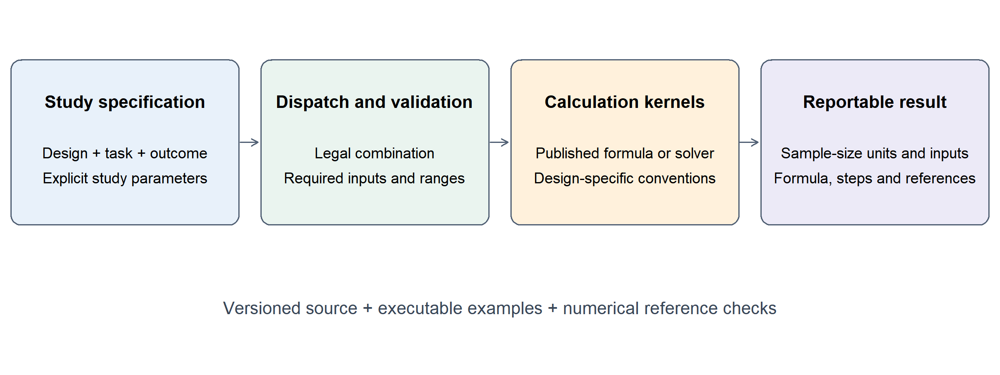
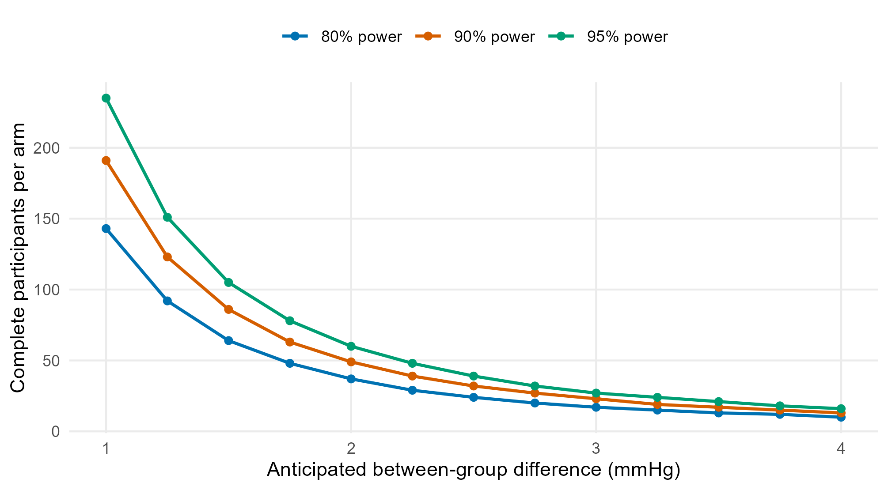

```{r setup, include=FALSE}
knitr::opts_chunk$set(echo = FALSE, warning = FALSE, message = FALSE,
                     out.width = "100%")
if (!file.exists("evidence/paper-results.rds")) {
  source("replicate.R", local = TRUE)
}
paper_data <- readRDS("evidence/paper-results.rds")
fmt_n <- function(x) format(x, big.mark = ",", scientific = FALSE, trim = TRUE)
```

**Affiliation:** Gansu Provincial Maternity and Child-care Hospital (Gansu
Provincial Central Hospital), China. **Corresponding author:** Portos (Yishan)
Wang, <portos.wang@gmail.com>.

**Keywords:** sample size; statistical power; clinical research; diagnostic
accuracy; bioequivalence; reproducible research; R.

**Draft status.** This manuscript contains reproducible software results and
illustrative planning scenarios. Items marked **TO COMPLETE** require author
input before submission. The manuscript has not yet been placed in the
publisher's final template.

# Motivation and significance

Sample size planning connects a research question to a feasible study. The
required quantity may be a number of independent participants, matched pairs,
clusters, diagnostic cases, or outcome events. The calculation also depends on
choices about the estimand, anticipated effect or precision, variance,
allocation, and testing convention. Established references provide detailed
methods for these settings [@machin2018; @zhou2011; @hajian2014]. Turning a
method into a reproducible study-planning record requires both correct
computation and an explicit account of what its inputs and outputs mean.

The R ecosystem provides strong foundations for this work [@r2026]. The `pwr`
package implements standard power-analysis procedures [@pwr2020]; `presize`
focuses on precision-based planning [@presize2021]; and `PowerTOST` provides
specialist functionality for equivalence and bioequivalence studies
[@powertost2025]. These packages illustrate different levels of specialisation.
A researcher working across trial, observational, and diagnostic projects may
also need a consistent way to record assumptions and assemble the calculation
into a protocol. Comparisons must respect the statistical conventions of each
implementation, including whether a number denotes one group or the complete
study.

`SampleSizeCalc` addresses this workflow through a common interface built on
established methods. A calculation is identified by study design, statistical
task, and outcome type. Its result combines numerical requirements with input
parameters, sample-size units, a plain-text formula, a LaTeX expression,
calculation steps, and methodological references. This representation is
intended for clinical investigators, statistical collaborators, and educators
who need to inspect how a planning result was obtained.

The contribution is a shared planning and reporting layer across several
method families, with explicit links to their statistical conventions. This
article describes its implementation, illustrates three planning workflows,
and reports selected numerical verification. Table 1 positions the package
relative to tools used as context or numerical comparators. It is a comparison
of intended roles in this manuscript, rather than an exhaustive feature audit
of every available planning package.

| Software | Relevant role | Relationship to this work |
|:--|:--|:--|
| `pwr` | Standard hypothesis-test power analysis | Context for existing general power functionality |
| `presize` | Precision-based sample size planning | Numerical comparator for Pearson-correlation precision |
| `PowerTOST` | Power and sample size for equivalence studies | Numerical comparator for two-period bioequivalence |
| `SampleSizeCalc` | Planning and reporting across multiple design families | Combines requirements, parameter roles, formulas, steps, and sources in a common result object |

Table 1. Positioning of the software and the selected comparison packages.

# Software description

## Architecture and design choices

The public entry point is `calculate(...)`. Its principal arguments are
`design`, `task`, and `outcome`; additional named arguments describe the study.
For example, a two-arm continuous-outcome test is selected with
`calculate("rct", "test", "mean", ...)`. Internally, a registry defines legal
combinations, default resolutions for unambiguous designs, and the associated
calculation route. This separates navigation of the design space from the
implementation of each statistical calculation (Figure 1).

```{r architecture, fig.cap="Software architecture. The diagram is a conceptual summary of the dispatcher, input checks, method kernels, and reporting object. It does not imply that all methods share the same statistical assumptions.", out.width="100%"}

```

The interface resolves control arguments by exact name. This is relevant when
short design-specific arguments, such as a precision margin named `d`, might
otherwise be confused with longer argument names. Input checks include
required parameters and design-specific bounds. Error messages identify the
argument or combination requiring attention. Such checks support valid calls,
while the scientific justification of an expected effect, prevalence,
non-inferiority margin, or intracluster correlation remains the user's
responsibility.

Calculations are assembled into an S3 `sample_size_result` object. The object
retains design-specific fields, such as `n_per_group`, `total_n`,
`target_state_cases_needed`, or `target_events_needed`. It also stores
`formula`, `formula_latex`, `calculation_steps`, `reference`, and, where
available, parameter `roles` and methodological `hints`. Standard `print()`
and `summary()` methods expose the report, and `plot()` supports selected
visual diagnostics. Keeping these components together allows a result to be
inspected interactively and its fields to be reused in a reproducible document.

Runtime imports are `cli`, `rlang`, and the standard R `stats` package.
Plotting and document-generation tools are optional dependencies. This keeps
the computational installation distinct from the additional tools needed to
build a website or render a manuscript. The legacy
`sample_size_calculator()` interface and its 17 historical keywords remain
available. The examples in this article use the three-axis interface;
historical parameter conventions should be checked when migrating existing
paired or diagnostic workflows.

## Functional scope and conventions

An executable inventory of version 3.1.1 contains
`r nrow(paper_data$routes)` legal combinations and
`r length(unique(paper_data$routes$design))` distinct design identifiers
(Table 2). These are counts of dispatcher entries, not counts of independently
validated statistical methods. The `its` entry is experimental. The exported
`mrmc_power()` helper for a multi-reader, multi-case diagnostic model is
available separately from the three-axis registry.

```{r scope-table, results='asis'}
knitr::kable(paper_data$scope, format = "pipe", row.names = FALSE)
```

Table 2. Functional inventory generated from the evaluated source archive.
The complete list of design, task, and outcome combinations is supplied as
`tables/dispatch-inventory.csv`.

Methods include normal-approximation calculations, Student t-based numerical
solutions, binomial search, and design-specific procedures described in the
methodological literature. Examples include diagnostic precision calculations
[@zhou2011; @hajian2014], two-stage phase II designs [@simon1989], and
bioequivalence planning using a noncentral t-based two-one-sided-tests approach
[@phillips1990; @julious2004]. The reporting layer preserves the distinction
between required participants, events, cases, and clusters.

Conventions remain specific to each route. For example, `alternative` is
currently consumed by the single-test diagnostic hypothesis-testing route;
`dropout` is implemented by the cohort proportion-testing route. Other
recruitment allowances in this article are applied explicitly after the
complete-case requirement. Users should consult the parameter documentation
for their selected design rather than assume that a control argument applies
to every route. Similarly, canonical diagnostic AUC precision defaults to a
binormal variance approximation, while an exponential alternative can be
selected explicitly. The corresponding assumptions are part of the planning
record.

# Illustrative examples

The following scenarios use teaching inputs. They demonstrate calculations
and interpretation, and do not constitute new clinical data or evidence of
external adoption. A real study requires compatible evidence for each planning
assumption and a prespecified analysis strategy.

## A parallel-group continuous-outcome trial

Consider a blinded, equally allocated trial with baseline-to-week-12 systolic
blood-pressure reduction as its endpoint. Suppose the anticipated mean
reductions are 10 and 12 mmHg, with a common standard deviation of 3 mmHg for
individual change scores. The objective is 80% power at two-sided alpha 0.05.
A normal-theory starting expression is

$$
n_{\mathrm{arm}} \approx
\frac{2\sigma^2\{z_{1-\alpha/2}+z_{1-\beta}\}^2}{\delta^2}.
$$

The trial route refines the requirement through the two-sample Student t-test
power calculation. The reproducible call is:

```{r trial-code, eval=FALSE, echo=TRUE}
trial <- SampleSizeCalc::calculate(
  "rct", "test", "mean",
  mean1 = 10, mean2 = 12, sd = 3,
  alpha = 0.05, power = 0.80
)
```

The result is **`r fmt_n(paper_data$trial$n_per_arm)` complete participants per
arm**, or `r fmt_n(paper_data$trial$total_n)` in total. If 10% are expected to
lack the primary endpoint, a separately documented allowance gives
$\lceil n_{\mathrm{arm}}/0.90\rceil =$
`r fmt_n(paper_data$trial$recruit_per_arm)` recruits per arm. This allowance
does not resolve bias from missing outcomes; it is a recruitment calculation.

Figure 2 varies the anticipated difference and target power while retaining
the standard deviation and two-sided alpha. It demonstrates the effect of
planning assumptions within the selected method, without making a performance
comparison with another implementation.

```{r sensitivity, fig.cap="Sample-size sensitivity for the trial example. Standard deviation is 3 mmHg and two-sided alpha is 0.05. Points are evaluated inputs; lines connect those points. Counts refer to complete participants per arm before recruitment allowances."}

```

## Diagnostic precision and screening assurance

Suppose a referral clinic plans to estimate the sensitivity of a fixed-threshold
test, with anticipated sensitivity 0.85 and a 95% confidence-interval half-width
of 0.05. The normal-approximation case requirement is

$$
n_{\mathrm{case}} =
\left\lceil\frac{z_{1-\alpha/2}^2\,Se(1-Se)}{d^2}\right\rceil.
$$

Using source-population prevalence 0.20 gives:

```{r diagnostic-code, eval=FALSE, echo=TRUE}
diagnostic <- SampleSizeCalc::calculate(
  "diagAccuracy", "estimate", "proportion",
  prob = 0.85, d = 0.05, prevalence = 0.20,
  alpha = 0.05
)
screen_n <- SampleSizeCalc::screen_required(
  diagnostic$target_state_cases_needed,
  prevalence = 0.20, beta = 0.10
)
```

The requirement is **`r fmt_n(paper_data$diagnostic$cases)` confirmed cases**.
An expectation-based conversion gives
`r fmt_n(paper_data$diagnostic$expected_screen)` screened participants. A 90%
assurance of obtaining at least that many cases instead requires the smallest
$N$ satisfying

$$
P\{\operatorname{Binomial}(N,0.20)\ge
`r paper_data$diagnostic$cases`\}\ge 0.90.
$$

The helper returns **`r fmt_n(paper_data$diagnostic$assured_screen)` screened
participants**. The replication script verifies both that this value meets
the probability bound and that the preceding integer does not. This assurance
concerns the number of cases under an assumed binomial prevalence model; it
is distinct from power for a diagnostic hypothesis test. Specificity precision,
reference-standard completeness, and uncertainty in prevalence require their
own planning considerations [@zhou2011; @hajian2014].

## Two-period bioequivalence planning

Consider a two-treatment, two-period crossover study of one prespecified
log-transformed pharmacokinetic endpoint. Assume within-subject coefficient
of variation 0.25, expected geometric mean ratio 1.00, equivalence bounds
0.80 and 1.25, one-sided alpha 0.05, and target power 0.80:

```{r bioequivalence-code, eval=FALSE, echo=TRUE}
be <- SampleSizeCalc::calculate(
  "bioequivalence", "equivalence", "mean",
  cv = 0.25, theta0 = 1.00,
  margin_low = 0.80, margin_high = 1.25,
  alpha = 0.05, power = 0.80
)
```

The requirement is **`r fmt_n(paper_data$bioequivalence$total_n)` complete
participants**, or `r fmt_n(paper_data$bioequivalence$per_sequence)` per
sequence. Changing the expected ratio to 0.95 increases the total to
`r fmt_n(paper_data$bioequivalence$shifted_total_n)`. Both requirements match
`PowerTOST::sampleN.TOST()` under the corresponding settings. The example
illustrates why a sequence-specific count must be distinguished from the
complete-study count. Planning for additional pharmacokinetic endpoints,
replicate designs, or regulatory conditions requires methods suited to those
objectives [@phillips1990; @julious2004; @powertost2025].

# Verification and reproducibility

The replication script evaluates a frozen version-3.1.1 source archive,
checks its SHA-256 identifier, generates the dispatcher inventory, recomputes
the worked examples, and exports every numerical table and figure. The archive
and evidence records accompany this working draft. No patient-level data are
needed for these calculations.

Twelve selected numerical comparisons are supplied in
`tables/validation-full.csv`; eight representative rows appear in Table 3.
The comparison set includes analytical checks, published worked examples,
Pearson-correlation precision from `presize` version
`r paper_data$evidence$comparators$presize`, and bioequivalence requirements
from `PowerTOST` version `r paper_data$evidence$comparators$PowerTOST`.
Parameters and output units are aligned before comparison. Integer
requirements agree for all 12 selected cases. The correlation comparisons
return 867 and 219 participants for confidence-interval widths 0.10 and 0.20,
respectively; the bioequivalence comparisons return 24 and 28 total
participants for expected ratios 1.00 and 0.95.

```{r validation-table, results='asis'}
knitr::kable(paper_data$main_validation, format = "pipe", row.names = FALSE)
```

Table 3. Selected numerical comparisons. Source references are @machin2018
and @zhou2011 for the indicated book sections and examples, and @presize2021
and @powertost2025 for the comparator software. The complete table records all
12 comparisons. Unit definitions are essential: diagnostic case counts,
maximum two-stage enrolment, and complete-study participant counts are
different quantities.

The published anchors and comparator outputs provide regression evidence at
specified inputs. They do not establish power or confidence-interval coverage
throughout the parameter space. Agreement between two implementations of a
shared formula is also narrower evidence than independent statistical
validation. Accordingly, this manuscript reports selected agreement without
claiming that all 46 dispatcher entries have undergone comprehensive external
validation.

Software-engineering evidence complements these numerical comparisons. On
5 November 2026, the evaluated source archive completed full
`R CMD check --as-cran` runs on Windows 11 with R 4.6.1, Windows R-devel
(3 November 2026, revision 90835), and Ubuntu 24.04.4 with R 4.6.1 under WSL2.
Each run finished with zero errors, zero warnings, and one `New submission`
note. Tests, examples including `donttest` examples, all four vignette
rebuilds, and PDF and HTML manual checks completed. A separate development
run recorded 630 passing assertions, with no failures, errors, warnings, or
skips. Historical logs and the reproduction session are retained in the
`evidence` directory. These checks document installation, code, documentation,
and regression behaviour; CRAN-style checking is not a certification of
statistical or clinical validity.

# Impact and limitations

The intended use is a planning workflow in which an investigator and a
statistical collaborator can review the same inputs, numerical requirements,
and methodological provenance. The returned fields can be incorporated into
a protocol or teaching document, and sensitivity plots can make assumptions
visible during discussion. The diagnostic example demonstrates a concrete
benefit of explicit units: expected screening capacity and a probability-based
case-accrual requirement can be considered separately. The bioequivalence
example similarly makes sequence allocation visible.

Current evidence in this manuscript consists of executable examples,
selected numerical comparisons, documentation, and software checks. External
adoption, usability outcomes, and improvements in research decisions have not
been measured here. **TO COMPLETE:** add a documented research workflow,
external use case, or specific researcher feedback if available. The teaching
examples should remain identified as illustrative rather than be described
as deployment evidence. A future user evaluation could examine whether
researchers correctly interpret sample-size units and retain the assumptions
needed to reproduce a calculation.

Several statistical boundaries deserve attention. An analytically correct
requirement can still be inappropriate when its variance, prevalence, effect,
correlation, or analysis-model assumptions do not match the proposed study.
AUC variance alternatives can produce different answers; approximation choice
should therefore be stated. Recruitment inflation is route-specific, and a
single `alternative` argument does not reconfigure every testing procedure.
The experimental interrupted-time-series route should be treated as a
simplified planning aid. Prediction-model planning includes selected criteria
and an events-per-variable option; it should not be described as a complete
implementation of all criteria discussed by @riley2020. Software output does
not establish an appropriate clinical margin, anticipated treatment benefit,
or acceptable missing-data strategy.

The comparative evidence also has a limited scope. The present evaluation
does not claim a runtime advantage, superior sample-size estimates, or
improved operating characteristics over specialist tools. A broader comparison
could examine additional packages, parameter ranges, and disagreement caused
by different conventions. Development priorities include stronger scope
signalling for design-specific controls and expanded validation of less
commonly used designs.

# Conclusions

`SampleSizeCalc` combines established sample-size and power calculations with
a common representation of inputs, sample-size units, formulas, calculation
steps, and methodological references. Version 3.1.1 provides 46 registered
combinations across 24 design identifiers, illustrated here by trial,
diagnostic, and bioequivalence workflows. Reproducible numerical comparisons
and cross-platform package checks support the documented implementation at
the evaluated settings. The software offers a basis for auditable planning
records, while further validation and research-use evidence should accompany
claims about its practical impact.

# Code metadata and availability

| Item | Description |
|:--|:--|
| Current code version | `SampleSizeCalc` 3.1.1 |
| Code repository | <https://github.com/portos-wang/Sample_Size_Calc> |
| Permanent version link | **TO COMPLETE:** identify the final immutable release tag and archived software DOI |
| Reproducible evaluation | `replicate.R`, the source archive, exported tables, figures, and evidence records accompanying this draft |
| Legal code licence | MIT |
| Version control system | Git |
| Language and environment | R >= 4.0.0; runtime imports `cli`, `rlang`, and `stats` |
| Documentation | <https://rpackages.portos.wang/sample_size_calc/> |
| Support contact | <portos.wang@gmail.com> |

The evaluated archive is identified in `evidence/verification.json`.
**TO COMPLETE:** confirm the final distribution links, the status of CRAN
availability, and an enduring public archive for the evaluated source and
replication materials before submission.

# Author declarations

**CRediT authorship statement.** **TO COMPLETE:** both authors should confirm
their actual contributions and approve the final authorship statement.

**Funding.** **TO COMPLETE:** provide the relevant funding sources and grant
identifiers, or confirm that no specific funding was received.

**Declaration of competing interest.** **TO COMPLETE:** authors should provide
their declaration after reviewing relevant financial and non-financial interests.

**Data availability.** This manuscript uses illustrative planning inputs and
published numerical examples. Numerical outputs, the computational source,
and replication scripts are included with the working draft. **TO COMPLETE:**
replace the working-draft location with the final public archive identifier.

# References
